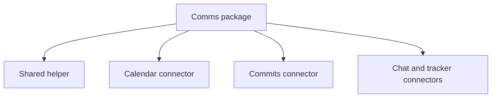

## Purpose

An empty package marker. It makes the `scripts/connectors/comms/` folder a regular Python package so the chat, tracker, notes, calendar and git connectors can share one helper through `from connectors.comms import comms_common`.

## Dependencies

**Depends on.** Nothing. The file has 0 bytes and 0 lines (checked with `wc -c` and `wc -l`, 2026-11-20).

**Used by.**
- Product code: the comms connectors import the package to reach the shared helper, for example `scripts/connectors/comms/calendar_connector.py` {src:scripts/connectors/comms/calendar_connector.py:36}, `scripts/connectors/comms/commits_connector.py` {src:scripts/connectors/comms/commits_connector.py:33}, `scripts/connectors/comms/jira_connector.py` {src:scripts/connectors/comms/jira_connector.py:27}, `scripts/connectors/comms/notion_connector.py` {src:scripts/connectors/comms/notion_connector.py:30} and `scripts/connectors/comms/slack_connector.py` {src:scripts/connectors/comms/slack_connector.py:38}. Found with `git grep` for `connectors.comms` (2026-11-20).
- Tests: `tests/scripts/connectors/comms/test_calendar.py` {src:tests/scripts/connectors/comms/test_calendar.py:16} and the other `test_*.py` files in that folder.

## Behavior

None. The file holds no code, so nothing runs when it is imported. Its only effect is that the folder is a regular package. A folder without this file also imports, as a namespace package {src:docs:https://docs.python.org/3/reference/import.html#namespace-packages}, so the marker is a convention rather than a requirement.

## Diagram: module level (L2, required)

## Diagram: function level (L3, optional)

None: no function has branching that the signature does not show.

## Notes

- Code and description: no description exists to compare, since the file is empty.
- Inputs that reach a path, command or address: none, no code.
- Shared file writes: none, no code.
