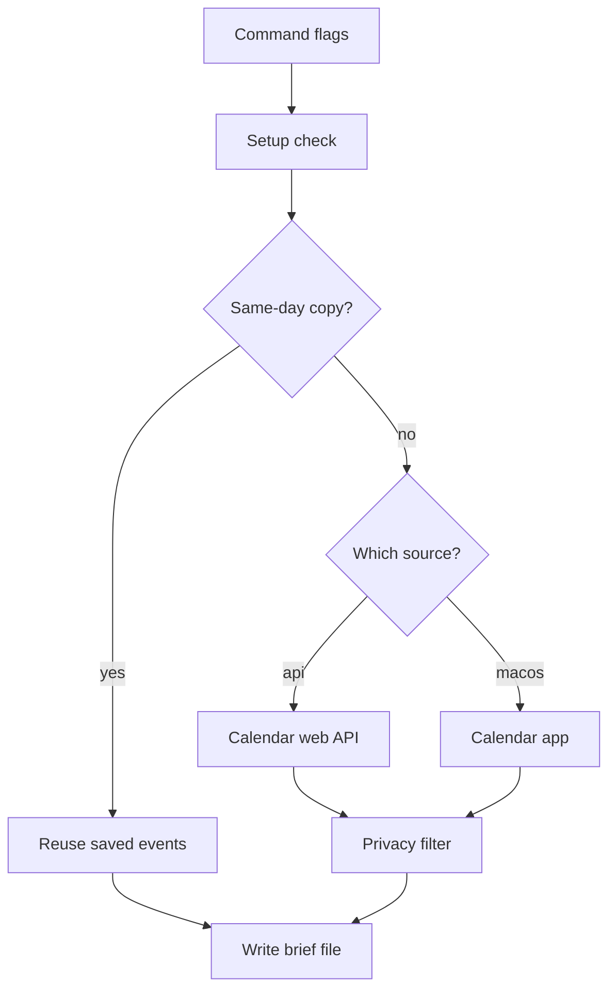

## Purpose

The calendar connector. It pulls one day of calendar events, either from a calendar web API or from the macOS Calendar app, strips each event to a few fields, drops any record the privacy filter rejects, redacts any secret left in the kept records, and writes the result as `calendar.json` for the daily brief. It is a connector, so it stays off until the person turns it on.

## Dependencies

**Depends on.**
- Standard library: `argparse`, `json`, `pathlib`, `subprocess`, `sys`, `urllib.parse`, `datetime`, and `zoneinfo` (imported inside `local_tz` only when a zone name is given {src:scripts/connectors/comms/calendar_connector.py:77}).
- System program: `osascript`, used in macOS mode {src:scripts/connectors/comms/calendar_connector.py:161}.
- Repo: `scripts/connectors/registry.py` for `register`, `ensure` and `run_cli` {src:scripts/connectors/comms/calendar_connector.py:35}. [[registry]] (no doc yet).
- Repo: `scripts/connectors/comms/comms_common.py` as `cc` {src:scripts/connectors/comms/calendar_connector.py:36}. [[comms_common]] with page [comms_common](comms_common.md).
- The connector must be on, with an address and a key in the secret store {src:scripts/connectors/registry.py:397-404}.

**Used by.**
- Product code: none found. `git grep` for `calendar_connector`, `calendar_pull` and `calendar.json` outside `docs/` and `tests/` (2026-11-20) finds only this file. It is run as a script, by its `__main__` block {src:scripts/connectors/comms/calendar_connector.py:241-242}.
- Tests: `tests/scripts/connectors/comms/test_calendar.py` imports it as `cal` {src:tests/scripts/connectors/comms/test_calendar.py:16}.

## Behavior

**Setup gate.** `main` calls `ensure(NAME)` before anything else, including in `--dry-run` {src:scripts/connectors/comms/calendar_connector.py:205}. With no terminal and the connector off, `ensure` raises `NotSetUp` {src:scripts/connectors/registry.py:422-424}, and `run_cli` prints it and exits 2 {src:scripts/connectors/registry.py:434-436}.

**Registration.** The file registers a client factory under the name `calendar` {src:scripts/connectors/comms/calendar_connector.py:172}.

**API mode (default).** `fetch_api` builds a one-day window from local midnight in the chosen zone {src:scripts/connectors/comms/calendar_connector.py:136-137}. For each calendar name (default `primary`) {src:scripts/connectors/comms/calendar_connector.py:139} it requests `<address>/calendars/<name>/events` with the name percent-encoded, so `/` cannot add path parts {src:scripts/connectors/comms/calendar_connector.py:142}. The key goes in an `Authorization: Bearer` header {src:scripts/connectors/comms/calendar_connector.py:144}, with a 15 second timeout {src:scripts/connectors/comms/calendar_connector.py:143}. A failed call, a body that is not an object, or an `items` value that is not a list returns no events and a reason {src:scripts/connectors/comms/calendar_connector.py:145-149}. Each item is cut down to `id`, `summary`, `start`, `end`, `attendees_count` {src:scripts/connectors/comms/calendar_connector.py:125-127}, using `dateTime` or else `date` for times {src:scripts/connectors/comms/calendar_connector.py:123}. Events seen twice across calendars are kept once, by id {src:scripts/connectors/comms/calendar_connector.py:154-156}.

**macOS mode.** `fetch_macos` runs `osascript -e <script>` with a 15 second limit {src:scripts/connectors/comms/calendar_connector.py:161-162} {src:scripts/connectors/comms/calendar_connector.py:40}. A timeout gives `API_TIMEOUT` {src:scripts/connectors/comms/calendar_connector.py:163-164}. A failure to start, or a non-zero exit, gives `AUTH_FAILED` {src:scripts/connectors/comms/calendar_connector.py:165-168}. The script lists events whose start falls between midnight and the end of today, for calendars named in a list {src:scripts/connectors/comms/calendar_connector.py:53-63}. Each output line must have exactly five tab separated fields, or the whole parse returns no events and `SCHEMA_INVALID` {src:scripts/connectors/comms/calendar_connector.py:98-100}. Repeats by id are dropped {src:scripts/connectors/comms/calendar_connector.py:102-104}. Dates are parsed with an English format string {src:scripts/connectors/comms/calendar_connector.py:41} {src:scripts/connectors/comms/calendar_connector.py:88}.

**Run flow.**
1. `--dry-run` uses two built-in fixture events and treats the run as a success {src:scripts/connectors/comms/calendar_connector.py:213-215}.
2. Otherwise, unless `--no-day-cache` is set, it looks for a same-day copy and uses it if found, as a success {src:scripts/connectors/comms/calendar_connector.py:217-219}.
3. Without a copy it fetches by `--source` {src:scripts/connectors/comms/calendar_connector.py:221-224}. A fetch failure gives an empty list and a failed result {src:scripts/connectors/comms/calendar_connector.py:225-226}.
4. Fetched events go through the privacy filter {src:scripts/connectors/comms/calendar_connector.py:228}, then every string in the kept events is redacted: a secret becomes `[REDACTED:LABEL]` in place and is counted by label in a tally {src:scripts/connectors/comms/calendar_connector.py:229} {src:scripts/connectors/comms/comms_common.py:81-87}. The order is filter first, then redaction, then write. If events came back but all were rejected the result is degraded {src:scripts/connectors/comms/calendar_connector.py:230-231}. If some were rejected it is degraded with another reason {src:scripts/connectors/comms/calendar_connector.py:232-233}. Otherwise it is a success {src:scripts/connectors/comms/calendar_connector.py:234-235}.
5. Unless the result failed, or this is a dry run, the day copy is saved {src:scripts/connectors/comms/calendar_connector.py:236-237}.
6. `cc.finish` gets the tally {src:scripts/connectors/comms/calendar_connector.py:238}. It writes `calendar.json` unless the result failed, logs the run and prints counts only, with the secret count by label added to the printed line {src:scripts/connectors/comms/comms_common.py:105-107} {src:scripts/connectors/comms/comms_common.py:110-113}. It always returns 0 {src:scripts/connectors/comms/comms_common.py:114}.

**Day copy.** It lives at `<state>/calendar/calendar_<date>.json` {src:scripts/connectors/comms/calendar_connector.py:176}. `load_day` returns the saved `data` list, or `None` if the file is missing, unreadable, not JSON, or `data` is not a list {src:scripts/connectors/comms/calendar_connector.py:181-184}. `save_day` creates the folder and writes the file, and ignores any `OSError` {src:scripts/connectors/comms/calendar_connector.py:189-193}.

## Diagram: module level (L2, required)

## Diagram: function level (L3, optional)

None: no function has branching that the signature does not show. The run flow above is described in Behavior.

## Notes

**Code and description disagree.**
- The description says "the day come from flags" {src:scripts/connectors/comms/calendar_connector.py:12}. In macOS mode the day is ignored: the script always reads today's events from the machine clock {src:scripts/connectors/comms/calendar_connector.py:53-57}, while `--date` only picks the file name of the day copy {src:scripts/connectors/comms/calendar_connector.py:209} {src:scripts/connectors/comms/calendar_connector.py:237}. `--source macos --date 2026-01-01` saves today's events under that date.
- The description says the time zone comes from flags {src:scripts/connectors/comms/calendar_connector.py:12}. In macOS mode `--tz` only labels the times; the Calendar app gives local times, and the label is attached without conversion {src:scripts/connectors/comms/calendar_connector.py:88}. A zone different from the machine's mislabels every event.
- The description says "Both modes still need the connector turned on first" {src:scripts/connectors/comms/calendar_connector.py:21}. True, and it also holds for `--dry-run` {src:scripts/connectors/comms/calendar_connector.py:205}, which the description does not say.
- The description says the key "goes to the secret store, never to a file" {src:scripts/connectors/comms/calendar_connector.py:10-11}. This file never handles key storage; the key arrives from the store through the registry {src:scripts/connectors/registry.py:268-271}. Where it is first saved was not checked for this page.
- The description says "Event titles are never printed or logged" {src:scripts/connectors/comms/calendar_connector.py:24}. That holds for the output and the run log {src:scripts/connectors/comms/comms_common.py:59-61} {src:scripts/connectors/comms/comms_common.py:111-113}. Titles are still written to `calendar.json` and to the day copy {src:scripts/connectors/comms/calendar_connector.py:106} {src:scripts/connectors/comms/calendar_connector.py:237}. Since this change a secret inside a title is replaced with `[REDACTED:LABEL]` before that write {src:scripts/connectors/comms/calendar_connector.py:229}; the rest of the title stays in clear text.

**Edge cases and limits.**
- `--dry-run` is not write-free. The day copy is skipped {src:scripts/connectors/comms/calendar_connector.py:236}, but `cc.finish` still writes `calendar.json` with the fixture events and appends to the run log {src:scripts/connectors/comms/calendar_connector.py:238} {src:scripts/connectors/comms/comms_common.py:105-110}. The fixture is not passed through redaction {src:scripts/connectors/comms/calendar_connector.py:214}. A dry run overwrites the real cache file.
- A same-day copy that is reused is returned as it was saved, with no new redaction pass {src:scripts/connectors/comms/calendar_connector.py:218-219}. A copy saved before secret redaction existed can still hold a secret. Copies saved now hold redacted text {src:scripts/connectors/comms/calendar_connector.py:237}.
- The secret count is per label per string, so two tokens of one kind in one title count once {src:scripts/connectors/comms/comms_common.py:74-75}.
- The day copy is keyed only by date. A later run with different `--calendar` or `--source` values reuses the earlier data {src:scripts/connectors/comms/calendar_connector.py:176} {src:scripts/connectors/comms/calendar_connector.py:217-219}. A degraded result is saved too {src:scripts/connectors/comms/calendar_connector.py:236-237}, and a later run reads it back as a clean success {src:scripts/connectors/comms/calendar_connector.py:219}.
- macOS mode with no `--calendar` builds an empty name list `{}` {src:scripts/connectors/comms/calendar_connector.py:83}, and the script then matches no calendar {src:scripts/connectors/comms/calendar_connector.py:62}. It returns zero events as a success. API mode defaults to `primary` {src:scripts/connectors/comms/calendar_connector.py:139}, so the two modes differ.
- One malformed API item discards every event {src:scripts/connectors/comms/calendar_connector.py:152-153}. An `id` that cannot be hashed (for example a list) would raise an uncaught `TypeError` at the `seen` check {src:scripts/connectors/comms/calendar_connector.py:154}.
- The API reader does not follow paging. Only the `items` of the first response are read, and no `nextPageToken` is handled (searched this file, 2026-11-20) {src:scripts/connectors/comms/calendar_connector.py:150}.
- A title holding a tab or newline breaks the five field split, so one such event fails the whole macOS pull {src:scripts/connectors/comms/calendar_connector.py:98-100}.
- Failure reasons are borrowed: a macOS error or a non-zero exit is logged as `AUTH_FAILED` {src:scripts/connectors/comms/calendar_connector.py:165-168}, whatever the real cause.
- A redirect from the server raises `RedirectRefused` {src:scripts/connectors/registry.py:241-245}. `cc.call` does not catch that type {src:scripts/connectors/comms/comms_common.py:132-135}, so the run stops with a traceback and no log line.
- The macOS date format is English only {src:scripts/connectors/comms/calendar_connector.py:41}. On another language setting, parsing fails and the pull ends as `SCHEMA_INVALID` {src:scripts/connectors/comms/calendar_connector.py:110-111}.
- `--date` with a bad value, and `--tz` with an unknown zone name, raise uncaught errors {src:scripts/connectors/comms/calendar_connector.py:209} {src:scripts/connectors/comms/calendar_connector.py:78}.

**Inputs that reach a path, command or address.**
- The connector address becomes the start of the request URL {src:scripts/connectors/comms/calendar_connector.py:132} {src:scripts/connectors/comms/calendar_connector.py:142}. No check is in this file. The default network client allows only `https`, or `http` on a loopback host, and refuses logins in the address {src:scripts/connectors/registry.py:94-100} {src:scripts/connectors/registry.py:230}. A test or custom client replaced through `set_http_factory` would skip that {src:scripts/connectors/registry.py:136}.
- `--calendar` names are percent-encoded for the URL {src:scripts/connectors/comms/calendar_connector.py:142}. For macOS mode only `"` and `\` are removed before the name goes into the script text {src:scripts/connectors/comms/calendar_connector.py:83}; no other check exists.
- `--date` goes into the day copy file name only after being parsed as a date {src:scripts/connectors/comms/calendar_connector.py:209} {src:scripts/connectors/comms/calendar_connector.py:176}, so it cannot add path parts.
- `--tz` is passed to `ZoneInfo` with no check in this file {src:scripts/connectors/comms/calendar_connector.py:77-78}.
- `osascript` is run with a list, not through a shell {src:scripts/connectors/comms/calendar_connector.py:161}.

**Shared file writes.**
- `calendar.json` is written by `atomic_replace`: a temp file named for the process id, flushed, synced, then renamed {src:scripts/cache/cache_write.py:24-30}. The rename is atomic. Nothing stops two writers at once; the last rename wins.
- The day copy is not atomic. It is a direct `write_text` with no lock {src:scripts/connectors/comms/calendar_connector.py:191}. Two overlapping runs can leave a half-written file, which `load_day` then treats as no copy {src:scripts/connectors/comms/calendar_connector.py:182-183}.
- The run log is appended under an exclusive lock {src:scripts/cache/run_log.py:89-91}.
