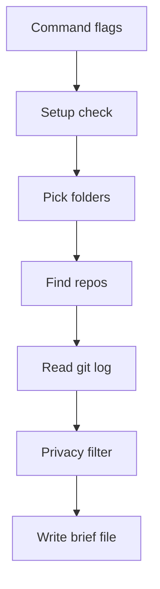

## Purpose

The git commits connector. It reads recent commits from local git repositories, drops any record the privacy filter rejects, redacts any secret left in the kept records, and writes the result as `commits.json` for the daily brief. It reads local history only, so it needs no real key, but it is built as a connector so it stays off until the person turns it on.

## Dependencies

**Depends on.**
- Standard library: `argparse`, `os`, `pathlib`, `subprocess`, `sys`.
- System program: `git`, run as `git -C <repo> log` {src:scripts/connectors/comms/commits_connector.py:81}.
- Repo: `scripts/connectors/registry.py` for `register`, `ensure` and `run_cli` {src:scripts/connectors/comms/commits_connector.py:32}. [[registry]] (no doc yet).
- Repo: `scripts/connectors/comms/comms_common.py` as `cc` {src:scripts/connectors/comms/commits_connector.py:33}. [[comms_common]] with page [comms_common](comms_common.md).
- The `repos` folder from the path loader, used only when no folder is given {src:scripts/connectors/comms/commits_connector.py:77}.

**Used by.**
- Product code: none found. `git grep` for `commits_connector`, `commits_pull` and `commits.json` outside `docs/` and `tests/` (2026-11-20) finds only this file. It runs as a script through its `__main__` block {src:scripts/connectors/comms/commits_connector.py:155-156}.
- Tests: `tests/scripts/connectors/comms/test_commits.py` imports it as `cm` {src:tests/scripts/connectors/comms/test_commits.py:17}.

## Behavior

**Setup gate.** `main` calls `ensure(NAME)` first, including for `--dry-run` {src:scripts/connectors/comms/commits_connector.py:129}. The connector registers a client factory under `git-commits` {src:scripts/connectors/comms/commits_connector.py:120}. The client ignores the key and the network object {src:scripts/connectors/comms/commits_connector.py:70}.

**Choosing folders.** `CommitsClient.roots` returns the `--root` flags if any {src:scripts/connectors/comms/commits_connector.py:73-74}. Otherwise, if the stored address is set and is not the word `local`, it splits it on the system path separator {src:scripts/connectors/comms/commits_connector.py:75-76}. Otherwise it uses the `repos` folder {src:scripts/connectors/comms/commits_connector.py:77}.

**Finding repos.** `resolve_repos` returns an empty list for a path that is not a folder {src:scripts/connectors/comms/commits_connector.py:53-54}, the folder itself if it has a `.git` entry {src:scripts/connectors/comms/commits_connector.py:55-56}, and otherwise each child folder that has one {src:scripts/connectors/comms/commits_connector.py:57}.

**Reading one repo.** `log_repo` runs `git -C <repo> log --since=<since> --pretty=format:... --no-merges -n200` with a 10 second limit {src:scripts/connectors/comms/commits_connector.py:81-83} {src:scripts/connectors/comms/commits_connector.py:39-40}. Failures map to reasons: timeout to `API_TIMEOUT` {src:scripts/connectors/comms/commits_connector.py:84-85}, failure to start to `API_5XX` {src:scripts/connectors/comms/commits_connector.py:86-87}, non-zero exit to `API_4XX` {src:scripts/connectors/comms/commits_connector.py:88-89}. Each output line must split into exactly four fields on the unit separator character, or the repo returns nothing and `SCHEMA_INVALID` {src:scripts/connectors/comms/commits_connector.py:61-63} {src:scripts/connectors/comms/commits_connector.py:93-94}. Each record holds `repo` (the folder name), `sha`, `timestamp`, `author` and `subject` {src:scripts/connectors/comms/commits_connector.py:65}.

**Collecting.** `collect` goes through every root and repo. A root with no repos, or a repo that fails, records the first bad reason and is skipped {src:scripts/connectors/comms/commits_connector.py:103-105} {src:scripts/connectors/comms/commits_connector.py:108-110}. No bad reason gives success {src:scripts/connectors/comms/commits_connector.py:113-114}. No repo read at all gives failed {src:scripts/connectors/comms/commits_connector.py:115-116}. Some read and some not gives degraded with the first bad reason {src:scripts/connectors/comms/commits_connector.py:117}.

**Main flow.**
1. `--dry-run` runs the privacy filter on two fixture commits and reports success {src:scripts/connectors/comms/commits_connector.py:134-136}.
2. A failed collection gives no records and no rejects {src:scripts/connectors/comms/commits_connector.py:139-140}.
3. Otherwise the commits go through the privacy filter {src:scripts/connectors/comms/commits_connector.py:142}, then every string in the kept records is redacted: a secret becomes `[REDACTED:LABEL]` in place and is counted by label in a tally {src:scripts/connectors/comms/commits_connector.py:143} {src:scripts/connectors/comms/comms_common.py:81-87}. The order is filter first, then redaction, then write. If commits came back but all were rejected the result is degraded {src:scripts/connectors/comms/commits_connector.py:144-145}. If the collection was degraded, that reason is kept {src:scripts/connectors/comms/commits_connector.py:146-147}. Else some rejects give degraded {src:scripts/connectors/comms/commits_connector.py:148-149}, and none gives success {src:scripts/connectors/comms/commits_connector.py:150-151}.
4. `cc.finish` gets the tally {src:scripts/connectors/comms/commits_connector.py:152}. It writes `commits.json` unless failed, logs, and prints counts with the secret count by label added to the line {src:scripts/connectors/comms/comms_common.py:105-107} {src:scripts/connectors/comms/comms_common.py:110-113}.

## Diagram: module level (L2, required)

## Diagram: function level (L3, optional)

None: no function has branching that the signature does not show. The result rules of `collect` and `main` are listed in Behavior.

## Notes

**Code and description disagree.**
- The description says "Commit subjects are never printed or logged, only counts" {src:scripts/connectors/comms/commits_connector.py:23-24}. That holds for the output and run log {src:scripts/connectors/comms/comms_common.py:59-61} {src:scripts/connectors/comms/comms_common.py:111-113}. Subjects and author names are written to `commits.json` {src:scripts/connectors/comms/commits_connector.py:65} {src:scripts/connectors/comms/commits_connector.py:152}. A secret inside a subject or author is replaced with `[REDACTED:LABEL]` first {src:scripts/connectors/comms/commits_connector.py:143}; the rest of the text stays in clear text.
- The description says the address is "one or more folders" and that `local` selects the `repos` folder {src:scripts/connectors/comms/commits_connector.py:20-22}. An empty address also selects it {src:scripts/connectors/comms/commits_connector.py:75-77}, which the description does not say.
- The description says it "makes no network call" {src:scripts/connectors/comms/commits_connector.py:13-14}. True for this file {src:scripts/connectors/comms/commits_connector.py:70}. The setup command it shows passes `--address /path/to/repos` {src:scripts/connectors/comms/commits_connector.py:18}; whether the setup tool accepts a folder as an address was not tested. The tool's address check lives in the network client, which this connector does not use {src:scripts/connectors/registry.py:230}, and the setup path only refuses logins in the address {src:scripts/connectors/registry.py:367}.
- Failure reasons are borrowed from web calls. A missing `git` is logged as `API_5XX`, a non-zero `git` exit as `API_4XX` {src:scripts/connectors/comms/commits_connector.py:86-89}.

**Edge cases.**
- `--dry-run` is not write-free. `cc.finish` still writes `commits.json` with the fixture commits and appends to the run log {src:scripts/connectors/comms/commits_connector.py:152} {src:scripts/connectors/comms/comms_common.py:105-110}. A dry run overwrites the real cache file. The fixture is not passed through redaction {src:scripts/connectors/comms/commits_connector.py:135}.
- The secret count is per label per string, so two tokens of one kind in one subject count once {src:scripts/connectors/comms/comms_common.py:74-75}.
- Each repo is capped at 200 commits with no signal that the cap was hit {src:scripts/connectors/comms/commits_connector.py:82}.
- A commit subject or author holding the separator character gives five fields, and the whole repo is dropped as `SCHEMA_INVALID` {src:scripts/connectors/comms/commits_connector.py:62-63} {src:scripts/connectors/comms/commits_connector.py:93-94}.
- An empty root list reports success with no data. If the address is only separators, `roots` returns an empty list {src:scripts/connectors/comms/commits_connector.py:76}, no bad reason is set and the result is success {src:scripts/connectors/comms/commits_connector.py:113-114}.
- When the `repos` folder path is not set, `get_path` raises `NotSetUp` {src:scripts/connectors/comms/commits_connector.py:77} {src:scripts/core/paths.py:112}, and `run_cli` exits 2 {src:scripts/connectors/registry.py:434-436}.
- The `repo` field is the folder name only, so two repos with the same folder name under different roots look the same {src:scripts/connectors/comms/commits_connector.py:92}.

**Inputs that reach a path, command or address.**
- `--root` values and the stored address are used as folder paths and passed to `git -C` with no check on the value {src:scripts/connectors/comms/commits_connector.py:73-76} {src:scripts/connectors/comms/commits_connector.py:81}. The command runs as a list, not through a shell {src:scripts/connectors/comms/commits_connector.py:81}.
- `--since` is added to the text `--since=`, so it cannot become a separate option, but its value is not checked {src:scripts/connectors/comms/commits_connector.py:81}.
- No network address is used.

**Shared file writes.**
- `commits.json` is written by `atomic_replace`, a temp file named for the process id then a rename {src:scripts/cache/cache_write.py:24-30}. Nothing stops two writers at once; the last rename wins.
- The run log is appended under an exclusive lock {src:scripts/cache/run_log.py:89-91}.
