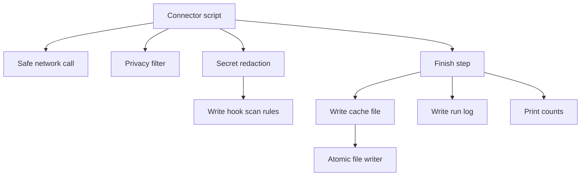

## Purpose

The shared helper for the chat, tracker, notes, calendar and git connectors, and for the Databricks schema export. It holds the cache file format, the run log call, a safe wrapper for one network call, the privacy rule that only counts, never message text or titles, are printed or logged, and the secret redaction that every connector applies to remote text before it is written. It also re-exports a few names from other modules so each connector needs one import.

## Dependencies

**Depends on.**
- Standard library: `json`, `pathlib`, `sys`, `urllib.error`, `datetime`.
- `core.paths` for `get_path` and `NotSetUp` {src:scripts/connectors/comms/comms_common.py:28}. [[paths]] with page [paths](../../core/paths.md).
- `cache_write` for `atomic_replace` {src:scripts/connectors/comms/comms_common.py:29}. [[cache_write]] with page [cache_write](../../cache/cache_write.md).
- `run_log` for `LogReason`, `LogResult` and `append` {src:scripts/connectors/comms/comms_common.py:30}. [[run_log]] with page [run_log](../../cache/run_log.md).
- `phi_guard` for `scrub` {src:scripts/connectors/comms/comms_common.py:31}. [[phi_guard]] with page [phi_guard](../../cache/phi_guard.md).
- `vault_write_scan` for `scan_text`, the secret redaction engine {src:scripts/connectors/comms/comms_common.py:32} {src:scripts/connectors/comms/comms_common.py:73}. [[vault_write_scan]] with page [vault_write_scan](../../sync/vault_write_scan.md).
- At import time it puts the `scripts/` folder, `scripts/cache/` and `scripts/sync/` at the front of `sys.path` if they are not already there {src:scripts/connectors/comms/comms_common.py:24-26}.

**Used by.**
- Product code: all five comms connectors import it as `cc`: `scripts/connectors/comms/calendar_connector.py` {src:scripts/connectors/comms/calendar_connector.py:36} ([[calendar_connector]] with page [calendar_connector](calendar_connector.md)), `scripts/connectors/comms/commits_connector.py` {src:scripts/connectors/comms/commits_connector.py:33} ([[commits_connector]] with page [commits_connector](commits_connector.md)), `scripts/connectors/comms/jira_connector.py` {src:scripts/connectors/comms/jira_connector.py:27} ([[jira_connector]] with page [jira_connector](jira_connector.md)), `scripts/connectors/comms/notion_connector.py` {src:scripts/connectors/comms/notion_connector.py:30} ([[notion_connector]] with page [notion_connector](notion_connector.md)) and `scripts/connectors/comms/slack_connector.py` {src:scripts/connectors/comms/slack_connector.py:38} ([[slack_connector]] with page [slack_connector](slack_connector.md)). The Databricks connector imports it too, for the schema export redaction: `scripts/connectors/data/databricks.py` {src:scripts/connectors/data/databricks.py:36} ([[databricks]] with page [databricks](../data/databricks.md)). Found with `git grep` (2026-11-20).
- Tests: no test file imports it by name (searched `tests/` for `comms_common`, 2026-11-20). It is covered only through the connector tests.

## Behavior

**Re-exports.** `__all__` lists `get_path`, `NotSetUp`, `LogReason`, `LogResult` and `scrub` next to this file's own functions, including the three redaction helpers {src:scripts/connectors/comms/comms_common.py:34-37}. `append` is imported but not listed {src:scripts/connectors/comms/comms_common.py:30}.

**`now_iso`** returns the current UTC time as an ISO string {src:scripts/connectors/comms/comms_common.py:41}.

**`build_payload`** wraps the data in an envelope: `_meta` with `pulled_at`, `result`, `reason` and `reject_count`, and `data` {src:scripts/connectors/comms/comms_common.py:46-48}. The daily brief reads the same `_meta` and `data` keys {src:scripts/cache/daily_brief.py:132} {src:scripts/cache/daily_brief.py:136}.

**`write_cache`** creates the cache folder if needed and writes `<name>.json` with `atomic_replace` {src:scripts/connectors/comms/comms_common.py:53-55}.

**`log_run`** appends one record with script, start and end times, result, reason and reject count {src:scripts/connectors/comms/comms_common.py:59-61}.

**`redact_text`** replaces each secret in a string with `[REDACTED:LABEL]` and keeps the rest of the text.
1. A value that is not a string, or an empty string, is returned unchanged {src:scripts/connectors/comms/comms_common.py:71-72}.
2. Otherwise it calls `vault_write_scan.scan_text` {src:scripts/connectors/comms/comms_common.py:73}. That function runs the same secret rules as the write hook, exact token shapes plus keyword based loose patterns {src:scripts/sync/vault_write_scan.py:67} {src:hooks/scrub_secrets.py:279}. Only the redacted text and the label list are used here; the PHI result from the same call is ignored {src:scripts/connectors/comms/comms_common.py:76}.
3. It adds one to the caller's `tally` for each label found {src:scripts/connectors/comms/comms_common.py:74-75}.
4. It returns the redacted text {src:scripts/connectors/comms/comms_common.py:76}.

**`redact_records`** returns a copy of a nested record with every string value redacted. It recurses into dicts, which keep their keys unchanged, and into lists, and passes other values through {src:scripts/connectors/comms/comms_common.py:81-87}.

**`secrets_line`** builds the log-safe text for the run line. With no redactions it gives `0 secrets redacted` {src:scripts/connectors/comms/comms_common.py:93-94}. Otherwise it gives a total and a sorted list of `LABEL count` pairs, for example `2 secrets redacted (CREDENTIAL 1, SLACK_TOKEN 1)` {src:scripts/connectors/comms/comms_common.py:95-96}. It never holds a secret value, only labels and numbers.

**`finish`** is the last step of a pull.
1. It writes the cache file unless the result is failed {src:scripts/connectors/comms/comms_common.py:105-107}.
2. If that write raises `OSError`, the result is changed to failed with reason `SCHEMA_INVALID` {src:scripts/connectors/comms/comms_common.py:108-109}.
3. It logs the run {src:scripts/connectors/comms/comms_common.py:110}.
4. It prints `script: result, N records, M rejected, <secrets line>`, with 0 records when failed. The secrets line comes from the optional `tally` argument, and an empty or missing tally prints `0 secrets redacted` {src:scripts/connectors/comms/comms_common.py:111-113}.
5. It always returns 0 {src:scripts/connectors/comms/comms_common.py:114}, so a scheduler does not retry a failed pull.

The run log record keeps its fixed field list and gets no secret count {src:scripts/connectors/comms/comms_common.py:59-61}. The count goes only on the printed line.

**`classify_status`** maps 400 to 499 to `API_4XX`, 500 to 599 to `API_5XX`, and any other status to `SCHEMA_INVALID` {src:scripts/connectors/comms/comms_common.py:118-122}.

**`call`** runs one request through the client handed in. An `HTTPError` becomes a reason from its status code {src:scripts/connectors/comms/comms_common.py:132-133}. A timeout, `URLError` or other `OSError` becomes `API_TIMEOUT` {src:scripts/connectors/comms/comms_common.py:134-135}. A response that is a dict with a `status` of 400 or more also fails {src:scripts/connectors/comms/comms_common.py:136-138}. On success it returns the response and `API_OK` {src:scripts/connectors/comms/comms_common.py:139}.

**`body_of`** takes the `body` from a dict response {src:scripts/connectors/comms/comms_common.py:144}, decodes bytes as UTF-8 with replacement {src:scripts/connectors/comms/comms_common.py:145-146}, and parses text as JSON, returning `None` when it is not JSON {src:scripts/connectors/comms/comms_common.py:147-151}. Any other body type is returned as it is {src:scripts/connectors/comms/comms_common.py:152}.

**`counts`** turns keyword numbers into a sorted `key=value` line, forcing each value through `int` {src:scripts/connectors/comms/comms_common.py:157}.

## Diagram: module level (L2, required)

## Diagram: function level (L3, optional)

None: no function has branching that the signature does not show. The steps of `finish` and `redact_text` are listed in Behavior.

## Notes

**Code and description disagree.**
- `body_of` says it returns "parsed JSON; None when it is not JSON" {src:scripts/connectors/comms/comms_common.py:143}. A body that is already a list, dict or number is passed through without any parse {src:scripts/connectors/comms/comms_common.py:152}, so the result is not always parsed JSON.
- The module description says it holds "the cache file format" {src:scripts/connectors/comms/comms_common.py:6}. The format is a nested dict built in `build_payload` {src:scripts/connectors/comms/comms_common.py:46-48}; no schema check exists here.
- The `finish` docstring says only counts are printed {src:scripts/connectors/comms/comms_common.py:103}. True of its own print {src:scripts/connectors/comms/comms_common.py:111-113}, but `finish` writes the full records (titles, subjects, authors) into the cache file {src:scripts/connectors/comms/comms_common.py:107}. The secrets in those records are redacted before this point by the caller, not by `finish` {src:scripts/connectors/comms/calendar_connector.py:229}.
- The module docstring says the privacy rule is "counts only" {src:scripts/connectors/comms/comms_common.py:7}. The redaction helpers keep the text and replace only the secret part {src:scripts/connectors/comms/comms_common.py:76}.

**Edge cases.**
- The tally counts one per label per string, not one per secret. The scan adds a label to its list once per call {src:hooks/scrub_secrets.py:281-282}, and `redact_text` adds one for each label in that list {src:scripts/connectors/comms/comms_common.py:74-75}. Two tokens of the same kind in one string give a count of 1. The text itself has both replaced {src:hooks/scrub_secrets.py:284}.
- `redact_text` does not catch a failure to load the scan rules. `scan_text` raises when the hook modules cannot be loaded and says it fails closed {src:scripts/sync/vault_write_scan.py:66}, so a connector run would stop with an error instead of writing unredacted text.
- Redaction leaves non-string values and dict keys alone {src:scripts/connectors/comms/comms_common.py:84} {src:scripts/connectors/comms/comms_common.py:87}.
- A write failure is logged as `SCHEMA_INVALID` {src:scripts/connectors/comms/comms_common.py:109}, which names a data problem, not a disk problem.
- `call` reports every `OSError`, `URLError` and timeout as `API_TIMEOUT` {src:scripts/connectors/comms/comms_common.py:134-135}, including DNS errors and refused connections.
- Only `OSError` is caught in `finish` {src:scripts/connectors/comms/comms_common.py:108}. A `NotSetUp` from `get_path` or a `ValueError` from the run log would propagate {src:scripts/connectors/comms/comms_common.py:53} {src:scripts/connectors/comms/comms_common.py:110}. The run log raises `ValueError` on a bad record {src:scripts/cache/run_log.py:72-78}.
- `call` does not catch errors raised by the client other than those listed. The default client raises `RedirectRefused` on a redirect {src:scripts/connectors/registry.py:241-245}, which passes through.
- `build_payload` assumes `result` and `reason` are enums with `.value` {src:scripts/connectors/comms/comms_common.py:46}.
- `counts` raises on a non-number value, since `int()` fails {src:scripts/connectors/comms/comms_common.py:157}. That keeps a log line to numbers only.

**Inputs that reach a path, command or address.**
- `write_cache(name, ...)` puts `name` into a file path with no check {src:scripts/connectors/comms/comms_common.py:55}. Every caller in the repo passes a fixed literal: `calendar` {src:scripts/connectors/comms/calendar_connector.py:238}, `commits` {src:scripts/connectors/comms/commits_connector.py:152} and `jira` {src:scripts/connectors/comms/jira_connector.py:150}. The other two connectors do not call `finish`: searched `scripts/connectors` for `cc.finish` (2026-11-20).
- `call(http, method, url)` passes `url` to the client with no check here {src:scripts/connectors/comms/comms_common.py:131}. The default client checks the address {src:scripts/connectors/registry.py:230}.
- No shell command is run in this file.

**Shared file writes.**
- The cache file goes through `atomic_replace`, which writes a temp file named for the process id and renames it {src:scripts/cache/cache_write.py:24-30}. Two writers cannot corrupt the file, but nothing stops both writing; the last rename wins.
- The run log is appended under an exclusive `flock` {src:scripts/cache/run_log.py:89-91}.
- Importing this file changes `sys.path` for the whole process {src:scripts/connectors/comms/comms_common.py:24-26}.
