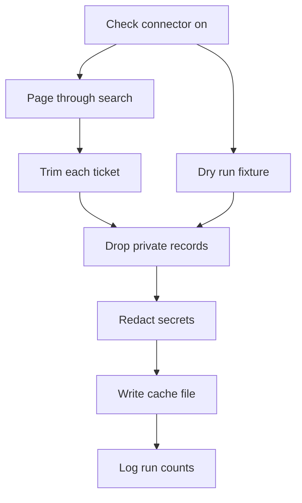

## Purpose

This is the tracker connector named `jira`. It asks a Jira style search API for tickets that were recently updated, trims each ticket to a few fields, drops records that look like they hold private health data, redacts any secret left in the kept records, and writes the result to the `jira.json` cache file that the daily brief reads. It exists so the brief can show ticket counts and keys without Tollgate ever keeping a Jira password in a file.

## Dependencies

**Depends on.**
- [[registry]] (no doc yet): `register`, `ensure`, `run_cli` are imported at {src:scripts/connectors/comms/jira_connector.py:26}. Source: `scripts/connectors/registry.py`.
- [[comms_common]] with page [comms_common](comms_common.md): imported as `cc` at {src:scripts/connectors/comms/jira_connector.py:27}. It supplies the HTTP wrapper `call`, `body_of`, `scrub`, `finish`, `now_iso`, `redact_records` and the `LogResult` and `LogReason` enums {src:scripts/connectors/comms/comms_common.py:34-37}. Source: `scripts/connectors/comms/comms_common.py`.
- Standard library: `argparse`, `base64`, `json`, `pathlib`, `sys`.
- Run time needs: a connector entry named `jira` that is on, with an address in the state file named by the `TOLLGATE_CONNECTORS` environment variable {src:scripts/connectors/registry.py:262-268}, and a key in the secret store {src:scripts/connectors/registry.py:402-404}.

**Used by.** No product code imports or runs this file. Searched 2026-11-20 with `git grep` for `jira_connector` and `connectors.comms` across the repo except `docs/`: the only hits are the file itself and its test. It is run by hand as `jira_connector.py [--jql QUERY] [--dry-run]` {src:scripts/connectors/comms/jira_connector.py:11}.
Tests: `tests/scripts/connectors/comms/test_jira.py` (imports it as `jira` {src:tests/scripts/connectors/comms/test_jira.py:18}).

## Behavior

**Setup gate.** `main` calls `ensure("jira")` first {src:scripts/connectors/comms/jira_connector.py:137}. In a terminal with the connector off, `ensure` runs the first-use prompt; without a terminal it raises `NotSetUp` {src:scripts/connectors/registry.py:418-427}. `run_cli` prints that error to stderr and exits with status 2 {src:scripts/connectors/registry.py:430-436}.

**Fetch.** `JiraClient.fetch` loops up to `MAX_PAGES` (10) pages {src:scripts/connectors/comms/jira_connector.py:98}. Each page is a POST of `{jql, maxResults: 50, fields}` to the address plus `/rest/api/3/search/jql`, with `nextPageToken` added from the second page on {src:scripts/connectors/comms/jira_connector.py:78-86}. A page is accepted only if the body is a dict with a list `issues` and a boolean `isLast`; otherwise the reason is `SCHEMA_INVALID` {src:scripts/connectors/comms/jira_connector.py:89-92}.

**Authentication header.** A key that contains a colon is sent as Basic auth (the whole key is base64 encoded); any other key is sent as Bearer {src:scripts/connectors/comms/jira_connector.py:74-76}.

**Projection.** `project_issue` keeps `key`, `summary`, status name, priority name, `updated` and the assignee display name {src:scripts/connectors/comms/jira_connector.py:62-66}. It returns `None` when the record is not a dict, has no `key`, has no `fields` dict, or when status, priority or assignee is neither null nor a dict {src:scripts/connectors/comms/jira_connector.py:53-60}. One bad record fails the whole fetch with `SCHEMA_INVALID` and an empty list {src:scripts/connectors/comms/jira_connector.py:103-105}.

**Caps.** When `MAX_TOTAL` (500) records are collected the fetch stops and reports `DEGRADED` {src:scripts/connectors/comms/jira_connector.py:107-108}. If all 10 pages are read without `isLast`, it also reports `DEGRADED` {src:scripts/connectors/comms/jira_connector.py:114}. A page that is not last but has no usable `nextPageToken` is a failure {src:scripts/connectors/comms/jira_connector.py:111-113}.

**Privacy filter.** `classify` runs `scrub` on the records {src:scripts/connectors/comms/jira_connector.py:122}. `scrub` drops any whole record in which any string value matches a health data pattern and returns the number dropped {src:scripts/cache/phi_guard.py:65-84}. If records came back but all were dropped, the result is `DEGRADED` with reason `PHI_REJECTED_ALL` and an empty list {src:scripts/connectors/comms/jira_connector.py:123-124}. If some were dropped the result is `DEGRADED` with `PHI_REJECTED` {src:scripts/connectors/comms/jira_connector.py:127-128}. Otherwise `SUCCESS` {src:scripts/connectors/comms/jira_connector.py:129}.

**Secret redaction.** After `classify` returns, `main` runs `cc.redact_records` on the kept records {src:scripts/connectors/comms/jira_connector.py:148-149}. Every string value, summary and key included, has each secret replaced in place with `[REDACTED:LABEL]`, and a tally counts the labels {src:scripts/connectors/comms/comms_common.py:81-87} {src:scripts/connectors/comms/comms_common.py:73-76}. The order is the privacy filter first, then redaction, then write. A failed fetch skips it, since there are no records {src:scripts/connectors/comms/jira_connector.py:145-146}.

**Output.** `main` ends in `cc.finish` and hands it the tally {src:scripts/connectors/comms/jira_connector.py:150}. `finish` writes `<cache>/jira.json` unless the result is `FAILED`, logs the run, prints only counts plus the secret count by label (for example `2 secrets redacted (CREDENTIAL 1, SLACK_TOKEN 1)`), and always returns 0 {src:scripts/connectors/comms/comms_common.py:105-114}. The run log record is unchanged and holds no secret count {src:scripts/connectors/comms/comms_common.py:59-61}. So a failed pull still exits with status 0. The write is atomic: a temp file named with the process id is written, synced and moved over the target {src:scripts/cache/cache_write.py:24-30}.

**Dry run.** With `--dry-run` the two fixture records are scrubbed and written as a `SUCCESS` pull without a network call {src:scripts/connectors/comms/jira_connector.py:140-142}.

## Diagram: module level (L2, required)

## Diagram: function level (L3, optional)

None: no function has branching that the signature does not show. The page loop in `fetch` {src:scripts/connectors/comms/jira_connector.py:95-114} is described in Behavior.

## Notes

**Code and description disagree.**
- The header says `--dry-run` writes "a fixture, no network" {src:scripts/connectors/comms/jira_connector.py:135}. The code calls `ensure` before it checks the flag {src:scripts/connectors/comms/jira_connector.py:137-140}, so a dry run still needs the connector to be on and the key to be in the secret store, and in a terminal it can start the first-use prompt.
- A dry run is not isolated: it passes through `cc.finish`, which overwrites the real `jira.json` cache with the fixture records {src:scripts/connectors/comms/jira_connector.py:150}{src:scripts/connectors/comms/comms_common.py:107}. The fixture does not go through redaction {src:scripts/connectors/comms/jira_connector.py:141}.
- The projection docstring says it "drops email addresses and account ids" {src:scripts/connectors/comms/jira_connector.py:51}. It does so only by not copying those fields; the free text `summary` is copied as is {src:scripts/connectors/comms/jira_connector.py:62}, so an address typed into a title is kept unless the privacy filter happens to match it. A secret typed into a title is now replaced with `[REDACTED:LABEL]` {src:scripts/connectors/comms/jira_connector.py:149}.
- The header says ticket titles are "never printed or logged" {src:scripts/connectors/comms/jira_connector.py:15-16}. True for output and the run log (counts only), but titles are written to the cache file {src:scripts/connectors/comms/comms_common.py:107}, with secrets inside them redacted first {src:scripts/connectors/comms/jira_connector.py:149}.
- The `Date:` header line is empty {src:scripts/connectors/comms/jira_connector.py:5}.

**Edge cases.**
- The secret count is per label per string, so two tokens of one kind in one summary count once {src:scripts/connectors/comms/comms_common.py:74-75}.
- `MAX_PAGES` times `PAGE_SIZE` is 500, equal to `MAX_TOTAL` {src:scripts/connectors/comms/jira_connector.py:35-37}. A search with exactly 500 results returns `DEGRADED` at the 500th record before the `isLast` check is reached {src:scripts/connectors/comms/jira_connector.py:107-109}.
- A bearer token that happens to contain a colon is sent as Basic auth {src:scripts/connectors/comms/jira_connector.py:74}.

**Inputs that reach a network address, command or outbound text without a check.**
- `--jql` goes straight into the POST body {src:scripts/connectors/comms/jira_connector.py:79}{src:scripts/connectors/comms/jira_connector.py:86}. No check on its value; it is the user's own query text and is sent as JSON, not placed in a URL or shell.
- The address comes from the state file. `UrlHttp` refuses non-https addresses except loopback and refuses redirects {src:scripts/connectors/registry.py:91-100}{src:scripts/connectors/registry.py:227-246}. When a test supplies a different `http` object these checks do not apply.
- The key goes only into the `Authorization` header {src:scripts/connectors/comms/jira_connector.py:84}.
- No input reaches a file path or shell command.

**Writes to shared files.** One: `<cache>/jira.json`, written atomically (temp file and replace) {src:scripts/cache/cache_write.py:24-30}. Nothing stops two runs at once; the temp name uses the process id, so they do not collide, and the last one to replace wins.
