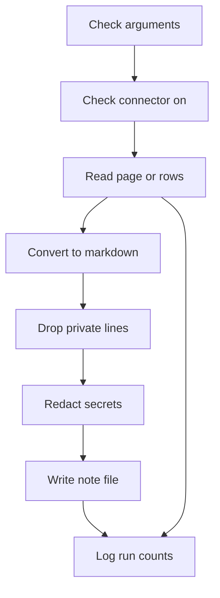

## Purpose

This is the notes connector named `notion`. Given the id of one page or one database in a Notion style notes API, it reads the content, drops lines the privacy filter rejects, redacts secrets in what is kept, and saves it as a markdown note in the user's `meetings` or `references` folder. It exists so notes kept in that tool can be searched and read next to the rest of the vault.

## Dependencies

**Depends on.**
- [[registry]] ([registry](registry.md)): `register`, `ensure`, `run_cli` {src:scripts/connectors/comms/notion_connector.py:29}. Source: `scripts/connectors/registry.py`.
- [[comms_common]] ([comms_common](comms_common.md)): imported as `cc` {src:scripts/connectors/comms/notion_connector.py:30}; used for `call`, `body_of`, `get_path`, `scrub`, `redact_text`, `secrets_line`, `now_iso`, `log_run`, `LogResult`, `LogReason`. Source: `scripts/connectors/comms/comms_common.py`.
- Standard library: `argparse`, `json`, `pathlib`, `re`, `sys`.
- Run time needs: connector `notion` turned on, with an address and a key in the secret store {src:scripts/connectors/registry.py:395-405}; the folders `meetings` and `references` resolve through `get_path` {src:scripts/core/paths.py:119}.

**Used by.** No product code imports or runs this file. Searched 2026-11-20 with `git grep` for `notion_connector` across the repo except `docs/`: the file itself and its test only. Run by hand as `notion_connector.py page ID` or `database ID` {src:scripts/connectors/comms/notion_connector.py:12-13}.
Tests: `tests/scripts/connectors/comms/test_notion.py` ([[test_notion]], [test_notion](../../../tests/scripts/connectors/comms/test_notion.md)), which imports it as `nt` {src:tests/scripts/connectors/comms/test_notion.py:15}.

## Behavior

**Arguments.** `main` takes `kind` (`page` or `database`), an `id`, and `--into` (`meetings` or `references`, default `references`) {src:scripts/connectors/comms/notion_connector.py:190-192}. The id must match `^[0-9a-fA-F-]{8,64}$` or the program exits with a message {src:scripts/connectors/comms/notion_connector.py:37} {src:scripts/connectors/comms/notion_connector.py:194-195}. Then it calls `ensure("notion")` {src:scripts/connectors/comms/notion_connector.py:196}.

**Requests.** Every call is made through `cc.call` with a Bearer key header, a fixed `Notion-Version` header of `2022-06-28`, and a 30 second timeout {src:scripts/connectors/comms/notion_connector.py:93-96}. A response whose body is not a JSON object counts as `SCHEMA_INVALID` {src:scripts/connectors/comms/notion_connector.py:99-101}.

**Page.** The page object is read from `/pages/<id>`; if that works, the blocks are read from `/blocks/<id>/children?page_size=100` {src:scripts/connectors/comms/notion_connector.py:105} {src:scripts/connectors/comms/notion_connector.py:111}. Blocks are read in pages of up to `MAX_PAGES` (20) requests per parent, following `next_cursor` while `has_more` is true {src:scripts/connectors/comms/notion_connector.py:110} {src:scripts/connectors/comms/notion_connector.py:126-130}. A block that reports `has_children` is read recursively while `depth < MAX_DEPTH` (3) {src:scripts/connectors/comms/notion_connector.py:121-125}. Any failed request aborts the whole read and nothing is written {src:scripts/connectors/comms/notion_connector.py:115-116} {src:scripts/connectors/comms/notion_connector.py:204-205}.

**Block to markdown.** `block_to_md` turns heading 1 to 3, bulleted and numbered items, to-dos, quotes, code and dividers into markdown; any other block type becomes its plain text {src:scripts/connectors/comms/notion_connector.py:63-81}. Every numbered item is written as `1.` {src:scripts/connectors/comms/notion_connector.py:72}. Indent applies only to list and to-do items, not to headings, quotes or code {src:scripts/connectors/comms/notion_connector.py:62-76}.

**Database.** The database object is read, then `/databases/<id>/query` is posted page by page (100 rows per request, up to `MAX_PAGES`) and the title of each row is kept {src:scripts/connectors/comms/notion_connector.py:135-146}. The note holds one `- title` bullet per row, `Untitled` for an empty title {src:scripts/connectors/comms/notion_connector.py:211}.

**Privacy filter.** `write_note` takes an optional `stats` dict and sets up a `phi` count and a `secrets` tally in it {src:scripts/connectors/comms/notion_connector.py:164-166}. It runs the title, then each body line, through `cc.scrub`. A title that matches is replaced by an empty string and counted, and a body line that matches is dropped and counted {src:scripts/connectors/comms/notion_connector.py:170-178}. `scrub` returns the kept records first, and drops a record when any string in it matches a built in pattern {src:scripts/cache/phi_guard.py:79-83}.

**Secret redaction.** After the filter, `write_note` runs `cc.redact_text` on the title and on every kept line {src:scripts/connectors/comms/notion_connector.py:179-180}. A secret becomes `[REDACTED:LABEL]` in place, the rest of the text stays, and the label is counted in the tally {src:scripts/connectors/comms/comms_common.py:73-76}. The title is redacted before the file name is built, so the file name holds no secret {src:scripts/connectors/comms/notion_connector.py:179} {src:scripts/connectors/comms/notion_connector.py:181}. The order is filter first, then redaction, then write.

**Writing the note.** `write_note` resolves the folder with `cc.get_path(folder_name)`, creates it {src:scripts/connectors/comms/notion_connector.py:167-168}, and writes `<slug(title)>-<first 8 id characters without dashes>.md` with a header holding the title, a `Source:` line with the kind and id, and a `Fetched:` timestamp {src:scripts/connectors/comms/notion_connector.py:181-184}. `slug` lowercases, replaces runs of characters outside `a-z0-9` with a dash, cuts to 60 characters and falls back to `untitled` {src:scripts/connectors/comms/notion_connector.py:85}.

**Result.** `main` makes a `stats` dict and passes it to `write_note` and to `_done` {src:scripts/connectors/comms/notion_connector.py:198} {src:scripts/connectors/comms/notion_connector.py:206-207}. `_done` logs the run with the count of dropped items as the reject count {src:scripts/connectors/comms/notion_connector.py:217}. It prints `notion: <result>, <n> items, 
 phi dropped, <secrets line>`, where the secrets line is a count by label such as `2 secrets redacted (CREDENTIAL 1, SLACK_TOKEN 1)` or `0 secrets redacted` {src:scripts/connectors/comms/notion_connector.py:218-219} {src:scripts/connectors/comms/comms_common.py:92-96}. It always returns 0, including on failure {src:scripts/connectors/comms/notion_connector.py:220}. A failed read calls `_done` without stats, so it prints `0 phi dropped` and `0 secrets redacted` {src:scripts/connectors/comms/notion_connector.py:205} {src:scripts/connectors/comms/notion_connector.py:216}.

## Diagram: module level (L2, required)

## Diagram: function level (L3, optional)

None: no function has branching that the signature does not show. The recursive block read {src:scripts/connectors/comms/notion_connector.py:107-131} is described in Behavior.

## Notes

**Code and description disagree.**
- The header says "Rerunning the same id overwrites the same file" {src:scripts/connectors/comms/notion_connector.py:19-20}. The file name includes the slug of the current title {src:scripts/connectors/comms/notion_connector.py:181}, so after a rename in Notion the next run writes a new file and the old one stays. Two different ids that share the first 8 characters and a title would write the same file.
- The error text says the id "must be letters, digits and dashes only" {src:scripts/connectors/comms/notion_connector.py:195}. The pattern allows only hex letters `a-f` and `A-F` {src:scripts/connectors/comms/notion_connector.py:37}. Also `$` in Python matches before a trailing newline, so an id ending in a newline passes the check.
- The header says titles and text are "never printed or logged" {src:scripts/connectors/comms/notion_connector.py:19-20}. Held: only the result, counts and secret labels are printed {src:scripts/connectors/comms/notion_connector.py:218-219}. The note file itself does hold the title and text, with secrets inside them redacted {src:scripts/connectors/comms/notion_connector.py:179-180}.
- The `Date:` header line is empty {src:scripts/connectors/comms/notion_connector.py:5}.

**Edge cases.**
- Reads past `MAX_PAGES` request pages or below `MAX_DEPTH` are cut off silently and the run still reports `SUCCESS` {src:scripts/connectors/comms/notion_connector.py:110} {src:scripts/connectors/comms/notion_connector.py:121} {src:scripts/connectors/comms/notion_connector.py:207}. The same holds for database rows {src:scripts/connectors/comms/notion_connector.py:139}.
- Dropped items are now counted. The run log gets the number of dropped title and lines as its reject count, and the printed line shows `phi dropped` {src:scripts/connectors/comms/notion_connector.py:217-219}. The `items` count printed is still the number of lines or rows before filtering {src:scripts/connectors/comms/notion_connector.py:207} {src:scripts/connectors/comms/notion_connector.py:212}.
- The secret count is per label per string, so two tokens of one kind in one line count once {src:scripts/connectors/comms/comms_common.py:74-75}.
- The filter works on one line at a time, so a pattern that spans two block lines is not caught. The title is checked alone, for both pages and databases. The `Source:` and `Fetched:` header lines are written as built {src:scripts/connectors/comms/notion_connector.py:182}.
- Nothing is printed on a failed page read except the count line `notion: failed, 0 items, 0 phi dropped, 0 secrets redacted` {src:scripts/connectors/comms/notion_connector.py:205} {src:scripts/connectors/comms/notion_connector.py:218-219}.

**Inputs reaching a path, command, network address or text without a check.**
- `id` is checked by the pattern above and then placed in the URL path {src:scripts/connectors/comms/notion_connector.py:105} {src:scripts/connectors/comms/notion_connector.py:135}. The trailing newline case is not caught.
- Block ids from the server go into the URL path unchecked {src:scripts/connectors/comms/notion_connector.py:111} {src:scripts/connectors/comms/notion_connector.py:122}, and `next_cursor` from the server is appended to the query string without URL encoding {src:scripts/connectors/comms/notion_connector.py:113}.
- The file name is built from the title slug (restricted to `a-z0-9` and dashes) and the id, and the folder is one of two fixed choices, so no path input escapes {src:scripts/connectors/comms/notion_connector.py:192} {src:scripts/connectors/comms/notion_connector.py:181}. The `Source:` line and the title text are written unescaped into the markdown {src:scripts/connectors/comms/notion_connector.py:182}.
- The address comes from the state file. The client handed to this connector is built for the name `notion` {src:scripts/connectors/registry.py:405}, so every request is checked against `api.notion.com` and `notion.com` on port 443 (no other subdomain) or a host the owner recorded with `--allow-host` {src:scripts/connectors/registry.py:111} {src:scripts/connectors/registry.py:232}. Any other host is refused before the key is sent {src:scripts/connectors/registry.py:209-213}.
- No shell command is built.

**Writes to shared files.** The note file is written with `write_text`: not atomic, no lock, existing file overwritten {src:scripts/connectors/comms/notion_connector.py:184}. Two runs at once on the same id could interleave. The run log is appended through `cc.log_run` {src:scripts/connectors/comms/notion_connector.py:217}.
