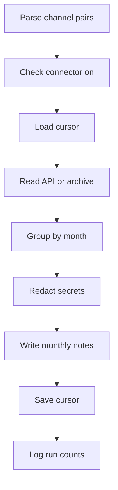

## Purpose

This is the chat connector named `slack`. It turns the message history of chosen channels and direct messages into one markdown note per channel per month, with thread replies placed under their parent message. It drops messages the privacy filter rejects and redacts secrets in the rest. It reads either a chat web API or a local SQLite archive. It exists so conversations can be searched and read like any other note in the vault.

## Dependencies

**Depends on.**
- [[registry]] ([registry](registry.md)): `register`, `ensure`, `run_cli` {src:scripts/connectors/comms/slack_connector.py:37}. Source: `scripts/connectors/registry.py`.
- [[comms_common]] ([comms_common](comms_common.md)): imported as `cc` {src:scripts/connectors/comms/slack_connector.py:38}; used for `call`, `body_of`, `get_path`, `scrub`, `redact_text`, `secrets_line`, `now_iso`, `log_run`, `counts`, `LogResult`, `LogReason`. Source: `scripts/connectors/comms/comms_common.py`.
- Standard library: `argparse`, `json`, `pathlib`, `re`, `sqlite3`, `sys`, `urllib.parse`, `datetime`; `zoneinfo` is imported inside `main` only when `--tz` is given {src:scripts/connectors/comms/slack_connector.py:311-313}.
- Run time needs: connector `slack` on, with an address and key {src:scripts/connectors/registry.py:395-405}; the `conversations` and `state` folders through `get_path` {src:scripts/connectors/comms/slack_connector.py:272}{src:scripts/connectors/comms/slack_connector.py:317}.

**Used by.** No product code imports or runs this file. Searched 2026-11-20 with `git grep` for `slack_connector` and `sync_slack` across the repo except `docs/`: the file itself and its test only. Run by hand {src:scripts/connectors/comms/slack_connector.py:14-15}.
Tests: `tests/scripts/connectors/comms/test_slack.py` ([[test_slack]], [test_slack](../../../tests/scripts/connectors/comms/test_slack.md)), which imports it as `sl` {src:tests/scripts/connectors/comms/test_slack.py:18}.

## Behavior

**Arguments.** `--channel ID=name` and `--dm ID=name` can repeat; `--archive PATH`, `--tz ZONE` and `--full` are optional {src:scripts/connectors/comms/slack_connector.py:301-305}. A pair without `=`, an empty id or an empty name exits with an error {src:scripts/connectors/comms/slack_connector.py:289-296}. With no channel, no dm and no archive, the program exits with a message {src:scripts/connectors/comms/slack_connector.py:309-310}. `ensure("slack")` runs before any of this is checked, so the connector must be on even in archive mode {src:scripts/connectors/comms/slack_connector.py:307}.

**Sources.** With `--archive`, `ArchiveSource` opens the SQLite file read only through a `file:` address {src:scripts/connectors/comms/slack_connector.py:210} and reads users from `S_USER` {src:scripts/connectors/comms/slack_connector.py:215}, messages from `MESSAGE` with a bound channel id and an optional `TS >` cursor value {src:scripts/connectors/comms/slack_connector.py:225-228}, and adds every direct message and group direct message channel that has at least one message {src:scripts/connectors/comms/slack_connector.py:239-243}{src:scripts/connectors/comms/slack_connector.py:323-325}. Without it, `ApiSource` calls `users.list`, `conversations.history` and, for each parent message with replies, `conversations.replies`, all as GET requests with a Bearer key {src:scripts/connectors/comms/slack_connector.py:151-154}{src:scripts/connectors/comms/slack_connector.py:165}{src:scripts/connectors/comms/slack_connector.py:183}{src:scripts/connectors/comms/slack_connector.py:191-192}. Each list call is capped at `MAX_PAGES` (50) pages {src:scripts/connectors/comms/slack_connector.py:42}{src:scripts/connectors/comms/slack_connector.py:177}. A response with `ok` false counts as `SCHEMA_INVALID` {src:scripts/connectors/comms/slack_connector.py:158-159}.

**Cursor.** The cursor file is `<state>/slack/cursor.json`, a map of channel id to newest message time {src:scripts/connectors/comms/slack_connector.py:271-272}. It is loaded unless `--full` is given {src:scripts/connectors/comms/slack_connector.py:319}. A missing or unreadable file reads as empty {src:scripts/connectors/comms/slack_connector.py:277-280}. After a channel is written, its cursor becomes the largest message time seen {src:scripts/connectors/comms/slack_connector.py:342}.

**Rendering.** `build_monthly` groups top level messages by (year, month) in the chosen time zone, skips a parent message whose cleaned text is empty or is dropped by the privacy filter {src:scripts/connectors/comms/slack_connector.py:101-103}, and puts each reply under its parent with a `  -> ` prefix, dropping a reply whose cleaned text is empty or is dropped by the filter {src:scripts/connectors/comms/slack_connector.py:110-114}. Both go through one inner helper, `keep`: empty text gives nothing {src:scripts/connectors/comms/slack_connector.py:86-87}, a message the filter rejects is counted in `stats["phi"]` and dropped {src:scripts/connectors/comms/slack_connector.py:88-90}, and a message that passes is redacted and returned {src:scripts/connectors/comms/slack_connector.py:91}. The filter is `cc.scrub`, which drops a record when any string in it matches a built in pattern {src:scripts/connectors/comms/slack_connector.py:88} {src:scripts/cache/phi_guard.py:79-83}.

**Secret redaction.** `keep` calls `cc.redact_text` on each kept message, so a secret becomes `[REDACTED:LABEL]` in place, the rest of the message stays, and the label is counted in a tally {src:scripts/connectors/comms/slack_connector.py:91} {src:scripts/connectors/comms/comms_common.py:73-76}. The order is filter first, then redaction, then write. `build_monthly` takes an optional `stats` dict that carries the `phi` count and the `secrets` tally back to `main` {src:scripts/connectors/comms/slack_connector.py:81-83}. Redaction runs after `clean_text` has turned markup into plain text, so it sees the text as it will be written {src:scripts/connectors/comms/slack_connector.py:101}. User names are not redacted {src:scripts/connectors/comms/slack_connector.py:107-108}, and neither are the channel name and id in the file header {src:scripts/connectors/comms/slack_connector.py:134-135}.

**Rendering continued.** A dropped parent also hides its replies, because replies are only written under a kept parent {src:scripts/connectors/comms/slack_connector.py:109}. `clean_text` turns `<@U..>` into `@name`, link markup into its label or address, and channel markup into `#name` {src:scripts/connectors/comms/slack_connector.py:51}{src:scripts/connectors/comms/slack_connector.py:58-60}. The time zone is `--tz` or the computer's own {src:scripts/connectors/comms/slack_connector.py:311-315}.

**Writing.** `write_files` makes one file per month named `<year>-<month>-<slug>.md` {src:scripts/connectors/comms/slack_connector.py:126}. If the file exists and already contains the new text as a substring, it is skipped; otherwise the new text is appended after the old {src:scripts/connectors/comms/slack_connector.py:128-132}. A new file gets a header with the title, channel id and a `Generated:` time {src:scripts/connectors/comms/slack_connector.py:134-138}. Channels go under `<conversations>/slack/channels/<slug>/` and direct messages under `.../dms/<slug>/` {src:scripts/connectors/comms/slack_connector.py:317}{src:scripts/connectors/comms/slack_connector.py:329-330}{src:scripts/connectors/comms/slack_connector.py:341}.

**Result.** If a channel read fails, the loop goes on with the next one and the run ends as `DEGRADED` with the first failure reason {src:scripts/connectors/comms/slack_connector.py:333-335}{src:scripts/connectors/comms/slack_connector.py:347-348}. A failed user list ends the run as `FAILED` {src:scripts/connectors/comms/slack_connector.py:321-322}{src:scripts/connectors/comms/slack_connector.py:354-357}. The run is logged with the number of messages dropped by the filter as its reject count {src:scripts/connectors/comms/slack_connector.py:347-348}. The printed line holds counts of channels, messages, files and dropped messages (`phi_dropped=N`), then the secret count by label, for example `2 secrets redacted (CREDENTIAL 1, SLACK_TOKEN 1)` or `0 secrets redacted` {src:scripts/connectors/comms/slack_connector.py:349-350} {src:scripts/connectors/comms/comms_common.py:92-96}. Both paths return 0 {src:scripts/connectors/comms/slack_connector.py:351}{src:scripts/connectors/comms/slack_connector.py:357}.

## Diagram: module level (L2, required)

## Diagram: function level (L3, optional)

None: no function has branching that the signature does not show. The channel loop in `main` {src:scripts/connectors/comms/slack_connector.py:331-343} is described in Behavior.

## Notes

**Code and description disagree.**
- The header gives the file name as `<year>-<month>-<name>.md` {src:scripts/connectors/comms/slack_connector.py:21}. The code uses `slug(name)`, which lowercases and replaces non-word characters with dashes {src:scripts/connectors/comms/slack_connector.py:68-69}{src:scripts/connectors/comms/slack_connector.py:339}.
- The header says `--full` "ignores" the cursor {src:scripts/connectors/comms/slack_connector.py:23}. It also replaces the saved cursor file: `state` starts empty and the whole map is saved, so cursors of channels not named in this run are lost {src:scripts/connectors/comms/slack_connector.py:319}{src:scripts/connectors/comms/slack_connector.py:346}.
- The header says message text is never printed or logged {src:scripts/connectors/comms/slack_connector.py:24-25}. Held: output is counts and secret labels only {src:scripts/connectors/comms/slack_connector.py:349-350}. The note files hold the message text, with secrets in it redacted {src:scripts/connectors/comms/slack_connector.py:91}.
- The `Date:` header line is empty {src:scripts/connectors/comms/slack_connector.py:5}.

**Edge cases and possible data loss.**
- A reply is rendered only if its parent is in the same batch: replies are looked up from the parent loop {src:scripts/connectors/comms/slack_connector.py:98-100}{src:scripts/connectors/comms/slack_connector.py:109}. A reply that arrives after the cursor under an older parent is never rendered, and the cursor still moves past it {src:scripts/connectors/comms/slack_connector.py:342}. In archive mode such a reply row is returned by the query {src:scripts/connectors/comms/slack_connector.py:225-228}; in API mode replies are only fetched for parents that the history call returns {src:scripts/connectors/comms/slack_connector.py:191-192}.
- The 50 page cap ends silently with no flag, and the run is still `SUCCESS` {src:scripts/connectors/comms/slack_connector.py:177}{src:scripts/connectors/comms/slack_connector.py:347-348}. Whether a capped history read leaves a gap behind the new cursor depends on the order the API returns messages in [uncertain: not checked against the API docs].
- A missing archive file, or an invalid `--tz` name, raises an uncaught exception (`sqlite3.connect` with `mode=ro` and `ZoneInfo`) {src:scripts/connectors/comms/slack_connector.py:210}{src:scripts/connectors/comms/slack_connector.py:313}. A hand edited cursor holding a non-number raises on `float(since)` {src:scripts/connectors/comms/slack_connector.py:180}{src:scripts/connectors/comms/slack_connector.py:228}.
- A cursor is saved even when every channel failed {src:scripts/connectors/comms/slack_connector.py:346}.
- Dropped messages are now counted: the run log reject count and the printed `phi_dropped` hold the number of messages the filter rejected {src:scripts/connectors/comms/slack_connector.py:348} {src:scripts/connectors/comms/slack_connector.py:350}. The printed `messages` count still includes the dropped ones, since it is the number read {src:scripts/connectors/comms/slack_connector.py:343}. The secret count is per label per message, so two tokens of one kind in one message count once {src:scripts/connectors/comms/comms_common.py:74-75}. The filter checks each message alone, so a pattern split across two messages is not caught. A channel or user name in the header and in the `**[time] name**` prefix is not filtered {src:scripts/connectors/comms/slack_connector.py:107-108}.

**Inputs reaching a path, command, network address or text without a check.**
- `--channel` and `--dm` ids go into URL parameters through `urlencode` {src:scripts/connectors/comms/slack_connector.py:152}, or into the SQL as a bound parameter {src:scripts/connectors/comms/slack_connector.py:228}. No check on their value.
- The channel name is made safe for a path by `slug`: only word characters and dashes survive, and dots become dashes {src:scripts/connectors/comms/slack_connector.py:69}{src:scripts/connectors/comms/slack_connector.py:339}. The unslugged name goes into the note title {src:scripts/connectors/comms/slack_connector.py:340}.
- `--archive PATH` is opened as given after URL quoting {src:scripts/connectors/comms/slack_connector.py:210}; no check that it is a Slack archive. The SQL text is built from fixed strings only {src:scripts/connectors/comms/slack_connector.py:225-227}.
- The address comes from the state file. `UrlHttp` limits it to https or loopback {src:scripts/connectors/registry.py:91-100}, and, because `require` hands the connector a client built for the name `slack` {src:scripts/connectors/registry.py:405}, it also checks every request against the built-in Slack hosts (`slack.com` and any `.slack.com` subdomain on port 443) or a host the owner recorded with `--allow-host` {src:scripts/connectors/registry.py:110} {src:scripts/connectors/registry.py:232}. A request to any other host is refused before the key is sent {src:scripts/connectors/registry.py:209-213}.
- No shell command is built.

**Writes to shared files.**
- Monthly notes: read, then `write_text`, so not atomic; nothing stops two runs from reading the same old text and one overwriting the other {src:scripts/connectors/comms/slack_connector.py:129-132}.
- Cursor file: `write_text`, not atomic, no lock {src:scripts/connectors/comms/slack_connector.py:286}. A crash mid-write can leave invalid JSON, which then reads as an empty cursor {src:scripts/connectors/comms/slack_connector.py:277-280}.
- Run log: appended through `cc.log_run` {src:scripts/connectors/comms/slack_connector.py:347}.
