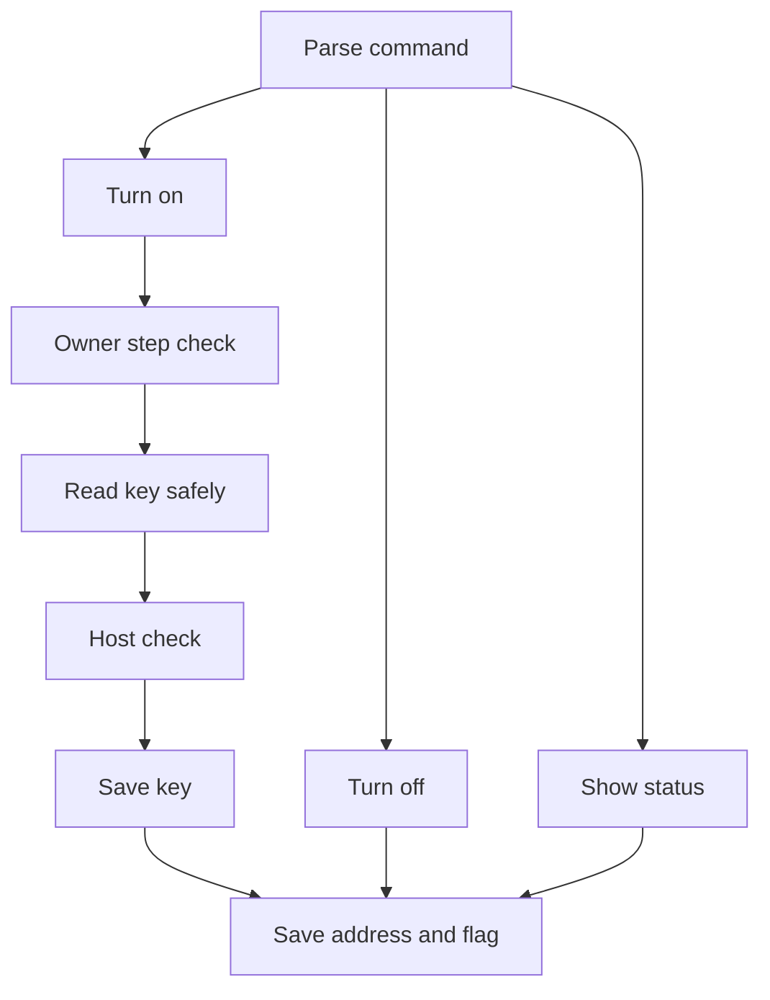

## Purpose

This is the one command for connector setup. It turns a connector on (saving its address in the state file and its key in the secret store), turns it off (removing both the on flag and the key), and shows which connectors are on. It also carries the owner step that approves a host outside a connector's built-in list. It exists so a key is only ever typed or piped once, into the secret store, and never lands in a file or an argument list.

## Dependencies

**Depends on.**
- [[registry]] ([registry](registry.md)): `from connectors import registry` {src:scripts/connectors/connect.py:29}. It supplies `turn_on`, `turn_off`, `load_state`, `check_settings`, `check_no_credentials`, `normalize_allowed_host`, `interactive` and `NotSetUp`. Source: `scripts/connectors/registry.py`.
- [[secret_store]] ([secret_store](secret_store.md)): `SecretStoreError` and `check_name` are imported {src:scripts/connectors/connect.py:30}. Source: `scripts/connectors/secret_store.py`.
- Standard library: `argparse`, `getpass`, `os`, `pathlib`, `sys`.
- Environment: `TOLLGATE_CONNECTORS` must be set for any command that reads or writes the state file {src:scripts/connectors/registry.py:264-268}.

**Used by.**
- Product code: `registry.ensure` imports it and calls `connect.first_use` when a connector is off and a terminal is present {src:scripts/connectors/registry.py:425-426}. Every connector error message tells the user to run it by hand {src:scripts/connectors/registry.py:326-327}, and the host refusal message gives the exact `--allow-host` command {src:scripts/connectors/registry.py:209-213}.
- Named in text only (not imported): {src:scripts/connectors/data/secrets_tool.py:93}, {src:scripts/connectors/comms/commits_connector.py:17}.
- Searched 2026-11-21 with `git grep` for `connectors import .*connect`, `connect.first_use` and `connect.main` across the repo except `docs/`.
- Tests: `tests/scripts/connectors/test_connectors.py`, `test_connectors_hardening.py`, `test_redirect_settings.py`, `test_host_allowlist.py`, `comms/comms_base.py`, `data/test_databricks.py`, `plane/test_plane_connector.py` and `plane/plane_sync_test_support.py` all call `connect.main`.

## Behavior

**Commands.** The parser has `on NAME`, `off NAME` and `status [NAME]` {src:scripts/connectors/connect.py:136-148}. `on` takes `--address`, repeated `--allow-host HOST`, repeated `--set KEY=VALUE`, and one of `--key-from-env VAR` or `--key-stdin` (mutually exclusive) {src:scripts/connectors/connect.py:139-144}.

**on.** The steps run in this order.
1. The `--set` pairs are parsed (a pair without `=` is an error) {src:scripts/connectors/connect.py:66-73} and checked: names that contain `key`, `token`, `secret` or `password`, or values that are not plain text, numbers, booleans or lists of those, are refused before anything is written {src:scripts/connectors/connect.py:77-78} {src:scripts/connectors/registry.py:330-348}.
2. If any `--allow-host` was given and the session is not a terminal, the command stops with "run it yourself in a terminal" {src:scripts/connectors/connect.py:79-82}. A session counts as a terminal only when `TOLLGATE_NONINTERACTIVE` is not `1` and both input and output are terminals {src:scripts/connectors/registry.py:408-415}.
3. Each `--allow-host` value is checked for shape before anything is written: `HOST` or `HOST:PORT`, no scheme, path, wildcard or trailing dot {src:scripts/connectors/connect.py:83-84} {src:scripts/connectors/registry.py:182-193}.
4. The key is read from the named environment variable (an empty or missing variable is an error) or from standard input, stripped of white space {src:scripts/connectors/connect.py:54-63}.
- No key flag and no terminal: error asking for `--address` and a key flag {src:scripts/connectors/connect.py:87-89}.
- No key flag and a terminal: `first_use` checks the connector name with `check_name` {src:scripts/connectors/connect.py:38}, asks for the address unless `--address` was given {src:scripts/connectors/connect.py:42-43}, asks for the key with no echo {src:scripts/connectors/connect.py:44}, and passes the allowed hosts on to `turn_on` {src:scripts/connectors/connect.py:51}.
- A key flag: the address is `--address`, or the one already saved for that name; both address and key must be non-empty {src:scripts/connectors/connect.py:93-96}. Then `registry.turn_on` runs with the allowed hosts {src:scripts/connectors/connect.py:97}.

`turn_on` checks the connector name with `check_name`, refuses an address that holds a user name or password {src:scripts/connectors/registry.py:366} {src:scripts/connectors/registry.py:367}, runs the host check on the address (built-in list, hosts recorded earlier, and the hosts given now) before the key is stored {src:scripts/connectors/registry.py:370-371}, writes the key to the secret store first, and only then writes the state file entry with `on` true, the settings merged over older ones and the allowed hosts merged into any already recorded {src:scripts/connectors/registry.py:372-380}. The state file holds addresses, on/off, settings and allowed hosts, never a key {src:scripts/connectors/registry.py:312-318}.

**off.** `turn_off` checks the name with `check_name` {src:scripts/connectors/registry.py:384}, sets `on` false in the state file if the name is there, drops its recorded hosts, then deletes the key from the secret store whether or not it was in the state file {src:scripts/connectors/registry.py:385-390} {src:scripts/connectors/connect.py:101-103}. A later `on` for a non-built-in host needs `--allow-host` again.

**status.** Without a name it lists every entry in the state file, or `no connectors set up` {src:scripts/connectors/connect.py:112-115}. For each it prints `name: on (address)`, `name: off` or `name: not set up`, plus its settings {src:scripts/connectors/connect.py:118-130}. An address with a login in it is replaced by a hidden notice {src:scripts/connectors/connect.py:120-123}. The exit status is 0 unless a name was given and that connector is not on, then 1 {src:scripts/connectors/connect.py:131}.

**Errors.** `NotSetUp`, `SecretStoreError` and `ValueError` are printed to stderr and give exit status 1 {src:scripts/connectors/connect.py:157-159}. A refused host raises a `ValueError` subclass, so it takes this path with the message that names the `--allow-host` command {src:scripts/connectors/registry.py:123-124} {src:scripts/connectors/registry.py:209-213}. Any other exception is not caught.

## Diagram: module level (L2, required)

## Diagram: function level (L3, optional)

None: no function has branching that the signature does not show. The order of checks in `cmd_on` {src:scripts/connectors/connect.py:77-97} is described in Behavior.

## Notes

**Code and description disagree.**
- The header usage lines omit `--set KEY=VALUE` {src:scripts/connectors/connect.py:10-13}, which the parser accepts {src:scripts/connectors/connect.py:141}.
- The header says that in a terminal with no flags it asks for address and key {src:scripts/connectors/connect.py:15-16}. The code also asks when only `--address` is given, and then asks only for the key {src:scripts/connectors/connect.py:42-44}.
- The header says `--allow-host` is refused without a terminal {src:scripts/connectors/connect.py:19-20}. That holds for the flag as typed, but the terminal test in `registry.interactive` is satisfied by anything that makes both streams look like terminals, since the code only reads `isatty` {src:scripts/connectors/registry.py:413}. The tests patch it directly {src:tests/scripts/connectors/test_host_allowlist.py:110}.
- The `Date:` header line is empty {src:scripts/connectors/connect.py:5}.

**Inputs reaching a command, address or file without a check.**
- `NAME` for `on` and `off` is checked by `check_name`, which accepts only 1 to 64 characters of lowercase letters, digits, `-` and `_`, starting with a letter or digit {src:scripts/connectors/secret_store.py:44} {src:scripts/connectors/secret_store.py:47-52}. The check runs in `first_use` {src:scripts/connectors/connect.py:38}, in `registry.turn_on` and `registry.turn_off` {src:scripts/connectors/registry.py:366} {src:scripts/connectors/registry.py:384}, and again when the secret store builds its service name {src:scripts/connectors/secret_store.py:56}. The pattern is anchored with `\A` and `\Z`, so a name with a trailing newline is refused {src:scripts/connectors/secret_store.py:44}. `status NAME` does not check the name: it only compares it with the state file keys {src:scripts/connectors/connect.py:113}. A name is not checked against the registered connector names. A name with no built-in host list (for example one nobody registered) has no allowed hosts, so `on` for it refuses every address unless `--allow-host` names the host {src:scripts/connectors/registry.py:173} {src:scripts/connectors/registry.py:207}.
- `--address` is checked for an embedded login and, through the host check, for scheme, port, odd characters and host before the key is stored {src:scripts/connectors/registry.py:367} {src:scripts/connectors/registry.py:371} {src:scripts/connectors/registry.py:138-158}. Its path and query are not checked.
- `--allow-host` text is shape-checked {src:scripts/connectors/registry.py:184-192} but nothing checks that the host is a real or sensible one: any plain host name or IP is accepted once the owner types it, and the host then receives the key on every request {src:scripts/connectors/registry.py:207} {src:scripts/connectors/registry.py:232}.
- `--key-from-env VAR`: the variable name is looked up in the environment, no other use {src:scripts/connectors/connect.py:56}.
- `--set` values are written into the state file as given after the plain-value check {src:scripts/connectors/registry.py:376-377}.

**Writes to shared files.**
- State file: `write_text`, not atomic, and `turn_on` and `turn_off` read, change and write the whole file with no lock, so two runs at once can drop one change {src:scripts/connectors/registry.py:271-279} {src:scripts/connectors/registry.py:318} {src:scripts/connectors/registry.py:373-380}.
- Secret store: the key is stored before the state file, so a failure in between leaves a key with no state entry {src:scripts/connectors/registry.py:372-373}.
- `turn_off` deletes the key even for a name the state file never held {src:scripts/connectors/registry.py:390}.

**Known limits.** `status` does not print the recorded hosts, so the owner cannot list approvals with this command (searched `connect.py` for `allowed_hosts`, 2026-11-21: no hit); `_print_settings` prints settings only {src:scripts/connectors/connect.py:106-108}.
