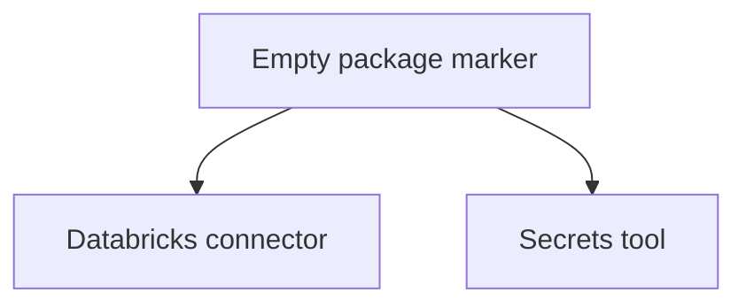

## Purpose

This file marks the folder `scripts/connectors/data/` as a Python package, so the data connectors `databricks.py` and `secrets_tool.py` can be imported as `connectors.data.databricks` and `connectors.data.secrets_tool`. It holds no code.

## Dependencies

**Depends on.** Nothing. The file is empty: 0 bytes (checked with `wc -c`, 2026-11-20), and the read tool reported empty content.

**Used by.** Importing `connectors.data.<module>` loads this package first. Product code: none; searched 2026-11-20 with `git grep` for `connectors.data` and `connectors/data` across the repo except `docs/`, and no product file imports from the package. The two modules in it are run as scripts.
Tests: `tests/scripts/connectors/data/test_databricks.py` (`from connectors.data import databricks as dbx`) and `tests/scripts/connectors/data/test_secrets_tool.py` (`from connectors.data import secrets_tool as st`). The test runner lists `connectors/data` as a test area in `tests/system/run.sh` line 22.

## Behavior

No behavior. There is no line of code to cite: the file has no lines. It sets no `__all__`, defines no name and imports nothing, so importing the package has no side effect.

## Diagram: module level (L2, required)

## Diagram: function level (L3, optional)

None: no function has branching that the signature does not show.

## Notes

- The sibling `scripts/connectors/__init__.py` and `scripts/connectors/comms/__init__.py` are also 0 bytes (checked with `wc -c`, 2026-11-20).
- The two scripts in this folder add the parent `scripts/` folder to `sys.path` themselves and import `connectors.registry` that way {src:scripts/connectors/data/secrets_tool.py:30-31}{src:scripts/connectors/data/databricks.py:32-33}, so they run directly with `python3 path/to/file.py`.
- No input reaches a file path, command, network address or outbound text, and nothing is written.
