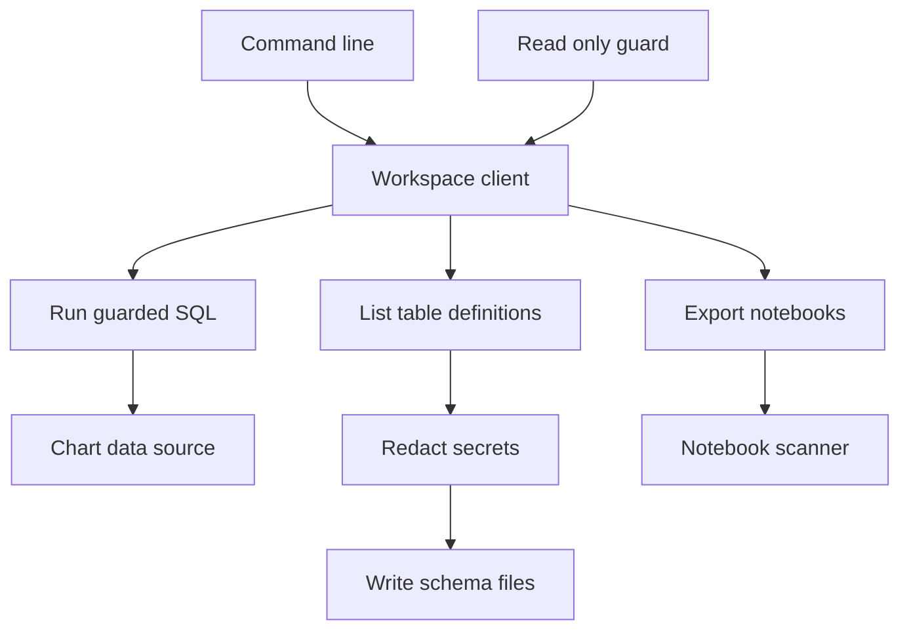
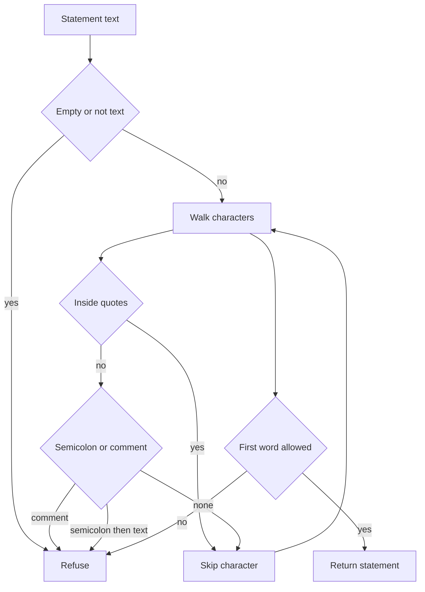

## Purpose

This is the Databricks connector. It lets Tollgate run read only SQL against a Databricks SQL warehouse, export table definitions from Unity Catalog as `.sql` files with any secret in them redacted, and read notebooks from a workspace so the notebook scanner can count sensitive patterns in them. It exists so the chart tool and the notebook scanner can reach a workspace through one guarded client that never writes and never logs row values.

## Dependencies

**Depends on.**
- [[registry]] (no doc yet): `register`, `ensure`, `run_cli`, `NotSetUp` {src:scripts/connectors/data/databricks.py:33}{src:scripts/connectors/data/databricks.py:353}. Source: `scripts/connectors/registry.py`.
- [[data_source]] (no doc yet): `DataSource`, `parse_sort`, `validate_identifier` {src:scripts/connectors/data/databricks.py:34}. Source: `scripts/chart/data_source.py`. `validate_identifier` allows only letters, digits and underscores {src:scripts/chart/data_source.py:19-27}.
- [[scan_notebooks]] (no doc yet): `NotebookSource`, `scan_source` {src:scripts/connectors/data/databricks.py:35}. Source: `scripts/qa/scan_notebooks.py`.
- [[paths]] (no doc yet): `core.paths.get_path`, imported inside `main` for the default export folder {src:scripts/connectors/data/databricks.py:386}. Source: `scripts/core/paths.py`.
- [[comms_common]] with page [comms_common](../comms/comms_common.md): imported as `cc` for `redact_text` and `secrets_line` {src:scripts/connectors/data/databricks.py:36}. It is the only file outside the comms connectors that imports it. Source: `scripts/connectors/comms/comms_common.py`.
- Standard library: `argparse`, `base64`, `json`, `logging`, `pathlib`, `re`, `sys`, `datetime`, `urllib.parse`.
- Run time needs: connector `databricks` on, with an address and a key {src:scripts/connectors/registry.py:395-405}.

**Used by.** Product code: none imports it. Searched 2026-11-20 with `git grep` for `databricks` and `WarehouseSource` across the repo except `docs/`: the chart seam does not use it, because `open_source` accepts only `csv:` and `sqlite:` {src:scripts/chart/data_source.py:167-174}. The command line is run by hand {src:scripts/connectors/data/databricks.py:12-15}. Files that mention the word databricks but not this module: the guard hook `hooks/pre-tool-bash-databricks-ask.py` (which asks before any Databricks command Claude runs; it does not import this file).
Tests: `tests/scripts/connectors/data/test_databricks.py` (imports it as `dbx`, line 31, and registers `dbx._factory`, line 80).

## Behavior

**Query guard.** `check_read_only` accepts exactly one statement whose first word is `SELECT`, `SHOW` or `DESCRIBE` {src:scripts/connectors/data/databricks.py:40}{src:scripts/connectors/data/databricks.py:90-93}. It walks the text and skips quoted parts (single, double, backtick) {src:scripts/connectors/data/databricks.py:69-78}. Outside quotes, a `;` followed by more text is refused, a trailing `;` is cut off, and `--` or `/*` is refused {src:scripts/connectors/data/databricks.py:79-85}. An open quote is refused {src:scripts/connectors/data/databricks.py:87-88}. An empty or non-text statement is refused {src:scripts/connectors/data/databricks.py:63-64}. A statement starting with `WITH` is therefore refused.

**Address.** The client accepts an address that is `https` with a host, or `http` to `127.0.0.1`, `localhost` or `::1`; anything else raises `NotSetUp` {src:scripts/connectors/data/databricks.py:97-104}{src:scripts/connectors/data/databricks.py:45}{src:scripts/connectors/data/databricks.py:113}.

**Host allowlist.** The connector's own address check does not look at the host name beyond https or loopback {src:scripts/connectors/data/databricks.py:97-104}. The host check is in the registry: requests go through a client built for the name `databricks` {src:scripts/connectors/registry.py:405}, which allows `.databricks.com`, `.azuredatabricks.net` and `.gcp.databricks.com` subdomains on port 443 {src:scripts/connectors/registry.py:112-113}, or a host the owner recorded with `--allow-host` {src:scripts/connectors/registry.py:207} {src:scripts/connectors/registry.py:232}. A custom or private workspace host therefore needs `connect.py on databricks --allow-host HOST` run in a terminal after updating {src:scripts/connectors/connect.py:80-82}.

**Calls.** `_call` sends the request through the given `http` object with a Bearer key header {src:scripts/connectors/data/databricks.py:119-126}, raises `DatabricksError` for a returned status of 400 or more {src:scripts/connectors/data/databricks.py:127-129}, parses a text body as JSON or raises `DatabricksError` {src:scripts/connectors/data/databricks.py:130-135}, and returns `{}` for an empty body {src:scripts/connectors/data/databricks.py:136}.

**query.** `query` runs the guard first {src:scripts/connectors/data/databricks.py:146}, then needs a warehouse id or raises `NotSetUp` {src:scripts/connectors/data/databricks.py:147-148}. The row cap is the smaller of the caller's limit and `MAX_ROWS` (500), at least 1 {src:scripts/connectors/data/databricks.py:149}. The POST to `/api/2.0/sql/statements` asks for `row_limit = cap + 1`, a 30 second wait, and cancel on timeout {src:scripts/connectors/data/databricks.py:150-153}{src:scripts/connectors/data/databricks.py:161}. The catalog is added when set {src:scripts/connectors/data/databricks.py:154-155}. Parameters go as bound `STRING` parameters with validated names {src:scripts/connectors/data/databricks.py:156-160}. Anything other than state `SUCCEEDED` raises with only the state in the message {src:scripts/connectors/data/databricks.py:162-164}. Rows are zipped to column names, and `truncated` is true when more than `cap` rows came back or the response says so {src:scripts/connectors/data/databricks.py:165-169}. Only counts are logged {src:scripts/connectors/data/databricks.py:170}.

**WarehouseSource.** `fetch_rows` and `fetch_summary` build `SELECT` text from validated, backtick quoted names and bound `:p0, :p1` id placeholders {src:scripts/connectors/data/databricks.py:220-223}{src:scripts/connectors/data/databricks.py:229-240}{src:scripts/connectors/data/databricks.py:254-257}. Table names may have one to three dot-separated parts {src:scripts/connectors/data/databricks.py:201-205}. An empty id list returns `{}` with no call {src:scripts/connectors/data/databricks.py:227-228}. In `fetch_rows`, a sort variable not in the column map is refused {src:scripts/connectors/data/databricks.py:234-236}, and each id keeps up to `limit + 1` rows so the caller can see a cut {src:scripts/connectors/data/databricks.py:246-247}. The single query is capped at `MAX_ROWS` rows across all ids, and `truncated` is set from it {src:scripts/connectors/data/databricks.py:241}.

**Notebooks.** `export_notebook` calls the workspace export in `JUPYTER` format and decodes the base64 content; a `DatabricksError` or a decoding or JSON error gives `{"_unreadable": True}` {src:scripts/connectors/data/databricks.py:191-196}. `WorkspaceNotebookSource` yields a label (last path segment, cut to 24 characters) and the notebook for each path {src:scripts/connectors/data/databricks.py:271-274}.

**Schema export.** `list_tables` pages through `/api/2.1/unity-catalog/tables` with `page_token` {src:scripts/connectors/data/databricks.py:175-185}. `export_schemas` validates catalog and schema names {src:scripts/connectors/data/databricks.py:325-326}, counts a failed listing as an error and moves on {src:scripts/connectors/data/databricks.py:327-331}, skips tables whose name is not `[A-Za-z0-9_]+` and counts them as errors {src:scripts/connectors/data/databricks.py:337-339}, and writes `<out>/<catalog>/<schema>/<table>.sql` {src:scripts/connectors/data/databricks.py:332-333}{src:scripts/connectors/data/databricks.py:340}. The text that is written is the rendered definition after `cc.redact_text`: each secret in it, whether in a table comment, a column comment or elsewhere in the text, becomes `[REDACTED:LABEL]` in place and is counted by label in an optional `tally` argument {src:scripts/connectors/data/databricks.py:321} {src:scripts/connectors/data/databricks.py:340} {src:scripts/connectors/comms/comms_common.py:73-76}. Redaction runs before `write_if_changed`, so the old and new text are compared in redacted form {src:scripts/connectors/data/databricks.py:340}. This export reads no message text, so there is no privacy filter step before it. `render_ddl` produces comment header lines, then `CREATE TABLE IF NOT EXISTS` with columns sorted by position {src:scripts/connectors/data/databricks.py:290-300}. `write_if_changed` compares the old and new text with the `-- extracted:` date line removed and writes only on a difference {src:scripts/connectors/data/databricks.py:303-312}.

**Command line.** Subcommands: `status` (prints the address, no network call), `check --warehouse ID [--catalog NAME]` (runs `SELECT 1 AS ok`), `schemas --schema CATALOG.SCHEMA ... [--out DIR]` and `scan-notebooks --path P ...` {src:scripts/connectors/data/databricks.py:365-374}{src:scripts/connectors/data/databricks.py:380-398}. The default export folder is the `references` folder plus `schemas` {src:scripts/connectors/data/databricks.py:390}. `schemas` makes a tally, passes it to `export_schemas` and prints `schemas: <written> written, <unchanged> unchanged, <errors> errors, <secrets line>`, for example `1 secret redacted (SLACK_TOKEN 1)` or `0 secrets redacted` {src:scripts/connectors/data/databricks.py:391-394} {src:scripts/connectors/comms/comms_common.py:92-96}. It returns 1 when any error was counted {src:scripts/connectors/data/databricks.py:395}. A `DatabricksError` is printed to stderr and returns 1 {src:scripts/connectors/data/databricks.py:399-401}.

## Diagram: module level (L2, required)

## Diagram: function level (L3, optional)

## Notes

**Code and description disagree.**
- The header says only a single `SELECT`, `SHOW` or `DESCRIBE` "is ever sent" {src:scripts/connectors/data/databricks.py:19}. True for the SQL statement endpoint, since `query` is the only caller that posts a statement {src:scripts/connectors/data/databricks.py:146}{src:scripts/connectors/data/databricks.py:161}. The guard looks at the first word and at quotes, comments and semicolons only; it does not parse the rest of the statement.
- The `_call` code that raises on a status of 400 or more {src:scripts/connectors/data/databricks.py:127-129} is reachable only through an `http` object that returns such a status (the test stub does). The real client `UrlHttp` re-raises an HTTP error instead of returning it, except 3xx which raises `RedirectRefused` {src:scripts/connectors/registry.py:240-246}. With the real client, a 4xx or 5xx therefore ends as an uncaught `urllib.error.HTTPError` or `RedirectRefused`: `main` catches only `DatabricksError` {src:scripts/connectors/data/databricks.py:399}, `run_cli` only `NotSetUp` {src:scripts/connectors/registry.py:433-436}, and `export_notebook` and `export_schemas` catch only `DatabricksError` (and `ValueError`) {src:scripts/connectors/data/databricks.py:195}{src:scripts/connectors/data/databricks.py:329}. So the "unreadable notebook" and the per-schema error count do not cover real HTTP failures.
- The header says the warehouse comes from flags {src:scripts/connectors/data/databricks.py:18}. Only `check` defines `--warehouse`; for the other commands it is `None` {src:scripts/connectors/data/databricks.py:358}, which is fine for `schemas` and `scan-notebooks` because they use REST endpoints, not the SQL warehouse.
- The `Date:` header line is empty {src:scripts/connectors/data/databricks.py:5}.

**Edge cases.**
- The secret count is per label per definition, so two tokens of one kind in one table definition count once {src:scripts/connectors/comms/comms_common.py:74-75}. The count is printed only for the `schemas` command {src:scripts/connectors/data/databricks.py:393-394}.
- `cc.redact_text` raises when the scan rules cannot be loaded {src:scripts/sync/vault_write_scan.py:66}, which would stop `schemas` before any file is written for that table.
- Importing `comms_common` puts `scripts/`, `scripts/cache/` and `scripts/sync/` on `sys.path` for every Databricks command, including `status` and `check` {src:scripts/connectors/data/databricks.py:36} {src:scripts/connectors/comms/comms_common.py:24-26}.
- `WarehouseSource` is not reachable from the chart command: `open_source` does not know it {src:scripts/chart/data_source.py:167-174}.
- `list_tables` loops while the server returns a page token, with no page cap {src:scripts/connectors/data/databricks.py:177-185}.
- `--schema a.b.c` splits to `("a", "b.c")`, passes the length check, and then fails in `validate_identifier` with a `ValueError` that `main` does not catch {src:scripts/connectors/data/databricks.py:387-389}{src:scripts/connectors/data/databricks.py:326}.
- Table names with a hyphen or dot cannot be read through `WarehouseSource`, because each part must match letters, digits and underscores {src:scripts/connectors/data/databricks.py:205}.

**Inputs reaching a path, command, network address or outbound text.**
- SQL: table, column, sort and id column names are validated and quoted {src:scripts/connectors/data/databricks.py:201-209}; id values are bound parameters {src:scripts/connectors/data/databricks.py:222-223}. A statement passed straight to `query` goes through the guard only. That includes `check` (fixed text) and any other caller.
- `--out DIR` is used as the export root with no check on its value {src:scripts/connectors/data/databricks.py:390}. Folder names under it come from validated `catalog` and `schema`, and file names from the checked table name {src:scripts/connectors/data/databricks.py:325-326}{src:scripts/connectors/data/databricks.py:337}.
- Text from the workspace is written into the `.sql` files after secrets are redacted {src:scripts/connectors/data/databricks.py:340}, but it is otherwise unescaped: a table comment goes after `-- comment:` on one line, so a comment with a line break leaves its later lines as plain SQL text {src:scripts/connectors/data/databricks.py:296-297}. Column comments escape only single quotes, not backslashes or line breaks {src:scripts/connectors/data/databricks.py:284-285}. Catalog, schema and table names in `CREATE TABLE` are not quoted {src:scripts/connectors/data/databricks.py:298}.
- `--path` values go to the export URL through `urlencode` {src:scripts/connectors/data/databricks.py:191}; no check on their value.
- The workspace host is checked by the registry on every request, not by this file (see Host allowlist) {src:scripts/connectors/registry.py:232}.
- The key goes only into the `Authorization` header {src:scripts/connectors/data/databricks.py:120}.

**Writes to shared files.** Schema files: `write_text` after a read and compare, not atomic, no lock {src:scripts/connectors/data/databricks.py:309-311}. Two exports into the same folder at once could interleave. No cache or state file is written; logging goes to stderr {src:scripts/connectors/data/databricks.py:377}.

**Tests.** The test file uses a stub `http` object, so it proves the guard, caps, parameter binding and file writing, but cannot show real HTTP error handling (see the second item under Code and description disagree). The guard test lists accepted and refused statements, including `SELECT ';' AS semi` and `WITH ...` (lines 157-168 of the test file).
