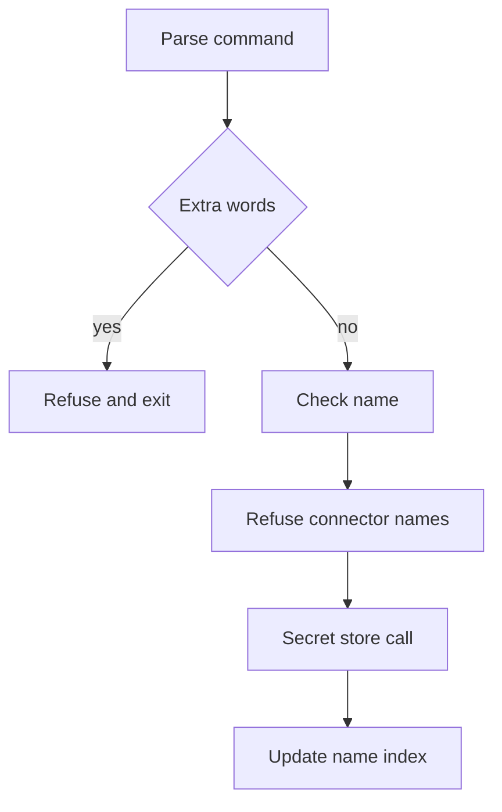

## Purpose

This is a small command for secrets that are not connector keys: it lists, sets, deletes and bulk deletes entries in the user's own secret store (macOS Keychain or Linux `secret-tool`). The user names each secret; the tool never prints a value and never accepts one as a command word. It exists so a person can keep a few other tokens in the same safe place as connector keys without writing them to a file.

## Dependencies

**Depends on.**
- [[registry]] (no doc yet): `registry.get_store`, `registry.load_state`, `registry.interactive` {src:scripts/connectors/data/secrets_tool.py:31}{src:scripts/connectors/data/secrets_tool.py:43}{src:scripts/connectors/data/secrets_tool.py:86}{src:scripts/connectors/data/secrets_tool.py:112}. Source: `scripts/connectors/registry.py`.
- [[secret_store]] (no doc yet): `RefusingStore`, `SecretStoreError` {src:scripts/connectors/data/secrets_tool.py:32}. Source: `scripts/connectors/secret_store.py`.
- [[paths]] (no doc yet): `core.paths.get_path("state")`, imported inside `_index_path` when `TOLLGATE_STATE_DIR` is unset {src:scripts/connectors/data/secrets_tool.py:55-56}. Source: `scripts/core/paths.py`.
- Standard library: `argparse`, `getpass`, `json`, `os`, `pathlib`, `re`, `sys`.
- Environment: `TOLLGATE_STATE_DIR` (optional) {src:scripts/connectors/data/secrets_tool.py:51}; `TOLLGATE_CONNECTORS` through `registry.load_state` {src:scripts/connectors/registry.py:262-268}.

**Used by.** Product code: none imports or runs it. Searched 2026-11-20 with `git grep` for `secrets_tool` across the repo except `docs/`; only the file itself and its tests match. Run by hand {src:scripts/connectors/data/secrets_tool.py:12-15}.
Tests: `tests/scripts/connectors/data/test_secrets_tool.py` (imports it as `st`, line 28, and runs the file as a program through `TOOL`, line 30).

## Behavior

**Store.** Every command first calls `_store()`, which returns the default store and raises `ToolError` with the refusal message when it is a `RefusingStore` {src:scripts/connectors/data/secrets_tool.py:42-46}. The default store is the Keychain on macOS when `security` exists, `secret-tool` on Linux when it exists, and otherwise the refusing store; there is no plain file store {src:scripts/connectors/secret_store.py:156-162}.

**Names.** A secret name must match `^[A-Za-z0-9_.-]{1,64}$` {src:scripts/connectors/data/secrets_tool.py:34}{src:scripts/connectors/data/secrets_tool.py:78-81}. A name that is already an entry in the connectors state file (on or off) is refused with a pointer to `connect.py` {src:scripts/connectors/data/secrets_tool.py:91-93}.

**list.** Prints the names from the index file, or `no secrets set through this tool` {src:scripts/connectors/data/secrets_tool.py:96-103}. It does not ask the store, so it shows only names this tool set and has not removed.

**set.** Reads the value from stdin when `--stdin` is given, otherwise from a hidden prompt when a terminal is present, otherwise raises {src:scripts/connectors/data/secrets_tool.py:110-115}{src:scripts/connectors/data/secrets_tool.py:174}. An empty value raises and nothing is saved {src:scripts/connectors/data/secrets_tool.py:116-117}. The value goes to `store.set` {src:scripts/connectors/data/secrets_tool.py:118}, then the name is added to the index and `<name>: saved` is printed {src:scripts/connectors/data/secrets_tool.py:120-121}. The stores pass the value on stdin of `security -i` or `secret-tool`, never as an argument {src:scripts/connectors/secret_store.py:76-79}{src:scripts/connectors/secret_store.py:105-107}.

**delete.** Deletes the entry from the store and removes the name from the index {src:scripts/connectors/data/secrets_tool.py:129-130}.

**cleanup.** Checks every name and refuses connector names before any change {src:scripts/connectors/data/secrets_tool.py:136-140}. Without `--confirm` it prints the names that would be deleted and returns 1 {src:scripts/connectors/data/secrets_tool.py:141-144}. With it, each is deleted and the index is rewritten {src:scripts/connectors/data/secrets_tool.py:145-148}.

**Extra words.** `parse_known_args` collects words the parser does not know; if there are any, the tool prints a fixed message without echoing them and exits with status 2 {src:scripts/connectors/data/secrets_tool.py:164-169}. So `set NAME VALUE` is refused and the value is not shown.

**Errors.** `ToolError` and `SecretStoreError` are printed to stderr and return 1 {src:scripts/connectors/data/secrets_tool.py:178-180}.

## Diagram: module level (L2, required)

## Diagram: function level (L3, optional)

None: no function has branching that the signature does not show.

## Notes

**Code and description disagree.**
- The header says the tool "never prints a value" {src:scripts/connectors/data/secrets_tool.py:6-7}. The code never prints one on purpose, but argparse itself echoes a first word that is not a command: running the file with a single made-up word prints `invalid choice: '<word>'` (run 2026-11-20 with a dummy word). The extra-words guard {src:scripts/connectors/data/secrets_tool.py:164-169} covers only words after a valid command, so a value typed as the first word is shown on stderr.
- The `Date:` header line is empty {src:scripts/connectors/data/secrets_tool.py:5}.

**Edge cases.**
- `_connector_names` catches every exception and then returns an empty set {src:scripts/connectors/data/secrets_tool.py:84-88}. When `TOLLGATE_CONNECTORS` is unset, `load_state` raises `NotSetUp` {src:scripts/connectors/registry.py:265-267}, so the guard is off and a connector key name can be overwritten or deleted. The guard also covers only names present in the state file, not connector names that are registered but never set up.
- `delete` and `cleanup` act on any entry under the `tollgate-<name>` service, not only on names this tool created {src:scripts/connectors/secret_store.py:20}{src:scripts/connectors/secret_store.py:55-57}.
- If `store.delete` fails part way through `cleanup`, earlier names are already deleted and the index is not rewritten {src:scripts/connectors/data/secrets_tool.py:145-147}. `delete` in the macOS and Linux stores ignores a missing entry {src:scripts/connectors/secret_store.py:92-94}{src:scripts/connectors/secret_store.py:118-120}.
- In `set`, the store call comes before the index update; if the index write fails the secret exists but is not listed {src:scripts/connectors/data/secrets_tool.py:118-120}.
- `value = None` after the store call {src:scripts/connectors/data/secrets_tool.py:119} drops the reference but does not wipe the text from memory.
- The index folder can differ from the state folder used by other code: here the environment variable wins {src:scripts/connectors/data/secrets_tool.py:51-53}, while `get_path` reads an explicit paths file line first {src:scripts/core/paths.py:125-127}.
- `list` exits 0 even when the index is unreadable, because a read error returns an empty list {src:scripts/connectors/data/secrets_tool.py:60-64}.

**Inputs reaching a path, command, network address or outbound text.**
- The secret name is checked by `NAME_RE` before use {src:scripts/connectors/data/secrets_tool.py:78-81}; this also keeps quotes out of the macOS `security -i` command text {src:scripts/connectors/secret_store.py:77-78}. `cmd_set`, `cmd_delete` and `cmd_cleanup` all call `_check_name` first {src:scripts/connectors/data/secrets_tool.py:107}{src:scripts/connectors/data/secrets_tool.py:126}{src:scripts/connectors/data/secrets_tool.py:136-137}.
- The value from stdin or the prompt has no length check {src:scripts/connectors/data/secrets_tool.py:111}{src:scripts/connectors/data/secrets_tool.py:113}. The macOS store refuses values containing a quote, backslash or line break {src:scripts/connectors/secret_store.py:72-75}.
- `TOLLGATE_STATE_DIR` is used as the folder for the index with no check {src:scripts/connectors/data/secrets_tool.py:51-53}.
- Cleanup prints the user's own names back in the preview line {src:scripts/connectors/data/secrets_tool.py:142}; they are checked against `NAME_RE` first.
- No shell command is built by this file.

**Writes to shared files.** The index file `secret-names.json` in the state folder: `write_text` and then `chmod 600`, so it is briefly created with the default permissions, and the read, change, write cycle has no lock; two runs at once can lose a name {src:scripts/connectors/data/secrets_tool.py:68-75}{src:scripts/connectors/data/secrets_tool.py:120}. The index never holds a value {src:scripts/connectors/data/secrets_tool.py:71}.
