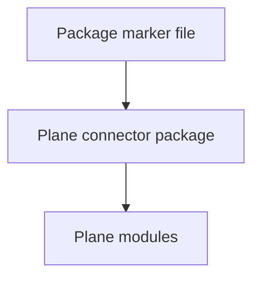

## Purpose

Marks the folder `scripts/connectors/plane/` as a Python package, so the other plane files can be imported as `connectors.plane.<name>`. It holds only a header comment that says what the package is for: Plane ticket cards kept in step with the ticket files in the vault.

## Dependencies

**Depends on.** Nothing. The file has no import statement {src:scripts/connectors/plane/__init__.py:1-8}. Its parent package has its own marker file, `scripts/connectors/__init__.py`.

**Used by.** Python's import system, every time any file imports `connectors.plane.<name>`. Examples: `scripts/connectors/plane/cli.py` {src:scripts/connectors/plane/cli.py:20}, and `scripts/connectors/plane/__main__.py` {src:scripts/connectors/plane/__main__.py:12}. Tests: `tests/scripts/connectors/plane/test_plane_cli.py:20` and others in that folder import from the package. `test_plane_standards.py:21` exempts this file from the type hint check. Searched: `git grep` for `connectors.plane` under the repo except `docs/` (2026-11-20).

## Behavior

None. All eight lines of the file are comments, with no code {src:scripts/connectors/plane/__init__.py:1-8}. Importing `connectors.plane` runs nothing and defines nothing, so none of the connector's modules are loaded until a file imports one by name.

## Diagram: module level (L2, required)

## Diagram: function level (L3, optional)

None: no function has branching that the signature does not show. The file has no function.

## Notes

**Code and its own description.** The header says the scope is "package marker" {src:scripts/connectors/plane/__init__.py:5}, and the file does exactly that. Its description line names the package purpose {src:scripts/connectors/plane/__init__.py:3}; the code in the package covers `create`, `sync` and `drift` {src:scripts/connectors/plane/cli.py:45-47}, which fits it. The header's date field is empty {src:scripts/connectors/plane/__init__.py:4}.

**Inputs reaching a path, command, address or outbound text without a check.** None. The file takes no input.

**Shared file writes.** None.
