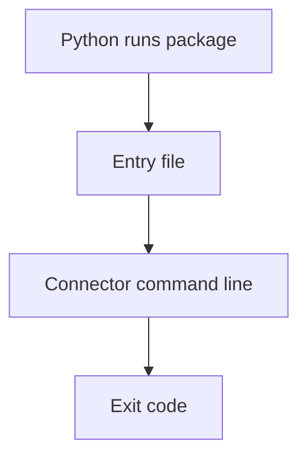

## Purpose

The entry point that lets the plane connector run as a package: `python3 -m connectors.plane sync|drift|create ...`. It passes the command line to the connector's `main` function and exits with the number that `main` returns. It holds no logic of its own.

## Dependencies

**Depends on.**
- Standard library: `sys` {src:scripts/connectors/plane/__main__.py:10}.
- [[cli]] ([cli](cli.md)): `main` {src:scripts/connectors/plane/__main__.py:12}.
- A module path that already holds the `scripts` folder, so that `connectors` can be imported. This file does not add it. It only imports `connectors.plane.cli` {src:scripts/connectors/plane/__main__.py:12}, and its header says the scripts folder must be on the path {src:scripts/connectors/plane/__main__.py:2}. The sibling entry `plane_sync.py` does add the folder itself {src:scripts/connectors/plane/plane_sync.py:14}.

**Used by.**
- Product code: none found. Nothing under the repo imports this file or runs `python3 -m connectors.plane` (searched `git grep` for `connectors.plane`, `-m connectors` and `__main__` under the repo except `docs/`, 2026-11-20). The only mention is its own header comment {src:scripts/connectors/plane/__main__.py:2}.
- Tests: none found that run it. The tests that start the connector as a program use `plane_sync.py` instead {src:tests/scripts/connectors/plane/test_plane_connector.py:95} {src:tests/system/test_e2e.py:181}.

## Behavior

Only when the file is run as the main program, it calls `main` with the command line minus the program name and passes the returned number to `sys.exit` {src:scripts/connectors/plane/__main__.py:14-15}. When the file is imported, it does nothing beyond importing `main` {src:scripts/connectors/plane/__main__.py:12}. What `main` does with the arguments is described in [[cli]] ([cli](cli.md)).

## Diagram: module level (L2, required)

## Diagram: function level (L3, optional)

None: no function has branching that the signature does not show. The file has no function.

## Notes

**Code and its own description.** The header says it is the entry point for `python3 -m connectors.plane` {src:scripts/connectors/plane/__main__.py:2}. The code matches that. The header's date field is empty {src:scripts/connectors/plane/__main__.py:4}.

**Inputs reaching a path, command, address or outbound text without a check.** `sys.argv[1:]` goes whole to `main` {src:scripts/connectors/plane/__main__.py:15}. This file checks nothing; the parsing and checks are in `cli.py`.

**Shared file writes.** None.

**Untested path.** No test found that runs `python3 -m connectors.plane` (see Used by), so this entry is exercised only by hand.
