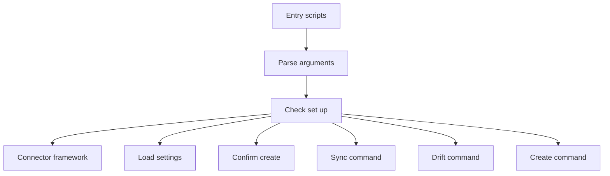
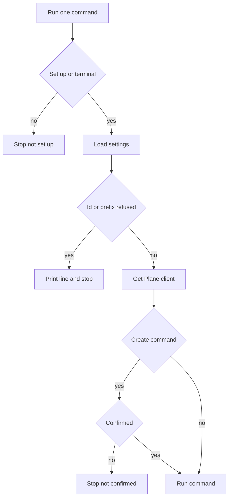

## Purpose

The command line of the plane connector. It reads the arguments for three commands, `create`, `sync` and `drift`, makes sure the connector is set up, asks for a yes before `create` changes anything, hands the work to the module that does it, and turns every failure into a printed line and an exit code. The work itself lives in other modules; this file is the front door.

## Dependencies

**Depends on.**
- Standard library: `argparse`, `os`, `sys`, `datetime`, `pathlib`, `typing` {src:scripts/connectors/plane/cli.py:12-17}.
- The connector framework, `scripts/connectors/registry.py`: register, is_on, interactive, ensure, how_to_set_up {src:scripts/connectors/plane/cli.py:19}. Its first-use flow runs only in a terminal {src:scripts/connectors/registry.py:418-427}.
- [[plane_drift_checker]] ([plane_drift_checker](plane_drift_checker.md)): `run_drift` {src:scripts/connectors/plane/cli.py:20}.
- [[plane_sync_ledger]] (no doc yet): `PlaneSyncLedgerError` {src:scripts/connectors/plane/cli.py:21}.
- [[plane_sync_settings]] (no doc yet): the settings type, the loader and its errors {src:scripts/connectors/plane/cli.py:22-28}.
- [[plane_ticket_syncer]] (no doc yet): `run_sync` and the two extras names {src:scripts/connectors/plane/cli.py:29}.
- [[plane_work_item_client]] (no doc yet): the client and `PlaneApiError` {src:scripts/connectors/plane/cli.py:30}.
- [[vault_ticket_creator]] (no doc yet): `run_create` {src:scripts/connectors/plane/cli.py:31}.
- [[vault_ticket_files]] (no doc yet): `VaultTicketError`, `safe_text`, `skip_line`, `ticket_id_gate` {src:scripts/connectors/plane/cli.py:32}.
- `scripts/connectors/secret_store.py` (`SecretStoreError`) {src:scripts/connectors/plane/cli.py:33} and `scripts/core/paths.py` (`NotSetUp`, `get_path`) {src:scripts/connectors/plane/cli.py:34}.
- Environment: the `env` mapping given to `main`, else the process environment {src:scripts/connectors/plane/cli.py:166}. The registry also reads `TOLLGATE_NONINTERACTIVE` {src:scripts/connectors/registry.py:410}.

**Used by.**
- Product code: `scripts/connectors/plane/__main__.py` imports and calls `main` {src:scripts/connectors/plane/__main__.py:12} {src:scripts/connectors/plane/__main__.py:15}. `scripts/connectors/plane/plane_sync.py` does the same {src:scripts/connectors/plane/plane_sync.py:16} {src:scripts/connectors/plane/plane_sync.py:19}.
- Tests: `tests/scripts/connectors/plane/test_plane_cli.py:20`, `test_plane_connector.py:24`, and the helper `plane_sync_test_support.py:34` (all under `tests/scripts/connectors/plane/`). `test_plane_standards.py:52` reads this file as text.
- Searched: `git grep` for `connectors.plane`, `plane_sync.py` and `cli.` under the repo except `docs/` (2026-11-20).

## Behavior

**Arguments.** One optional `--settings` file, then a required subcommand {src:scripts/connectors/plane/cli.py:78-79}.
- `create` needs `--prefix`, `--title`, `--priority`, `--scope`, `--repo` and `--type` (one of `feature`, `fix`, `research`), and takes an optional `--yes` {src:scripts/connectors/plane/cli.py:80-87} {src:scripts/connectors/plane/cli.py:44}.
- `sync` takes one ticket id, an optional `--extras` (the two names come from the syncer) and an optional `--from-start` {src:scripts/connectors/plane/cli.py:88-91}.
- `drift` takes one or more ticket ids {src:scripts/connectors/plane/cli.py:92-93}.
- There is no command line flag for plain-http addresses; that switch is only a keyword argument of `main` that defaults to off {src:scripts/connectors/plane/cli.py:185}.

**Run order (`_run`).**
1. If the connector is not turned on and there is no terminal, it raises the "not set up" message {src:scripts/connectors/plane/cli.py:162-163}.
2. It loads settings, from the settings given to `main`, else from `--settings`, else from the default place next to the paths file {src:scripts/connectors/plane/cli.py:164-166}.
3. It checks for answers that need no card call (below) {src:scripts/connectors/plane/cli.py:167-169}. This happens before the client is built, so a bad id or an unmapped prefix never starts first-time setup and never reaches Plane.
4. It stores the settings and the plain-http switch in a module-level dictionary, then asks the framework for the client {src:scripts/connectors/plane/cli.py:170-171}. In a terminal, a connector that is not yet set up goes through first-use setup there {src:scripts/connectors/registry.py:422-427}.
5. For `create`, it asks for confirmation and stops with code 2 if it is not given {src:scripts/connectors/plane/cli.py:172-173}.
6. It runs the command {src:scripts/connectors/plane/cli.py:174}.

**Answers that need no card call (`_tokenless_outcome`).** `create` with a prefix not in the settings prints the skip line and returns 2 {src:scripts/connectors/plane/cli.py:101-103}. For `sync` and `drift`, each id goes through the id gate {src:scripts/connectors/plane/cli.py:104-105}. If every id is stopped by the gate, the lines are printed and the highest code returned {src:scripts/connectors/plane/cli.py:108-110}. If at least one id passes, the run goes on and `drift` handles the others itself {src:scripts/connectors/plane/cli.py:106-107}. A malformed id gives code 2, and an unmapped prefix gives code 0 {src:scripts/connectors/plane/vault_ticket_files.py:72-75}.

**Confirmation for `create` (`_confirmed`).** `--yes` passes at once {src:scripts/connectors/plane/cli.py:118-119}. With no terminal and no `--yes`, it prints a stopped line and says no {src:scripts/connectors/plane/cli.py:120-122}. In a terminal, it asks a question that names the title (cleaned by `safe_text`) and the project key, and accepts only `y` or `yes`, in any case {src:scripts/connectors/plane/cli.py:123-126} {src:scripts/connectors/plane/cli.py:48}. Anything else prints "create was not confirmed" and says no {src:scripts/connectors/plane/cli.py:128-129}. The question does not show the priority, scope or repo values.

**Where files live (`_roots`).** The tickets folder is the `tickets` path unless a test passes one, and the state folder is the `state` path plus `plane` {src:scripts/connectors/plane/cli.py:133-135} {src:scripts/connectors/plane/cli.py:41-43}.

**Dispatch (`_dispatch`).** `sync` calls `run_sync` with the ticket id, the extras choice and the from-start flag {src:scripts/connectors/plane/cli.py:143-147}. `drift` calls `run_drift` {src:scripts/connectors/plane/cli.py:148-149}. Anything else is `create`, which calls `run_create` with today's date added {src:scripts/connectors/plane/cli.py:150-154}.

**Client factory.** At import time the module registers `_build_client` under the name `plane` {src:scripts/connectors/plane/cli.py:73}. The factory builds the client from the address and key the framework passes, plus the settings stored by the current run {src:scripts/connectors/plane/cli.py:60-70}, and raises a settings error if none were stored {src:scripts/connectors/plane/cli.py:61-62}.

**Exit codes and errors (`main`).**
- A bad command line ends in `SystemExit` inside `argparse`; `main` returns its code, or 0 when the code is not a number {src:scripts/connectors/plane/cli.py:189-192}.
- Not set up, or a secret store error: message to standard error, code 2 {src:scripts/connectors/plane/cli.py:195-197}.
- Plane API error: `stopped | ...`, code 3 {src:scripts/connectors/plane/cli.py:198-200} {src:scripts/connectors/plane/cli.py:40}.
- Ledger error: `stopped | ...`, code 2 {src:scripts/connectors/plane/cli.py:201-203}.
- Address error, settings error or vault ticket error: `stopped | ...`, code 1 {src:scripts/connectors/plane/cli.py:204-212} {src:scripts/connectors/plane/cli.py:37}.
- The ledger code and the stopped code are both 2 {src:scripts/connectors/plane/cli.py:38-39}, so a caller cannot tell them apart by the code alone.

## Diagram: module level (L2, required)

## Diagram: function level (L3, optional)

## Notes

**Code and its own description.**
- The scope line says "one emit function writes every output line" {src:scripts/connectors/plane/cli.py:5}. Not quite. `emit` writes the normal lines {src:scripts/connectors/plane/cli.py:53-55}, but the "not set up" and secret store messages go straight to standard error {src:scripts/connectors/plane/cli.py:196}, and the confirmation question is shown by `input` {src:scripts/connectors/plane/cli.py:125-126}. Argparse prints its own usage messages too.
- The description says first use goes through the framework {src:scripts/connectors/plane/cli.py:2}. True, but only in a terminal; without one the framework re-raises {src:scripts/connectors/registry.py:423-424}.
- The `main` docstring says the keyword arguments exist for tests {src:scripts/connectors/plane/cli.py:188}. That matches how the tests call it {src:tests/scripts/connectors/plane/test_plane_cli.py:123}.

**Module state.** The settings and the plain-http switch live in a module-level dictionary {src:scripts/connectors/plane/cli.py:50}, which each run overwrites {src:scripts/connectors/plane/cli.py:170}. The factory reads it later {src:scripts/connectors/plane/cli.py:60}. Two runs in one process (as in tests) share it, and the last one wins.

**Constants.** There are 13 ALL_CAPS constants {src:scripts/connectors/plane/cli.py:36-48}. No other file reads one of them by attribute (searched `cli.` under `scripts/` and `tests/`, 2026-11-20), so none are listed in the frontmatter.

**Not caught.** Errors other than the ones listed under exit codes, for example a bad settings file that raises something outside those classes, or `EOFError` from `input`, end in a Python traceback {src:scripts/connectors/plane/cli.py:195-212}.

**Inputs reaching a path, command, address or outbound text without a check in this file.**
- `--settings` goes to `Path(...)` and then `load_settings` as given {src:scripts/connectors/plane/cli.py:165-166}. No check on the path here.
- `--title`, `--priority`, `--scope` and `--repo` go straight to `run_create` {src:scripts/connectors/plane/cli.py:150-153}. This file checks none of them (`--type` is limited to three values {src:scripts/connectors/plane/cli.py:86}). `vault_ticket_creator.py` scans the title for secret patterns {src:scripts/connectors/plane/vault_ticket_creator.py:153}; I did not read the rest of that file, so checks on the other three are not described here.
- Ticket ids are checked by the gate before any use {src:scripts/connectors/plane/cli.py:105}, so only letters, a hyphen and digits go on.
- The Plane address is not handled here. It comes from the framework state and is checked in the client, where the plain-http switch matters {src:scripts/connectors/plane/cli.py:65}.
- Error text from Plane is printed as received {src:scripts/connectors/plane/cli.py:199}. Whether the error class cleans it is not checked here.

**Shared file writes.** This file writes no file. It prints to standard output and standard error only. Writes to the ledger and to the vault happen in the syncer and creator, which this page does not cover.
