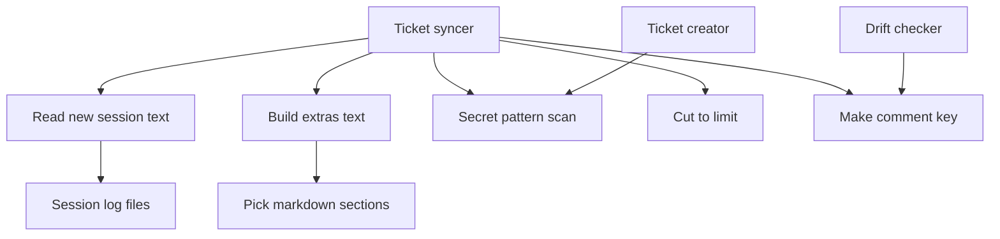

## Purpose

A set of small text helpers for the plane connector. They cut pieces out of vault ticket files (new session text, spec sections, a design diagram, validation text), check text against secret patterns, cut text to a length limit, and make the short hash that the connector uses as a comment key and as a file fingerprint. The module exists so the syncer and the ticket creator share one copy of this text work.

## Dependencies

**Depends on.**
- Standard library: `hashlib`, `re`, `pathlib`, `typing` {src:scripts/connectors/plane/plane_comment_builder.py:12-15}.
- [[plane_markdown]] ([plane_markdown](plane_markdown.md)): imported as `markdown_to_html` {src:scripts/connectors/plane/plane_comment_builder.py:17}. This file never calls it (see Notes).
- [[vault_ticket_files]] (no doc yet): `session_log_files` {src:scripts/connectors/plane/plane_comment_builder.py:18}.

**Used by.**
- Product code: `scripts/connectors/plane/plane_ticket_syncer.py` imports eight names from here {src:scripts/connectors/plane/plane_ticket_syncer.py:16-24}. It uses `find_secret_pattern` {src:scripts/connectors/plane/plane_ticket_syncer.py:106}, `extract_markdown_section` {src:scripts/connectors/plane/plane_ticket_syncer.py:122}, `build_dev_extras` and `build_spec_extras` {src:scripts/connectors/plane/plane_ticket_syncer.py:190} {src:scripts/connectors/plane/plane_ticket_syncer.py:192}, `cut_to_limit` {src:scripts/connectors/plane/plane_ticket_syncer.py:202}, `read_new_session_text` {src:scripts/connectors/plane/plane_ticket_syncer.py:240}, and `comment_key` {src:scripts/connectors/plane/plane_ticket_syncer.py:323}.
- Product code: `scripts/connectors/plane/vault_ticket_creator.py` uses `find_secret_pattern` on a new ticket title {src:scripts/connectors/plane/vault_ticket_creator.py:15} {src:scripts/connectors/plane/vault_ticket_creator.py:153}.
- Product code: `scripts/connectors/plane/plane_drift_checker.py` uses `comment_key` {src:scripts/connectors/plane/plane_drift_checker.py:16} {src:scripts/connectors/plane/plane_drift_checker.py:42}.
- Tests: `tests/scripts/connectors/plane/test_plane_comment_builder.py:15`, `test_plane_sync.py:17`, `test_plane_fixes.py:24`, `test_plane_secret_shapes.py:14` (all under `tests/scripts/connectors/plane/`).
- Searched: `git grep` for `plane_comment_builder` and each exported name under the repo except `docs/` (2026-11-20).

## Behavior

**`find_secret_pattern(text, patterns)`.** Walks the name-to-regex mapping in its order, runs `re.search` for each, and returns the name of the first one that matches, else `None` {src:scripts/connectors/plane/plane_comment_builder.py:33-36}. It returns the pattern name, not the matched text.

**`cut_to_limit(text, limit, pointer_line)`.** Returns the text unchanged when its length is at most the limit {src:scripts/connectors/plane/plane_comment_builder.py:41-42}. Otherwise it keeps the first `limit - len(pointer_line) - 1` characters (never below zero), then a newline, then the pointer line {src:scripts/connectors/plane/plane_comment_builder.py:43-44}.

**`read_new_session_text(folder, ticket_id, offsets)`.** For each session log file of the ticket {src:scripts/connectors/plane/plane_comment_builder.py:53}, reads the whole file as UTF-8 {src:scripts/connectors/plane/plane_comment_builder.py:54} and records the file length in characters as the new offset, keyed by file name {src:scripts/connectors/plane/plane_comment_builder.py:55}. The new text is everything after the old offset (zero for a file not seen before) {src:scripts/connectors/plane/plane_comment_builder.py:56}. A file whose new text is blank adds nothing to the text, but its offset is still recorded {src:scripts/connectors/plane/plane_comment_builder.py:57-58}. Each non-blank piece is headed `### <file name>`, and the pieces are joined with a blank line {src:scripts/connectors/plane/plane_comment_builder.py:58-59}. The files are the sorted matches of `<ticket id><infix>*.md` in the ticket folder {src:scripts/connectors/plane/vault_ticket_files.py:262-265}, and an absent folder gives no files {src:scripts/connectors/plane/vault_ticket_files.py:263-264}.

**`extract_markdown_section(text, heading)`.** Starts collecting at the line that equals `## <heading>` after trailing spaces are removed {src:scripts/connectors/plane/plane_comment_builder.py:69-70}. It stops before the next line that starts with `## ` {src:scripts/connectors/plane/plane_comment_builder.py:67-68}. A `### ` sub-heading does not stop it, because the third character is `#` and not a space. It returns the collected lines with surrounding newlines trimmed, or an empty string when the heading is absent {src:scripts/connectors/plane/plane_comment_builder.py:73}. The match is exact and case-sensitive.

**`extract_first_mermaid_block(text, after_heading)`.** Finds the first line equal to `## <heading>` or `### <heading>` {src:scripts/connectors/plane/plane_comment_builder.py:76-81}. After it, the first line whose stripped text is a mermaid fence opener begins the block {src:scripts/connectors/plane/plane_comment_builder.py:92-93}. Lines are added until a line whose stripped text is a bare closing fence, and the block is returned with both fence lines {src:scripts/connectors/plane/plane_comment_builder.py:94-97}. No heading means an empty string {src:scripts/connectors/plane/plane_comment_builder.py:88-89}, and a block that never closes also gives an empty string {src:scripts/connectors/plane/plane_comment_builder.py:98}. The search does not stop at the next heading, so a diagram in a later section is taken if there is none under the named heading {src:scripts/connectors/plane/plane_comment_builder.py:91-98}.

**`build_spec_extras(spec_text, design_text)`.** For each of the two spec sections (`Requirements`, `Acceptance Criteria`) it adds the section text, or a placeholder line naming the missing section {src:scripts/connectors/plane/plane_comment_builder.py:26} {src:scripts/connectors/plane/plane_comment_builder.py:104-106}. It then adds the first diagram under `Implementation Plan` in the design, headed `### Final diagram`, or a placeholder line when there is none {src:scripts/connectors/plane/plane_comment_builder.py:107-111}. The parts are joined with blank lines {src:scripts/connectors/plane/plane_comment_builder.py:112}.

**`build_dev_extras(validation_text)`.** When the first line is a `---` fence, it returns everything after the next `---` line, trimmed of surrounding newlines {src:scripts/connectors/plane/plane_comment_builder.py:118-121}. With no fence, or with an opening fence that is never closed, it returns the whole text trimmed of surrounding newlines, opening fence included {src:scripts/connectors/plane/plane_comment_builder.py:122}.

**`comment_key(text)`.** Returns the first 12 hex characters of the SHA-256 of the UTF-8 text {src:scripts/connectors/plane/plane_comment_builder.py:127}, where 12 is the constant {src:scripts/connectors/plane/plane_comment_builder.py:20}. The syncer uses it as a fingerprint of the state file {src:scripts/connectors/plane/plane_ticket_syncer.py:323} and as the external id of a comment {src:scripts/connectors/plane/plane_ticket_syncer.py:231}. The drift checker compares it with the `state-sha:` text on the card {src:scripts/connectors/plane/plane_drift_checker.py:42-43}.

## Diagram: module level (L2, required)

## Diagram: function level (L3, optional)

None: no function has branching that the signature does not show. The loop in `extract_first_mermaid_block` is the closest, and its steps are listed in Behavior.

## Notes

**Code and its own description.**
- The header says the module does "markdown to HTML" {src:scripts/connectors/plane/plane_comment_builder.py:2}. It does not. `markdown_to_html` is imported {src:scripts/connectors/plane/plane_comment_builder.py:17} and appears nowhere else in the file. The import works as a re-export: the syncer and one test take `markdown_to_html` from this module {src:scripts/connectors/plane/plane_ticket_syncer.py:23} {src:tests/scripts/connectors/plane/test_plane_fixes.py:24}.
- The scope line says the module "reads vault files, writes nothing" {src:scripts/connectors/plane/plane_comment_builder.py:5}. Only `read_new_session_text` reads a file {src:scripts/connectors/plane/plane_comment_builder.py:54}; every other function takes text. It writes nothing.
- `cut_to_limit` says it returns text that fits, but when the pointer line is longer than the limit the result is the newline plus the pointer, which is longer than the limit {src:scripts/connectors/plane/plane_comment_builder.py:43-44}. Worked out from the code, not run.

**Limits worth knowing.**
- `cut_to_limit` cuts by character count, so it can cut inside a code fence or a link and leave the markdown unbalanced {src:scripts/connectors/plane/plane_comment_builder.py:44}.
- `extract_markdown_section` has no knowledge of code fences, so a `## ` line inside a fenced block ends the section {src:scripts/connectors/plane/plane_comment_builder.py:67-68}.
- Offsets are character counts of the whole file {src:scripts/connectors/plane/plane_comment_builder.py:55}. If an earlier part of a log file is edited, the change is not seen, and if the file gets shorter than its offset, the new text is empty {src:scripts/connectors/plane/plane_comment_builder.py:56}.
- `comment_key` keeps only 48 bits of the hash {src:scripts/connectors/plane/plane_comment_builder.py:127}. That is enough as a fingerprint but is not a collision-proof id.

**Inputs reaching a path, command, address or outbound text without a check.**
- `ticket_id` reaches a file glob pattern in `session_log_files` {src:scripts/connectors/plane/vault_ticket_files.py:265}. This module does not check it. The CLI checks the id shape (letters, a hyphen, digits) before any call {src:scripts/connectors/plane/cli.py:104-110}.
- The regex strings in `patterns` go straight into `re.search` {src:scripts/connectors/plane/plane_comment_builder.py:34}. An invalid regex raises `re.error` here and nothing catches it in this file. A pattern that backtracks badly would run slowly. The patterns come from settings {src:scripts/connectors/plane/plane_ticket_syncer.py:106}.
- `read_text` can raise on an unreadable file or on bytes that are not UTF-8, and nothing in this file catches that {src:scripts/connectors/plane/plane_comment_builder.py:54}.
- The text this module builds is later sent to Plane. The module does not scan it; the callers scan it with `find_secret_pattern` before sending {src:scripts/connectors/plane/plane_ticket_syncer.py:251}.

**Shared file writes.** None. The module opens no file for writing.
