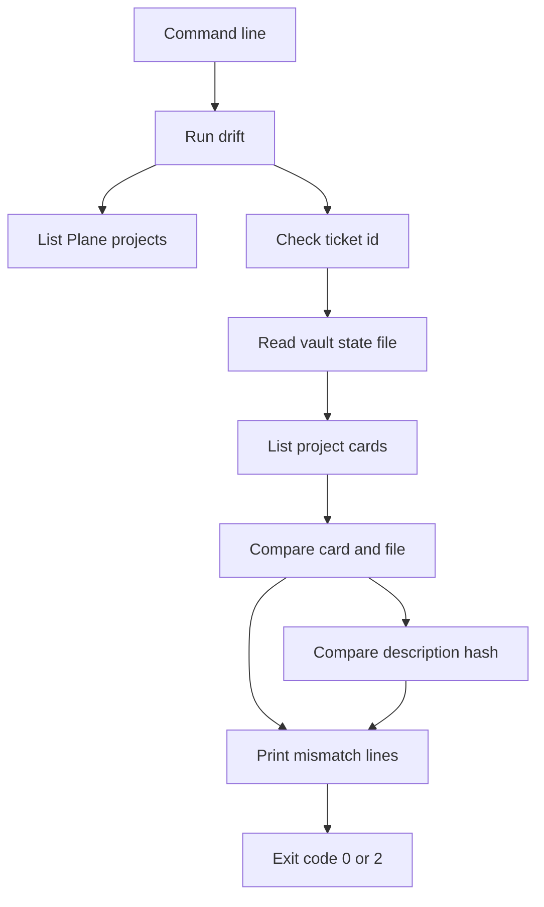

## Purpose

The `drift` command of the plane connector. For each ticket id it compares the Plane card with the ticket's state file in the vault and prints one line per mismatch, so a person can see where the card and the file have come apart. It only reads from Plane and from the vault.

## Dependencies

**Depends on.**
- Standard library: `re`, `pathlib`, `typing` {src:scripts/connectors/plane/plane_drift_checker.py:12-14}.
- [[plane_comment_builder]] ([plane_comment_builder](plane_comment_builder.md)): `comment_key`, the 12-character fingerprint {src:scripts/connectors/plane/plane_drift_checker.py:16}.
- [[plane_sync_settings]] (no doc yet): the settings type, and its prefix table {src:scripts/connectors/plane/plane_drift_checker.py:17} {src:scripts/connectors/plane/plane_drift_checker.py:76}.
- [[plane_work_item_client]] (no doc yet): the Plane client and the card record type {src:scripts/connectors/plane/plane_drift_checker.py:18}.
- [[vault_ticket_files]] (no doc yet): state file reading, id parsing and the id gate {src:scripts/connectors/plane/plane_drift_checker.py:19-26}.
- A live Plane server, through the client: `list_projects` {src:scripts/connectors/plane/plane_drift_checker.py:99}, `list_work_items` {src:scripts/connectors/plane/plane_drift_checker.py:83}, `get_work_item` {src:scripts/connectors/plane/plane_drift_checker.py:37}. Each of these sends a GET {src:scripts/connectors/plane/plane_work_item_client.py:191-195} {src:scripts/connectors/plane/plane_work_item_client.py:212-215} {src:scripts/connectors/plane/plane_work_item_client.py:217-219}.

**Used by.**
- Product code: `scripts/connectors/plane/cli.py` imports `run_drift` {src:scripts/connectors/plane/cli.py:20} and calls it for the `drift` command {src:scripts/connectors/plane/cli.py:149}.
- Tests: `tests/scripts/connectors/plane/test_plane_drift.py:14` and `tests/scripts/connectors/plane/test_plane_fixes.py:25`.
- Searched: `git grep` for `plane_drift_checker` and `run_drift` under the repo except `docs/` (2026-11-20).

## Behavior

**`run_drift`.** Builds a map from project key to project id from one `list_projects` call {src:scripts/connectors/plane/plane_drift_checker.py:99}, keeps an empty cache of cards per project {src:scripts/connectors/plane/plane_drift_checker.py:100}, and checks every ticket id in turn {src:scripts/connectors/plane/plane_drift_checker.py:101-104}. It returns 2 when any ticket printed a mismatch line and 0 otherwise {src:scripts/connectors/plane/plane_drift_checker.py:105} {src:scripts/connectors/plane/plane_drift_checker.py:28-29}.

**Per ticket (`_drift_one`).**
1. The id goes through the id gate first {src:scripts/connectors/plane/plane_drift_checker.py:71}. When the gate has something to say, that line is printed and the ticket is done {src:scripts/connectors/plane/plane_drift_checker.py:72-73}. A malformed id counts as one mismatch. An id whose prefix has no Plane project is only a `skip` line and counts as none {src:scripts/connectors/plane/plane_drift_checker.py:74}, because the gate returns exit code 0 for it {src:scripts/connectors/plane/vault_ticket_files.py:74-75}.
2. The state file is read from the ticket folder {src:scripts/connectors/plane/plane_drift_checker.py:77}.
3. If the project key has no project in Plane, it prints `missing_card` and counts one {src:scripts/connectors/plane/plane_drift_checker.py:78-81}.
4. Otherwise it lists that project's cards once and reuses the list for later tickets of the same project {src:scripts/connectors/plane/plane_drift_checker.py:82-83}, prints each line found {src:scripts/connectors/plane/plane_drift_checker.py:85-86}, and returns how many {src:scripts/connectors/plane/plane_drift_checker.py:87}.

**What counts as a mismatch (`_card_lines`).** The card is the first one whose external id equals the ticket id {src:scripts/connectors/plane/plane_drift_checker.py:52}. These lines can come out:
- `missing_card`: no card has that external id {src:scripts/connectors/plane/plane_drift_checker.py:53-54}.
- `wrong_number`: the card's number differs from the number in the ticket id {src:scripts/connectors/plane/plane_drift_checker.py:56-57}.
- `wrong_name`: the card name differs from the state file title, by exact comparison {src:scripts/connectors/plane/plane_drift_checker.py:58-59}.
- `description_unreadable` or `wrong_description`, from the next check {src:scripts/connectors/plane/plane_drift_checker.py:60-62}.

**Description check (`_description_line`).** It reads the card again with `get_work_item`, one extra call per ticket {src:scripts/connectors/plane/plane_drift_checker.py:37}. If the read gives no description, it reports `description_unreadable` {src:scripts/connectors/plane/plane_drift_checker.py:38-39}. Otherwise it finds every `state-sha: ` followed by 12 hex characters {src:scripts/connectors/plane/plane_drift_checker.py:30}, takes the last one, or `none` when there is no such text {src:scripts/connectors/plane/plane_drift_checker.py:40-41}. It compares that with `comment_key` of the raw state file text and reports `wrong_description` with both values when they differ {src:scripts/connectors/plane/plane_drift_checker.py:42-44}. The syncer writes the same marker when it makes the description {src:scripts/connectors/plane/plane_ticket_syncer.py:41} {src:scripts/connectors/plane/plane_ticket_syncer.py:109}, and builds its fingerprint from the raw state text the same way {src:scripts/connectors/plane/plane_ticket_syncer.py:323}.

## Diagram: module level (L2, required)

## Diagram: function level (L3, optional)

None: no function has branching that the signature does not show. The ordered checks of one ticket are listed under Behavior.

## Notes

**Code and its own description.** The header says the command is "read only, sends no write call" {src:scripts/connectors/plane/plane_drift_checker.py:5}. That holds: the only client calls are the three GET methods named above, and the file opens nothing for writing. It also says it "prints each mismatch" {src:scripts/connectors/plane/plane_drift_checker.py:3}, which holds except that a missing or unreadable state file stops the whole run (next item). The `run_drift` docstring "Returns 0 when none, else 2" matches the code {src:scripts/connectors/plane/plane_drift_checker.py:98} {src:scripts/connectors/plane/plane_drift_checker.py:105}. No disagreement found beyond the points here.

**One bad state file stops the run.** `read_state_file` raises `VaultTicketError` when the file cannot be read {src:scripts/connectors/plane/vault_ticket_files.py:189-190}. Nothing in this module catches it {src:scripts/connectors/plane/plane_drift_checker.py:77}, so the remaining tickets are not checked. The CLI turns it into one `stopped` line and exit code 1 {src:scripts/connectors/plane/cli.py:210-212}. Mismatch lines already printed stay on screen.

**Duplicate cards.** If two cards carry the same external id, only the first is compared {src:scripts/connectors/plane/plane_drift_checker.py:52}.

**Inputs reaching a path, command, address or outbound text without a check.**
- `ticket_id` reaches a file path through `ticket_folder` {src:scripts/connectors/plane/plane_drift_checker.py:77}. It is checked first by the gate, which accepts only letters, a hyphen and digits {src:scripts/connectors/plane/vault_ticket_files.py:27} {src:scripts/connectors/plane/vault_ticket_files.py:54}, so no path separator can pass.
- The ticket title from the vault file is printed as it is, with no control character removal {src:scripts/connectors/plane/plane_drift_checker.py:59}. The card name beside it is cleaned with `safe_text`, and the title is not. The parser keeps the title as read, and a quoted title is decoded with `json.loads`, so an escape such as `\u001b` becomes a real control character {src:scripts/connectors/plane/vault_ticket_files.py:129-130} {src:scripts/connectors/plane/vault_ticket_files.py:177}. Such a title would reach the terminal.
- The state file text is read from a vault path, and the card text comes from Plane. Neither is sent anywhere. The only outbound text is the lines printed through `emit`.
- There is no network address in this file. The address belongs to the client built elsewhere.

**Shared file writes.** None. The module writes no file and sends no write call to Plane.
