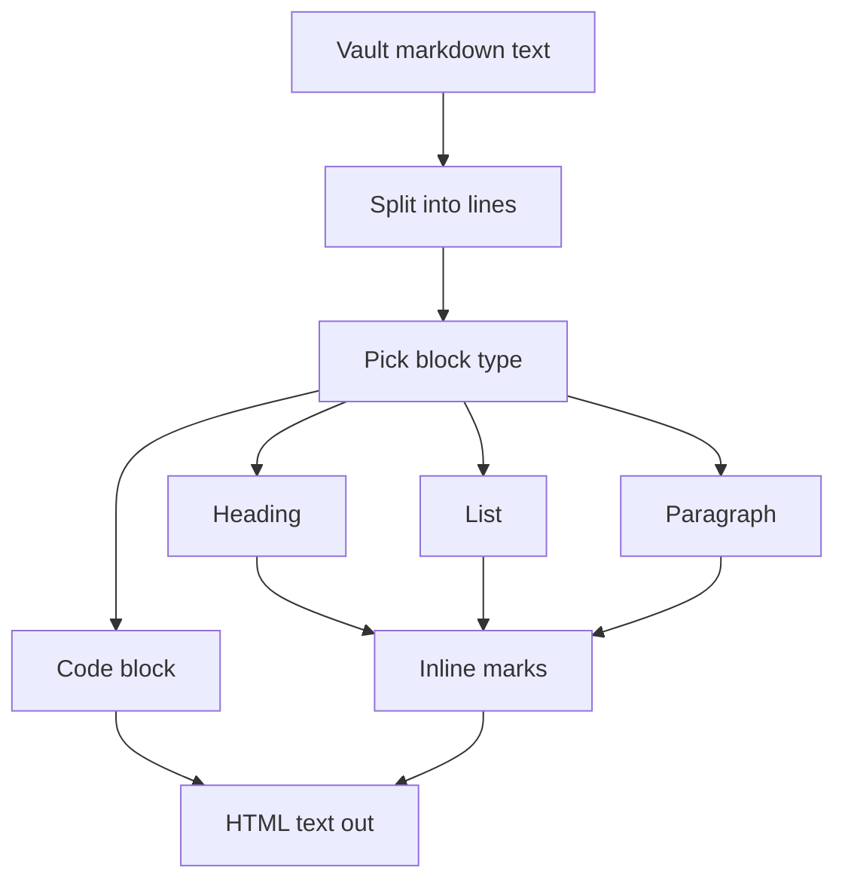

## Purpose

A small markdown to HTML converter with no outside library. The plane connector uses it to turn vault ticket text into the HTML that a Plane card description or comment holds. It supports only a short list of markdown features, and it is written so that raw HTML in the vault text is shown as text instead of being passed on.

## Dependencies

**Depends on.** Standard library `re` only {src:scripts/connectors/plane/plane_markdown.py:12}. No other file in the repo and no environment variable.

**Used by.**
- Product code: `scripts/connectors/plane/plane_comment_builder.py` ([[plane_comment_builder]], [plane_comment_builder](plane_comment_builder.md)) imports `markdown_to_html` {src:scripts/connectors/plane/plane_comment_builder.py:17}. `scripts/connectors/plane/plane_ticket_syncer.py` ([[plane_ticket_syncer]], [plane_ticket_syncer](plane_ticket_syncer.md)) gets `markdown_to_html` by importing it from the comment builder (a re-export, since the name is imported there but not otherwise used) {src:scripts/connectors/plane/plane_ticket_syncer.py:23}. It calls it to make a card description {src:scripts/connectors/plane/plane_ticket_syncer.py:109}, a status comment {src:scripts/connectors/plane/plane_ticket_syncer.py:132}, and the session and extras comment {src:scripts/connectors/plane/plane_ticket_syncer.py:218}.
- Tests: `tests/scripts/connectors/plane/test_plane_markdown.py` ([[test_plane_markdown]], [test_plane_markdown](../../../tests/scripts/connectors/plane/test_plane_markdown.md)) imports it {src:tests/scripts/connectors/plane/test_plane_markdown.py:13}; `tests/scripts/connectors/plane/test_plane_fixes.py` imports it through the comment builder {src:tests/scripts/connectors/plane/test_plane_fixes.py:24}.
- Searched: `git grep` for `plane_markdown` and `markdown_to_html` under the repo except `docs/` (2026-11-20).

## Behavior

**Entry point.** `markdown_to_html` splits the text into lines and walks them one block at a time {src:scripts/connectors/plane/plane_markdown.py:106-129}. Each pass takes the first rule that fits: a blank line is skipped {src:scripts/connectors/plane/plane_markdown.py:112-113}, a fence opener starts a code block {src:scripts/connectors/plane/plane_markdown.py:114-116}, a heading line becomes `<h1>` to `<h6>` by its count of `#` {src:scripts/connectors/plane/plane_markdown.py:117-120}, a bullet line starts an unordered list {src:scripts/connectors/plane/plane_markdown.py:121-123}, a numbered line starts an ordered list {src:scripts/connectors/plane/plane_markdown.py:124-126}, and anything else becomes a paragraph {src:scripts/connectors/plane/plane_markdown.py:127-129}. The result is the blocks joined by newlines with one trailing newline, or an empty string when there are no blocks {src:scripts/connectors/plane/plane_markdown.py:130}.

**Escaping.** `escape` replaces `&`, `<`, `>` and the double quote with entities {src:scripts/connectors/plane/plane_markdown.py:28-29}. Every inline line is escaped before any mark is applied {src:scripts/connectors/plane/plane_markdown.py:47}, and code block bodies and the code block language are escaped too {src:scripts/connectors/plane/plane_markdown.py:57-58}. So `` comes out as text. I confirmed this by running the function on that input (the run shows `&lt;img ...&gt;`).

**Inline marks.** `_inline` first swaps each backtick code span for a placeholder so the other marks cannot touch its content {src:scripts/connectors/plane/plane_markdown.py:43-47}. It then applies links {src:scripts/connectors/plane/plane_markdown.py:48}, bold {src:scripts/connectors/plane/plane_markdown.py:49} and italics {src:scripts/connectors/plane/plane_markdown.py:50}, and puts the code spans back {src:scripts/connectors/plane/plane_markdown.py:51-52}.

**Links.** A link becomes an anchor only when its target starts with `http://`, `https://` or `mailto:`, compared without regard to case {src:scripts/connectors/plane/plane_markdown.py:22} {src:scripts/connectors/plane/plane_markdown.py:34}. Any other target (for example `javascript:`) leaves the original text unchanged, so no anchor is made {src:scripts/connectors/plane/plane_markdown.py:35}. An image mark `` is not special: the `!` stays as text and the rest becomes an ordinary anchor, so no `img` tag is ever written {src:scripts/connectors/plane/plane_markdown.py:21}.

**Code blocks.** A fence opens with three or more backticks or tildes plus an optional language word {src:scripts/connectors/plane/plane_markdown.py:14}. It closes on a later line made only of that same character, at least as long as the opener {src:scripts/connectors/plane/plane_markdown.py:87}. A fence that never closes runs to the end of the text {src:scripts/connectors/plane/plane_markdown.py:85-92}.

**Lists.** Consecutive lines that match the bullet pattern (`-`, `*` or `+`) or the numbered pattern (`1.` or `1)`) are gathered into one list {src:scripts/connectors/plane/plane_markdown.py:69-72}. Both patterns allow leading spaces and then drop them {src:scripts/connectors/plane/plane_markdown.py:16-17}, so an indented sub-item becomes a sibling item and nesting is lost. I confirmed this by running `- a` then `  - b`, which gave two items in one list.

**Paragraphs.** Lines are stripped and joined with a newline inside one `
`, stopping at a blank line or at a line that starts another block {src:scripts/connectors/plane/plane_markdown.py:98-101}.

**Not supported.** The dispatch has no rule for blockquotes, tables, horizontal rules or hard line breaks {src:scripts/connectors/plane/plane_markdown.py:109-129}. A line starting with `>` is a paragraph with an escaped `&gt;` (confirmed by running it).

## Diagram: module level (L2, required)

## Diagram: function level (L3, optional)

None: no function has branching that the signature does not show. The only branching is the block dispatch drawn above {src:scripts/connectors/plane/plane_markdown.py:109-129}.

## Notes

**Code and its own description.**
- The scope comment says the renderer handles "http links" {src:scripts/connectors/plane/plane_markdown.py:6}. The code also accepts `mailto:` targets {src:scripts/connectors/plane/plane_markdown.py:22}, and it matches `https://` as well as `http://`.
- The header says raw HTML and images are never produced {src:scripts/connectors/plane/plane_markdown.py:2}. That holds in the runs I did (no `img`, raw tags escaped). The anchor target is the only place user text lands inside a tag, and it is escaped first {src:scripts/connectors/plane/plane_markdown.py:47}.

**Closing hash marks are removed from a heading only after a space.** The heading pattern drops a closing run of `#` only when white space comes before it {src:scripts/connectors/plane/plane_markdown.py:15}. A heading written `# C#` renders as `<h1>C#</h1>`, `# Title ##` as `<h1>Title</h1>`, and `# C# ##` as `<h1>C#</h1>` (confirmed by running them, 2026-11-20). A title that ends in `#` with no space before it keeps the mark.

**Odd link target with a code span.** A code span inside a link target is replaced by its placeholder before the link rule runs, so the finished `href` can hold `<code>` tags: `[a](http://x`y`)` gives `href="http://x<code>y</code>"` (confirmed by running it). The span content was escaped first, so it cannot close the attribute, but the link is wrong.

**Placeholder collision.** The placeholder is the text `\x00N\x00` {src:scripts/connectors/plane/plane_markdown.py:23}. Input text that itself holds that exact sequence, together with a real code span, would be swapped for that span {src:scripts/connectors/plane/plane_markdown.py:51-52}. Not run; this is from reading.

**Inputs reaching a path, command, address or outbound text without a check.** The module touches no file path, shell command or network address. All its input goes to outbound HTML, and it is checked by escaping {src:scripts/connectors/plane/plane_markdown.py:28-29} and, for link targets, by the scheme list {src:scripts/connectors/plane/plane_markdown.py:34}. There is no size limit on the text.

**Shared file writes.** None. The module reads no file and writes none.

**Other.** An `assert` guards the fence opener match {src:scripts/connectors/plane/plane_markdown.py:81}; it is always true at the one call site {src:scripts/connectors/plane/plane_markdown.py:114-115}.
