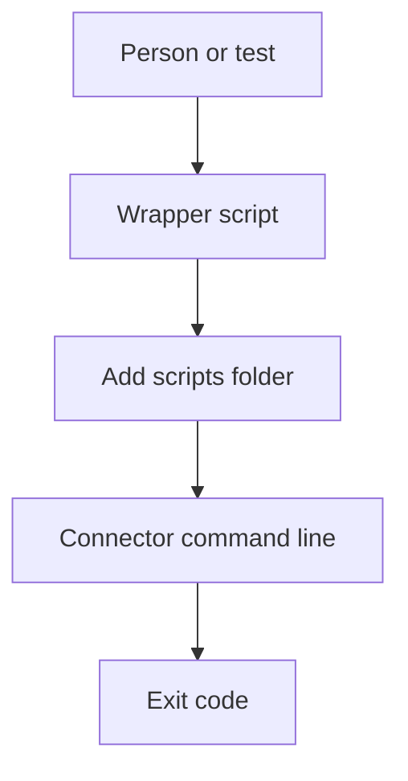

## Purpose

The script you run by file path to use the plane connector: `python3 plane_sync.py sync|drift|create ...`. Unlike the package entry file, it finds the `scripts` folder on its own, so it works from any folder. It is a thin wrapper around the connector's `main` function.

## Dependencies

**Depends on.**
- Standard library: `pathlib`, `sys` {src:scripts/connectors/plane/plane_sync.py:11-12}.
- [[cli]] ([cli](cli.md)): `main` {src:scripts/connectors/plane/plane_sync.py:16}.
- Its own location on disk: the folder two levels above this file must be the `scripts` folder {src:scripts/connectors/plane/plane_sync.py:14}.

**Used by.**
- Product code: none found. Nothing under the repo outside the plane package and its tests names `plane_sync.py` (searched `git grep` for `plane_sync.py` and `connectors/plane` under the repo except `docs/`, 2026-11-20). People run it by hand.
- Tests: `tests/scripts/connectors/plane/test_plane_connector.py:95` and `tests/system/test_e2e.py:181` run it as a program. `tests/scripts/connectors/plane/test_plane_standards.py:31` lists it among files that must exist and `:21` exempts it from the type hint check.

## Behavior

On start it puts the `scripts` folder first on the module search path, found as the second parent of this file's resolved location {src:scripts/connectors/plane/plane_sync.py:14}. It then imports `main` {src:scripts/connectors/plane/plane_sync.py:16}. When run as the main program, it calls `main` with the command line minus the program name and exits with the returned number {src:scripts/connectors/plane/plane_sync.py:18-19}. Because the path edit runs on import as well, importing this file also changes the module path {src:scripts/connectors/plane/plane_sync.py:14}. The behavior of the commands is described in [[cli]] ([cli](cli.md)).

## Diagram: module level (L2, required)

## Diagram: function level (L3, optional)

None: no function has branching that the signature does not show. The file has no function.

## Notes

**Code and its own description.** The description says "python3 plane_sync.py sync|drift|create ..." {src:scripts/connectors/plane/plane_sync.py:3}. The parser accepts exactly those three commands {src:scripts/connectors/plane/cli.py:80-93}. The header's date field is empty {src:scripts/connectors/plane/plane_sync.py:4}. The scope line says it "finds the scripts folder by itself" {src:scripts/connectors/plane/plane_sync.py:6}. That holds only while the file stays exactly two folders below `scripts`.

**Inputs reaching a path, command, address or outbound text without a check.**
- The folder added to the module search path comes from this file's own location, not from user input {src:scripts/connectors/plane/plane_sync.py:14}. The entry goes first in the search order, so a `connectors` package in that folder takes priority over any other.
- `sys.argv[1:]` goes whole to `main` {src:scripts/connectors/plane/plane_sync.py:19}; this file checks nothing.

**Shared file writes.** None.

**Style.** The import after the path edit carries a `noqa: E402` mark to quiet the linter {src:scripts/connectors/plane/plane_sync.py:16}.
