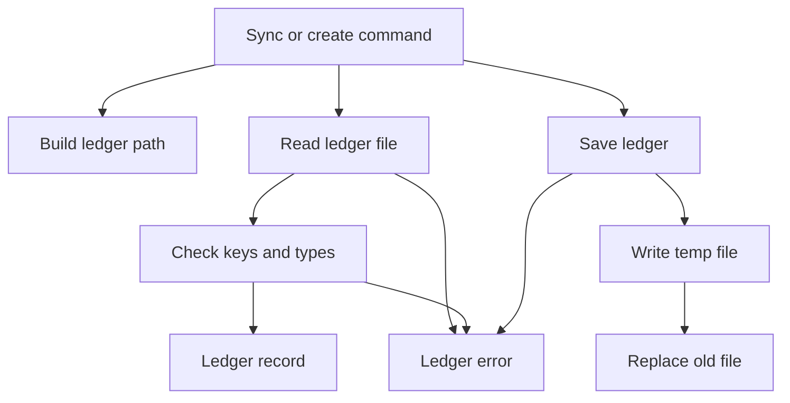

## Purpose

The Plane sync keeps one small JSON file per ticket that remembers what was already sent to the ticket's Plane card: which card it is, a fingerprint of the last description, the last status word, how far each session log was read, and the keys of comments already posted. This module reads that file, checks its shape, and writes it back. It exists so a second run of the sync can skip work that already happened.

## Dependencies

**Depends on.** Standard library only: `contextlib`, `json`, `os`, `secrets`, `dataclasses`, `pathlib`, `typing`. No other file in the repo is imported.

**Used by.**
- Product code: [[plane_ticket_syncer]] and [plane_ticket_syncer](plane_ticket_syncer.md) imports `SyncLedger`, `ledger_path`, `load_ledger`, `save_ledger` {src:scripts/connectors/plane/plane_ticket_syncer.py:26}. [[vault_ticket_creator]] and [vault_ticket_creator](vault_ticket_creator.md) imports `PlaneSyncLedgerError`, `SyncLedger`, `ledger_path`, `save_ledger` {src:scripts/connectors/plane/vault_ticket_creator.py:16}. [[cli]] (no doc yet) imports `PlaneSyncLedgerError` only, to turn it into an exit code {src:scripts/connectors/plane/cli.py:21}.
- Tests: `tests/scripts/connectors/plane/test_plane_cli.py`, `test_plane_create.py`, `test_plane_fixes.py`, `test_plane_sync.py`, `test_plane_vault_files.py` (found with `git grep plane_sync_ledger`, searched 2026-11-20).

## Behavior

**Shape of the ledger.** A `SyncLedger` holds eight fields: ticket id, project id, work item id, card number, description fingerprint (may be none), status word (may be none), a map of session file name to character offset, and a list of posted comment keys {src:scripts/connectors/plane/plane_sync_ledger.py:34-43}. The file name is `plane_sync_ledger.json` {src:scripts/connectors/plane/plane_sync_ledger.py:20}, and `ledger_path` puts it at `<state_root>/<ticket_id>/plane_sync_ledger.json` {src:scripts/connectors/plane/plane_sync_ledger.py:47}.

**Loading.** `load_ledger` returns `None` when the file does not exist {src:scripts/connectors/plane/plane_sync_ledger.py:69-70}. A read error or invalid JSON raises `PlaneSyncLedgerError("<name> is not valid JSON")` {src:scripts/connectors/plane/plane_sync_ledger.py:71-74}. The parsed value is then checked by `_checked`: it must be an object {src:scripts/connectors/plane/plane_sync_ledger.py:51-52}, hold all eight required keys {src:scripts/connectors/plane/plane_sync_ledger.py:53-55}, and every value must have the right type {src:scripts/connectors/plane/plane_sync_ledger.py:56-64}. The card number must be an integer and not a boolean {src:scripts/connectors/plane/plane_sync_ledger.py:62}. Keys beyond the eight are dropped silently when the object is built {src:scripts/connectors/plane/plane_sync_ledger.py:65}.

**Saving.** `save_ledger` builds a temp file name from the target name, the process id and 4 random bytes in hex {src:scripts/connectors/plane/plane_sync_ledger.py:86-87}. It creates the parent folder if needed {src:scripts/connectors/plane/plane_sync_ledger.py:89}, writes the JSON (indented, sorted keys) to the temp file {src:scripts/connectors/plane/plane_sync_ledger.py:90}, and moves it over the target with `os.replace` {src:scripts/connectors/plane/plane_sync_ledger.py:91}. The temp file is opened with `O_CREAT | O_EXCL | O_WRONLY` and mode `0o600` {src:scripts/connectors/plane/plane_sync_ledger.py:79-80}, so an existing temp file is never reused. If any `OSError` occurs, the temp file is removed (errors ignored) and `PlaneSyncLedgerError("<name> cannot be written")` is raised {src:scripts/connectors/plane/plane_sync_ledger.py:92-95}.

## Diagram: module level (L2, required)

## Diagram: function level (L3, optional)

None: no function has branching that the signature does not show.

## Notes

- **Description versus code, load error text.** The module header says it reads and writes the ledger (line 2). The error text for a file that exists but cannot be read (permission problem) is "is not valid JSON", because one `except` handles both `OSError` and `ValueError` {src:scripts/connectors/plane/plane_sync_ledger.py:73-74}. The message is misleading for the permission case.
- **Type check gap.** The card number rejects booleans {src:scripts/connectors/plane/plane_sync_ledger.py:62}, but the offset values only test `isinstance(v, int)`, which accepts `true` and `false` {src:scripts/connectors/plane/plane_sync_ledger.py:58-60}.
- **Unchecked input to a file path.** `ticket_id` goes straight into the path `state_root / ticket_id / <file>` with no check in this module {src:scripts/connectors/plane/plane_sync_ledger.py:47}. The sync command checks the id first with `ticket_id_gate` {src:scripts/connectors/plane/vault_ticket_files.py:69-76}. The create command builds the id from a prefix taken from the settings file, whose characters are not checked {src:scripts/connectors/plane/plane_sync_settings.py:140}, and does not pass it through that gate before calling `save_ledger` {src:scripts/connectors/plane/vault_ticket_creator.py:108}. The settings file is a trusted local file, but a prefix with a path separator would reach this path.
- **Shared-file writes.** The ledger is written atomically in the sense that readers see the old or new file, never a half file (`os.replace` {src:scripts/connectors/plane/plane_sync_ledger.py:91}). There is no file lock and no `fsync`. The sync command loads the ledger once {src:scripts/connectors/plane/plane_ticket_syncer.py:271} and saves it at several later points {src:scripts/connectors/plane/plane_ticket_syncer.py:114}, so two syncs of the same ticket at once would each overwrite the other's changes (last writer wins), and could post the same comment twice.
- No code path in this module reads `TOLLGATE_*` environment variables or any network address.
