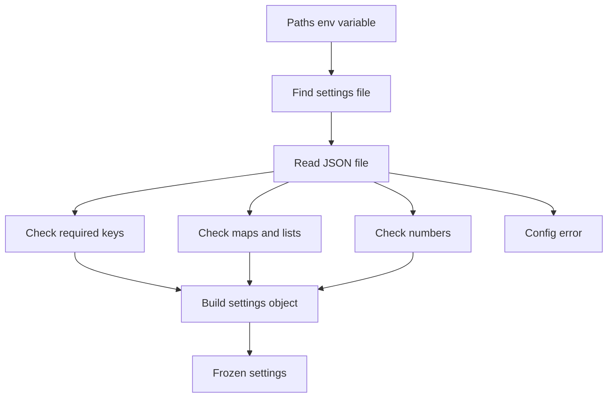

## Purpose

The Plane sync needs a handful of choices that are not secret: which Plane workspace to talk to, which ticket prefixes map to which Plane projects, how vault status words map to board columns, how fast to call, and which text patterns count as secrets. This module reads those choices from one JSON file, checks every value, and returns them as frozen objects so the rest of the sync cannot change them by accident. The connector address and API key live elsewhere (the connector registry and the secret store).

## Dependencies

**Depends on.** Standard library only: `json`, `os`, `re`, `dataclasses`, `pathlib`, `typing`. Environment variables `TOLLGATE_PATHS` {src:scripts/connectors/plane/plane_sync_settings.py:20} and `TOLLGATE_TICKET_PREFIX` {src:scripts/connectors/plane/plane_sync_settings.py:21}. A settings file named `plane-sync.json` {src:scripts/connectors/plane/plane_sync_settings.py:19}.

**Used by.**
- Product code: [[cli]] (no doc yet) {src:scripts/connectors/plane/cli.py:22-28}, [[plane_ticket_syncer]] and [plane_ticket_syncer](plane_ticket_syncer.md) {src:scripts/connectors/plane/plane_ticket_syncer.py:27}, [[plane_work_item_client]] and [plane_work_item_client](plane_work_item_client.md) imports `PlaneAddressError` {src:scripts/connectors/plane/plane_work_item_client.py:19}, [[vault_ticket_creator]] and [vault_ticket_creator](vault_ticket_creator.md) {src:scripts/connectors/plane/vault_ticket_creator.py:17}, [[vault_ticket_files]] and [vault_ticket_files](vault_ticket_files.md) imports `PrefixRow` {src:scripts/connectors/plane/vault_ticket_files.py:18}, [[plane_drift_checker]] (no doc yet) {src:scripts/connectors/plane/plane_drift_checker.py:17}.
- Tests: `tests/scripts/connectors/plane/plane_sync_test_support.py`, `test_plane_settings.py`, `test_plane_secret_shapes.py`, `test_plane_client.py`, `test_plane_vault_files.py` (found with `git grep plane_sync_settings`, searched 2026-11-20).

## Behavior

**Finding the file.** `default_settings_path` reads `TOLLGATE_PATHS` (from the given mapping, else the process environment), raises `PlaneSyncConfigError("TOLLGATE_PATHS")` when it is empty, and returns `plane-sync.json` in the same folder as that paths file {src:scripts/connectors/plane/plane_sync_settings.py:86-90}. `load_settings` uses an explicit path when given, else that default {src:scripts/connectors/plane/plane_sync_settings.py:180}. The command line passes `--settings` when present {src:scripts/connectors/plane/cli.py:165-166}.

**Reading.** The file must be readable UTF-8 JSON holding an object; otherwise the error carries only the file name {src:scripts/connectors/plane/plane_sync_settings.py:159-164}.

**Keys, what each controls, and who reads it.**

| Key | Rule in this module | Effect elsewhere |
|---|---|---|
| `workspace_slug` | required non-empty string {src:scripts/connectors/plane/plane_sync_settings.py:181-183} | becomes part of every Plane API address {src:scripts/connectors/plane/plane_work_item_client.py:131} |
| `new_ticket_board_status` | required non-empty string {src:scripts/connectors/plane/plane_sync_settings.py:181-183} | board column a new card is created in {src:scripts/connectors/plane/vault_ticket_creator.py:91} |
| `external_source_name` | optional string, default `tollgate`; null becomes empty {src:scripts/connectors/plane/plane_sync_settings.py:187} | sent as `external_source` on comments and card updates {src:scripts/connectors/plane/plane_work_item_client.py:238}, {src:scripts/connectors/plane/vault_ticket_creator.py:135} |
| `prefix_table` | map of prefix to row; if absent, one row built from `TOLLGATE_TICKET_PREFIX`, else error {src:scripts/connectors/plane/plane_sync_settings.py:131-140} | decides which ticket ids may reach Plane {src:scripts/connectors/plane/vault_ticket_files.py:74} |
| `status_map` | required map of text to text {src:scripts/connectors/plane/plane_sync_settings.py:101-108}, {src:scripts/connectors/plane/plane_sync_settings.py:190} | vault status word to board column {src:scripts/connectors/plane/plane_ticket_syncer.py:159} |
| `blocked_words` | list of strings, default `["QA_BLOCKED"]` {src:scripts/connectors/plane/plane_sync_settings.py:111-115} | status words that add the "Current state" section to the status comment {src:scripts/connectors/plane/plane_ticket_syncer.py:121-123} |
| `secret_patterns` | map name to regex; if the key is present it replaces the built-in set entirely {src:scripts/connectors/plane/plane_sync_settings.py:184} | scanned before every outbound text {src:scripts/connectors/plane/plane_ticket_syncer.py:106} |
| `template_path` | optional string, default none {src:scripts/connectors/plane/plane_sync_settings.py:193} | state file template for `create` {src:scripts/connectors/plane/vault_ticket_creator.py:120} |
| `min_seconds_between_calls` | number, default 1.2, stored as float {src:scripts/connectors/plane/plane_sync_settings.py:143-149} | wait between Plane calls {src:scripts/connectors/plane/plane_work_item_client.py:144-146} |
| `http_timeout_seconds` | number, default 30.0 {src:scripts/connectors/plane/plane_sync_settings.py:45-48} | timeout per call {src:scripts/connectors/plane/plane_work_item_client.py:161} |
| `page_size` | integer, default 100 {src:scripts/connectors/plane/plane_sync_settings.py:49}, {src:scripts/connectors/plane/plane_sync_settings.py:150-154} | `per_page` on list calls {src:scripts/connectors/plane/plane_work_item_client.py:177} |
| `comment_max_chars` | integer, default 15000 {src:scripts/connectors/plane/plane_sync_settings.py:49} | upper limit of a posted comment {src:scripts/connectors/plane/plane_ticket_syncer.py:212} |

Each prefix row has `project_key` (default: the prefix itself), `number_width` (default 1) and `ticket_pattern` (default `^<prefix>-(\d+)$`) {src:scripts/connectors/plane/plane_sync_settings.py:121-128}. `number_width` pads ticket numbers {src:scripts/connectors/plane/vault_ticket_files.py:80}; `ticket_pattern` is used to find the highest local ticket number {src:scripts/connectors/plane/vault_ticket_files.py:103-108}. Keys not in the table are ignored: nothing reads them.

**Built-in secret patterns.** Ten named regexes: private key block, named secret assignment, credentials in a URL, bearer token, AWS access key, GitHub token, Slack token, Plane API key, JSON-quoted secret and a long mixed-case token {src:scripts/connectors/plane/plane_sync_settings.py:24-44}.

**Result.** All values go into a frozen `PlaneSyncSettings` {src:scripts/connectors/plane/plane_sync_settings.py:68-81}, built at the end of `load_settings` {src:scripts/connectors/plane/plane_sync_settings.py:185-195}. Booleans are rejected where numbers or integers are expected {src:scripts/connectors/plane/plane_sync_settings.py:93-98}.

## Diagram: module level (L2, required)

## Diagram: function level (L3, optional)

None: no function has branching that the signature does not show.

## Notes

- **Description versus code, error message.** The docstring says the message of `PlaneSyncConfigError` is "the key name only" {src:scripts/connectors/plane/plane_sync_settings.py:54}. The code also puts the environment variable name {src:scripts/connectors/plane/plane_sync_settings.py:89} and the settings file name {src:scripts/connectors/plane/plane_sync_settings.py:162} in it. Neither is a secret, so the intent (no values in the message) holds.
- **Description versus code, address error.** `PlaneAddressError` is documented as raised when the address is not https {src:scripts/connectors/plane/plane_sync_settings.py:58}. It is defined here but never raised here; the check lives in the client {src:scripts/connectors/plane/plane_work_item_client.py:129-130}.
- **Header claim "the address and key never live here".** The module has no address or key field, but it does not refuse a file that contains one: unknown keys are ignored, not rejected {src:scripts/connectors/plane/plane_sync_settings.py:185-195}. Nothing stops a user from pasting a key into the file.
- **Unchecked inputs.** `ticket_pattern` is compiled later with `re.compile` and `match.group(1)` with no check that it is valid or has a group {src:scripts/connectors/plane/plane_sync_settings.py:125-128}, {src:scripts/connectors/plane/vault_ticket_files.py:103-108}; a bad pattern raises an unhandled `re.error` or `IndexError`. Secret-pattern regexes are checked only for being text {src:scripts/connectors/plane/plane_sync_settings.py:106}, and compiled at scan time {src:scripts/connectors/plane/plane_comment_builder.py:33-34}. A settings file with an empty `secret_patterns` map turns the secret scan off {src:scripts/connectors/plane/plane_sync_settings.py:184}. Prefix keys are converted to text but their characters are not checked {src:scripts/connectors/plane/plane_sync_settings.py:140}; they later form ticket ids used in file paths. `template_path` is any text and is read as a file by the create command {src:scripts/connectors/plane/vault_ticket_creator.py:120-122}. Numbers have no range check (zero page size or negative wait is accepted) {src:scripts/connectors/plane/plane_sync_settings.py:143-155}. The settings path comes from `--settings` or `TOLLGATE_PATHS` and is only read, never executed.
- **Shared-file writes.** None: this module only reads.
- A built-in pattern, `long_mixed_token`, flags any 32-plus character mixed-case-and-digit word {src:scripts/connectors/plane/plane_sync_settings.py:40-43}, so long identifiers in a description can stop a send. This is a design choice, noted for maintainers.
