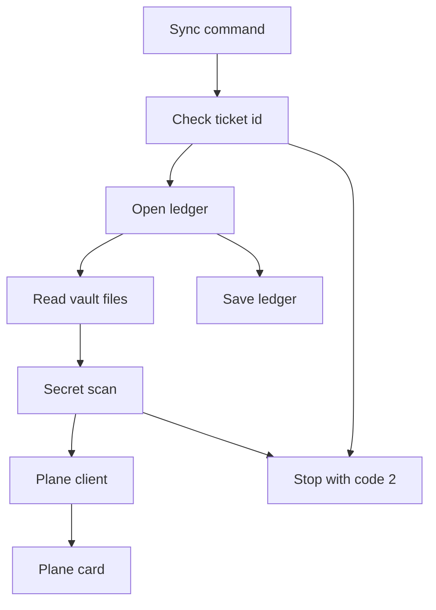
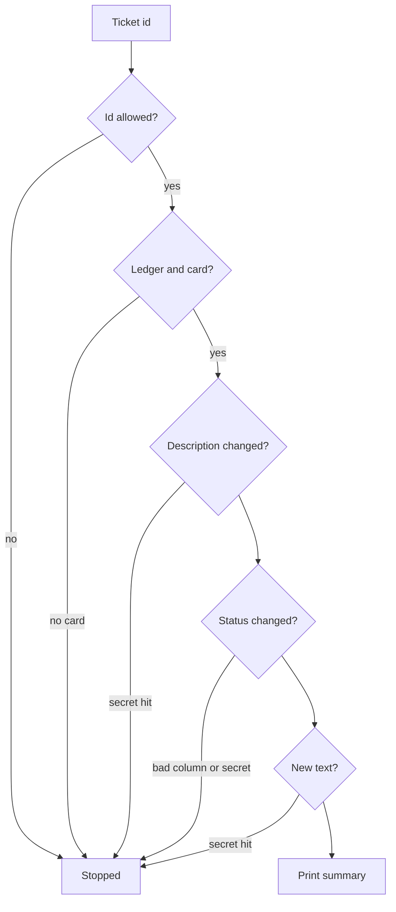

## Purpose

This is the `sync` command of the Plane connector. For one ticket it compares the vault state file and session logs with what the ledger says was already sent, and sends only the difference to the ticket's Plane card: the description, the board column, and a comment with new session text (optionally with spec or validation extras). It exists so the vault stays the source of truth and Plane shows a readable copy without duplicate posts.

## Dependencies

**Depends on.**
- Repo modules: [[plane_comment_builder]] (no doc yet) {src:scripts/connectors/plane/plane_ticket_syncer.py:16-25}; [[plane_sync_ledger]] and [plane_sync_ledger](plane_sync_ledger.md) {src:scripts/connectors/plane/plane_ticket_syncer.py:26}; [[plane_sync_settings]] and [plane_sync_settings](plane_sync_settings.md) {src:scripts/connectors/plane/plane_ticket_syncer.py:27}; [[plane_work_item_client]] and [plane_work_item_client](plane_work_item_client.md) {src:scripts/connectors/plane/plane_ticket_syncer.py:28}; [[vault_ticket_files]] and [vault_ticket_files](vault_ticket_files.md) {src:scripts/connectors/plane/plane_ticket_syncer.py:29-37}.
- Standard library: `dataclasses`, `pathlib`, `typing`.
- Files read at run time: the ticket state file, `<ticket>-session-*.md` files, and for extras `<ticket>-spec.md`, `<ticket>-design.md` or `<ticket>-edge-case-validation.md` {src:scripts/connectors/plane/plane_ticket_syncer.py:183-185}.

**Used by.**
- Product code: [[cli]] (no doc yet) imports `EXTRAS_DEV`, `EXTRAS_SPEC`, `run_sync` {src:scripts/connectors/plane/cli.py:29} and calls `run_sync` for the sync command {src:scripts/connectors/plane/cli.py:144-147}.
- Tests: `tests/scripts/connectors/plane/plane_sync_test_support.py`, `test_plane_sync.py`, `test_plane_fixes.py` (found with `git grep plane_ticket_syncer`, searched 2026-11-20).

## Behavior

**Entry.** `run_sync(settings, client, tickets_root, state_root, ticket_id=, extras=, emit=, from_start=)` returns 0 or 2 {src:scripts/connectors/plane/plane_ticket_syncer.py:293-304}. It first runs `ticket_id_gate`; if the gate has an answer it prints that line and returns its code (a bad id stops with 2, an unmapped prefix prints a skip line and returns 0) {src:scripts/connectors/plane/plane_ticket_syncer.py:305-308}, {src:scripts/connectors/plane/vault_ticket_files.py:71-75}. It then finds the ticket folder, reads and parses the state file {src:scripts/connectors/plane/plane_ticket_syncer.py:311-312}, and refuses `--from-start` when a ledger file already exists {src:scripts/connectors/plane/plane_ticket_syncer.py:314-316}.

**Ledger and first sync.** An existing ledger is used as is. If none exists, `_first_sync_ledger` looks up the Plane project by key and the card whose external id equals the ticket id and whose number equals the ticket number {src:scripts/connectors/plane/plane_ticket_syncer.py:84-93}. Without `--from-start` it records the current length of every session file as already sent, so old history is not posted {src:scripts/connectors/plane/plane_ticket_syncer.py:94-97}. With no card found the run stops with "no card for <ticket>" {src:scripts/connectors/plane/plane_ticket_syncer.py:320-322}. A new ledger is saved before any send {src:scripts/connectors/plane/plane_ticket_syncer.py:274-276}.

**Three steps, in order, stopping at the first stop.** `_run_steps` runs description, status, comment {src:scripts/connectors/plane/plane_ticket_syncer.py:282-286}, returns the stop code if any {src:scripts/connectors/plane/plane_ticket_syncer.py:287-288}, otherwise prints one summary line {src:scripts/connectors/plane/plane_ticket_syncer.py:289}.

1. **Description.** The fingerprint is the first 12 hex characters of the SHA-256 of the whole state file text, frontmatter included {src:scripts/connectors/plane/plane_ticket_syncer.py:323}, {src:scripts/connectors/plane/plane_comment_builder.py:127}. If it equals the ledger value nothing is sent {src:scripts/connectors/plane/plane_ticket_syncer.py:103-104}. Otherwise the title and body are scanned for secret patterns; a hit stops the run with nothing sent {src:scripts/connectors/plane/plane_ticket_syncer.py:106-108}. If clean, the card's description and name are overwritten with the body as HTML plus a `state-sha:` line {src:scripts/connectors/plane/plane_ticket_syncer.py:109-112}, and the fingerprint is saved to the ledger {src:scripts/connectors/plane/plane_ticket_syncer.py:113-114}.
2. **Status.** The state file's status word is upper-cased and normalised {src:scripts/connectors/plane/plane_ticket_syncer.py:155}, {src:scripts/connectors/plane/vault_ticket_files.py:202-204}. If it equals the ledger word nothing happens {src:scripts/connectors/plane/plane_ticket_syncer.py:157-158}. If the settings `status_map` has no entry, the step records `unknown:<word>` and goes on {src:scripts/connectors/plane/plane_ticket_syncer.py:159-163}. If the mapped board column does not exist in Plane, the run stops {src:scripts/connectors/plane/plane_ticket_syncer.py:164-166}. On a first sync (ledger word is none) the card is only moved when it is not already in the column, and no comment is posted {src:scripts/connectors/plane/plane_ticket_syncer.py:139-143}. On later syncs the status comment text "Status: old to new (board: X) (generated)" is built {src:scripts/connectors/plane/plane_ticket_syncer.py:120}, extended with the "Current state" section when the word is in `blocked_words` {src:scripts/connectors/plane/plane_ticket_syncer.py:121-123}, scanned {src:scripts/connectors/plane/plane_ticket_syncer.py:146-148}, the card is moved {src:scripts/connectors/plane/plane_ticket_syncer.py:149}, and the comment is posted once per key made from old word, new word and fingerprint {src:scripts/connectors/plane/plane_ticket_syncer.py:128-134}.
3. **Comment.** New session text is everything after each file's saved offset {src:scripts/connectors/plane/plane_comment_builder.py:47-59}. Extras are built from spec and design (`spec`) or the validation file (`dev`); a missing file adds a "(extras: ... not found)" note {src:scripts/connectors/plane/plane_ticket_syncer.py:180-197}. A text whose key is already in `posted_keys` is dropped {src:scripts/connectors/plane/plane_ticket_syncer.py:242-246}. With nothing new, only the offsets are saved {src:scripts/connectors/plane/plane_ticket_syncer.py:247-250}. Otherwise the combined text is scanned {src:scripts/connectors/plane/plane_ticket_syncer.py:251-253}, shrunk to fit the limit, posted, and the keys and offsets are saved {src:scripts/connectors/plane/plane_ticket_syncer.py:254-257}, {src:scripts/connectors/plane/plane_ticket_syncer.py:230-235}.

**Fitting the limit.** `_compose_html` makes the HTML at most `comment_max_chars` long: it cuts the markdown, converts, and if the HTML is too long, scales the markdown limit down and retries, at most 5 rounds {src:scripts/connectors/plane/plane_ticket_syncer.py:216-222}. If it never fits, only the pointer line is posted {src:scripts/connectors/plane/plane_ticket_syncer.py:223-224}. When session text exists the extras keep at most half the limit {src:scripts/connectors/plane/plane_ticket_syncer.py:202}.

**Exit code.** 2 when any status word was unknown, even though other steps ran and a summary line was printed {src:scripts/connectors/plane/plane_ticket_syncer.py:289-290}.

## Diagram: module level (L2, required)

## Diagram: function level (L3, optional)

## Notes

- **Description versus code, header.** The header names the module `plane syncer.py` {src:scripts/connectors/plane/plane_ticket_syncer.py:1}; the file is `plane_ticket_syncer.py`. Its scope line says "every send is guarded by the ledger and by the secret scan" {src:scripts/connectors/plane/plane_ticket_syncer.py:5}. Description, status comment and comment text are scanned and fingerprinted or keyed. Two sends are not: the first-sync column move sends only a column id and has no ledger guard beyond a read of the card {src:scripts/connectors/plane/plane_ticket_syncer.py:139-143}, and the fixed pointer line (ticket id only) is not scanned {src:scripts/connectors/plane/plane_ticket_syncer.py:213}.
- **Status comment ignores the length limit.** The cut to `comment_max_chars` is applied only in the session and extras comment {src:scripts/connectors/plane/plane_ticket_syncer.py:212}. The status comment, which can hold a whole "Current state" section {src:scripts/connectors/plane/plane_ticket_syncer.py:121-123}, is posted without it {src:scripts/connectors/plane/plane_ticket_syncer.py:132}.
- **Fingerprint covers frontmatter.** Any edit to the state file, including a date in the frontmatter, changes the fingerprint and re-sends the description {src:scripts/connectors/plane/plane_ticket_syncer.py:323}. The fingerprint is 12 hex characters (48 bits) {src:scripts/connectors/plane/plane_comment_builder.py:20}.
- **Plane edits are overwritten.** The description step replaces the card's description and name {src:scripts/connectors/plane/plane_ticket_syncer.py:110-112}; changes made in Plane are lost on the next change in the vault.
- **Partial runs.** The steps are not one transaction. A description sent and saved {src:scripts/connectors/plane/plane_ticket_syncer.py:113-114} stays sent even if the status step then stops {src:scripts/connectors/plane/plane_ticket_syncer.py:164-166}, and no summary line is printed on a stop {src:scripts/connectors/plane/plane_ticket_syncer.py:287-288}.
- **Post before save.** A comment is posted before the ledger is saved {src:scripts/connectors/plane/plane_ticket_syncer.py:232-235}. A crash between the two would re-send it next run, with the same external id {src:scripts/connectors/plane/plane_ticket_syncer.py:231}. Whether Plane refuses a repeated external id is not shown in this repo.
- **Inputs without a check.** The ticket id is checked by the gate before it is used in file names and globs {src:scripts/connectors/plane/plane_ticket_syncer.py:305-308}. Text sent to the network (title, state body, session text, extras) is scanned only against the patterns in the settings; an empty pattern map scans nothing {src:scripts/connectors/plane/plane_sync_settings.py:184}. Extras files are read by name from the ticket folder without checking that they are plain files inside the vault {src:scripts/connectors/plane/plane_ticket_syncer.py:176-177}, so a symlink there would be read and sent (after the scan).
- **Shared-file writes.** The ledger is saved at 5 places {src:scripts/connectors/plane/plane_ticket_syncer.py:113}, {src:scripts/connectors/plane/plane_ticket_syncer.py:134}, {src:scripts/connectors/plane/plane_ticket_syncer.py:171}, {src:scripts/connectors/plane/plane_ticket_syncer.py:235}, {src:scripts/connectors/plane/plane_ticket_syncer.py:249} (plus the first-sync save {src:scripts/connectors/plane/plane_ticket_syncer.py:276}), each atomic but with no lock between two runs {src:scripts/connectors/plane/plane_sync_ledger.py:91}. The module writes no other local file.
- **Constants.** Nine module constants not imported elsewhere: `EXIT_OK`, `EXIT_STOPPED`, `STATE_SHA_PREFIX`, `CURRENT_STATE_HEADING`, `PARTS_JOINER`, `JOINER_LENGTH`, `MAX_FIT_ROUNDS`, `FIT_SAFETY`, `NOTE_KEY_PREFIX` {src:scripts/connectors/plane/plane_ticket_syncer.py:39-49}.
