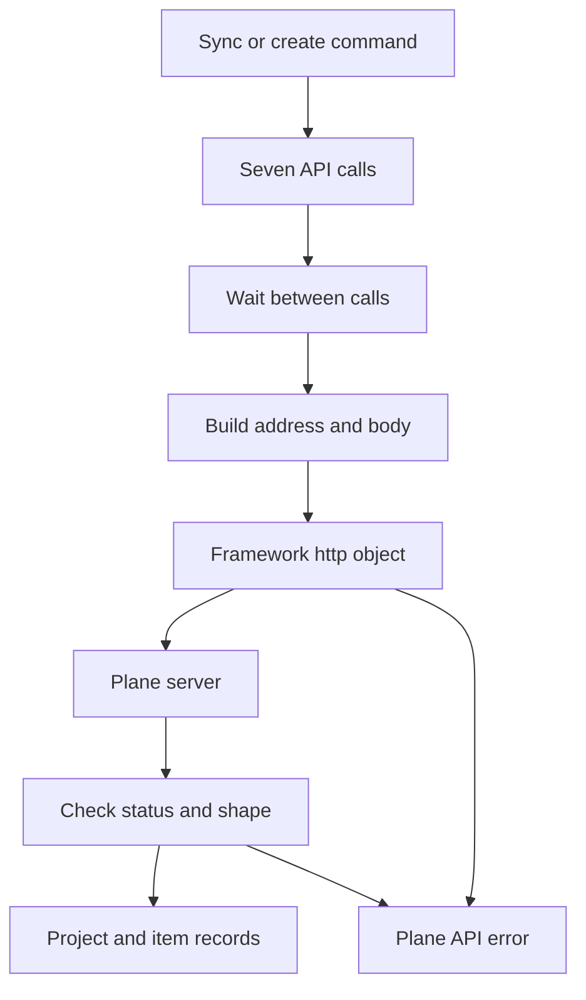
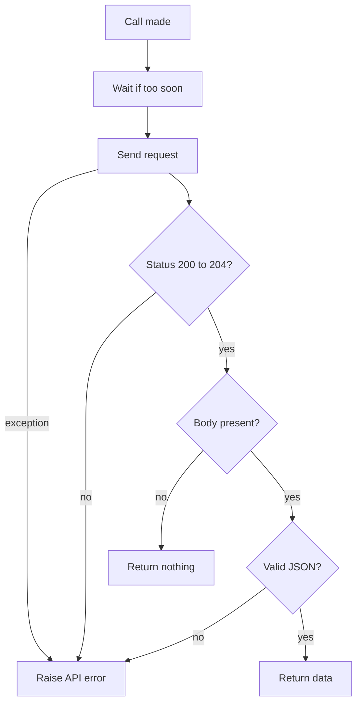

## Purpose

A thin client for the few Plane API calls the sync needs: list projects, list board states, list or read work items, create a work item, update one, and post a comment. It does not open network connections itself; it is handed an `http` object by the connector framework and only builds addresses, bodies and headers, paces calls, checks replies and turns any failure into one error type that carries no secrets.

## Dependencies

**Depends on.** Standard library: `json`, `logging`, `time`, `dataclasses`, `typing`, `urllib.parse`. One repo module: [[plane_sync_settings]] and [plane_sync_settings](plane_sync_settings.md), for `PlaneAddressError` {src:scripts/connectors/plane/plane_work_item_client.py:19}. An `http` object with a `request(method, url, headers=, data=, timeout=)` method returning a mapping with `status` and `body` {src:scripts/connectors/plane/plane_work_item_client.py:160-162}, {src:scripts/connectors/plane/plane_work_item_client.py:167-171}; in production that is `UrlHttp` from [[registry]] and [registry](../registry.md) {src:scripts/connectors/registry.py:216-246}.

**Used by.**
- Product code: [[cli]] (no doc yet) builds the client in its connector factory {src:scripts/connectors/plane/cli.py:58-70}; [[plane_ticket_syncer]] and [plane_ticket_syncer](plane_ticket_syncer.md) {src:scripts/connectors/plane/plane_ticket_syncer.py:28}; [[vault_ticket_creator]] and [vault_ticket_creator](vault_ticket_creator.md) {src:scripts/connectors/plane/vault_ticket_creator.py:18}; [[plane_drift_checker]] (no doc yet) {src:scripts/connectors/plane/plane_drift_checker.py:18}.
- Tests: `tests/scripts/connectors/plane/test_plane_client.py`, `plane_sync_test_support.py`, `test_plane_create.py`, `test_plane_fixes.py`, `test_plane_sync.py`, and `test_plane_standards.py` (which reads this file as text) (found with `git grep plane_work_item_client`, searched 2026-11-20).

## Behavior

**Construction.** The address must start with `https://` unless `allow_insecure_http` is set; otherwise `PlaneAddressError` is raised {src:scripts/connectors/plane/plane_work_item_client.py:129-130}. The base is `<address>/api/v1/workspaces/<slug>/` with the slug percent-encoded {src:scripts/connectors/plane/plane_work_item_client.py:131}, {src:scripts/connectors/plane/plane_work_item_client.py:23}. Every request carries the key in the `X-API-Key` header and a JSON content type {src:scripts/connectors/plane/plane_work_item_client.py:140}, {src:scripts/connectors/plane/plane_work_item_client.py:24}.

**Pacing.** Before each call, if the last call started less than `min_seconds_between_calls` ago, the client sleeps for the difference; the first call does not wait {src:scripts/connectors/plane/plane_work_item_client.py:142-147}.

**One send path.** `_send` paces, builds the address (query encoded with `urlencode`), serialises the body as JSON, and calls `http.request` with the configured timeout {src:scripts/connectors/plane/plane_work_item_client.py:156-162}. Any exception from the `http` object becomes `PlaneApiError` with the HTTP status when the exception has an integer `code`, else the exception class name as the reason; the original error is dropped {src:scripts/connectors/plane/plane_work_item_client.py:163-166}, {src:scripts/connectors/plane/plane_work_item_client.py:92-94}. A reply whose status is not an integer from 200 to 204 is an error {src:scripts/connectors/plane/plane_work_item_client.py:167-170}, {src:scripts/connectors/plane/plane_work_item_client.py:25-26}. The body is decoded: empty becomes `None`, bytes are decoded as UTF-8 with replacement, text is parsed as JSON and a parse failure is an error {src:scripts/connectors/plane/plane_work_item_client.py:97-108}. There is no retry anywhere: each public method makes its call once.

**Paging.** `_list_all` requests `per_page` pages, requires a `results` list, and follows `next_cursor` while `next_page_results` is exactly true; a missing or repeated cursor is an error {src:scripts/connectors/plane/plane_work_item_client.py:173-189}.

**The seven calls.**
- `list_projects`: id and identifier of every project {src:scripts/connectors/plane/plane_work_item_client.py:191-201}.
- `list_state_ids`: map of board column name to id for a project {src:scripts/connectors/plane/plane_work_item_client.py:203-210}.
- `list_work_items`: all items of a project, asking only for `id,sequence_id,name,state,external_id` {src:scripts/connectors/plane/plane_work_item_client.py:212-215}, {src:scripts/connectors/plane/plane_work_item_client.py:28}.
- `get_work_item`: one item {src:scripts/connectors/plane/plane_work_item_client.py:217-219}.
- `create_work_item`: POST with a name and a state id {src:scripts/connectors/plane/plane_work_item_client.py:221-224}.
- `update_work_item`: PATCH with any given fields; the reply is ignored {src:scripts/connectors/plane/plane_work_item_client.py:226-228}.
- `post_comment`: POST of the comment HTML, an external id and the external source name; returns the new comment's id, error if the reply has none {src:scripts/connectors/plane/plane_work_item_client.py:230-243}.

**Reply checks.** A work item reply must be an object with an integer (non-boolean) `sequence_id` and text `id` and `name`; `state`, `external_id` and `description_html` may be missing or null but not non-text {src:scripts/connectors/plane/plane_work_item_client.py:76-89}.

## Diagram: module level (L2, required)

## Diagram: function level (L3, optional)

## Notes

- **Description versus code.** The header says "Seven paced Plane API calls ... No retry anywhere. All HTTP goes through the http object the framework hands in" {src:scripts/connectors/plane/plane_work_item_client.py:2}. The code agrees: there are seven public call methods (lines 191, 203, 212, 217, 221, 226, 230), each goes through `_send` {src:scripts/connectors/plane/plane_work_item_client.py:156}, and no loop retries. The header says errors carry "method, path, status and reason only" {src:scripts/connectors/plane/plane_work_item_client.py:5}; that holds {src:scripts/connectors/plane/plane_work_item_client.py:57}, though the path includes project and item ids.
- **Address check is shallow.** Only the text prefix `https://` is tested, case-sensitively, with no host check and no check for a user name or password in the address {src:scripts/connectors/plane/plane_work_item_client.py:129}. The real http object does refuse an address with credentials, and refuses non-loopback `http` {src:scripts/connectors/registry.py:73-100}, {src:scripts/connectors/registry.py:230}; a replacement `http` object would not.
- **Inputs to the network.** The address is built from the stored connector address, which is not checked here beyond the prefix {src:scripts/connectors/plane/plane_work_item_client.py:131}. Workspace slug, project id and work item id are percent-encoded before use in the path {src:scripts/connectors/plane/plane_work_item_client.py:131}, {src:scripts/connectors/plane/plane_work_item_client.py:204}, {src:scripts/connectors/plane/plane_work_item_client.py:218}. Query values go through `urlencode` {src:scripts/connectors/plane/plane_work_item_client.py:157}. Names, descriptions, external ids and comment HTML go as JSON body fields with no check on their value; the secret scan happens in the caller, not here.
- **Paging is not bounded.** The loop ends only when the server says there is no next page or repeats a cursor {src:scripts/connectors/plane/plane_work_item_client.py:184-188}; a server that keeps sending new cursors would loop forever.
- **Item list has no description.** `list_work_items` does not request `description_html` {src:scripts/connectors/plane/plane_work_item_client.py:28}, so listed records carry none unless the server sends it anyway.
- **Create is not idempotent.** `create_work_item` sends no external id {src:scripts/connectors/plane/plane_work_item_client.py:223}, so a repeat call makes a second card. Comments carry an external id the caller chooses {src:scripts/connectors/plane/plane_work_item_client.py:237}.
- **Shared-file writes.** None: this module writes no local file. It writes to Plane (POST and PATCH) with nothing here stopping two clients at once.
- The API key is held in memory in the header map {src:scripts/connectors/plane/plane_work_item_client.py:140} and is not logged; the debug line logs method, path and status only {src:scripts/connectors/plane/plane_work_item_client.py:168}.
