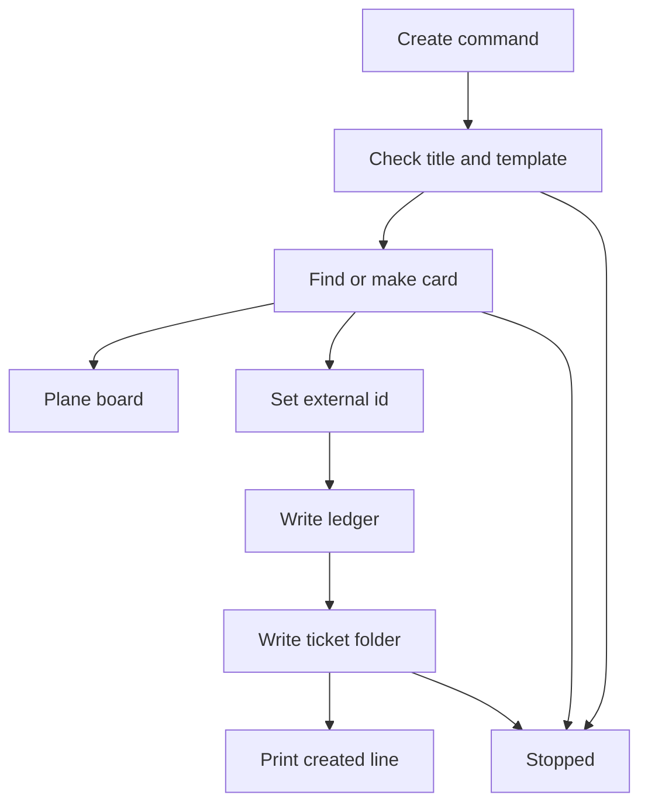
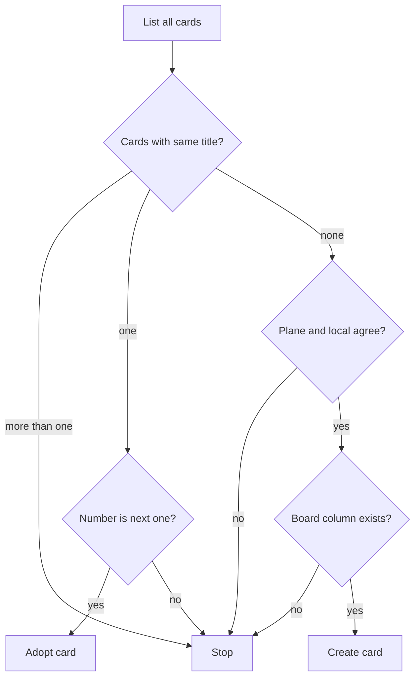

## Purpose

This is the `create` command of the Plane connector. It opens a new ticket in two places that must agree: a card on the Plane board, and a ticket folder with a state file in the vault. Plane hands out the card number, so the card is made first and the vault folder takes its number. The module also guards against making a second card when an earlier run stopped half way.

## Dependencies

**Depends on.** Standard library: `pathlib`, `typing`. Repo modules: [[plane_comment_builder]] (no doc yet) for `find_secret_pattern` {src:scripts/connectors/plane/vault_ticket_creator.py:15}; [[plane_sync_ledger]] and [plane_sync_ledger](plane_sync_ledger.md) {src:scripts/connectors/plane/vault_ticket_creator.py:16}; [[plane_sync_settings]] and [plane_sync_settings](plane_sync_settings.md) {src:scripts/connectors/plane/vault_ticket_creator.py:17}; [[plane_work_item_client]] and [plane_work_item_client](plane_work_item_client.md) {src:scripts/connectors/plane/vault_ticket_creator.py:18}; [[vault_ticket_files]] and [vault_ticket_files](vault_ticket_files.md) {src:scripts/connectors/plane/vault_ticket_creator.py:19-30}. A state file template: the file named in settings, else `plane_ticket_state_template.md` next to this module {src:scripts/connectors/plane/vault_ticket_creator.py:36}, {src:scripts/connectors/plane/vault_ticket_creator.py:120}.

**Used by.**
- Product code: [[cli]] (no doc yet) imports and calls `run_create` {src:scripts/connectors/plane/cli.py:31}, {src:scripts/connectors/plane/cli.py:150-154}.
- Tests: `tests/scripts/connectors/plane/test_plane_create.py`, `test_plane_fixes.py` (found with `git grep vault_ticket_creator`, searched 2026-11-20).

## Behavior

**Entry.** `run_create(settings, client, tickets_root, state_root, prefix=, title=, priority=, scope=, repo=, work_type=, today=, emit=, template_text=)` returns 0 on success and 2 when stopped {src:scripts/connectors/plane/vault_ticket_creator.py:175-191}. A prefix not in the settings table prints a skip line and returns 2 {src:scripts/connectors/plane/vault_ticket_creator.py:192-195}. The template is the given text or the one read from disk {src:scripts/connectors/plane/vault_ticket_creator.py:196}.

**Checks before anything is sent.** `_create_checked` first scans the title for secret patterns {src:scripts/connectors/plane/vault_ticket_creator.py:153-155}. Then `_check_inputs` rejects a title over 255 characters {src:scripts/connectors/plane/vault_ticket_creator.py:46-47}, renders the template with ticket number 0 and parses the result to prove the state file will be readable {src:scripts/connectors/plane/vault_ticket_creator.py:49-52}, and requires the parsed title to equal the given title {src:scripts/connectors/plane/vault_ticket_creator.py:55-56}.

**Finding or making the card.** The Plane project is found by the prefix row's project key; none found stops the run {src:scripts/connectors/plane/vault_ticket_creator.py:111-115}, {src:scripts/connectors/plane/vault_ticket_creator.py:160-162}. `_find_or_create_card` lists all items and computes the highest Plane number {src:scripts/connectors/plane/vault_ticket_creator.py:71-72}.
- Candidates are items with the same name and an external id that is none, empty or the id this run expects {src:scripts/connectors/plane/vault_ticket_creator.py:73-76}. Two or more candidates stop the run {src:scripts/connectors/plane/vault_ticket_creator.py:77-80}.
- One candidate is adopted only when it is the highest card in Plane and exactly one above the highest local ticket number {src:scripts/connectors/plane/vault_ticket_creator.py:81-84}; otherwise the run stops {src:scripts/connectors/plane/vault_ticket_creator.py:85-86}.
- With no candidate, Plane's highest number must equal the local highest {src:scripts/connectors/plane/vault_ticket_creator.py:87-89}, the configured board column must exist {src:scripts/connectors/plane/vault_ticket_creator.py:90-93}, and then a card is created in it {src:scripts/connectors/plane/vault_ticket_creator.py:94-96}.

**Finishing.** The ticket id is the prefix plus the card number {src:scripts/connectors/plane/vault_ticket_creator.py:132}. The card is updated with that id as its external id and the configured source name {src:scripts/connectors/plane/vault_ticket_creator.py:133-136}. The state text is rendered with the real id {src:scripts/connectors/plane/vault_ticket_creator.py:137}. The ledger is written {src:scripts/connectors/plane/vault_ticket_creator.py:139}, then the vault folder with its state file {src:scripts/connectors/plane/vault_ticket_creator.py:140}. An existing folder stops the run and keeps the card {src:scripts/connectors/plane/vault_ticket_creator.py:141-142}; other vault or ledger errors do the same {src:scripts/connectors/plane/vault_ticket_creator.py:143-144}. Success prints `created | <id> | card <n>` {src:scripts/connectors/plane/vault_ticket_creator.py:145-146}. The new ledger records the status word from the state text and no description fingerprint, so the first sync sends the description {src:scripts/connectors/plane/vault_ticket_creator.py:102-107}.

## Diagram: module level (L2, required)

## Diagram: function level (L3, optional)

## Notes

- **Description versus code, order.** The header says the command "Makes the Plane card first, then the vault folder, state file and ledger" {src:scripts/connectors/plane/vault_ticket_creator.py:2}. The code writes the ledger first and the vault folder second {src:scripts/connectors/plane/vault_ticket_creator.py:139-140}. The scope line, "no file or folder is written before the card exists" {src:scripts/connectors/plane/vault_ticket_creator.py:5}, holds: the card is made at line 94 and the first local write is at line 139 {src:scripts/connectors/plane/vault_ticket_creator.py:94}.
- **Orphan ledger.** Because the ledger is written first, a stop at the folder step (folder exists, or the write fails) leaves a ledger on disk with no new folder {src:scripts/connectors/plane/vault_ticket_creator.py:139-144}. A later sync would find and use that ledger.
- **Misleading message.** Any `VaultTicketError` from the dry render, including an unreadable or bad template, is reported as "title cannot be stored" {src:scripts/connectors/plane/vault_ticket_creator.py:157-158}, {src:scripts/connectors/plane/vault_ticket_creator.py:53-54}.
- **Inputs without a check.** The title goes to Plane after a secret scan and a length check {src:scripts/connectors/plane/vault_ticket_creator.py:153}, {src:scripts/connectors/plane/vault_ticket_creator.py:46}. `scope` and `repo` are not scanned for secrets and are not length-limited; they are only JSON-quoted into the local state file {src:scripts/connectors/plane/vault_ticket_files.py:223-226}. `priority` and `work_type` must be letters, digits, hyphen or underscore {src:scripts/connectors/plane/vault_ticket_files.py:218-220}. `today` is put into the file as given, with no check inside this module {src:scripts/connectors/plane/vault_ticket_files.py:228}, {src:scripts/connectors/plane/vault_ticket_creator.py:188}; the command line supplies today's date {src:scripts/connectors/plane/cli.py:153}. `template_path` from the settings is expanded and read as a file with no check on where it points {src:scripts/connectors/plane/vault_ticket_creator.py:120-122}. The folder path is `tickets_root / <prefix>-<number>` built from a settings prefix whose characters are not checked {src:scripts/connectors/plane/vault_ticket_files.py:92-97}, {src:scripts/connectors/plane/plane_sync_settings.py:140}.
- **No lock against two creators.** The number guard reads Plane and the vault, then creates {src:scripts/connectors/plane/vault_ticket_creator.py:71-96}. Two `create` runs at once could both pass the guard before either creates a card; Plane then gives each a different number, so the damage is two cards and two folders, not one overwritten. The card create has no external id {src:scripts/connectors/plane/plane_work_item_client.py:223}.
- **Half-finished card.** If the external id update fails, the card stays in Plane with no external id; the next run adopts it when the title matches and the number guard passes {src:scripts/connectors/plane/vault_ticket_creator.py:73-84}.
- **Shared-file writes.** The ledger goes through `save_ledger` (atomic replace, no lock) {src:scripts/connectors/plane/plane_sync_ledger.py:91}. The state file is written with exclusive create into a folder that must not exist before {src:scripts/connectors/plane/vault_ticket_files.py:248}, {src:scripts/connectors/plane/vault_ticket_files.py:254}; that is create-only and not atomic against a crash mid-write.
