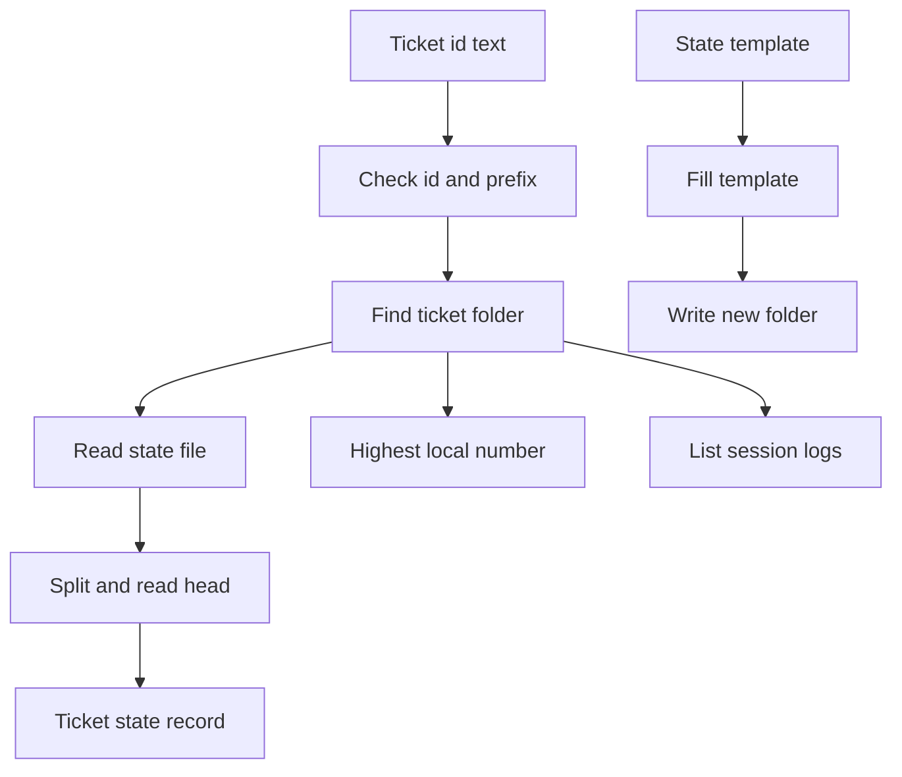
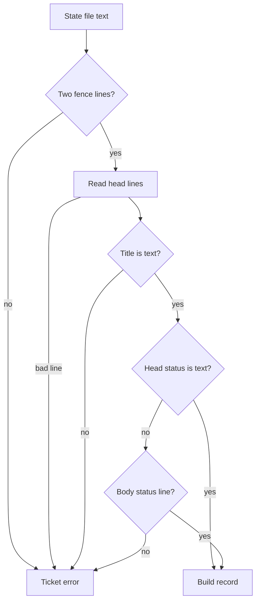

## Purpose

The vault side of the Plane sync. It answers: is this text a ticket id, where is that ticket's folder, what does its state file say (title, status, body), what is the highest ticket number on disk, and what do the session logs look like. It can also write a brand-new ticket folder from a template. Keeping this apart from the Plane client means the sync logic never touches vault files directly.

## Dependencies

**Depends on.** Standard library: `json`, `re`, `dataclasses`, `pathlib`, `typing`. [[plane_sync_settings]] and [plane_sync_settings](plane_sync_settings.md) for `PrefixRow` {src:scripts/connectors/plane/vault_ticket_files.py:18}. [[paths]] (no doc yet) in `scripts/core/paths.py` for `iter_ticket_folders` and `ticket_folder` {src:scripts/connectors/plane/vault_ticket_files.py:19}.

**Used by.**
- Product code: [[plane_ticket_syncer]] and [plane_ticket_syncer](plane_ticket_syncer.md) {src:scripts/connectors/plane/plane_ticket_syncer.py:29-37}; [[vault_ticket_creator]] and [vault_ticket_creator](vault_ticket_creator.md) {src:scripts/connectors/plane/vault_ticket_creator.py:19-30}; [[plane_comment_builder]] (no doc yet) imports `session_log_files` {src:scripts/connectors/plane/plane_comment_builder.py:18}; [[plane_drift_checker]] (no doc yet) {src:scripts/connectors/plane/plane_drift_checker.py:19-26}; [[cli]] (no doc yet) {src:scripts/connectors/plane/cli.py:32}.
- Tests: `tests/scripts/connectors/plane/test_plane_vault_files.py`, `test_plane_create.py`, `test_plane_fixes.py` (found with `git grep vault_ticket_files`, searched 2026-11-20).

## Behavior

**Ticket ids.** `parse_ticket_id` accepts only letters, a hyphen and digits for the whole text and returns the prefix and number {src:scripts/connectors/plane/vault_ticket_files.py:27}, {src:scripts/connectors/plane/vault_ticket_files.py:52-57}. `ticket_id_gate` returns a stop line and code 2 for a non-id {src:scripts/connectors/plane/vault_ticket_files.py:71-73}, a skip line and code 0 for a prefix with no entry in the settings {src:scripts/connectors/plane/vault_ticket_files.py:74-75}, and `None` for a mapped id {src:scripts/connectors/plane/vault_ticket_files.py:76}. `safe_text` removes control characters (which include newline) and cuts to 80 characters, so an id is safe to print {src:scripts/connectors/plane/vault_ticket_files.py:28}, {src:scripts/connectors/plane/vault_ticket_files.py:60-62}. `format_ticket_id` pads the number with zeros to the row's width {src:scripts/connectors/plane/vault_ticket_files.py:79-80}.

**Finding folders.** `ticket_folder` asks the shared path helper first, which looks flat then under a prefix folder and refuses a folder whose real location is outside the tickets folder {src:scripts/connectors/plane/vault_ticket_files.py:89-91}, {src:scripts/core/paths.py:237-262}. For a ticket that does not exist yet, it returns a folder under an existing letters-only prefix folder of the same name (any case), else directly under the tickets folder {src:scripts/connectors/plane/vault_ticket_files.py:92-97}. `highest_local_ticket_number` returns 0 when the tickets folder is missing {src:scripts/connectors/plane/vault_ticket_files.py:101-102}; otherwise it matches each ticket folder name against the row's pattern and takes the highest number in group 1 {src:scripts/connectors/plane/vault_ticket_files.py:103-109}. `iter_ticket_folders` yields only folders named like a ticket key {src:scripts/core/paths.py:265-291}.

**Reading a state file.** `parse_state_text` splits the text at the first two lines that are exactly `---` {src:scripts/connectors/plane/vault_ticket_files.py:112-117}, reads the head with a small flat key reader {src:scripts/connectors/plane/vault_ticket_files.py:136-149}, and requires a text `title` {src:scripts/connectors/plane/vault_ticket_files.py:169-170}. The status is the frontmatter `status` when it is text, else the first `Status:` line at column one outside fenced code in the body {src:scripts/connectors/plane/vault_ticket_files.py:171}, {src:scripts/connectors/plane/vault_ticket_files.py:152-163}. The reader skips blank, comment, indented and `-` lines {src:scripts/connectors/plane/vault_ticket_files.py:140-141}, raises on any other line that is not `key:` or `key: value` {src:scripts/connectors/plane/vault_ticket_files.py:142-144}, and reads a value as a JSON string if it starts with a double quote, as a single-quoted string, as none for numbers, booleans and null, else plain text {src:scripts/connectors/plane/vault_ticket_files.py:126-133}. `read_state_file` reads `<folder>/<id>-state.md`; a read error raises `VaultTicketError` naming only the file {src:scripts/connectors/plane/vault_ticket_files.py:185-190}. `normalize_status_word` cuts the text at the first whitespace followed by `(` or `-`, then upper-cases and turns spaces and hyphens into underscores {src:scripts/connectors/plane/vault_ticket_files.py:25}, {src:scripts/connectors/plane/vault_ticket_files.py:202-204}.

**Rendering a new state file.** `render_initial_state_file` requires `priority` and `work_type` to be letters, digits, hyphen or underscore {src:scripts/connectors/plane/vault_ticket_files.py:218-220}. It JSON-quotes title, scope and repo and leaves ticket id, priority, work type and date as they are {src:scripts/connectors/plane/vault_ticket_files.py:221-229}. Every `{lower_case_name}` in the template is replaced in one pass; a name with no value raises {src:scripts/connectors/plane/vault_ticket_files.py:24}, {src:scripts/connectors/plane/vault_ticket_files.py:231-237}.

**Writing a new ticket folder.** `write_new_ticket_folder` makes the folder (and missing parents) and fails if the folder exists {src:scripts/connectors/plane/vault_ticket_files.py:248-250}. It then opens the state file in exclusive-create mode and writes the text {src:scripts/connectors/plane/vault_ticket_files.py:254-255}. If that write fails it deletes the state file and the folder and raises {src:scripts/connectors/plane/vault_ticket_files.py:256-258}, {src:scripts/connectors/plane/vault_ticket_files.py:240-242}.

**Session logs.** `session_log_files` returns `<id>-session-*.md` files of the folder sorted by name, or an empty list when the folder is missing {src:scripts/connectors/plane/vault_ticket_files.py:262-265}.

## Diagram: module level (L2, required)

## Diagram: function level (L3, optional)

## Notes

- **Description versus code, header.** The scope line says `write_new_ticket_folder` "is the only writer and is create-only" {src:scripts/connectors/plane/vault_ticket_files.py:5}. It is the only function that writes, but on a failed write it also deletes the state file and the folder {src:scripts/connectors/plane/vault_ticket_files.py:240-242}, and it creates missing parent folders, which are not removed on failure {src:scripts/connectors/plane/vault_ticket_files.py:248}.
- **Description versus code, `safe_text`.** The docstring promises text "safe to print" {src:scripts/connectors/plane/vault_ticket_files.py:61}. The pattern covers codes 0 to 31 and 127 to 159 only {src:scripts/connectors/plane/vault_ticket_files.py:28}, so Unicode line separators (U+2028, U+2029) and direction marks pass through.
- **Description versus code, reader.** `parse_state_text` records `state_path=Path(source_name)`, which is a file name, not a path {src:scripts/connectors/plane/vault_ticket_files.py:181}; `read_state_file` rebuilds the object with the real path {src:scripts/connectors/plane/vault_ticket_files.py:192-199}.
- **Quirks of the head reader.** It is not YAML. A later duplicate key overwrites an earlier one {src:scripts/connectors/plane/vault_ticket_files.py:146}. An empty `status:` gives an empty text, so the body `Status:` line is not used {src:scripts/connectors/plane/vault_ticket_files.py:128-133}, {src:scripts/connectors/plane/vault_ticket_files.py:171}. Text before the first `---` line is ignored, and a file with no frontmatter but two `---` rules would read the text between them as frontmatter {src:scripts/connectors/plane/vault_ticket_files.py:114-117}.
- **Template placeholders.** Any `{lower_case}` text in a template, including in prose, must be one of the seven known names or the render raises {src:scripts/connectors/plane/vault_ticket_files.py:24}, {src:scripts/connectors/plane/vault_ticket_files.py:233-234}.
- **Inputs without a check.** `ticket_id` is used in file names and a glob {src:scripts/connectors/plane/vault_ticket_files.py:186}, {src:scripts/connectors/plane/vault_ticket_files.py:246}, {src:scripts/connectors/plane/vault_ticket_files.py:265} with no check inside these functions; callers use the gate for sync and drift, while create builds it from a settings prefix with no character check {src:scripts/connectors/plane/vault_ticket_creator.py:132}. In the new-ticket branch of `ticket_folder`, a prefix folder that is a symlink pointing outside the tickets folder is accepted, because that branch does not do the inside-the-tickets-folder check the shared helper does {src:scripts/connectors/plane/vault_ticket_files.py:93-96}, {src:scripts/core/paths.py:260}. `row.ticket_pattern` is compiled from settings without a check {src:scripts/connectors/plane/vault_ticket_files.py:103}. `scope` and `repo` are written to the new state file with JSON quoting only {src:scripts/connectors/plane/vault_ticket_files.py:225-226}; `today` and `ticket_id` are written raw {src:scripts/connectors/plane/vault_ticket_files.py:222}, {src:scripts/connectors/plane/vault_ticket_files.py:228}.
- **Cleanup can fail.** `_remove_partial_folder` runs inside an `except OSError` block and its own `rmdir` is unguarded {src:scripts/connectors/plane/vault_ticket_files.py:242}, so a failure there raises a raw `OSError` instead of `VaultTicketError`.
- **Shared-file writes.** The state file is created with mode `x`, so an existing file is never overwritten, and `mkdir(exist_ok=False)` makes two creators of the same ticket collide with an error instead of overwriting {src:scripts/connectors/plane/vault_ticket_files.py:248}, {src:scripts/connectors/plane/vault_ticket_files.py:254}. The write is in place, not through a temp file, so a crash mid-write leaves a partial file. No other file is written here.
- **Constants.** 15 module constants, none imported by another file (searched `git grep` over `scripts/` and `tests/`, 2026-11-20): `FRONTMATTER_FENCE`, `STATE_FILE_SUFFIX`, `SESSION_FILE_INFIX`, `PLACEHOLDER_PATTERN`, `STATUS_SPLIT_PATTERN`, `SAFE_WORD_PATTERN`, `TICKET_ID_PATTERN`, `CONTROL_CHARACTERS`, `SAFE_TEXT_LIMIT`, `EXIT_OK`, `EXIT_STOPPED`, `PLAIN_NON_TEXT`, `KEY_LINE`, `BODY_STATUS_LINE`, `FENCE_LINE` {src:scripts/connectors/plane/vault_ticket_files.py:21-31}, {src:scripts/connectors/plane/vault_ticket_files.py:120-123}.
