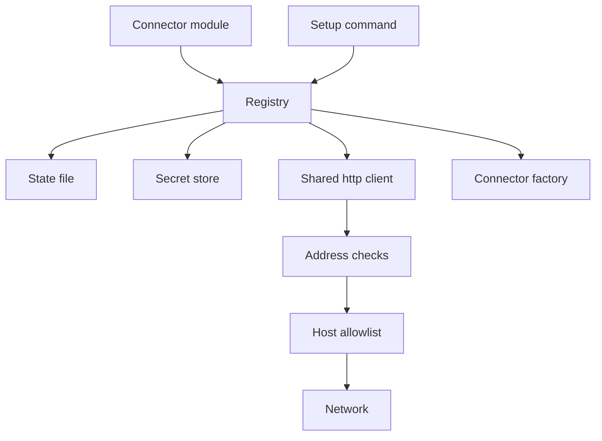
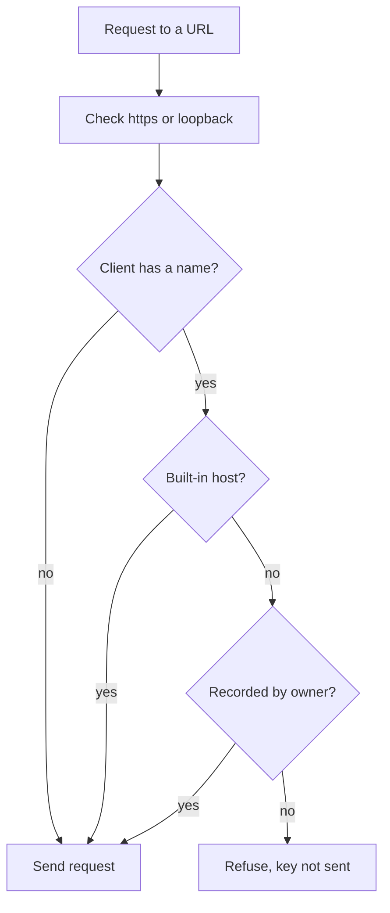

## Purpose

The central desk for every connector (Plane, Jira, Slack and the others). It keeps one small state file that says which connectors are on, at what address, with which plain settings and with which extra hosts the owner approved. It stores and fetches keys through the secret store, never in that file. It also builds the one network client the connectors share, which refuses redirects, unsafe addresses and any host that is not on the connector's allowed list. A connector is off until someone sets it up, and asking for an off connector gives a clear "how to set it up" message.

## Dependencies

**Depends on.** Standard library: `ipaddress`, `json`, `os`, `pathlib`, `re`, `sys`, plus `urllib` pieces imported inside functions. `core.paths` for `NotSetUp`; if that import fails the module defines its own empty `NotSetUp` {src:scripts/connectors/registry.py:23-27}. [[secret_store]] ([secret_store](secret_store.md)) for `default_store` and `check_name` {src:scripts/connectors/registry.py:29}. Environment variables `TOLLGATE_CONNECTORS` {src:scripts/connectors/registry.py:264} and `TOLLGATE_NONINTERACTIVE` {src:scripts/connectors/registry.py:410}. Late import of [[connect]] ([connect](connect.md)) inside `ensure` {src:scripts/connectors/registry.py:425}.

**Used by.**
- Product code: the five comms connectors import `register`, `ensure`, `run_cli` ({src:scripts/connectors/comms/calendar_connector.py:35}, {src:scripts/connectors/comms/commits_connector.py:32}, {src:scripts/connectors/comms/jira_connector.py:26}, {src:scripts/connectors/comms/notion_connector.py:29}, {src:scripts/connectors/comms/slack_connector.py:37}); `scripts/connectors/connect.py` {src:scripts/connectors/connect.py:29}; `scripts/connectors/data/databricks.py` {src:scripts/connectors/data/databricks.py:33}; `scripts/connectors/data/secrets_tool.py` {src:scripts/connectors/data/secrets_tool.py:31}; the Plane command line {src:scripts/connectors/plane/cli.py:19}, which registers its factory {src:scripts/connectors/plane/cli.py:73}.
- Tests: `tests/scripts/connectors/test_connectors.py`, `test_connectors_hardening.py`, `test_redirect_settings.py`, `test_host_allowlist.py`, `fake_connector.py`, `comms/comms_base.py`, `comms/test_jira.py`, `data/test_databricks.py`, `data/test_secrets_tool.py`, `plane/plane_sync_test_support.py`, `plane/test_plane_cli.py`, `plane/test_plane_connector.py`, and the harness file `tests/harness/connector_helpers.py` {src:tests/harness/connector_helpers.py:102} (found with `git grep`, searched 2026-11-21).

## Behavior

**Registering.** `register(name, factory)` stores a factory that later gets `(address, key, http)` {src:scripts/connectors/registry.py:36-38}, {src:scripts/connectors/registry.py:405}. A second registration of a name replaces the first without a warning {src:scripts/connectors/registry.py:38}. `registered()` lists names sorted {src:scripts/connectors/registry.py:42}. `set_store` and `set_http_factory` swap in a test store or a test client builder {src:scripts/connectors/registry.py:45-48} {src:scripts/connectors/registry.py:58-61}; `get_store` builds the default store on first use {src:scripts/connectors/registry.py:51-55}.

**Address checks.** `check_no_credentials` refuses an address with a user name, a password or an `@` in the host part {src:scripts/connectors/registry.py:82}, and its message never repeats the address {src:scripts/connectors/registry.py:86-88}. `check_address` allows https with a host, or http only to `127.0.0.1`, `localhost` or `::1` {src:scripts/connectors/registry.py:96-100}.

**The host allowlist.** A key goes only to a host on the built-in list for that connector, or to a host the owner recorded {src:scripts/connectors/registry.py:103-107}.
- Built-in hosts: Jira `.atlassian.net`, `.atlassian.com` and `api.atlassian.com`; Slack `slack.com` and `.slack.com`; Notion `api.notion.com` and `notion.com`; Databricks `.databricks.com`, `.azuredatabricks.net` and `.gcp.databricks.com`; Calendar `www.googleapis.com` and `calendar.googleapis.com` {src:scripts/connectors/registry.py:108-115}. Plane has no entry, so every Plane host must be recorded {src:scripts/connectors/registry.py:173}. `git-commits` is exempt because it makes no network call {src:scripts/connectors/registry.py:116-117} {src:scripts/connectors/registry.py:202-203}.
- A built-in match needs port 443 and a host name, not an IP address {src:scripts/connectors/registry.py:171-172}. An entry with a leading dot matches only a real subdomain, not the bare suffix {src:scripts/connectors/registry.py:174-176}; an entry without a dot matches that host exactly {src:scripts/connectors/registry.py:177-178}.
- `parse_host` returns `(host, port)` or raises `HostRefused`. It refuses spaces and any character outside printable ASCII {src:scripts/connectors/registry.py:138-140}, a login or a bad scheme {src:scripts/connectors/registry.py:141-142}, a backslash in the host part {src:scripts/connectors/registry.py:144-145}, an invalid port {src:scripts/connectors/registry.py:146-149}, an empty host or one ending in a dot {src:scripts/connectors/registry.py:150-151}, and a host that is neither an IP address nor made of valid name labels {src:scripts/connectors/registry.py:154-158}. A missing port becomes 443 for https and 80 for http {src:scripts/connectors/registry.py:152-153}. The host is lowercased by `urlparse`.
- The owner records a host with `HOST` or `HOST:PORT`. `normalize_allowed_host` lowercases it and refuses a scheme, path, wildcard, bracket, trailing dot, a port outside 1 to 65535, or text that is neither a host name nor an IP {src:scripts/connectors/registry.py:184-192}. The stored form omits port 443 and otherwise reads `host:port` {src:scripts/connectors/registry.py:127-128} {src:scripts/connectors/registry.py:193}.
- `check_host(name, url, env, extra)` raises `HostRefused` unless the host is built in or its stored form is in the recorded list or `extra` {src:scripts/connectors/registry.py:204-208}. A recorded host matches exactly: no subdomains and no other port {src:scripts/connectors/registry.py:207}. The refusal text names the exact `connect.py on NAME --allow-host HOST` command to run in a terminal {src:scripts/connectors/registry.py:209-213}. Recorded hosts are read from the state file on each call that gets past the built-in check {src:scripts/connectors/registry.py:196-197} {src:scripts/connectors/registry.py:205-207}.

**The shared network client.** `get_http(name, env)` returns the test factory's object when one is set, else `UrlHttp(name, env)` {src:scripts/connectors/registry.py:255-257}. `UrlHttp.request` first checks the address {src:scripts/connectors/registry.py:230}, then, when the client was built with a name, checks the host on every request, so an edit to the state file takes effect on the next call {src:scripts/connectors/registry.py:231-232}. It never follows a redirect: a 3xx raises `RedirectRefused` naming only the status code {src:scripts/connectors/registry.py:64-70}, {src:scripts/connectors/registry.py:236}, {src:scripts/connectors/registry.py:241-245}. Other HTTP errors are re-raised {src:scripts/connectors/registry.py:246}. A good reply gives `{"status", "body"}` with the body decoded as UTF-8 {src:scripts/connectors/registry.py:239}.

**The state file.** Its path is the file in `TOLLGATE_CONNECTORS`; if unset, `NotSetUp` is raised {src:scripts/connectors/registry.py:264-268}. `load_state` returns an empty map if the file cannot be read or parsed, or is not an object {src:scripts/connectors/registry.py:273-278}. It then keeps only entries that are maps with a text name; `on` is true only for JSON `true`, a non-text address becomes empty, `settings` are kept only when a non-empty map, and `allowed_hosts` keeps only the non-empty text items of a list {src:scripts/connectors/registry.py:291-303}. `save_state` rewrites the whole file as indented, sorted JSON with address, `on`, any settings and any allowed hosts {src:scripts/connectors/registry.py:312-318}.

**Turning on and off.** `turn_on` checks the connector name with `check_name` {src:scripts/connectors/registry.py:366}, refuses an address with a login in it {src:scripts/connectors/registry.py:367}, checks any settings {src:scripts/connectors/registry.py:368-369}, normalizes the hosts given with `--allow-host` {src:scripts/connectors/registry.py:370}, and runs the host check against the address, counting those new hosts, before the key is stored {src:scripts/connectors/registry.py:371}. Only then does it save the key {src:scripts/connectors/registry.py:372} and write the state, merging new settings over old ones and new hosts into the old list {src:scripts/connectors/registry.py:373-380}. `turn_off` checks the name {src:scripts/connectors/registry.py:384}, sets `on` to false, drops the recorded hosts (keeping address and settings) {src:scripts/connectors/registry.py:387-389}, and then deletes the key {src:scripts/connectors/registry.py:390}. `check_name` raises `SecretStoreError` for a name that is not 1 to 64 lowercase letters, digits, `-` or `_` {src:scripts/connectors/secret_store.py:44} {src:scripts/connectors/secret_store.py:49-52}.

**Settings.** `check_settings` refuses a setting whose name contains `key`, `token`, `secret` or `password` {src:scripts/connectors/registry.py:330} {src:scripts/connectors/registry.py:342-345}, and any value that is not text, a number, a boolean or a list of those {src:scripts/connectors/registry.py:333-336} {src:scripts/connectors/registry.py:346-348}. `set_settings` merges into the existing settings and saves {src:scripts/connectors/registry.py:355-362}; `get_settings` returns a copy {src:scripts/connectors/registry.py:351-352}.

**Using a connector.** `require` returns `factory(address, key, http)` with an `http` built for that connector name. It raises `NotSetUp` when the entry is missing or off {src:scripts/connectors/registry.py:397-399}, when no factory is registered {src:scripts/connectors/registry.py:400-401}, or when the secret store has no key {src:scripts/connectors/registry.py:402-404}. `ensure` calls `require`; on `NotSetUp` it re-raises unless the session is interactive, where it runs the first-use setup and calls `require` again {src:scripts/connectors/registry.py:418-427}. A session is interactive when `TOLLGATE_NONINTERACTIVE` is not `1` and both input and output are terminals {src:scripts/connectors/registry.py:408-415}. `run_cli` prints a `NotSetUp` message to standard error and exits with 2 {src:scripts/connectors/registry.py:430-436}.

## Diagram: module level (L2, required)

## Diagram: function level (L3, optional)

## Notes

- **Description versus code, "only handed out once a connector is on".** The header says the `http` object "is only handed out once a connector is on" {src:scripts/connectors/registry.py:12-13}, and `UrlHttp` says it is "only built once a connector is on" {src:scripts/connectors/registry.py:217}. `get_http` itself has no on-check {src:scripts/connectors/registry.py:255-257}. The rule holds only because `require` is the sole caller and checks first {src:scripts/connectors/registry.py:397-405} (searched `git grep get_http scripts tests hooks`, 2026-11-21: no other caller).
- **Description versus code, "never a key" and "names, addresses and on/off only".** The header says the state file holds "names, addresses and on/off only, never a key" {src:scripts/connectors/registry.py:10-11}. The file also holds settings and allowed hosts {src:scripts/connectors/registry.py:313-316}. Settings are screened by name only, not by value, so `{"catalog": "<anything>"}` is saved as given {src:scripts/connectors/registry.py:342-348}. The address check looks only for a user name or password in the address {src:scripts/connectors/registry.py:82}, so a key in the query string or path would be stored.
- **Host check is on the name only.** The host is compared as text. Nothing in this file resolves the name or checks where it points (searched the file 2026-11-21). A recorded entry that is an IP address works as an exact match, and built-in entries never match an IP {src:scripts/connectors/registry.py:171} {src:scripts/connectors/registry.py:207}.
- **Bypasses by design.** A client built with no name skips the host check {src:scripts/connectors/registry.py:231}, and when a test client builder is set, `get_http` ignores the name and returns that object {src:scripts/connectors/registry.py:257}. In product code `get_http` is reached only through `require`, which always passes the name {src:scripts/connectors/registry.py:405}. The tests call `UrlHttp()` with no name in `test_redirect_settings.py` {src:tests/scripts/connectors/test_redirect_settings.py:66}.
- **The allowlist lives in a plain file; the model write guards cover it.** The recorded hosts are a plain list in the state file {src:scripts/connectors/registry.py:315-316}. The `--allow-host` flag is refused without a terminal {src:scripts/connectors/connect.py:80-82}, and nothing in this file stops another program from writing the entry directly. The installer's default location for that file is `~/.claude/tollgate/connectors.yaml` {src:install.sh:927}. The model write guards now protect that folder {src:hooks/lib/protected_paths.py:30} and the file named by `TOLLGATE_CONNECTORS` when it is set {src:hooks/lib/protected_paths.py:35} {src:hooks/lib/protected_paths.py:69-70}, so the model cannot add a host through the Write, Edit or Bash tools; only the owner's terminal can. A program the owner or a script runs outside those hooks is not stopped. A hand-written entry is kept as text without the host-name check {src:scripts/connectors/registry.py:298-302}, and it can only match a host exactly {src:scripts/connectors/registry.py:207}.
- **`check_no_credentials` fails open.** If the address cannot be parsed, the function treats it as having no login {src:scripts/connectors/registry.py:83-84}. `turn_on` now reaches `check_address` through the host check, and that function parses again without a guard, so an unparseable address raises `ValueError` there {src:scripts/connectors/registry.py:371} {src:scripts/connectors/registry.py:204} {src:scripts/connectors/registry.py:142} {src:scripts/connectors/registry.py:95}.
- **`ensure` wording.** The docstring says it runs "require(), but run the first-use flow first" {src:scripts/connectors/registry.py:419}. The code runs `require` first and the setup flow only after it fails {src:scripts/connectors/registry.py:420-427}. It also starts setup when the failure is "no connector module is loaded" {src:scripts/connectors/registry.py:400-401}, which setup cannot fix. Setup from `ensure` passes no `--allow-host` hosts, so a connector with a host that is not built in cannot finish first-use setup this way {src:scripts/connectors/registry.py:426} {src:scripts/connectors/registry.py:371}.
- **Corrupt state file loses entries.** An unreadable or invalid file reads as empty {src:scripts/connectors/registry.py:273-276}, and the next `turn_on`, `turn_off` or `set_settings` rewrites the file from that empty map {src:scripts/connectors/registry.py:318}. Other connectors' entries, and their recorded hosts, are lost.
- **Inputs and the name check.** `turn_on` and `turn_off` check `name` with `check_name` before anything reaches the secret store {src:scripts/connectors/registry.py:366} {src:scripts/connectors/registry.py:384}. `require`, `ensure`, `register`, `is_on`, `get_settings` and `set_settings` do not check it {src:scripts/connectors/registry.py:397} {src:scripts/connectors/registry.py:355}; `require` reaches the secret store through `get`, and the Keychain and `secret-tool` stores check the name again when they build the service name {src:scripts/connectors/registry.py:402} {src:scripts/connectors/secret_store.py:56}. The in-memory test store does not. The check pattern is anchored with `\A` and `\Z`, so a name with a trailing newline is refused {src:scripts/connectors/secret_store.py:44}. The address host is now checked at turn-on and on every request {src:scripts/connectors/registry.py:371} {src:scripts/connectors/registry.py:232}; its path and query are not checked. The response body has no size limit and a body that is not UTF-8 raises an unhandled `UnicodeDecodeError` {src:scripts/connectors/registry.py:239}.
- **Shared-file writes.** `save_state` uses `write_text` directly: not atomic, no lock, and the file gets the default permissions {src:scripts/connectors/registry.py:318}. `turn_on`, `turn_off` and `set_settings` read the file, change it and write it back {src:scripts/connectors/registry.py:357-362}, {src:scripts/connectors/registry.py:373-380}, {src:scripts/connectors/registry.py:385-389}, so two at once can lose an update or leave a partial file.
- **Order on failure.** `turn_on` runs every check, including the host check, before the key is saved {src:scripts/connectors/registry.py:366-371}, so a refused host stores nothing. It saves the key before the state {src:scripts/connectors/registry.py:372-380}; if the state write fails the key stays stored with the connector still off. `turn_off` saves the state before it deletes the key {src:scripts/connectors/registry.py:389-390}; a store failure leaves the connector off with its key present.
