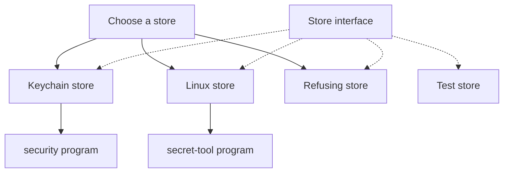
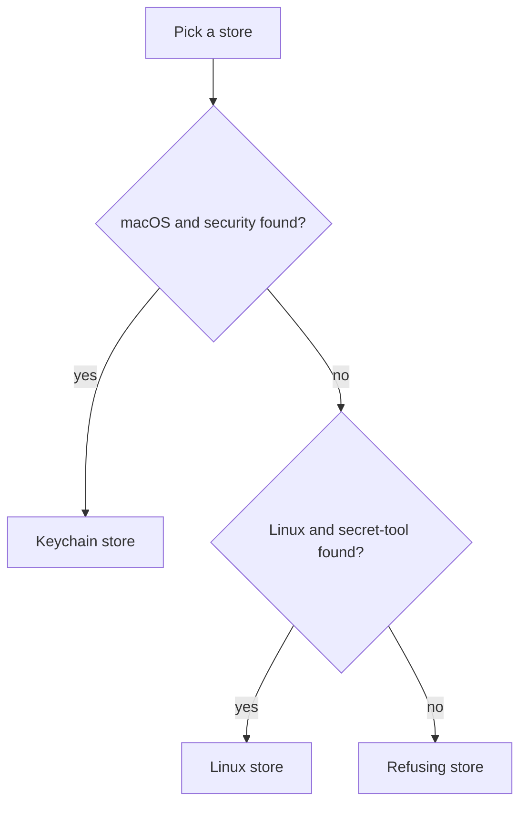

## Purpose

Connector keys must live in the user's own secret store and never in a file. This module defines the small interface for that (set, get, delete by connector name), the rule for what a connector name may look like, the two real stores (macOS Keychain and Linux `secret-tool`), a store that only exists for tests, and a store that refuses every call when no real store is available. `default_store` picks between them.

## Dependencies

**Depends on.** Standard library only: `getpass`, `platform`, `re`, `shutil`, `subprocess` {src:scripts/connectors/secret_store.py:14-18}. At run time it calls the outside programs `security` (macOS) {src:scripts/connectors/secret_store.py:79} and `secret-tool` (Linux) {src:scripts/connectors/secret_store.py:105}. No other repo file is imported.

**Used by.**
- Product code:
  - `scripts/connectors/registry.py` calls `default_store()` when no store has been set {src:scripts/connectors/registry.py:54}. Also imports `check_name` {src:scripts/connectors/registry.py:29} and calls it before a connector is turned on or off {src:scripts/connectors/registry.py:366} {src:scripts/connectors/registry.py:384}. Page: [[registry]] and [registry](registry.md).
  - `scripts/connectors/data/secrets_tool.py` imports `RefusingStore` and `SecretStoreError` {src:scripts/connectors/data/secrets_tool.py:32} and turns a `RefusingStore` into its own error {src:scripts/connectors/data/secrets_tool.py:44-45}. Page: [[secrets_tool]] and [secrets_tool](data/secrets_tool.md).
  - `scripts/connectors/connect.py` catches `SecretStoreError` {src:scripts/connectors/connect.py:157} and imports `check_name` {src:scripts/connectors/connect.py:30}. Page: [[connect]] and [connect](connect.md).
  - `scripts/connectors/plane/cli.py` catches `SecretStoreError` {src:scripts/connectors/plane/cli.py:195}. Page: [[cli]] and [cli](plane/cli.md).
- Tests: `tests/scripts/connectors/test_connectors.py` (class `TestSecretStores`) {src:tests/scripts/connectors/test_connectors.py:188}, `tests/scripts/connectors/data/test_secrets_tool.py` {src:tests/scripts/connectors/data/test_secrets_tool.py:106}. Many other tests use the separate fake `FakeSecretStore` from `tests/harness/connector_helpers.py` {src:tests/harness/connector_helpers.py:25}, not a class from this file.
- Found with `git grep` for the module and class names, excluding `docs/` (2026-11-20).

## Behavior

**Connector names.** `check_name` accepts a string of 1 to 64 characters that starts with a lowercase letter or digit and then holds only lowercase letters, digits, `-` and `_` {src:scripts/connectors/secret_store.py:44}. Anything else, including a value that is not a string, raises `SecretStoreError` {src:scripts/connectors/secret_store.py:49-52}.

**Service and account names.** Every key is filed under the service name `tollgate-` plus the connector name {src:scripts/connectors/secret_store.py:20} {src:scripts/connectors/secret_store.py:57}. Building the service name runs `check_name` first, so every Keychain and `secret-tool` call checks the name {src:scripts/connectors/secret_store.py:56}. `MemoryStore` and `RefusingStore` do not check names. The account is the login name of the current user, or the text `tollgate` if reading it raises any error {src:scripts/connectors/secret_store.py:60-64}.

**Interface.** `SecretStore` has `set`, `get` and `delete`, each raising `NotImplementedError` until a subclass fills it in {src:scripts/connectors/secret_store.py:34-41}. `NoSecretStore` is a kind of `SecretStoreError` {src:scripts/connectors/secret_store.py:27}.

**macOS Keychain store (`MacKeychainStore`).**
- `set` refuses a key that contains a double quote, backslash, newline, carriage return or NUL byte {src:scripts/connectors/secret_store.py:72-75}. Otherwise it builds one `add-generic-password` command line with `-U` (update an existing entry) {src:scripts/connectors/secret_store.py:77-78} and sends it on the standard input of `security -i`, so the key is not in the argument list {src:scripts/connectors/secret_store.py:79-80}. A non-zero exit raises `SecretStoreError` with a fixed message that does not include the program's own output {src:scripts/connectors/secret_store.py:81-82}.
- `get` runs `security find-generic-password ... -w` {src:scripts/connectors/secret_store.py:85-87}. Any non-zero exit returns `None`, so "not found" and "Keychain error" look the same {src:scripts/connectors/secret_store.py:88-89}. Success returns the output with trailing newlines removed {src:scripts/connectors/secret_store.py:90}.
- `delete` runs `delete-generic-password` and ignores the result {src:scripts/connectors/secret_store.py:93-94}.

**Linux store (`SecretToolStore`).**
- `set` runs `secret-tool store` with the key as standard input, not as an argument {src:scripts/connectors/secret_store.py:105-107}. The attributes are `service` and `account` {src:scripts/connectors/secret_store.py:101-102}. A non-zero exit raises `SecretStoreError` {src:scripts/connectors/secret_store.py:108-109}.
- `get` returns `None` on a non-zero exit or empty output, else the output unchanged {src:scripts/connectors/secret_store.py:114-116}. Unlike the Keychain store it does not strip a trailing newline.
- `delete` runs `secret-tool clear` and ignores the result {src:scripts/connectors/secret_store.py:119-120}.

**Test store (`MemoryStore`).** Keeps keys in a dictionary in memory, nothing touches disk {src:scripts/connectors/secret_store.py:126-136}.

**Refusing store (`RefusingStore`).** Every method, including `get`, raises `NoSecretStore` with the message about not keeping a key in a plain file {src:scripts/connectors/secret_store.py:142-153}. This differs from the real stores, where `get` returns `None` for a missing key.

**Choosing a store (`default_store`).** The system name defaults to `platform.system()` {src:scripts/connectors/secret_store.py:157}. On Darwin with `security` found it returns the Keychain store {src:scripts/connectors/secret_store.py:158-159}. On Linux with `secret-tool` found it returns the Linux store {src:scripts/connectors/secret_store.py:160-161}. Anything else, including Windows or a missing tool, returns `RefusingStore` {src:scripts/connectors/secret_store.py:162}. There is no plain-file store anywhere in the file.

## Diagram: module level (L2, required)

## Diagram: function level (L3, optional)

## Notes

**Code and its own description.**
- The header says the default store refuses if neither tool exists {src:scripts/connectors/secret_store.py:12}. The code agrees {src:scripts/connectors/secret_store.py:162}. It also refuses on a platform that is neither macOS nor Linux, which the header does not mention.
- The header says "A key never goes into an argument list" {src:scripts/connectors/secret_store.py:10}. This holds for `set` in both real stores {src:scripts/connectors/secret_store.py:79-80} {src:scripts/connectors/secret_store.py:105-106}. The refusal message tells the user to "Install secret-tool" {src:scripts/connectors/secret_store.py:144}, which does not help on a Mac without `security`; this is a wording gap, not a code fault.
- The header `Date:` is blank {src:scripts/connectors/secret_store.py:5}.

**Inputs that reach a command or file without a check.**
- The connector `name` is checked by `check_name` before it reaches the service name, so a quote or line break inside it is refused {src:scripts/connectors/secret_store.py:56} {src:scripts/connectors/secret_store.py:77-78}. The pattern is anchored with `\A` and `\Z` {src:scripts/connectors/secret_store.py:44}. It used to end in `$`, which in Python also matches before a final newline and let a name such as `x` plus a newline through; `\Z` matches only at the true end of the text, so that name is now refused. The callers add their own checks: `secrets_tool` accepts names matching a separate regular expression {src:scripts/connectors/data/secrets_tool.py:34} {src:scripts/connectors/data/secrets_tool.py:78-81}.
- The account name (from `getpass.getuser()`) goes into the same command line with no check {src:scripts/connectors/secret_store.py:60-62} {src:scripts/connectors/secret_store.py:77-78}.
- Key characters other than the five rejected ones (for example `$` or a backtick) are passed to `security -i` unchanged. How `security -i` reads them is not checked here [uncertain].
- No file path, network address or outbound text is built from an input in this file.

**Shared file writes.** None. The file writes no file. The only shared state is the user's Keychain or `secret-tool` store; nothing in this file stops two writers at once, and `add-generic-password -U` replaces an existing entry {src:scripts/connectors/secret_store.py:77}.

**Other.**
- `delete` ignores failures in both real stores {src:scripts/connectors/secret_store.py:93-94} {src:scripts/connectors/secret_store.py:119-120}, so a failed delete looks like a success to the caller.
- Exceptions from running `security` or `secret-tool` itself (for example the program vanishing after `which`) are not caught here.
- Tests: `test_keychain_secret_not_in_arguments` proves the key is absent from the argument list and present in the standard input text {src:tests/scripts/connectors/test_connectors.py:197-203}. `test_keychain_rejects_unsafe_value` proves one rejected character (a double quote) raises {src:tests/scripts/connectors/test_connectors.py:205-207}; the other four rejected characters are not tested. `test_secret_tool_secret_on_stdin` proves the Linux key goes on standard input {src:tests/scripts/connectors/test_connectors.py:209-215}. `test_get_returns_value_or_none` proves the newline is stripped and a non-zero exit gives `None`, for the Keychain store only {src:tests/scripts/connectors/test_connectors.py:217-221}. `test_no_tool_refuses_never_plain_file` and `test_default_store_choice` prove the three outcomes of `default_store` with a fake system name and a fake `which`, so they do not depend on the machine {src:tests/scripts/connectors/test_connectors.py:223-238}. `test_memory_store` proves set, get, delete {src:tests/scripts/connectors/test_connectors.py:240-245}. Nothing tests `SecretToolStore.get` or either `delete`. The name check is tested in `tests/scripts/connectors/test_connectors_hardening.py` (class `S5ConnectorName`): nine bad names (one is `slack` plus a trailing newline) make the Keychain store's `set`, `get` and `delete` raise without starting `security` {src:tests/scripts/connectors/test_connectors_hardening.py:141} {src:tests/scripts/connectors/test_connectors_hardening.py:161-169}, and three plain names pass `check_name` {src:tests/scripts/connectors/test_connectors_hardening.py:183-186}. See [[test_connectors_hardening]] ([test_connectors_hardening](../../tests/scripts/connectors/test_connectors_hardening.md)).