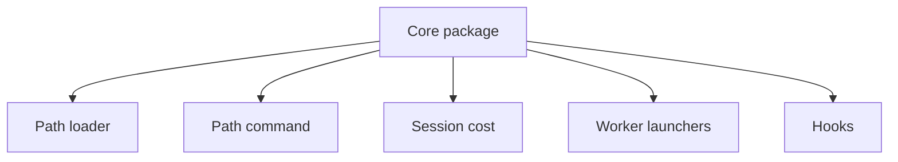

## Purpose

An empty package marker. It makes the `scripts/core/` folder a regular Python package so that other code can write `from core.paths import get_path`. See [[core]] and [core](../core.md) for the folder as a whole.

## Dependencies

**Depends on.** Nothing. The file has 0 bytes and 0 lines (checked with `ls -la` and `wc -l`, 2026-11-20).

**Used by.**
- Product code: every file that imports from the `core` package, for example `scripts/core/tg_path` {src:scripts/core/tg_path:15}, `scripts/core/session_cost.py` {src:scripts/core/session_cost.py:22}, `scripts/search/build_index.py` {src:scripts/search/build_index.py:42} and `scripts/connectors/plane/cli.py` {src:scripts/connectors/plane/cli.py:34}. Found with `git grep` for `from core` and `import core` (2026-11-20). All of these import `core.paths`; none imports `core` itself.
- Tests: for example `tests/scripts/core/test_paths.py` {src:tests/scripts/core/test_paths.py:21} and `tests/scripts/cron/test_cron_tools.py` {src:tests/scripts/cron/test_cron_tools.py:30}.

## Behavior

None. The file holds no code, so nothing runs when it is imported. Its only effect is that the folder is a regular package. Importers first put the `scripts/` folder on the import path, for example `tg_path` inserts the parent of its own folder {src:scripts/core/tg_path:14}, and then import `core.paths` {src:scripts/core/tg_path:15}. Since Python 3.3 a folder without this file also imports, as a namespace package {src:docs:https://docs.python.org/3/reference/import.html#namespace-packages}, so the marker is a convention rather than a requirement.

## Diagram: module level (L2, required)

## Diagram: function level (L3, optional)

None: no function has branching that the signature does not show.

## Notes

- Code and description: no description exists to compare, since the file is empty.
- Inputs that reach a path, command or address: none, no code.
- Shared file writes: none, no code.
- The page for the whole folder is `docs/scripts/core.md`. A page for the path loader `paths.py` does not exist yet (no doc yet).
