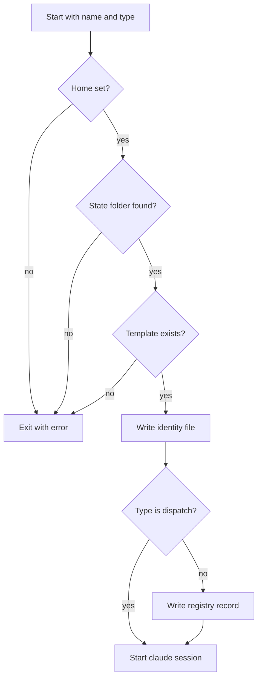

## Purpose

The shared launcher behind every worker start script. Given a worker name and a worker type, it writes that worker's identity file from a template, writes a registry record saying the worker is available (except for the dispatch type), and then replaces itself with a `claude` session that has the identity file added to its system prompt. The eight named wrappers (`bootstrap-arch-1.sh` and the others) only supply the name and type.

## Dependencies

**Depends on.**
- Environment: `TOLLGATE_HOME` (required) {src:scripts/core/bootstrap/_worker_common.sh:19-22}; `TOLLGATE_WORKER_TEMPLATES` (optional) {src:scripts/core/bootstrap/_worker_common.sh:27}.
- Repo file `scripts/core/tg_path`, run to find the state folder {src:scripts/core/bootstrap/_worker_common.sh:24-25}. Page: no doc yet, see the folder page [[core]] and [core](../../core.md).
- Template file `<type>-identity-template.md` inside the template folder {src:scripts/core/bootstrap/_worker_common.sh:30}.
- Outside programs: `sed` {src:scripts/core/bootstrap/_worker_common.sh:43}, `date` {src:scripts/core/bootstrap/_worker_common.sh:57}, `mv` {src:scripts/core/bootstrap/_worker_common.sh:62}, and `claude` {src:scripts/core/bootstrap/_worker_common.sh:67}.

**Used by.**
- Product code: the eight wrappers call it with `exec bash`: `bootstrap-arch-1.sh` {src:scripts/core/bootstrap/bootstrap-arch-1.sh:11}, `bootstrap-arch-2.sh` {src:scripts/core/bootstrap/bootstrap-arch-2.sh:11}, `bootstrap-dev-1.sh` {src:scripts/core/bootstrap/bootstrap-dev-1.sh:11}, `bootstrap-dev-2.sh` {src:scripts/core/bootstrap/bootstrap-dev-2.sh:11}, plus `bootstrap-dispatch.sh`, `bootstrap-qa-1.sh`, `bootstrap-qa-2.sh`, `bootstrap-spec-1.sh` and `bootstrap-spec-2.sh` (found by `git grep`, 2026-11-20). Pages: [[bootstrap-arch-1]] and [bootstrap-arch-1](bootstrap-arch-1.md), and the same for `bootstrap-arch-2`, `bootstrap-dev-1`, `bootstrap-dev-2`. The other five wrappers have no page yet (no doc yet).
- No file under `scripts/`, `install.sh` or the hooks calls this script directly or starts the wrappers (searched with `git grep` for `_worker_common` and `bootstrap-`, excluding `docs/`, 2026-11-20).
- Tests: `tests/scripts/core/test_bootstrap.py` runs the wrappers, which run this script {src:tests/scripts/core/test_bootstrap.py:63}.

## Behavior

1. **Strict mode and arguments.** `set -euo pipefail` {src:scripts/core/bootstrap/_worker_common.sh:9}. Both arguments are required: a missing name or type makes the shell stop with the given message {src:scripts/core/bootstrap/_worker_common.sh:16-17}.
2. **Home check.** If `TOLLGATE_HOME` is unset or empty it prints `not set up: TOLLGATE_HOME is not set` to standard error and exits 1 {src:scripts/core/bootstrap/_worker_common.sh:19-22}.
3. **State folder.** It runs `tg_path state`; if that fails it prints `not set up` and exits 1 {src:scripts/core/bootstrap/_worker_common.sh:24-25}. The identity files go in `<state>/workers` and the registry records in `<state>/worker-registry` {src:scripts/core/bootstrap/_worker_common.sh:28-29}.
4. **Template lookup.** The template folder is `TOLLGATE_WORKER_TEMPLATES` when set, else `<TOLLGATE_HOME>/templates/workers` {src:scripts/core/bootstrap/_worker_common.sh:27}. The file is `<type>-identity-template.md` {src:scripts/core/bootstrap/_worker_common.sh:30}. If it is missing the script prints `identity template not found for worker type: <type>` and exits 1 {src:scripts/core/bootstrap/_worker_common.sh:33-36}.
5. **Terminal title.** Writes the escape sequence that sets the terminal title to the worker name {src:scripts/core/bootstrap/_worker_common.sh:39}. It writes to standard output whether or not that is a terminal.
6. **Identity file.** Creates the workers folder and writes `<name>-identity.md`, a copy of the template with every `{{WORKER_NAME}}` replaced by the name {src:scripts/core/bootstrap/_worker_common.sh:42-43}. Any other placeholder in the template is left as written. An existing identity file is overwritten.
7. **Registry record.** Skipped when the type is `dispatch` {src:scripts/core/bootstrap/_worker_common.sh:46}. Otherwise it writes `<name>.json` with status `available`, no ticket, empty worktree path and session id, and the current UTC time {src:scripts/core/bootstrap/_worker_common.sh:50-61}. It writes to `<name>.json.tmp` first and then moves it into place {src:scripts/core/bootstrap/_worker_common.sh:49} {src:scripts/core/bootstrap/_worker_common.sh:62}. The write is unconditional: it replaces any record that already exists, including one for a worker that is busy.
8. **Launch.** Exports `TOLLGATE_WORKER_ID` as the name and replaces the shell with `claude --append-system-prompt-file <identity file>` {src:scripts/core/bootstrap/_worker_common.sh:66-67}. Exit codes before this point are 1 for the three checks above; after the `exec` the code is whatever `claude` returns, or the shell's own error if `claude` is not on the path.

## Diagram

## Notes

**Code and its own description.**
- The header says it writes "the identity file and the registry record under the state path" {src:scripts/core/bootstrap/_worker_common.sh:14}. For the dispatch type there is no registry record; the code comment says so {src:scripts/core/bootstrap/_worker_common.sh:45-46}, the header line does not.
- The header says templates come from `TOLLGATE_WORKER_TEMPLATES` or "the templates folder inside TOLLGATE_HOME" {src:scripts/core/bootstrap/_worker_common.sh:12-13}. The code agrees {src:scripts/core/bootstrap/_worker_common.sh:27}, but that folder does not exist in this checkout: `templates/` holds only `code-docs` (listed 2026-11-20), and no file in the repo other than this script and its test names `identity-template` (`git grep`, 2026-11-20). Without `TOLLGATE_WORKER_TEMPLATES` the run stops at the missing-template check {src:scripts/core/bootstrap/_worker_common.sh:33-36}. Nothing in `install.sh` sets that variable (`git grep` for `TOLLGATE_WORKER_TEMPLATES`, 2026-11-20).
- The header `Date:` is blank {src:scripts/core/bootstrap/_worker_common.sh:4}.

**Inputs that reach a path, command or text without a check.** Called through the wrappers the values are fixed text, so the risk is for a direct call only.
- `WORKER_NAME` is used in file paths {src:scripts/core/bootstrap/_worker_common.sh:31} {src:scripts/core/bootstrap/_worker_common.sh:48}, in the `sed` replacement text {src:scripts/core/bootstrap/_worker_common.sh:43} and in the JSON text {src:scripts/core/bootstrap/_worker_common.sh:52}, with no check. A `/` or `&` in the name breaks or changes the `sed` substitution, a `..` or `/` reaches the file path, and a quote or backslash makes the JSON invalid.
- `WORKER_TYPE` is used in the template path {src:scripts/core/bootstrap/_worker_common.sh:30} and the JSON {src:scripts/core/bootstrap/_worker_common.sh:53}, with no check. Only the `dispatch` comparison looks at its value {src:scripts/core/bootstrap/_worker_common.sh:46}.
- `TOLLGATE_WORKER_TEMPLATES` is used as a folder as given {src:scripts/core/bootstrap/_worker_common.sh:27}. The identity file text goes straight into the system prompt of the session {src:scripts/core/bootstrap/_worker_common.sh:67}, so whoever controls the template controls that prompt.

**Writes to shared files.**
- Identity file: written with a plain redirect, which is not atomic, and nothing stops two launches of the same worker name at once {src:scripts/core/bootstrap/_worker_common.sh:43}.
- Registry record: written to a fixed temp name then moved, so a reader never sees a half-written record {src:scripts/core/bootstrap/_worker_common.sh:49} {src:scripts/core/bootstrap/_worker_common.sh:62}. Two launches of the same worker share one temp name and nothing locks them, so they can mix. No file in the repo reads the `worker-registry` folder (`git grep` for `worker-registry`, excluding `docs/`: only this script and its test, 2026-11-20).

**Tests** (`tests/scripts/core/test_bootstrap.py`).
- `test_each_role_launches_with_identity` runs every wrapper against a fake `claude` and checks the identity text, the three arguments the fake received, and the registry record fields, including that no `.tmp` is left {src:tests/scripts/core/test_bootstrap.py:59-80}. It covers the success path for all nine roles. It cannot catch a template folder missing from the real repo, because it always sets `TOLLGATE_WORKER_TEMPLATES` {src:tests/scripts/core/test_bootstrap.py:44}.
- `test_missing_template_fails_clearly` proves a non-zero exit and the text `template not found` {src:tests/scripts/core/test_bootstrap.py:82-88}, matching the message {src:scripts/core/bootstrap/_worker_common.sh:34}.
- `test_unset_home_says_not_set_up` proves exit 1 and the text `not set up` when `TOLLGATE_HOME` is removed {src:tests/scripts/core/test_bootstrap.py:90-96}.
- No test covers an existing registry record being overwritten, an odd worker name, or a failing `tg_path`. The tests need `bash` and a `python3` on the path (for `tg_path`) and run the scripts from the repo location, not a fixed machine path {src:tests/scripts/core/test_bootstrap.py:18}.
