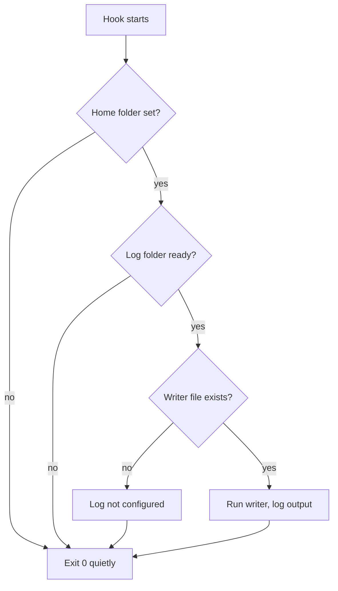

## Purpose

A helper meant to be called by a PreCompact hook entry. It runs a separate "session state writer" program, chosen by the person who installs Tollgate through an environment variable, and records that program's output in a log file. Its design goal is that a hook failure never disturbs the Claude session, so it exits 0 on every path.

## Dependencies

**Depends on.**
- Environment variables: `TOLLGATE_HOME` {src:scripts/core/hooks/session_state_hook.sh:11}, `TOLLGATE_SESSION_STATE_WRITER` {src:scripts/core/hooks/session_state_hook.sh:18}, and optional `TOLLGATE_PYTHON` {src:scripts/core/hooks/session_state_hook.sh:24}.
- `scripts/core/tg_path`, a Python command that prints the folder for a logical name; called with the name `logs`. {src:scripts/core/hooks/session_state_hook.sh:15} {src:scripts/core/tg_path:23} The `logs` name defaults to `~/.tollgate/logs` unless the paths file sets it. {src:scripts/core/paths.py:53} {src:scripts/core/paths.py:107} {src:scripts/core/paths.py:126-127} `tg_path` has no page yet: [[tg_path]] (no doc yet).
- `mkdir` {src:scripts/core/hooks/session_state_hook.sh:16}, `bash` (shebang) {src:scripts/core/hooks/session_state_hook.sh:1}, and `python3` when `TOLLGATE_PYTHON` is unset. {src:scripts/core/hooks/session_state_hook.sh:24}

**Used by.** No product code calls this script. A repo search for `session_state_hook` and `SESSION_STATE_WRITER` outside `docs/` (git grep, 2026-11-20) finds only the script itself and the tests. `settings.json` does not name it. {src:settings.json:252} The repo's overview page says the same. {src:docs/scripts/core.md:63}
- Tests: `tests/scripts/core/test_bootstrap.py` runs it twice. {src:tests/scripts/core/test_bootstrap.py:143} {src:tests/scripts/core/test_bootstrap.py:154}

## Behavior

1. When `TOLLGATE_HOME` is unset or empty, exits 0 at once, writing nothing and logging nothing. {src:scripts/core/hooks/session_state_hook.sh:11-13}
2. Asks `tg_path` for the `logs` folder, with its error output discarded; on any failure exits 0. {src:scripts/core/hooks/session_state_hook.sh:15}
3. Creates the log folder with `mkdir -p`; on failure exits 0. {src:scripts/core/hooks/session_state_hook.sh:16}
4. Reads the writer path from `TOLLGATE_SESSION_STATE_WRITER`. When it is empty or is not an existing regular file, appends "session state writer not configured" to `session_state_hook.log` and exits 0. {src:scripts/core/hooks/session_state_hook.sh:18-22}
5. Otherwise runs `${TOLLGATE_PYTHON:-python3} "$WRITER"` and appends both its standard output and standard error to `session_state_hook.log`. {src:scripts/core/hooks/session_state_hook.sh:24} The writer's own exit status is not read. {src:scripts/core/hooks/session_state_hook.sh:26}
6. Exits 0. {src:scripts/core/hooks/session_state_hook.sh:26}

The script has no `set -e`, so a failing writer cannot stop it, and the script passes no argument to the writer. Standard input is not redirected, so the writer inherits whatever the hook caller supplies on it. {src:scripts/core/hooks/session_state_hook.sh:24}

## Diagram

## Notes

- **Header versus code, errors.** The header says "Errors go to the log, never to the session". {src:scripts/core/hooks/session_state_hook.sh:6} Only the writer's output and errors reach the log. {src:scripts/core/hooks/session_state_hook.sh:24} A missing `TOLLGATE_HOME`, a failing `tg_path` and a failing `mkdir` all exit 0 without writing anything anywhere, so those errors are dropped, not logged. {src:scripts/core/hooks/session_state_hook.sh:11-13} {src:scripts/core/hooks/session_state_hook.sh:15} {src:scripts/core/hooks/session_state_hook.sh:16}
- **Header versus code, message.** The log text "session state writer not configured" is also written when the variable is set but the file does not exist or is not a regular file, so a typo in the path reads as "not configured". {src:scripts/core/hooks/session_state_hook.sh:19-20} The `2>&1` after the `echo` redirect does nothing useful. {src:scripts/core/hooks/session_state_hook.sh:20} The `Date:` header field is empty. {src:scripts/core/hooks/session_state_hook.sh:4}
- **Unchecked inputs.** No check exists on any of these values:
  - `TOLLGATE_HOME` builds the path of the program that is run to find the log folder. {src:scripts/core/hooks/session_state_hook.sh:15}
  - `TOLLGATE_SESSION_STATE_WRITER` is run as a program argument to Python after only a file-exists test; the file is executed whatever it contains. {src:scripts/core/hooks/session_state_hook.sh:19} {src:scripts/core/hooks/session_state_hook.sh:24}
  - `TOLLGATE_PYTHON` is run as the command itself, with no check. {src:scripts/core/hooks/session_state_hook.sh:24}
  - The log folder from `tg_path` is passed to `mkdir -p` and used as the log path, with no check on its value. {src:scripts/core/hooks/session_state_hook.sh:16} {src:scripts/core/hooks/session_state_hook.sh:20}
  All four are set by the installer or user, not by session content, so the risk is a misconfigured or hostile environment, not prompt input.
- **Shared-file writes.** Both writes append to `session_state_hook.log` with `>>`. {src:scripts/core/hooks/session_state_hook.sh:20} {src:scripts/core/hooks/session_state_hook.sh:24} Appending is not a temp-file-and-rename write, and nothing locks the log, so two hooks firing together can interleave their lines. Whether the writer program writes other shared files is outside this script.
- **Tests.** `test_session_state_logs_when_unconfigured` sets `TOLLGATE_HOME`, leaves the writer unset (the test environment strips every `TOLLGATE_*` value), runs the hook and expects exit 0 and the words "not configured" in `~/.tollgate/logs/session_state_hook.log` under the throwaway home. {src:tests/scripts/core/test_bootstrap.py:141-146} {src:tests/harness/throwaway_home.py:31-34} It depends on the log folder defaulting to `.tollgate/logs` under `HOME`. {src:scripts/core/paths.py:107} `test_session_state_runs_writer` writes a one-line Python writer, sets the variable and expects "writer ran" in the log. {src:tests/scripts/core/test_bootstrap.py:148-157} It uses plain `python3` from `PATH` because `TOLLGATE_PYTHON` is stripped, so it fails on a machine with no `python3`. No test covers an unset `TOLLGATE_HOME`, a writer path that is set but missing, or a writer that exits non-zero.
