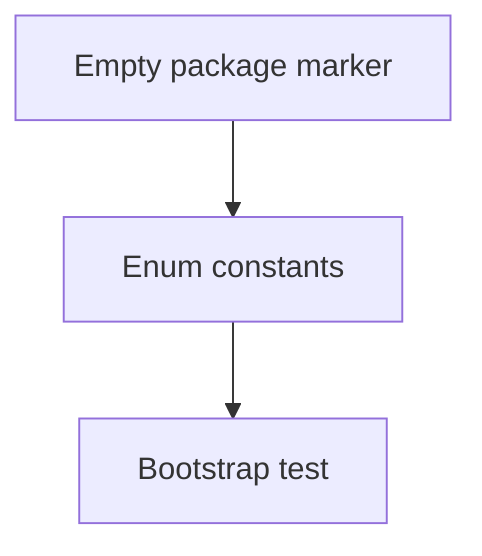

## Purpose

This is the package marker for `scripts/core/memory/`. It makes the folder importable as `core.memory` so the enum constants module beside it can be reached with an ordinary import.

## Dependencies

**Depends on.** Nothing. The file is empty: `wc -l` reports 0 lines and `ls -l` reports 0 bytes (checked 2026-11-20).

**Used by.** No product code imports `core.memory` (searched the repo for `core.memory`, `core/memory` and `_enums`, excluding `docs/`, 2026-11-20). One test imports a module from the package, which goes through this folder {src:tests/scripts/core/test_bootstrap.py:208}. The package holds one other file, [[_enums]] / [_enums](_enums.md).

## Behavior

The file contains no code, so nothing runs when the package is imported. There are no lines to cite; the claim rests on the file size of 0 bytes. It defines no names, so `from core.memory import X` for any name other than the `_enums` submodule fails.

## Diagram: module level (L2, required)

## Diagram: function level (L3, optional)

None: no function has branching that the signature does not show.

## Notes

- The sibling `scripts/core/__init__.py` is also empty (0 bytes, checked 2026-11-20), so the `core` package carries no setup code either.
- No input reaches a file path, shell command, network address or outbound text, because the file has no code.
- The file writes nothing, so there is no shared-file write.
- No description in the file disagrees with the code, because the file has no text.
- The empty file is the only link in the chain between the test and the constants. The test would still pass if the file were deleted, because Python 3 can import a folder without an init file as a namespace package (not tested here). Do not rely on this page for whether removal is safe.
