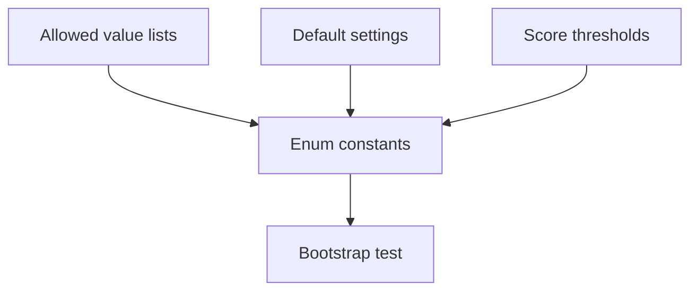

## Purpose

This file holds fixed value lists and default settings for the memory feature: which scope, confidence, status and data domain values a memory file may carry, where quarantined files go, which reasons a health report may give, and the score thresholds for search results. It has no functions. Its own header calls it the single source of truth for these values.

## Dependencies

**Depends on.** Nothing. The file has no import statements (read in full, lines 1-114), so it needs no other module, file or environment variable.

**Used by.** No product code. A search of the repo for `_enums`, `core.memory` and `core/memory`, excluding `docs/` (searched 2026-11-20), finds one importer, a test.

Tests: {src:tests/scripts/core/test_bootstrap.py:208}.

The constants `CONFIDENCE_VALUES`, `STATUS_VALUES_MEMORY`, `STATUS_VALUES_STANDARDS`, `MANIFEST_HEALTH_REASONS`, `CASCADE_WARNINGS_REASONS`, `MEMORY_DEFENSIVE_DEFAULTS`, `FOUNDATION_DEFENSIVE_DEFAULTS`, `CASCADE_MIN_SCORE` and `MIN_SCORE` are read by no other file under this name (same search, plus a search for each name).

## Behavior

The module only defines names; nothing runs when it is imported.

- Scope values: five allowed strings {src:scripts/core/memory/_enums.py:13-19}. `RESTRICTED_SCOPES` is that set minus `all` {src:scripts/core/memory/_enums.py:21}.
- Confidence values: `hypothesis`, `observed`, `validated` {src:scripts/core/memory/_enums.py:25-29}.
- Status values for memory files: `active`, `draft`, `deprecated`, `superseded` {src:scripts/core/memory/_enums.py:33-38}. The standards tier list leaves out `superseded` {src:scripts/core/memory/_enums.py:41-45}.
- Data domains: `general`, `client-a` to `client-d`, `internal` {src:scripts/core/memory/_enums.py:49-56}.
- Quarantine folders: each non-active status maps to a `memory-quarantine/<status>` folder string {src:scripts/core/memory/_enums.py:60-64}.
- Health reasons and cascade warning reasons are two lists of fixed strings {src:scripts/core/memory/_enums.py:68-73} {src:scripts/core/memory/_enums.py:77-82}.
- `DROP_SENTINEL` is the string `DROP` {src:scripts/core/memory/_enums.py:89}. The standards defaults map a missing status to that sentinel {src:scripts/core/memory/_enums.py:101-103}.
- Memory defaults: a missing scope reads as `internal-only`, a missing confidence as `hypothesis`, a missing status as `active`, a missing data domain as `general` {src:scripts/core/memory/_enums.py:92-97}.
- Foundation defaults: a missing status reads as `active` {src:scripts/core/memory/_enums.py:107-109}.
- Thresholds: both `CASCADE_MIN_SCORE` and `MIN_SCORE` are 0.3 {src:scripts/core/memory/_enums.py:113} {src:scripts/core/memory/_enums.py:114}.

## Diagram: module level (L2, required)

## Diagram: function level (L3, optional)

None: no function has branching that the signature does not show.

## Notes

**Code and description disagree.**
- The header says this is the single source of truth for memory enum values {src:scripts/core/memory/_enums.py:3}. No product code imports it (searched 2026-11-20). Search has its own `MIN_SCORE` of 0.3 {src:scripts/search/config.py:78}, and the vault inject hook uses 0.40 {src:hooks/pre-submit-vault-inject.sh:19}.
- The comment says missing fields in the memory tier read as "the most restrictive safe value" {src:scripts/core/memory/_enums.py:91}. Scope does read as a restricted value {src:scripts/core/memory/_enums.py:93}, but a missing status reads as `active` {src:scripts/core/memory/_enums.py:94}, and the health reasons show that draft, deprecated and superseded are the excluded statuses {src:scripts/core/memory/_enums.py:69-71}. A missing data domain reads as `general` {src:scripts/core/memory/_enums.py:96}.
- The comment on `CASCADE_MIN_SCORE` says it was lowered from 0.5 {src:scripts/core/memory/_enums.py:113}. Nothing in the repo shows the old value (not checkable from this file).
- The comment on `MIN_SCORE` says "legacy threshold" for non-cascade mode {src:scripts/core/memory/_enums.py:114}. No code reads either constant (searched), so neither mode uses them.
- The comment on foundation files says they use `supersedes:` instead of `status:` {src:scripts/core/memory/_enums.py:105}. No code in the repo reads that field through this module, so the claim is not checkable here.
- The path loader says no other file may hold a folder name {src:scripts/core/paths.py:30-31}; the quarantine values here are folder strings {src:scripts/core/memory/_enums.py:61-63}. They are not built from the loader.
- The `date:` header field is empty {src:scripts/core/memory/_enums.py:5}.

**Constants not listed in the frontmatter.** There are 15 module-level constants. The six another file reads are listed in `exports`; the other nine are named under Dependencies, above.

**Inputs with no check.** None: the file takes no input, builds no path, command, address or outbound text.

**Shared files.** None: the file writes nothing.

**Test coverage.** The one test checks six of the fifteen constants {src:tests/scripts/core/test_bootstrap.py:209-214}. It asserts values the module defines, so it fails if one of those values changes. It does not depend on a machine path or Python version beyond the module's own `frozenset[str]` annotations, which need Python 3.9 or newer {src:scripts/core/memory/_enums.py:13}; the 3.12 minimum covers that.
