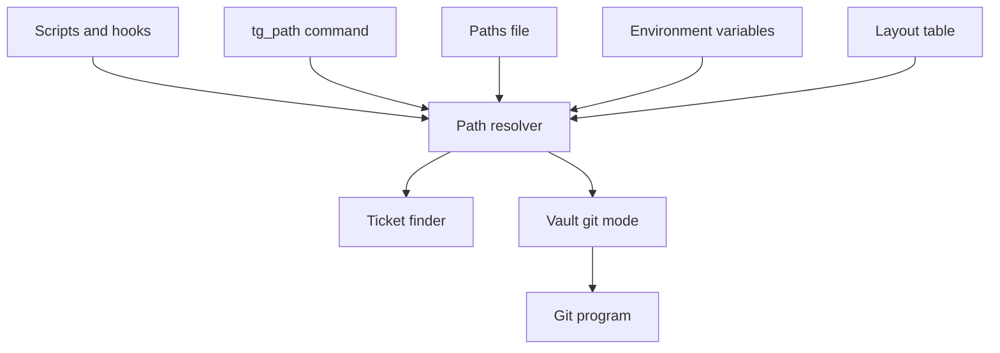
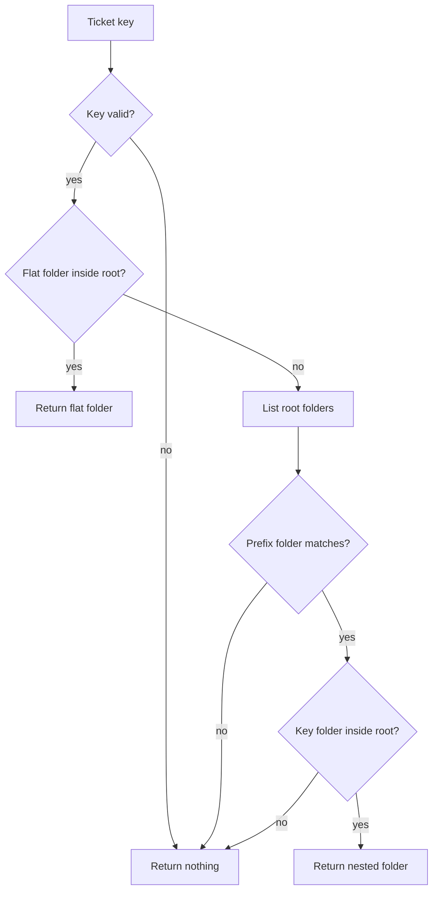

## Purpose

This is the path loader. Every Tollgate script and hook asks it for a folder by logical name (vault, tickets, state, index and so on) instead of writing a folder string itself. It reads an optional paths file, falls back to environment variables and built-in defaults, and also holds the one table of vault folder names, the ticket folder finder and the vault git mode reader.

## Dependencies

**Depends on.**
- Standard library: `os`, `pathlib`, `re`, `subprocess` {src:scripts/core/paths.py:14-17}.
- Environment variables `TOLLGATE_PATHS`, `TOLLGATE_KNOWLEDGE`, `TOLLGATE_STATE_DIR`, `TOLLGATE_CODE_DIR` {src:scripts/core/paths.py:24-27}.
- The `git` program, called by `detect_vault_git` {src:scripts/core/paths.py:153}.
- No other file in the repo is imported.

**Used by.**

Product code, importing the module:
- Hooks: {src:hooks/pre-prompt-expansion-check-gates.py:99} {src:hooks/pre-prompt-expansion-check-gates.py:161} {src:hooks/read_guard_common.py:44}.
- Installer, which runs `paths.py dirs` to get the vault folder list {src:install.sh:1018}.
- Command line wrappers: [[tg_path]] / [tg_path](tg_path.md) {src:scripts/core/tg_path:15}, and `tg_vault_git` {src:scripts/core/tg_vault_git:15}, and [[tg_ticket_dir]] / [tg_ticket_dir](tg_ticket_dir.md), which imports `ticket_folder` and `NotSetUp` {src:scripts/core/tg_ticket_dir:15}.
- [[session_cost]] / [session_cost](session_cost.md) {src:scripts/core/session_cost.py:22}.
- Cache scripts {src:scripts/cache/daily_brief.py:46} {src:scripts/cache/run_log.py:23}, chart check {src:scripts/chart/chart_check:207}.
- Connectors {src:scripts/connectors/comms/comms_common.py:28} {src:scripts/connectors/data/databricks.py:386} {src:scripts/connectors/data/secrets_tool.py:55} {src:scripts/connectors/plane/cli.py:34} {src:scripts/connectors/plane/vault_ticket_files.py:19} {src:scripts/connectors/registry.py:24}.
- Cron scripts {src:scripts/cron/setup_cron.py:32} {src:scripts/cron/vault_staleness.py:30} {src:scripts/cron/write_nightly_health.py:24}.
- Search scripts {src:scripts/search/build_index.py:42} {src:scripts/search/check_index_health.py:27} {src:scripts/search/config.py:22} {src:scripts/search/eval_judge.py:25} {src:scripts/search/eval_rag.py:26} {src:scripts/search/query_index.py:26} {src:scripts/search/reference_add.py:27} {src:scripts/search/reference_query.py:29} {src:scripts/search/vault_health.py:24}.
- State scripts {src:scripts/state/backfill_session_logs.py:22} {src:scripts/state/backfill_vault_frontmatter.py:54} {src:scripts/state/doc_drift_patrol.py:25} {src:scripts/state/system_progress.py:27} {src:scripts/state/ticket_state_check.py:28} {src:scripts/state/vault_census.py:42} {src:scripts/state/vault_query.py:18}.
- Sync scripts {src:scripts/sync/lint_wikilinks.py:32} {src:scripts/sync/sweep:36} (`sweep` imports `ticket_folder` and calls it to find the folder for an approval record {src:scripts/sync/sweep:138}) {src:scripts/sync/sync_conversations.py:32} {src:scripts/sync/sync_meetings.py:38}.

Tests: {src:tests/scripts/core/test_paths.py:21} {src:tests/scripts/core/test_vault_git.py:21} {src:tests/scripts/cron/test_cron_tools.py:30} {src:tests/scripts/connectors/plane/test_plane_cli.py:22} {src:tests/scripts/core/test_no_literal_paths.py:18} (allowlist entry, so the module may hold folder strings) and a stand-in module in {src:tests/scripts/state/test_backfill_vault_frontmatter.py:2079}.

## Behavior

**Resolution order.** `get_path(name, env)` first reads the paths file; a line for the name wins {src:scripts/core/paths.py:125-127}. For `vault` only, it next tries `TOLLGATE_KNOWLEDGE` {src:scripts/core/paths.py:128-131}. Otherwise it calls `_default` {src:scripts/core/paths.py:132}. An optional `env` mapping replaces `os.environ` for the lookups {src:scripts/core/paths.py:124}.

**Paths file.** The file location comes from `TOLLGATE_PATHS`; unset, blank, or unreadable gives an empty result {src:scripts/core/paths.py:72-79}. Each line is `name: path`. Blank lines, lines starting with `#` and lines with no colon are skipped {src:scripts/core/paths.py:83-84}. The line splits at the first colon {src:scripts/core/paths.py:85}. A trailing comment is cut only at a space followed by `#` {src:scripts/core/paths.py:86}. Matching outer quotes are removed {src:scripts/core/paths.py:63-67}. A line with an empty name or empty value is dropped {src:scripts/core/paths.py:88-89}. Values are expanded for `~` and `$VAR` {src:scripts/core/paths.py:60}.

**Defaults.** `vault` has no default and raises `NotSetUp` {src:scripts/core/paths.py:99-100}. Every name in the vault children table is joined onto the vault folder {src:scripts/core/paths.py:101-102}. `state` uses `TOLLGATE_STATE_DIR`, else `~/.tollgate/state` {src:scripts/core/paths.py:103-105}. `cache`, `logs` and `index` sit under `~/.tollgate` {src:scripts/core/paths.py:106-107}. `repos` needs `TOLLGATE_CODE_DIR` or raises `NotSetUp` {src:scripts/core/paths.py:108-112}. `standards` has no default and always raises `NotSetUp` unless the file has a line for it {src:scripts/core/paths.py:113-115}. Any other name raises `KeyError` {src:scripts/core/paths.py:116}. The home folder comes from the real process home, not from the `env` mapping {src:scripts/core/paths.py:93-94}.

**Layout table.** `LAYOUT` maps ten logical names to vault folder names {src:scripts/core/paths.py:32-43}. `LAYOUT_SUBDIRS` lists subfolders the installer creates under two of them {src:scripts/core/paths.py:45-48}. `meetings` and `references` are added to the resolvable names but are not in `LAYOUT`, so `layout_dirs` does not list them {src:scripts/core/paths.py:50} {src:scripts/core/paths.py:308-313}.

**Helpers.**
- `get_all` returns every name that resolves and silently skips names that raise `NotSetUp` {src:scripts/core/paths.py:174-182}.
- `file_value` returns the paths-file value for a name, or `None` {src:scripts/core/paths.py:135-141}.
- `folder_name` returns the vault-relative folder name for a layout key, the last path part when the paths file points outside the vault, and raises `KeyError` for an unknown key {src:scripts/core/paths.py:191-200}.
- `subdir_prefixes` returns `<folder>/<name>/` only for names the layout lists under that key {src:scripts/core/paths.py:300-305}.
- `layout_dirs` lists the layout folders then each subfolder {src:scripts/core/paths.py:310-313}.

**Vault git mode.** `detect_vault_git` returns `none` when the vault has no `.git` {src:scripts/core/paths.py:150-151}, runs `git remote` with a 20 second limit {src:scripts/core/paths.py:153-154}, returns `local` if git cannot run {src:scripts/core/paths.py:155-156}, `remote` when the command succeeds with output {src:scripts/core/paths.py:157-158}, else `local` {src:scripts/core/paths.py:159}. `vault_git_mode` prefers a valid `vault_git` line (`none`, `local`, `remote`, case-insensitive) {src:scripts/core/paths.py:168-170}, else detects {src:scripts/core/paths.py:171}.

**Tickets.** A key must be letters, a hyphen and digits {src:scripts/core/paths.py:203}. `ticket_folder` refuses other keys with `None` {src:scripts/core/paths.py:245-246}, tries `<root>/KEY` first {src:scripts/core/paths.py:248-250}, then scans the root for a folder whose name matches the key letters without regard to case {src:scripts/core/paths.py:251-261}. Both results must resolve inside the root after symlinks {src:scripts/core/paths.py:207-214}. `iter_ticket_folders` yields key-named folders, and key-named folders inside letters-only prefix folders whose letters match {src:scripts/core/paths.py:280-291}. `ticket_prefix_depth` gives 1 only for three or more parts with a matching prefix folder and key folder {src:scripts/core/paths.py:228-234}.

**Command line.** `paths.py layout` prints `key: name` lines from the `LAYOUT` table {src:scripts/core/paths.py:318-320}; `paths.py dirs` prints `layout_dirs()` {src:scripts/core/paths.py:321-322}; anything else prints usage and exits 2 {src:scripts/core/paths.py:323-325}.

## Diagram: module level (L2, required)

## Diagram: function level (L3, optional)

## Notes

**Code and description disagree.**
- `get_path` says it raises `NotSetUp` when a name cannot be resolved {src:scripts/core/paths.py:120}; for an unknown name with no paths-file line the code raises `KeyError` {src:scripts/core/paths.py:116}.
- `file_value` says its names are ones "get_path does not know" {src:scripts/core/paths.py:138}; but `get_path` returns any name that has a paths-file line before it checks whether the name is known {src:scripts/core/paths.py:126-127}.
- The comment says nothing else may hold a folder name {src:scripts/core/paths.py:30-31}; `_enums.py` holds `memory-quarantine/...` strings {src:scripts/core/memory/_enums.py:61-63} (see its page, [[_enums]] / [_enums](memory/_enums.md)).
- `iter_ticket_folders` says it yields "sorted by path" {src:scripts/core/paths.py:266}; the code sorts each folder level separately {src:scripts/core/paths.py:273} {src:scripts/core/paths.py:284}. In a vault that mixes flat and prefix layouts, a folder `S` sorts before `PROJ-1`, while the full paths `PROJ-1` and `PROJ/PROJ-312` sort the other way (`-` is below `/`), so the order can differ from a sort of the full paths.
- `paths.py layout` prints the built-in `LAYOUT` names {src:scripts/core/paths.py:319}, while `paths.py dirs` uses `folder_name`, which follows paths-file renames {src:scripts/core/paths.py:310}. After a rename the two outputs disagree.
- `_default` takes an `explicit` argument it never uses {src:scripts/core/paths.py:97}.

**Inputs with no check on their value.**
- Paths-file values and the four environment variables become folder paths through `_expand` with no check that they exist or sit under any root {src:scripts/core/paths.py:60} {src:scripts/core/paths.py:127} {src:scripts/core/paths.py:131} {src:scripts/core/paths.py:105} {src:scripts/core/paths.py:111}. `$VAR` text in a value is expanded from the environment {src:scripts/core/paths.py:60}.
- The vault folder is passed to `git -C` as a list item, so no shell is involved, but its value is not checked {src:scripts/core/paths.py:153}.
- `tickets_root` passed by a caller is used as given {src:scripts/core/paths.py:218}.
- Ticket keys are checked by regex before use {src:scripts/core/paths.py:245}. The pattern ends in `$`, which in Python also matches before one trailing newline {src:scripts/core/paths.py:203}; a key with a trailing newline could pass the check (the effect was not tested).
- No network address or outbound text is built here.

**Shared files.** The module only reads files and runs `git remote`. It writes nothing, so there is no write to guard.

**Other.** The `date:` header field is empty {src:scripts/core/paths.py:5}.
