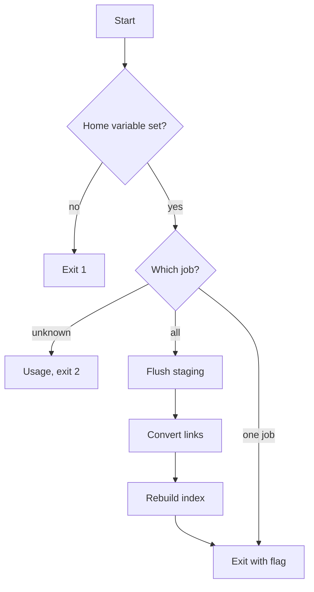

## Purpose

`run.sh` is a manual button for the three routine vault jobs: flush staging into the vault, convert markdown links to wiki links, and rebuild the search index. It runs the chosen job scripts one after another with their output on screen, and reports whether any failed. It does no work of its own beyond starting those scripts.

## Dependencies

**External commands.** `python3` or the program named in `TOLLGATE_PYTHON` {src:scripts/core/run.sh:24}; `printf` for the status lines {src:scripts/core/run.sh:27-30}.

**Environment variables.** `TOLLGATE_HOME` is required {src:scripts/core/run.sh:18-21}. `TOLLGATE_PYTHON` is optional {src:scripts/core/run.sh:24}.

**Files it starts.** `$TOLLGATE_HOME/scripts/sync/sweep` {src:scripts/core/run.sh:41}, `scripts/search/build_index.py` {src:scripts/core/run.sh:47}, `scripts/sync/lint_wikilinks.py` {src:scripts/core/run.sh:48}. All three exist in this repo (checked 2026-11-20). None has a page under `docs/scripts/` of its own: `sweep` (no doc yet), `build_index` (no doc yet), `lint_wikilinks` (no doc yet).

**Used by.** No product code starts this script. A repo search for `run.sh` and `core/run` (excluding `docs/`, 2026-11-20) finds only the file's own header and unrelated `run.sh` files in other folders. Tests: {src:tests/scripts/core/test_bootstrap.py:103} {src:tests/scripts/core/test_bootstrap.py:110} {src:tests/scripts/core/test_bootstrap.py:122} {src:tests/scripts/core/test_bootstrap.py:129}.

## Behavior

1. With `TOLLGATE_HOME` unset or empty, it prints `not set up` to stderr and exits 1 {src:scripts/core/run.sh:18-21}.
2. Job scripts are taken from `$TOLLGATE_HOME/scripts` {src:scripts/core/run.sh:23}. The Python program is `$TOLLGATE_PYTHON`, else `python3` {src:scripts/core/run.sh:24}.
3. The first argument picks the job; no argument means `all` {src:scripts/core/run.sh:50}. `all` runs sweep, then lint, then index {src:scripts/core/run.sh:51}. `sweep`, `index` and `lint` run one job each {src:scripts/core/run.sh:52-54}. Any other word prints usage to stderr and exits 2 {src:scripts/core/run.sh:55-57}.
4. A Python job is skipped, with a `skipped` line, when its script file is absent {src:scripts/core/run.sh:35}. The sweep job is skipped when the file is missing or not executable {src:scripts/core/run.sh:42}. A skip does not count as a failure.
5. A job that exits non-zero prints `failed` and sets the failure flag {src:scripts/core/run.sh:37} {src:scripts/core/run.sh:44} {src:scripts/core/run.sh:29}. Later jobs still run, because the script does not use `set -e` {src:scripts/core/run.sh:16}.
6. The script exits with the failure flag, so 0 when nothing failed and 1 when any job failed {src:scripts/core/run.sh:61}.
7. Jobs get no extra arguments: `run_py` shifts off its own two arguments and passes the rest, and the callers pass none {src:scripts/core/run.sh:34} {src:scripts/core/run.sh:47-48}.

## Diagram

## Notes

**Code and description disagree.** The header says each job is skipped when its script is absent {src:scripts/core/run.sh:14}. For the sweep job the test is "not executable", which also skips a present but non-executable file {src:scripts/core/run.sh:42}. For the Python jobs the test is "is a regular file", so a present file that cannot be read or run is attempted and counted as failed {src:scripts/core/run.sh:35}. The header line 8 describes `sweep` as flushing staging into the vault {src:scripts/core/run.sh:8}; what the sweep script does was not read for this page.

**Inputs with no check on their value.**
- `TOLLGATE_HOME` is only tested for being non-empty {src:scripts/core/run.sh:18}. Whatever sits at `$TOLLGATE_HOME/scripts/sync/sweep` is executed if it is an executable file {src:scripts/core/run.sh:44}.
- `TOLLGATE_PYTHON` is used as the program name with no check that it exists or is executable {src:scripts/core/run.sh:37}, unlike `tg-search`, which tests it first {src:scripts/search/tg-search:40}.
- The first argument is compared against fixed words and shown only through `$0` in the usage line {src:scripts/core/run.sh:56}. It never reaches a path or command.

**Shared files.** `run.sh` writes no file itself. The jobs it starts may write to the vault and the search index; whether they use locks or atomic writes is not covered here. Two `run.sh` runs at once are not guarded: there is no lock file or process check in the script.

**Other.**
- The pattern `cmd && ok || fail` is used for every job {src:scripts/core/run.sh:37} {src:scripts/core/run.sh:44}. If the job passes but printing `ok` fails, `fail` also runs and sets a stray failure flag. This is unlikely in practice.
- It requires bash for `local` {src:scripts/core/run.sh:33}; the shebang asks for bash {src:scripts/core/run.sh:1}. The `date:` header field is empty {src:scripts/core/run.sh:4}.

**Tests.** The four tests check: an unknown argument exits 2 with "Usage" {src:tests/scripts/core/test_bootstrap.py:100-105}; a home with no scripts folder skips every job and exits 0 {src:tests/scripts/core/test_bootstrap.py:107-112}; a sweep stub that exits 3 makes `run.sh` exit 1 with "failed" {src:tests/scripts/core/test_bootstrap.py:114-124}; an unset home exits 1 with "not set up" {src:tests/scripts/core/test_bootstrap.py:126-131}. All use a throwaway home. The first uses the real repo as `TOLLGATE_HOME` {src:tests/scripts/core/test_bootstrap.py:102}, but exits before any job starts. No test runs a job that passes, so the `ok` path and the `all` order are untested. The tests need `bash` only.
