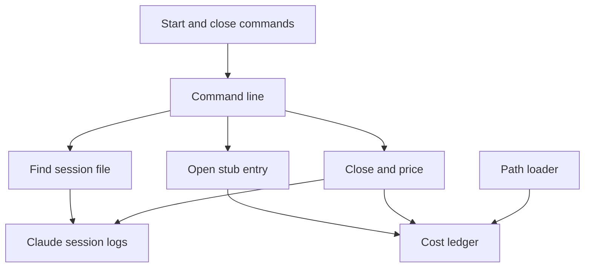
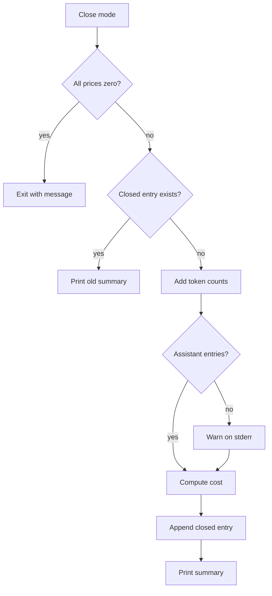

## Purpose

`session_cost.py` works out what a Claude Code session cost. It finds the session log file for the current folder, adds up the token counts, multiplies them by fixed prices and appends one line per session to a ledger file in the vault output folder. The start and close commands call it so each session log entry can carry a cost line.

## Dependencies

**Depends on.**
- Standard library: `argparse`, `json`, `os`, `re`, `sys`, `datetime`, `pathlib`, `typing` {src:scripts/core/session_cost.py:12-19}.
- [[paths]] / [paths](paths.md): `get_path` and `NotSetUp`, to find the `output` folder {src:scripts/core/session_cost.py:22} {src:scripts/core/session_cost.py:48}. The import path is extended with the parent of this file's folder {src:scripts/core/session_cost.py:21}.
- Environment variable `CLAUDE_CONFIG_DIR` {src:scripts/core/session_cost.py:40}.
- Claude Code session logs, one `.jsonl` file per session under `<config>/projects/<slug>/` {src:scripts/core/session_cost.py:43} {src:scripts/core/session_cost.py:70}.

**Used by.**
- Product code (command files that tell the model to run it): the start command runs it with `--mode start` {src:commands/tg-start.md:174}; the close command runs it with `--mode=close` {src:commands/tg-close.md:67}, reads its stdout {src:commands/tg-close.md:71} and puts it in the session log text {src:commands/tg-close.md:88}. No Python file imports it.
- Tests: {src:tests/scripts/core/test_bootstrap.py:177} {src:tests/scripts/core/test_bootstrap.py:192} {src:tests/scripts/core/test_bootstrap.py:200} {src:tests/scripts/core/test_paths.py:227} {src:tests/commands/test_commands.py:410}.

## Behavior

**Command line.** `--mode` is required and is `start` or `close` {src:scripts/core/session_cost.py:290}. `--tasks` defaults to empty {src:scripts/core/session_cost.py:291-295}. `--session-file` and `--sessions-dir` override discovery {src:scripts/core/session_cost.py:296-307}. `main` builds the project slug from the current folder, finds the session file, reads its session id, then runs the chosen mode {src:scripts/core/session_cost.py:310-319}. The session file is looked up for both modes, so `start` also fails when no session file exists yet {src:scripts/core/session_cost.py:311}.

**Finding the session.** The slug is the current folder path with every character other than a letter or digit turned into a dash {src:scripts/core/session_cost.py:55}. `--session-file` is returned as given {src:scripts/core/session_cost.py:60-61}. Otherwise the sessions base is `--sessions-dir`, else `$CLAUDE_CONFIG_DIR/projects`; with neither it exits with `not set up` {src:scripts/core/session_cost.py:38-43}. A missing slug folder exits with a message {src:scripts/core/session_cost.py:64-68}. Files are sorted newest first by modified time {src:scripts/core/session_cost.py:70-74}, none found exits {src:scripts/core/session_cost.py:75-76}, and the newest is used {src:scripts/core/session_cost.py:87}. If more than one file changed in the last 10 minutes it prints a warning to stderr but still uses the newest {src:scripts/core/session_cost.py:78-85}. The session id is the first `sessionId` value found in the file, or the run exits {src:scripts/core/session_cost.py:96-100}.

**Ledger.** The ledger is `session-costs.jsonl` in the `output` folder {src:scripts/core/session_cost.py:31} {src:scripts/core/session_cost.py:48}; an unset vault exits with the loader's message {src:scripts/core/session_cost.py:49-50}. `load_ledger` reads every line as JSON {src:scripts/core/session_cost.py:103-112}. `append_ledger` creates the folder and appends one JSON line {src:scripts/core/session_cost.py:116-118}.

**Start.** If the ledger already has an `open` entry for this session, nothing happens {src:scripts/core/session_cost.py:197-200}. Otherwise it appends an `open` entry with session id, date, start time and project {src:scripts/core/session_cost.py:202-209}.

**Close.** The run exits with a message if all four prices are 0.0 {src:scripts/core/session_cost.py:248-260}. If the ledger already has a `closed` entry for the session, it prints that entry's summary and writes nothing {src:scripts/core/session_cost.py:263-266}. Otherwise it adds the token counts of every `assistant` entry in the session file {src:scripts/core/session_cost.py:149-156}, with no check for repeated entries. If there are none it prints a warning but still writes an entry with zero cost {src:scripts/core/session_cost.py:271-275} {src:scripts/core/session_cost.py:282}. The start time is the `open` entry's start, else the first timestamp in the file converted to local time, else `unknown` {src:scripts/core/session_cost.py:171-176}. Cost is each token count divided by one million and multiplied by its price {src:scripts/core/session_cost.py:214-217}, rounded to 4 places {src:scripts/core/session_cost.py:241}. The closed entry gets today's date and the current time as its end {src:scripts/core/session_cost.py:233} {src:scripts/core/session_cost.py:235}. The `open` entry is not changed, so a started and closed session has two ledger lines.

**Summary line.** `date | start-end | $cost | NK in / NK out / NK write / NK read | tasks`, token counts divided by 1000 with integer division {src:scripts/core/session_cost.py:189-193}.

**Prices.** $3.00 input, $15.00 output, $3.75 cache write, $0.30 cache read per million tokens {src:scripts/core/session_cost.py:26-29}. They were not checked against a price page (source: this file only; unverified: confirm before relying on this).

## Diagram: module level (L2, required)

## Diagram: function level (L3, optional)

## Notes

**Code and description disagree.**
- The close command says any non-zero exit means the pricing constants are not set {src:commands/tg-close.md:73}. The script also exits non-zero for a missing sessions folder or `CLAUDE_CONFIG_DIR` {src:scripts/core/session_cost.py:42} {src:scripts/core/session_cost.py:65-68}, no session files {src:scripts/core/session_cost.py:76}, no session id {src:scripts/core/session_cost.py:100}, an unset vault {src:scripts/core/session_cost.py:50}, a missing `--tasks` {src:scripts/core/session_cost.py:318}, and an uncaught JSON error on a bad log line {src:scripts/core/session_cost.py:96}. The pricing guard can fire only when all four prices are 0.0 {src:scripts/core/session_cost.py:248-256}; with the current values it cannot.
- The comment on the prices says to edit them when the model changes {src:scripts/core/session_cost.py:24-25}. The code applies one flat rate to the whole session {src:scripts/core/session_cost.py:212-218}, so a session that used more than one model, or a model with different prices, is priced at those four rates.
- No file in the repo sets `CLAUDE_CONFIG_DIR` (searched 2026-11-20, excluding `docs/` and `tests/`; `setup_cron.py` only passes it through). The commands call the script without `--sessions-dir` {src:commands/tg-close.md:67-68} {src:commands/tg-start.md:174}, so they work only when the shell already has that variable. [uncertain: whether Claude Code exports it.]
- The `date:` header field is empty {src:scripts/core/session_cost.py:6}.

**Inputs with no check on their value.**
- `--session-file` is opened as given {src:scripts/core/session_cost.py:91} {src:scripts/core/session_cost.py:141}.
- `--sessions-dir` and `CLAUDE_CONFIG_DIR` are joined with the slug and listed with no check {src:scripts/core/session_cost.py:40} {src:scripts/core/session_cost.py:63}. The slug itself is made only of letters, digits and dashes, so it cannot escape the folder {src:scripts/core/session_cost.py:55}.
- `--tasks` goes unchecked into the ledger {src:scripts/core/session_cost.py:242} and into the printed summary {src:scripts/core/session_cost.py:192}, which the close command puts in the session log text {src:commands/tg-close.md:88}. A newline in the text would split the one-line summary.
- No network address or shell command is built here.

**Shared file writes.** The ledger is the only write. `append_ledger` opens it in append mode and writes one line {src:scripts/core/session_cost.py:117-118}. That is not atomic in the sense of a temp file and rename, and nothing locks it. Close reads the ledger first {src:scripts/core/session_cost.py:262} and appends later {src:scripts/core/session_cost.py:282}, so two close runs for one session at the same moment could both append a closed entry. A corrupt line in the ledger stops every later run, because `load_ledger` has no error handling {src:scripts/core/session_cost.py:111}.

**Other.**
- The closed entry carries the date of the close, not of the session start {src:scripts/core/session_cost.py:233}, so a session that crosses midnight shows the later date.
- `ledger_path` is called several times per run, each time asking the loader again {src:scripts/core/session_cost.py:104} {src:scripts/core/session_cost.py:107} {src:scripts/core/session_cost.py:116} {src:scripts/core/session_cost.py:117}.

**Tests.**
- Close test: builds a one-million-token input and output session, runs close with `--session-file`, and expects a closed ledger line with cost 18.0 {src:tests/scripts/core/test_bootstrap.py:174-186}. The 18.0 is 3.00 plus 15.00, so the test fails whenever either price changes. It uses a throwaway home.
- Unset vault test: close with no `TOLLGATE_KNOWLEDGE` exits non-zero with `not set up` {src:tests/scripts/core/test_bootstrap.py:188-195}.
- Missing sessions folder test: `--mode start` with no `CLAUDE_CONFIG_DIR` exits non-zero with `not set up` {src:tests/scripts/core/test_bootstrap.py:197-203}.
- Slug test: `/a.b/c_d e` gives `-a-b-c-d-e` {src:tests/scripts/core/test_paths.py:226-228}.
- Command file test only checks that the close command names the script path {src:tests/commands/test_commands.py:410}.
- Not covered: the `start` happy path, a repeated close, the multiple-recent-sessions warning, the no-assistant-entries warning, the zero-price guard and a corrupt ledger. No test depends on a machine path or on a Python version beyond 3.7 (`datetime.fromisoformat`, f-strings).
