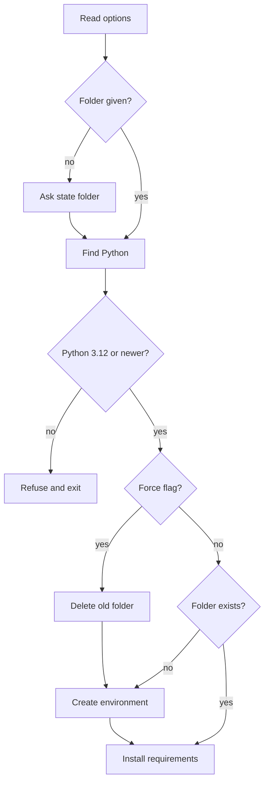

## Purpose

This script builds the Python virtual environment the search and state scripts need. It makes the environment folder, upgrades `pip`, and installs the libraries listed in `scripts/requirements.txt`. By default the environment goes in a `venv` folder inside the Tollgate state folder.

## Dependencies

**External commands.** `bash` {src:scripts/core/setup_venv.sh:1}, a Python named by `TOLLGATE_BASE_PYTHON` or `python3` {src:scripts/core/setup_venv.sh:17}, which must be 3.12 or newer {src:scripts/core/setup_venv.sh:40}, `pip` from the new environment {src:scripts/core/setup_venv.sh:56-57}, and `rm` for `--force` {src:scripts/core/setup_venv.sh:47}. It also needs network access to a package index when `pip` installs, which is outside this script's control.

**Files.** `scripts/requirements.txt`, found as the parent of the script's own folder {src:scripts/core/setup_venv.sh:16}. [[tg_path]] / [tg_path](tg_path.md) in the same folder, used only when `--venv` is not given {src:scripts/core/setup_venv.sh:31}.

**Environment variables.** `TOLLGATE_BASE_PYTHON` {src:scripts/core/setup_venv.sh:17}. The default folder comes from the state path, which depends on the variables the path loader reads (see [[paths]] / [paths](paths.md)).

**Used by.**
- Product code: the installer runs it with `bash` and the vault variables set {src:install.sh:1616}. A comment in the installer {src:install.sh:1568} and the search wrapper {src:scripts/search/tg-search:12} name it, and the scripts README tells people to run it {src:scripts/README.md:27}.
- Tests: {src:tests/installer/test_lifecycle.sh:231} {src:tests/installer/test_lifecycle.sh:233} {src:tests/scripts/core/test_setup_venv.py:18}.

## Behavior

1. `set -euo pipefail` makes any failed command, unset variable or failed pipe stop the script {src:scripts/core/setup_venv.sh:13}.
2. It finds its own folder, and the requirements file in the folder above {src:scripts/core/setup_venv.sh:15-16}.
3. Options: `--force` sets a flag {src:scripts/core/setup_venv.sh:23}; `--venv DIR` takes the next argument and aborts with a message if it is missing or empty {src:scripts/core/setup_venv.sh:24}; any other word prints `unknown option` and exits 2 {src:scripts/core/setup_venv.sh:25}.
4. Without `--venv`, the folder is `<state folder>/venv`, where the state folder comes from `tg_path state`. If that command fails the script prints `not set up` and exits 1 {src:scripts/core/setup_venv.sh:30-33}.
5. If the chosen Python is not found, it prints `python not found` and exits 1 {src:scripts/core/setup_venv.sh:35-38}.
6. It then asks that Python to check its own version. If it is older than 3.12, or cannot run at all, the script asks it once more for its version number, prints `Tollgate needs Python 3.12 or newer, found X in <python>` to stderr and exits 1 {src:scripts/core/setup_venv.sh:40-44}. When the second ask fails too, `X` reads `no working python` {src:scripts/core/setup_venv.sh:41-42}. This check sits before the deletion and the creation steps, so a refused run changes nothing on disk {src:scripts/core/setup_venv.sh:40-48}.
7. With `--force` it deletes the folder first with `rm -rf` {src:scripts/core/setup_venv.sh:46-48}.
8. It creates the environment only when the folder does not exist {src:scripts/core/setup_venv.sh:50-53}. An existing folder is reused as is.
9. It upgrades `pip` then installs `requirements.txt`, both quietly {src:scripts/core/setup_venv.sh:56-57}. The file lists `chromadb`, `pyyaml`, `ebooklib` and `beautifulsoup4` with no version pins {src:scripts/requirements.txt:7-10}.
10. It prints `venv ready` and the Python version {src:scripts/core/setup_venv.sh:59-60}. A run that reaches this point exits 0.

## Diagram

## Notes

**Code and description disagree.** None found. The header says the default folder is "the venv folder inside the state path" {src:scripts/core/setup_venv.sh:8}, which matches {src:scripts/core/setup_venv.sh:32}. The requirements file comment says session_cost needs no library {src:scripts/requirements.txt:8}, and that holds: [[session_cost]] / [session_cost](session_cost.md) imports only the standard library and `core.paths` {src:scripts/core/session_cost.py:12-22}. The `date:` header field is empty {src:scripts/core/setup_venv.sh:4}.

**Inputs with no check on their value.**
- `--venv DIR` is checked only for being non-empty {src:scripts/core/setup_venv.sh:24}. With `--force` the value goes straight to `rm -rf` {src:scripts/core/setup_venv.sh:47}, so a wrong folder such as one holding other files is deleted with no confirmation and no check that it is a venv.
- `TOLLGATE_BASE_PYTHON` is checked to exist as a command {src:scripts/core/setup_venv.sh:35} and to report 3.12 or newer {src:scripts/core/setup_venv.sh:40}. Its value is not checked otherwise, it is printed in the refusal message {src:scripts/core/setup_venv.sh:42}, and it is run to create the environment {src:scripts/core/setup_venv.sh:52}.
- `requirements.txt` content is installed as written {src:scripts/core/setup_venv.sh:57}. Because versions are not pinned, two runs on different days can install different library versions.
- The state folder printed by `tg_path` is used as a path without a check {src:scripts/core/setup_venv.sh:31-32}.

**Shared files.** The script writes only inside the environment folder. Nothing stops two runs at once, for example two installers, from building the same folder together, and creation is not atomic.

**Version check scope.** The check covers the base Python only. An existing environment folder is reused without looking at which Python built it {src:scripts/core/setup_venv.sh:50}, so a venv made earlier on an older Python stays in use until it is rebuilt with `--force`. The installer has its own read-only check for that case: it refuses an existing search venv on an older Python and tells the user to delete it {src:install.sh:172-183}.

**Idempotency.** Safe to run again: an existing folder is reused and the libraries are reinstalled or upgraded. A broken folder is not repaired without `--force`.

**Tests.** One installer lifecycle test runs the whole installer with a stub Python and checks the venv Python exists at `<home>/.tollgate/state/venv` {src:tests/installer/test_lifecycle.sh:231-233}. The stub handles only `-m venv` and passes every other call, including the version check, to the real `python3` {src:tests/installer/test_lifecycle.sh:228}, so that test needs a real Python 3.12 or newer on the path. The refusal itself is covered by [[test_setup_venv]] / [test_setup_venv](../../tests/scripts/core/test_setup_venv.md). A second check reads the stub's call log for a `pip install --quiet -r .../scripts/requirements.txt` line {src:tests/installer/test_lifecycle.sh:234-235}. The script runs through the installer, not alone. The tests replace the real Python with a stub, so real `pip` installs are not exercised. The new test file covers the version check and `--force` with an old Python {src:tests/scripts/core/test_setup_venv.py:54-74}. No test covers `--venv` with a missing value or the unknown option branch (searched `tests/` for `setup_venv`, 2026-11-20).
