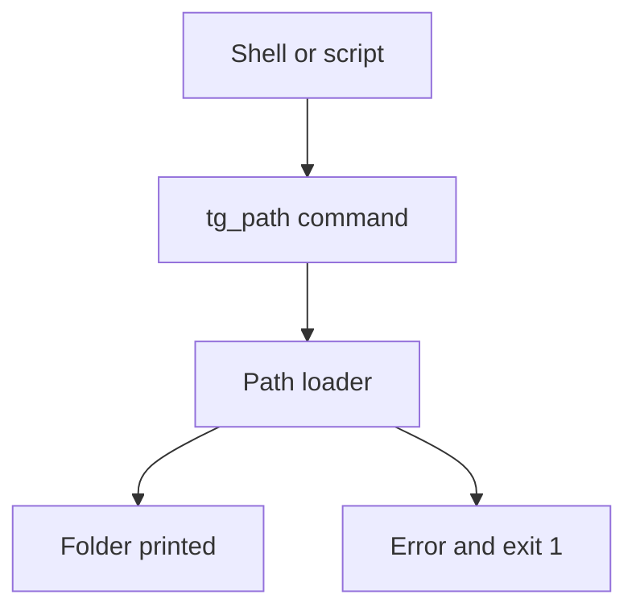
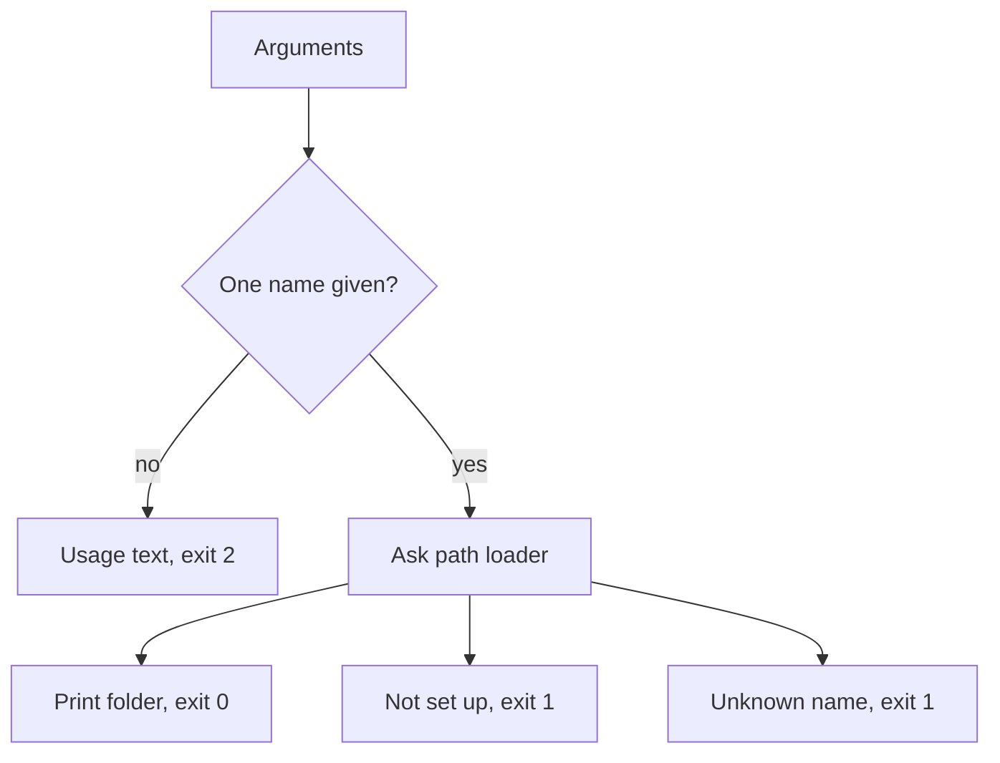

## Purpose

`tg_path` is a small command that prints the folder for one logical name, so shell scripts and command files can ask the path loader for a folder without importing Python. The file has no `.py` extension; it is run directly as a script, so it is documented with the module template (Python shebang).

## Dependencies

**Depends on.**
- [[paths]] / [paths](paths.md): `get_path` and `NotSetUp` {src:scripts/core/tg_path:15}.
- Standard library: `pathlib`, `sys` {src:scripts/core/tg_path:11-12}.
- It adds the parent folder of its own folder (`scripts/`) to the import path so `core.paths` is found {src:scripts/core/tg_path:14}.

**Used by.**

Product code:
- Installer {src:install.sh:1572} {src:install.sh:1628}.
- [[setup_venv]] / [setup_venv](setup_venv.md) {src:scripts/core/setup_venv.sh:31}.
- Core scripts {src:scripts/core/bootstrap/_worker_common.sh:24} {src:scripts/core/hooks/session_state_hook.sh:15}.
- Cron and state scripts {src:scripts/cron/backup_vault.sh:24} {src:scripts/cron/launchers/run_task.sh:33} {src:scripts/cron/nightly_index.sh:23} {src:scripts/state/backup_index.sh:20} {src:scripts/state/restore_index.sh:19}.
- Search and sync scripts {src:scripts/search/rebuild.sh:12} {src:scripts/search/tg-search:43} {src:scripts/sync/sync_repos.sh:17}.
- Command files tell the model to run it, for example {src:commands/tg-arch.md:3} {src:commands/tg-doc-gen.md:235}. Most other command files carry a similar `Folders:` line on line 3 (found by `git grep tg_path -- commands`, 2026-11-20).

Tests: {src:tests/scripts/core/test_paths.py:23} {src:tests/scripts/cron/test_cron_tools.py:49} {src:tests/scripts/core/test_no_literal_paths.py:18}.

## Behavior

- Exactly one argument is required. Otherwise it writes `usage: tg_path <name>` and exits 2 {src:scripts/core/tg_path:19-21}.
- It prints `get_path(name)` followed by a newline and exits 0 {src:scripts/core/tg_path:23} {src:scripts/core/tg_path:30}.
- A `NotSetUp` error writes the error text to stderr and exits 1 {src:scripts/core/tg_path:24-26}.
- An unknown name (a `KeyError`) writes `not set up: unknown name <name>` to stderr and exits 1 {src:scripts/core/tg_path:27-29}. Unknown names therefore share exit code 1 and the words "not set up" with the unset case; callers cannot tell them apart by exit code.
- The `__main__` guard exits with the return value of `main` {src:scripts/core/tg_path:33-34}.

## Diagram: module level (L2, required)

## Diagram: function level (L3, optional)

## Notes

**Code and description disagree.** The description says it exits 1 with "not set up" on stderr when it "cannot resolve" {src:scripts/core/tg_path:4}. That holds for both error kinds {src:scripts/core/tg_path:25-29}. No disagreement found. The `date:` header field is empty {src:scripts/core/tg_path:6}.

**Inputs with no check.** The name argument goes to `get_path` unchanged {src:scripts/core/tg_path:23}. It is used as a dictionary key, never joined onto a path or put into a command here. A name with a line in the paths file resolves, even if it is not a built-in name {src:scripts/core/paths.py:126-127}. The unknown name is echoed to stderr unescaped {src:scripts/core/tg_path:28}.

**Shared files.** None. The command only reads the paths file through the loader and prints to stdout.

**Tests.** The CLI tests check a printed path equals `<vault>/02-tickets` {src:tests/scripts/core/test_paths.py:196-201}, exit 1 with "not set up" when the vault variable is unset {src:tests/scripts/core/test_paths.py:204-209}, exit 1 for an unknown name {src:tests/scripts/core/test_paths.py:212-215}, and exit 2 with "usage" for no argument {src:tests/scripts/core/test_paths.py:218-222}. The first test hard-codes the folder name `02-tickets`, so it fails if the default layout name changes; it uses a throwaway home, not a machine path. No test passes more than one argument, so the `len(argv) != 2` check for extra arguments is untested.
