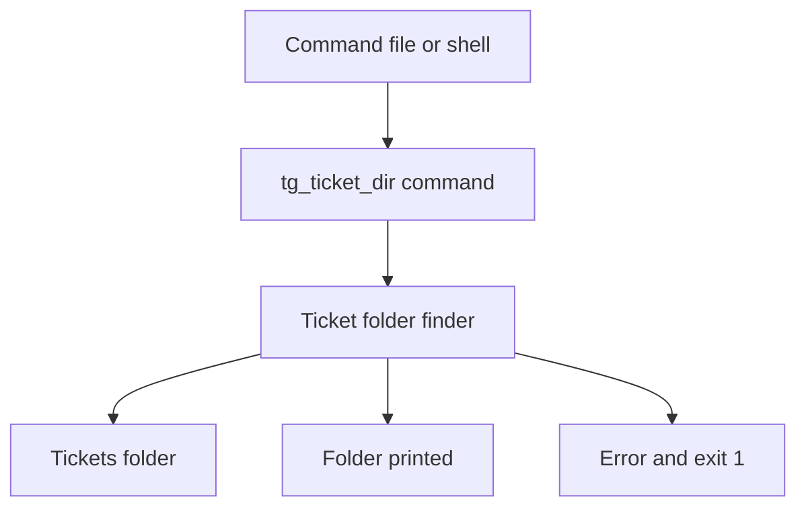
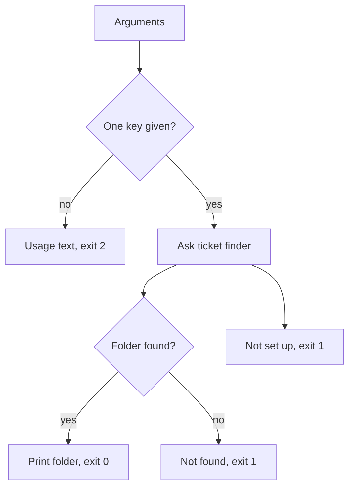

## Purpose

`tg_ticket_dir` is a small command that prints the folder of one ticket, so command files and shell scripts can ask for it without knowing whether the vault keeps tickets flat (`<tickets>/KEY`) or under a prefix folder (`<tickets>/PREFIX/KEY`). It is the ticket counterpart of [[tg_path]] / [tg_path](tg_path.md), which prints a folder for a logical name. The file has no `.py` extension; it is run directly as a script, so it is documented with the module template (Python shebang).

## Dependencies

**Depends on.**
- [[paths]] / [paths](paths.md): `ticket_folder` and `NotSetUp` {src:scripts/core/tg_ticket_dir:15}.
- Standard library: `pathlib`, `sys` {src:scripts/core/tg_ticket_dir:11-12}.
- It adds the parent folder of its own folder (`scripts/`) to the import path so `core.paths` is found {src:scripts/core/tg_ticket_dir:14}.

**Used by.**

Product code: the command files. Each one defines `{ticket}` on its `**Folders:**` line as the folder printed by this command {src:commands/tg-arch.md:3} {src:commands/tg-close.md:3} {src:commands/tg-dev.md:3} {src:commands/tg-devops.md:3} {src:commands/tg-pr-review.md:10} {src:commands/tg-qa.md:3} {src:commands/tg-spec.md:3} {src:commands/tg-sre.md:3} {src:commands/tg-start.md:3} {src:commands/tg-status.md:3} {src:commands/tg-support.md:3} {src:commands/tg-sync.md:9} {src:commands/tg-terraform.md:3} {src:commands/tg-ticket.md:3} {src:commands/tg-weekly.md:3}. No script, hook or installer line names it (`git grep tg_ticket_dir` outside `docs/`, searched 2026-11-20: the command files, this file and its test file only).

Tests: `tests/scripts/core/test_tg_ticket_dir.py` ([[test_tg_ticket_dir]], [test_tg_ticket_dir](../../tests/scripts/core/test_tg_ticket_dir.md)) {src:tests/scripts/core/test_tg_ticket_dir.py:21}.

## Behavior

- Exactly one argument is required. Otherwise it writes `usage: tg_ticket_dir <KEY>` to stderr and exits 2 {src:scripts/core/tg_ticket_dir:19-21}.
- It calls `ticket_folder(KEY)` {src:scripts/core/tg_ticket_dir:23}. When that returns a folder, the command prints it with a newline and exits 0 {src:scripts/core/tg_ticket_dir:30-31}.
- When `ticket_folder` returns `None`, it writes `not found: no ticket folder for the key given` to stderr and exits 1 {src:scripts/core/tg_ticket_dir:27-29}.
- A `NotSetUp` or `KeyError` raised by the lookup writes the error text to stderr and exits 1 {src:scripts/core/tg_ticket_dir:24-26}. For the vault not being set up, the text is `not set up: ` plus the name of the vault variable {src:scripts/core/paths.py:100}.
- The `__main__` guard exits with the return value of `main` {src:scripts/core/tg_ticket_dir:34-35}.
- What `ticket_folder` does, as seen from this command: a key that is not letters, a hyphen and digits gives `None` {src:scripts/core/paths.py:245-246}. The flat folder `<tickets>/KEY` is tried first and wins when it exists {src:scripts/core/paths.py:248-250}. Otherwise the tickets folder is scanned for a folder whose name matches the key letters without regard to case, and `<tickets>/<that folder>/KEY` is returned when it exists {src:scripts/core/paths.py:251-261}. Both results must be inside the tickets folder after symlinks are resolved {src:scripts/core/paths.py:249} {src:scripts/core/paths.py:260}. The printed path is the joined path, so a symlink that stays inside the tickets folder keeps its own name in the output {src:scripts/core/paths.py:250}.

## Diagram: module level (L2, required)

## Diagram: function level (L3, optional)

## Notes

**Code and description disagree.** The description says it prints the folder and exits 1 with "not found" on stderr when there is none {src:scripts/core/tg_ticket_dir:4}. That holds {src:scripts/core/tg_ticket_dir:27-29}. The description leaves out two other outcomes: exit 1 with the not-set-up text {src:scripts/core/tg_ticket_dir:24-26} and exit 2 with usage {src:scripts/core/tg_ticket_dir:19-21}. The command files also say a missing ticket exits 1 with `not found` {src:commands/tg-arch.md:3}; that matches. The `date:` header line is empty {src:scripts/core/tg_ticket_dir:6}.

**Exit code 1 has several meanings.** A missing ticket, a key in the wrong shape, and a vault that is not set up all exit 1. A key in the wrong shape gives `None` before the tickets folder is looked up {src:scripts/core/paths.py:245-247}, so with the vault not set up a malformed key prints `not found`, not the not-set-up text. A caller can tell the cases apart only by the stderr words. The `KeyError` branch looks unreachable in normal use: the only name looked up is `tickets`, a built-in layout name {src:scripts/core/paths.py:101-102}. I read this and did not run it.

**Inputs with no check.** The key argument goes to `ticket_folder` unchanged {src:scripts/core/tg_ticket_dir:23}, and that function checks it against a letters-hyphen-digits pattern and refuses folders that resolve outside the tickets folder {src:scripts/core/paths.py:245-246} {src:scripts/core/paths.py:249}. The pattern ends in `$`, which in Python also matches before one trailing newline {src:scripts/core/paths.py:203}; a key with a trailing newline could pass the pattern (not tested). No shell command, network address or outbound text is built here. The key is echoed nowhere: the not-found message does not repeat it {src:scripts/core/tg_ticket_dir:28}.

**Shared files.** None. The command only reads folder names and prints to stdout or stderr.

**Tests.** The test file checks a nested folder, a flat folder, a missing ticket (exit 1 with "not found" and empty stdout), the key `../etc` (exit 1 with "not found"), an unset vault (exit 1 with "not set up"), and a wrong argument count (exit 2 with "usage") {src:tests/scripts/core/test_tg_ticket_dir.py:36-83}. See [[test_tg_ticket_dir]] / [test_tg_ticket_dir](../../tests/scripts/core/test_tg_ticket_dir.md).
