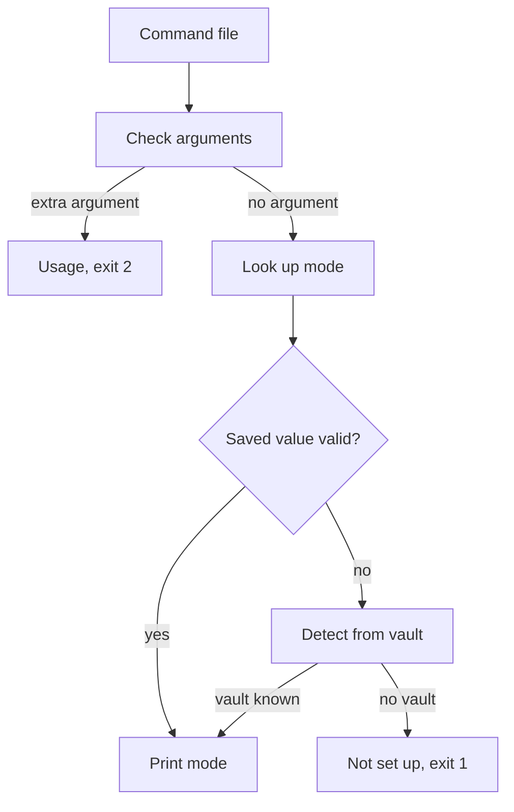

## Purpose

`tg_vault_git` is a small command line program. It tells a caller how the user's vault folder is saved with git: `none` (plain files), `local` (a git repo with no remote) or `remote` (a git repo with a remote). The Tollgate command files run it to decide which git lines to print for the user. The script only reports a mode. The real logic lives in `scripts/core/paths.py`. The file has no `.py` extension because it is meant to be run directly as a command; doc-gen normally stops on extensionless files, and this page was generated on purpose with the module template.

## Dependencies

**Depends on.**
- `pathlib` and `sys` from the standard library {src:scripts/core/tg_vault_git:11-12}.
- `core.paths`, for `NotSetUp` and `vault_git_mode` {src:scripts/core/tg_vault_git:15}. `scripts/core/paths.py` (no doc yet; `docs/scripts/core.md` is a different page). The script puts its own parent `scripts/` folder first on the import path so `core` resolves {src:scripts/core/tg_vault_git:14}.
- The paths file named by the environment variable `TOLLGATE_PATHS`, read through `vault_git_mode` {src:scripts/core/paths.py:72}.
- The environment variable `TOLLGATE_KNOWLEDGE` (or a `vault` line in the paths file) when the mode has to be detected {src:scripts/core/paths.py:129-131}.
- The system program `git`, called only during detection {src:scripts/core/paths.py:153}.

**Used by.** Searched 2026-11-19 across the whole repo except `.git`, `docs/`, virtual environments and caches, for `tg_vault_git`.
- Product code: three command files tell the model to run it: `commands/tg-close.md` {src:commands/tg-close.md:272}, `commands/tg-dev.md` {src:commands/tg-dev.md:468} and again {src:commands/tg-dev.md:523}, and `commands/tg-qa.md` {src:commands/tg-qa.md:691}.
- The installer `install.sh` does not call it. It names only the `vault_git` setting and reimplements the lookup in shell {src:install.sh:956}.
- Tests: `tests/scripts/core/test_vault_git.py` {src:tests/scripts/core/test_vault_git.py:23}, `tests/installer/test_vault_git.sh` {src:tests/installer/test_vault_git.sh:88} and `tests/commands/test_commands.py` {src:tests/commands/test_commands.py:437}.

## Behavior

The program is run with no arguments. `main` receives `sys.argv`, so exactly one item (the program name) means no extra arguments {src:scripts/core/tg_vault_git:19}. Any extra argument prints `usage: tg_vault_git` on stderr and exits 2 {src:scripts/core/tg_vault_git:20-21}.

With no arguments it prints the result of `vault_git_mode()` on stdout and exits 0 {src:scripts/core/tg_vault_git:23} {src:scripts/core/tg_vault_git:27}. If `vault_git_mode` raises `NotSetUp`, the program writes the exception text to stderr and exits 1 {src:scripts/core/tg_vault_git:24-26}. No other exception is caught.

How `vault_git_mode` picks the value:
1. It reads the `vault_git` line of the paths file, trims it and lower-cases it {src:scripts/core/paths.py:168}.
2. If the value is one of `none`, `local`, `remote`, that value is returned as is {src:scripts/core/paths.py:144} {src:scripts/core/paths.py:169-170}. The saved value wins even when the vault folder says otherwise.
3. A missing line, an empty value or any other value falls through to detection of the vault folder {src:scripts/core/paths.py:171}. The paths file reader drops a line whose value is empty {src:scripts/core/paths.py:88}, and returns an empty result when the file is missing or unreadable {src:scripts/core/paths.py:76-79}.
4. Detection: no `.git` inside the vault means `none` {src:scripts/core/paths.py:150-151}. Otherwise it runs `git -C <vault> remote` with a 20 second limit {src:scripts/core/paths.py:153-154}. Any remote name printed means `remote` {src:scripts/core/paths.py:157-158}. No remote, a failing git, a missing git program or a timeout all mean `local` {src:scripts/core/paths.py:155-156} {src:scripts/core/paths.py:159}.
5. The vault folder comes from a `vault` line in the paths file, else from `TOLLGATE_KNOWLEDGE` {src:scripts/core/paths.py:126-131}. If neither exists, `NotSetUp` is raised with a message starting "not set up" {src:scripts/core/paths.py:99-100}. This can only happen when detection is needed, because a saved mode returns before the vault is looked up {src:scripts/core/paths.py:169-170}.

The script never runs a vault git command that changes anything. The only git call is the read-only `git remote` above {src:scripts/core/paths.py:153}. The command files then print the add, commit and push lines for the user and tell the model not to run them {src:commands/tg-close.md:274} {src:commands/tg-close.md:277}.

## Diagram: module level (L2, required)

## Diagram: function level (L3, optional)

None: no function has branching that the signature does not show. The only function in this file is `main`, and its branches are drawn in the L2 diagram above; the branching in `vault_git_mode` lives in `scripts/core/paths.py`.

## Notes

- **Description versus code.** The module docstring says the program prints the mode and exits 1 with "not set up" on stderr when the mode cannot be found {src:scripts/core/tg_vault_git:4}. The code does that, but only for `NotSetUp` {src:scripts/core/tg_vault_git:24-26}. Two behaviors are not in the docstring: exit 2 with a usage line for extra arguments {src:scripts/core/tg_vault_git:19-21}, and the quiet fall back to `local` when `git` fails or times out {src:scripts/core/paths.py:155-156}. The `date:` header field is empty {src:scripts/core/tg_vault_git:6}.
- **Shell installer and this program read the same setting in two ways.** The installer takes the first `vault_git` line {src:install.sh:956} and strips a trailing comment that starts at any whitespace then `#`. The Python reader keeps the last duplicate line {src:scripts/core/paths.py:89} and cuts a comment only at a space then `#` {src:scripts/core/paths.py:86}. The installer later rewrites the file with a single `vault_git` line {src:install.sh:984}, so duplicates only arise from hand edits.
- **Unchecked inputs.** The vault folder, taken from `TOLLGATE_KNOWLEDGE` or a `vault` line, is passed as one argument to `git -C` without any check on its value {src:scripts/core/paths.py:153}. It is passed in a list, so no shell reads it. The command line arguments are only counted, never read {src:scripts/core/tg_vault_git:19}. No value reaches a network address or outbound text except the printed mode, which is one of three fixed words or a result of detection {src:scripts/core/tg_vault_git:23}.
- **Shared file writes.** None. The program only reads the paths file and prints to stdout and stderr.
- **Test cover.** `tests/scripts/core/test_vault_git.py` exercises the saved value, detection, a bad value, the no-vault error and both exit codes {src:tests/scripts/core/test_vault_git.py:103-113}. It does not test the git failure or timeout fall back to `local`, nor a mixed-case saved value.
