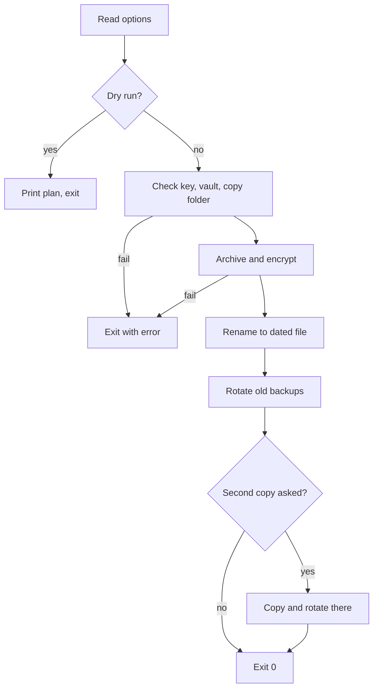

## Purpose

This script makes one encrypted copy of the whole vault folder per day, keeps it in the output folder under `backups/`, and can place a second copy in a folder the caller names, such as a mounted drive. Old copies are thinned out on a daily, weekly and monthly schedule. It exists so the vault can be restored without ever leaving a readable archive on disk.

## Dependencies

**Depends on.**
- `scripts/core/tg_path`, the command that prints a folder for a logical name: [[tg_path]] (no doc yet) {src:scripts/cron/backup_vault.sh:24}.
- The system programs `tar`, `openssl`, `cp`, `mv`, `du`, `cut` {src:scripts/cron/backup_vault.sh:89-91}.
- `python3`, or the program named in the environment variable `TOLLGATE_PYTHON`, used only for the rotation step {src:scripts/cron/backup_vault.sh:25}.
- A key command supplied by the caller with `--key-cmd`, run through `bash -c` {src:scripts/cron/backup_vault.sh:87}.

**Used by.**
- Product code: none. Nothing in `install.sh`, `scripts/cron/nightly_index.sh` or the job table of `scripts/cron/setup_cron.py` calls it {src:scripts/cron/setup_cron.py:46-49}. Searched with `git grep backup_vault` over the repo except `docs/` on 2026-11-20. It is meant to be run by hand or scheduled with the generic `--program` option of [[setup_cron]] [setup_cron](setup_cron.md).
- Tests: `tests/scripts/cron/test_cron_tools.py` class `BackupVault` {src:tests/scripts/cron/test_cron_tools.py:321}, one test that schedules this script as a custom program {src:tests/scripts/cron/test_cron_tools.py:154}, and one test that an option with no value exits 2 instead of looping {src:tests/scripts/cron/test_cron_tools.py:367}.

## Behavior

**Options.** `--key-cmd`, `--copy-to` and `--dry-run` are read in a loop; any other word prints an error and exits 2 {src:scripts/cron/backup_vault.sh:28-35}. `--key-cmd` or `--copy-to` given as the last word, with no value after it, prints "missing value for" that option and exits 2 {src:scripts/cron/backup_vault.sh:30} {src:scripts/cron/backup_vault.sh:31}. The script sets `pipefail`, so a failure in `tar` is not hidden by `openssl` {src:scripts/cron/backup_vault.sh:21}.

**Folders.** The vault folder and the output folder come from the path loader; if either cannot be resolved the script prints "not set up" and exits 2 {src:scripts/cron/backup_vault.sh:37-38}. Backups go to `output/backups` {src:scripts/cron/backup_vault.sh:39}.

**Dry run.** With `--dry-run` it prints the file it would write and the copy folder, then exits 0 before any check of the key, the vault or the copy folder {src:scripts/cron/backup_vault.sh:48-53}.

**Checks, in order.** A missing `--key-cmd` exits 1 {src:scripts/cron/backup_vault.sh:55-58}. A missing vault folder exits 1 {src:scripts/cron/backup_vault.sh:59-62}. A `--copy-to` folder that does not exist exits 1 and is never created, so an unmounted drive cannot silently become a local folder {src:scripts/cron/backup_vault.sh:63-68}. The key command is run once and its output only tested for being non-empty; empty output exits 1 {src:scripts/cron/backup_vault.sh:79-82}.

**Encrypt.** The backups folder is created, the key command is run a second time and its output is attached to file descriptor 3 {src:scripts/cron/backup_vault.sh:84-87}. `tar` writes a compressed archive of the vault folder to a pipe that `openssl` encrypts with AES-256-CBC, a salt and PBKDF2 at 600000 rounds, reading the passphrase from descriptor 3, into a temporary file `.vault-enc-tmp-<pid>` inside the backups folder {src:scripts/cron/backup_vault.sh:89-91} {src:scripts/cron/backup_vault.sh:41} {src:scripts/cron/backup_vault.sh:44}. No plain archive is written. Any non-zero result of the pipe prints an error and exits with that code {src:scripts/cron/backup_vault.sh:92-98}.

**Finish.** The temporary file is renamed to `vault-YYYY-MM-DD.enc` {src:scripts/cron/backup_vault.sh:43} {src:scripts/cron/backup_vault.sh:100}. An exit trap deletes the temporary file if it is still there {src:scripts/cron/backup_vault.sh:70-76}.

**Rotation.** A small embedded Python program keeps three groups of files named `vault-????-??-??.enc`: every file dated within the last 7 days, the newest file of each of the last 4 earlier ISO weeks, and the newest file of each of the last 12 earlier months; the current week and month are skipped for the weekly and monthly groups. All other matching files are deleted and each deletion is printed {src:scripts/cron/backup_vault.sh:110} {src:scripts/cron/backup_vault.sh:125} {src:scripts/cron/backup_vault.sh:127-135} {src:scripts/cron/backup_vault.sh:137-143}. Rotation runs on the backups folder every time {src:scripts/cron/backup_vault.sh:147}.

**Second copy.** With `--copy-to`, the new file is copied with `cp`; a failed copy prints a message, skips rotation of that folder and exits 1; a good copy is followed by the same rotation in the copy folder {src:scripts/cron/backup_vault.sh:150-158}. Success exits 0 {src:scripts/cron/backup_vault.sh:159}.

## Diagram

## Notes

**Code and its own description disagree.**
- The header says the key "is read once" {src:scripts/cron/backup_vault.sh:6}. The code runs the key command twice: once to test it (line 79) and once to feed `openssl` (line 87) {src:scripts/cron/backup_vault.sh:79} {src:scripts/cron/backup_vault.sh:87}. A key store that answers differently or prompts on the second call is not caught by the non-empty check. What `openssl` does with an empty passphrase on descriptor 3 was not checked [uncertain].
- The dry run prints "Nothing is read or written" {src:scripts/cron/backup_vault.sh:49}. Before that point the script has already run `tg_path` twice, which reads the paths file {src:scripts/cron/backup_vault.sh:37-38}. No vault file is touched, so the practical effect is small.
- The header says "7 daily" {src:scripts/cron/backup_vault.sh:9}. The code keeps every file whose date is inside a 7-day window, not a count of seven files {src:scripts/cron/backup_vault.sh:125}.
- The test named "encrypts, rotates and never prints the key" creates a single archive, so the rotation branch that deletes files is not exercised there {src:tests/scripts/cron/test_cron_tools.py:322}.

**Inputs that reach a command or path with no check on their value.**
- `--key-cmd` is run as shell code with `bash -c` twice; no check exists, by design {src:scripts/cron/backup_vault.sh:79} {src:scripts/cron/backup_vault.sh:87}.
- `--copy-to` is only tested to be an existing folder and is then used as the target of `cp` and of rotation deletes {src:scripts/cron/backup_vault.sh:63} {src:scripts/cron/backup_vault.sh:151} {src:scripts/cron/backup_vault.sh:156}. Rotation there deletes any file matching `vault-????-??-??.enc` that is outside the keep set, including files placed by another machine {src:scripts/cron/backup_vault.sh:115} {src:scripts/cron/backup_vault.sh:140-142}.
- `TOLLGATE_PYTHON` is executed as a program with no check {src:scripts/cron/backup_vault.sh:25} {src:scripts/cron/backup_vault.sh:104}.
- The vault and output folders come from the path loader and are used for `tar` and `mv` unchanged {src:scripts/cron/backup_vault.sh:37-38}.

**Trailing option with no value.** Each of the two value options tests that a second word is left before it reads `$2`, and exits 2 with a message if not {src:scripts/cron/backup_vault.sh:30} {src:scripts/cron/backup_vault.sh:31}. Without that test the `shift 2` would fail and leave the loop condition true forever; the test now covers this case for both options {src:tests/scripts/cron/test_cron_tools.py:367}. A value that is itself another option word, for example `--key-cmd --dry-run`, is accepted as the value; nothing checks for that {src:scripts/cron/backup_vault.sh:30}.

**Unchecked results.** The `mv` is not checked, yet the next line prints "backup written" {src:scripts/cron/backup_vault.sh:100-101}. The rotation program's exit code is ignored, so a Python failure still ends with exit 0 {src:scripts/cron/backup_vault.sh:147-148} {src:scripts/cron/backup_vault.sh:159}. Only the first line of the key command's output is used by `openssl` as the passphrase; a key with a newline is cut. This is the behavior of `-pass fd:` and was not checked in this run [uncertain].

**Writes to shared files.** The encrypted archive is written to a per-process temporary name and then renamed {src:scripts/cron/backup_vault.sh:44} {src:scripts/cron/backup_vault.sh:100}, which is atomic on one disk. Two runs on the same day both rename to the same final name; nothing stops this and the later rename wins. The copy to `--copy-to` is a plain `cp`, not atomic, so a stopped copy can leave a partial file under the final name {src:scripts/cron/backup_vault.sh:151}. Rotation deletes files with no lock {src:scripts/cron/backup_vault.sh:142}.

**Assumptions.** Needs `bash` and OpenSSL with `-pbkdf2` support; the `tar -C` form is used {src:scripts/cron/backup_vault.sh:89}. Safe to run more than once a day, since the same dated name is overwritten.
