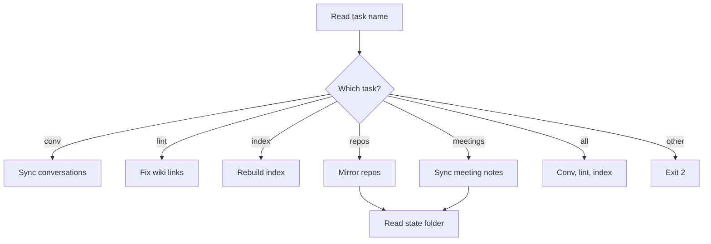

## Purpose

This script runs one maintenance job by hand, with output shown live: convert session files, fix wiki links, mirror repos, sync meeting notes, rebuild the index, or the three most common ones together. The double click `.command` files next to it each call it with one task name. It is the manual twin of the nightly job.

## Dependencies

**Depends on.**
- `scripts/sync/sync_conversations.py`, `scripts/sync/lint_wikilinks.py`, `scripts/sync/sync_meetings.py`, `scripts/sync/sync_repos.sh` and `scripts/search/rebuild.sh`, all run by path {src:scripts/cron/launchers/run_task.sh:28-30} {src:scripts/cron/launchers/run_task.sh:34} {src:scripts/cron/launchers/run_task.sh:40}. None of these has a page yet: [[sync_conversations]] (no doc yet), [[lint_wikilinks]] (no doc yet), [[sync_meetings]] (no doc yet), [[sync_repos]] (no doc yet), [[rebuild]] (no doc yet).
- `scripts/core/tg_path`, which prints the state folder: [[tg_path]] (no doc yet) {src:scripts/cron/launchers/run_task.sh:33}.
- Two files in the state folder: `repos.list` and `meetings-source` {src:scripts/cron/launchers/run_task.sh:34} {src:scripts/cron/launchers/run_task.sh:39}.
- Environment variable `TOLLGATE_PYTHON`, default `python3` {src:scripts/cron/launchers/run_task.sh:21}.

**Used by.**
- Product code: the six double click launchers `run-all.command`, `run-conversations.command`, `run-index.command`, `run-lint.command`, `run-meetings.command` and `run-repos.command` in the same folder, for example {src:scripts/cron/launchers/run-index.command:6}. Searched with `git grep run_task` over the repo except `docs/` on 2026-11-20.
- Tests: `tests/scripts/cron/test_cron_tools.py` test `test_launchers_dry_run` {src:tests/scripts/cron/test_cron_tools.py:311-318}.

## Behavior

**Arguments.** The first argument is the task name and defaults to `all` {src:scripts/cron/launchers/run_task.sh:22}. Dry run is on only when the second argument is exactly `--dry-run` {src:scripts/cron/launchers/run_task.sh:23}. A dry run does not execute the job; it prints "would run:" and the command {src:scripts/cron/launchers/run_task.sh:26}.

**Tasks.** The case statement maps `conv` to the conversation sync, `lint` to the wiki link fixer, `meetings` to the meeting sync, `repos` to the repo mirror, `index` to the index rebuild, and `all` to conv, then lint, then index; any other name prints an error and exits 2 {src:scripts/cron/launchers/run_task.sh:43-51}. `all` leaves out repos and meetings {src:scripts/cron/launchers/run_task.sh:49}.

**Repos and meetings.** Both look up the state folder first; if the path loader cannot resolve it they print "not set up" and return 2 {src:scripts/cron/launchers/run_task.sh:33} {src:scripts/cron/launchers/run_task.sh:38}. Repos passes `$STATE/repos.list` to the mirror script {src:scripts/cron/launchers/run_task.sh:34}. Meetings returns 1 with "not set up" when the `meetings-source` file is missing, otherwise passes its first line as the `--source` value {src:scripts/cron/launchers/run_task.sh:39-40}.

**Exit status.** The script ends with whatever the last command of the chosen branch returned. In `all`, the exit status is that of the index rebuild only {src:scripts/cron/launchers/run_task.sh:49}, since no step result is saved.

## Diagram

## Notes

**Code and its own description disagree.**
- The header says every folder comes from the path loader "through the scripts it runs" {src:scripts/cron/launchers/run_task.sh:4}. That holds for the scripts it calls, but this script itself reads `repos.list` and `meetings-source` by joining names onto the state folder {src:scripts/cron/launchers/run_task.sh:34} {src:scripts/cron/launchers/run_task.sh:39}. The state folder does come from the loader.
- The header calls it a trigger "with live output" {src:scripts/cron/launchers/run_task.sh:3}. In a dry run the repos and meetings branches still run the path lookup and file check before printing {src:scripts/cron/launchers/run_task.sh:33} {src:scripts/cron/launchers/run_task.sh:39}, so a dry run of `meetings` can fail with status 1 on a machine with no source file.

**Inputs reaching commands or paths with no check.**
- The first line of `meetings-source` is passed as the `--source` argument; it is quoted, so it is one argument, but its value is not checked here {src:scripts/cron/launchers/run_task.sh:40}.
- `TOLLGATE_PYTHON` is executed as a program unchecked {src:scripts/cron/launchers/run_task.sh:21} {src:scripts/cron/launchers/run_task.sh:28}.
- The `repos.list` path is not tested for existence before use {src:scripts/cron/launchers/run_task.sh:34}; the sync script handles a missing list itself {src:scripts/sync/sync_repos.sh:23-26}.
- A second argument other than `--dry-run` is silently ignored, so a typo such as `--dryrun` runs the real job {src:scripts/cron/launchers/run_task.sh:23}.

**Shared files.** This script writes no file itself. The scripts it launches write to shared folders; nothing here stops two runs at once, including a manual run overlapping the nightly job.

**Test coverage.** The test checks `all --dry-run` output and that the home folder is unchanged, and that an unknown task exits 2 {src:tests/scripts/cron/test_cron_tools.py:314-318}. The real task branches, `repos` and `meetings` and the exit status of `all` are not tested.
