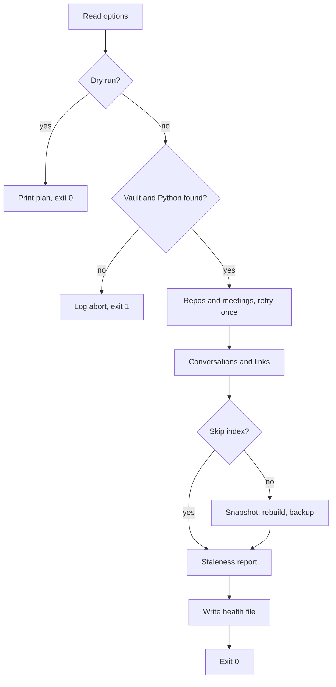

## Purpose

This is the nightly maintenance run for the vault. It mirrors repos, syncs meeting notes and conversations, fixes wiki links, takes a safety copy of the search index, rebuilds the index, makes a dated index backup, writes a staleness report, and then writes a small health file that says which steps passed. It is meant to be started by a scheduled job, and it is built so one failing step does not stop the others.

## Dependencies

**Depends on.**
- `scripts/core/tg_path`, which prints folders for logical names: [[tg_path]] (no doc yet) {src:scripts/cron/nightly_index.sh:23}.
- `scripts/sync/sync_repos.sh`, `scripts/sync/sync_meetings.py`, `scripts/sync/sync_conversations.py`, `scripts/sync/lint_wikilinks.py`, `scripts/search/rebuild.sh`, `scripts/state/backup_index.sh`: none has a page yet: [[sync_repos]] (no doc yet), [[sync_meetings]] (no doc yet), [[sync_conversations]] (no doc yet), [[lint_wikilinks]] (no doc yet), [[rebuild]] (no doc yet), [[backup_index]] (no doc yet) {src:scripts/cron/nightly_index.sh:125} {src:scripts/cron/nightly_index.sh:128} {src:scripts/cron/nightly_index.sh:130-131} {src:scripts/cron/nightly_index.sh:142-143}.
- Two more scripts in this folder: [[vault_staleness]] [vault_staleness](vault_staleness.md) {src:scripts/cron/nightly_index.sh:146} and [[write_nightly_health]] [write_nightly_health](write_nightly_health.md) {src:scripts/cron/nightly_index.sh:150}.
- Optional input files in the state folder: `repos.list` and `meetings-source` {src:scripts/cron/nightly_index.sh:55-56}.
- Environment variable `TOLLGATE_PYTHON`, and the program `venv/bin/python3` inside the state folder, one of which is used as the Python program before the fallback `python3` {src:scripts/cron/nightly_index.sh:44} {src:scripts/cron/nightly_index.sh:45} {src:scripts/cron/nightly_index.sh:46}.

**Used by.**
- Product code: the `nightly-index` entry of the job table in [[setup_cron]] [setup_cron](setup_cron.md), which runs this script with `--notify` at 2:00 {src:scripts/cron/setup_cron.py:47}; `install.sh` schedules that job {src:install.sh:1674}.
- Tests: `tests/scripts/cron/test_cron_tools.py` class `NightlyAndHelpers` and two tests in `SetupCronCarriesPathsAndNightlyChecks` {src:tests/scripts/cron/test_cron_tools.py:207} {src:tests/scripts/cron/test_cron_tools.py:177}.
- Searched with `git grep nightly_index` over the repo except `docs/` on 2026-11-20.

## Behavior

**Options.** `--dry-run`, `--skip-index` and `--notify` are accepted; any other word exits 2 {src:scripts/cron/nightly_index.sh:26-33}.

**Folders.** The vault, state, logs, cache, output and index folders each come from the path loader; if any cannot be resolved the script prints "not set up" and exits 2 {src:scripts/cron/nightly_index.sh:35-41}. The helper hides the loader's own error text {src:scripts/cron/nightly_index.sh:35}.

**Python choice.** The Python program is taken in this order: the `TOLLGATE_PYTHON` variable if it is set and not empty {src:scripts/cron/nightly_index.sh:44}; else `venv/bin/python3` in the state folder if that file is executable {src:scripts/cron/nightly_index.sh:45}; else plain `python3`, with a note "no venv found" kept for the log {src:scripts/cron/nightly_index.sh:46}. The note is written to the log right after the header line, only when that fallback was taken {src:scripts/cron/nightly_index.sh:80}. The same order is used by [[rebuild]] [rebuild](../search/rebuild.md) {src:scripts/search/rebuild.sh:14-16}.

**Environment.** It adds the usual tool folders to `PATH` and turns off git credential prompts {src:scripts/cron/nightly_index.sh:51} {src:scripts/cron/nightly_index.sh:53}. The log file is `logs/nightly/<date>.log` {src:scripts/cron/nightly_index.sh:47-48}.

**Dry run.** Prints the log and health file names and the list of steps it would run, then exits 0, running nothing {src:scripts/cron/nightly_index.sh:60-76}.

**Guards.** It creates the log and state folders and writes a header line to the log {src:scripts/cron/nightly_index.sh:78-79}. If the vault folder is missing it logs and prints an ABORT message and exits 1 {src:scripts/cron/nightly_index.sh:84-89}. If the Python program is not found it logs an ABORT line and exits 1 {src:scripts/cron/nightly_index.sh:91-94}. Neither abort writes a health file.

**Step runner.** `run_step` runs a command with all output appended to the log and records `name:PASS` or `name:FAIL:<code>` {src:scripts/cron/nightly_index.sh:99-106}. `run_step_with_retry` does the same but, after a failure, waits 30 seconds and runs the command once more, recording the second result {src:scripts/cron/nightly_index.sh:108-121}. There is no `set -e`, so a failed step does not stop the run {src:scripts/cron/nightly_index.sh:96}.

**Steps, in order.**
1. Repo mirror with retry, only if `repos.list` exists {src:scripts/cron/nightly_index.sh:124-126}.
2. Meeting sync with retry, only if `meetings-source` has a first line {src:scripts/cron/nightly_index.sh:58} {src:scripts/cron/nightly_index.sh:127-129}.
3. Conversation sync, then wiki link fixer, both without retry {src:scripts/cron/nightly_index.sh:130-131}.
4. Unless `--skip-index`: delete the old snapshot folder `cache/index-backup`, copy the index folder into it if the index exists, note if there is nothing to copy {src:scripts/cron/nightly_index.sh:133-140}; then rebuild the index and run the index backup script {src:scripts/cron/nightly_index.sh:142-143}.
5. Staleness report with `--report-only`, so findings do not count as a failure {src:scripts/cron/nightly_index.sh:146}.
6. The health writer receives every recorded result as arguments, plus `--notify` if asked; a failure of the writer is logged but does not change the exit code {src:scripts/cron/nightly_index.sh:148-153}.

**Exit.** The script always ends with exit 0 after the health step {src:scripts/cron/nightly_index.sh:157}. Step failures show only in the log and the health file.

## Diagram

## Notes

**Code and its own description disagree.**
- The header says it "reads and writes only inside folders the path loader returns" {src:scripts/cron/nightly_index.sh:7}. The loader folders are used, but the script also adds `/opt/homebrew/bin` and `/usr/local/bin` to `PATH` {src:scripts/cron/nightly_index.sh:51}, and the steps it launches write wherever their own code writes; this page does not check those scripts.
- The header says "Every step runs even when an earlier one fails" {src:scripts/cron/nightly_index.sh:5}. That holds once the steps start. The two guard aborts happen before any step and exit 1 {src:scripts/cron/nightly_index.sh:84-94}, and they skip the health file, so the health file from the previous night stays and looks current to a reader.
- The abort for a missing Python writes only to the log, not to the error stream, unlike the vault abort {src:scripts/cron/nightly_index.sh:92} {src:scripts/cron/nightly_index.sh:87}.
- The header mentions a "dated index backup" {src:scripts/cron/nightly_index.sh:4}. The script only calls `backup_index.sh` {src:scripts/cron/nightly_index.sh:143}; the dating is that script's job and was not read here.
- The dry run says "Nothing is run or written" {src:scripts/cron/nightly_index.sh:61}, which holds for steps, but the dry run does call the path loader for several lines {src:scripts/cron/nightly_index.sh:65-68}.

**Inputs reaching paths or commands with no check on their value.**
- The first line of `meetings-source` goes unchecked as the `--source` value of the meeting sync (quoted, so one argument) {src:scripts/cron/nightly_index.sh:58} {src:scripts/cron/nightly_index.sh:128}.
- `TOLLGATE_PYTHON`, or else the state folder `venv/bin/python3`, is run as a program; only its presence is tested with `command -v`, and nothing checks that it is a Python of a usable version {src:scripts/cron/nightly_index.sh:44} {src:scripts/cron/nightly_index.sh:45} {src:scripts/cron/nightly_index.sh:91}.
- Folder values from the loader are used for `rm -rf`, `cp -R` and `mkdir` unchanged. The `rm -rf` is guarded against an empty value by `${SNAP:?}` {src:scripts/cron/nightly_index.sh:137}, but `SNAP` is built from the cache folder and nothing checks that the cache folder is a sensible place {src:scripts/cron/nightly_index.sh:135}.

**Snapshot risk.** The old snapshot is deleted before the new copy is made {src:scripts/cron/nightly_index.sh:137-138}. If the copy fails partway, the log gets the error but the snapshot is partial or missing, and the rebuild still runs {src:scripts/cron/nightly_index.sh:138} {src:scripts/cron/nightly_index.sh:142}.

**Shared writes.** The log is appended to with `>>`, not atomic, with no lock; two runs on the same day would interleave in the same file {src:scripts/cron/nightly_index.sh:48} {src:scripts/cron/nightly_index.sh:102}. The snapshot folder is deleted and recreated with no lock. The health file is written by [[write_nightly_health]] [write_nightly_health](write_nightly_health.md), not here.

**Assumptions.** The health call uses the `${arr[@]+...}` form for the optional arguments {src:scripts/cron/nightly_index.sh:150}; why that form was chosen is not stated in the file. The Python version is not checked. The notification option relies on `osascript`, so it works only on macOS (see the health writer page).
