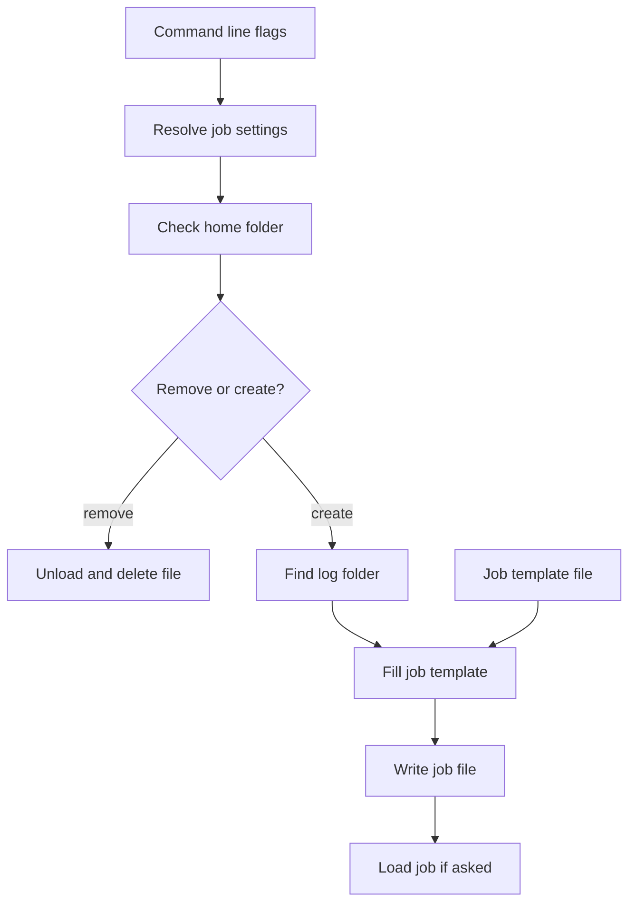

## Purpose

This program creates, and can remove, a macOS scheduled job file (a launchd property list) for a Tollgate script. It fills a generic template with the program to run, its arguments, a time, a log file and the folder settings, writes the file under the home folder it is given, and loads the job only when asked. Two ready made jobs exist: the nightly index and the weekly reminder.

## Dependencies

**Depends on.**
- [[paths]] (no doc yet): `core.paths` gives `get_path` and `NotSetUp` {src:scripts/cron/setup_cron.py:32}.
- The template file `scripts/cron/launchd/job.plist.template` {src:scripts/cron/setup_cron.py:35} {src:scripts/cron/setup_cron.py:106}.
- The scripts it schedules: [[nightly_index]] [nightly_index](nightly_index.md) and [[think_calibrate_reminder]] [think_calibrate_reminder](think_calibrate_reminder.md) {src:scripts/cron/setup_cron.py:47-48}.
- The program `launchctl` (or whatever `--launcher` names) {src:scripts/cron/setup_cron.py:65}.
- Environment variables carried into the job: `TOLLGATE_HOME`, `TOLLGATE_PATHS`, `TOLLGATE_KNOWLEDGE`, `TOLLGATE_STATE_DIR`, `TOLLGATE_CODE_DIR`, `TOLLGATE_PYTHON`, `CLAUDE_CONFIG_DIR`; and `HOME` for the install check {src:scripts/cron/setup_cron.py:42-43} {src:scripts/cron/setup_cron.py:173}.
- Standard library: `argparse`, `os`, `pathlib`, `re`, `subprocess`, `sys`, `xml.sax.saxutils`.

**Used by.**
- Product code: `install.sh` runs it to schedule the nightly job {src:install.sh:1674} and to remove jobs on uninstall {src:install.sh:492}. The abort message in [[nightly_index]] [nightly_index](nightly_index.md) names it in text only {src:scripts/cron/nightly_index.sh:85}.
- Tests: `tests/scripts/cron/test_cron_tools.py` classes `SetupCron` and `SetupCronCarriesPathsAndNightlyChecks` {src:tests/scripts/cron/test_cron_tools.py:64} {src:tests/scripts/cron/test_cron_tools.py:164}.
- Searched with `git grep setup_cron` over the repo except `docs/` on 2026-11-20.

## Behavior

**Job table.** `nightly-index` runs `nightly_index.sh --notify` at 02:00 every day; `weekly-reminder` runs `think_calibrate_reminder.sh` at 09:00 on weekday 0, which the help text calls Sunday {src:scripts/cron/setup_cron.py:46-49} {src:scripts/cron/setup_cron.py:62}.

**`build_parser`.** Defines `--home` (required), `--job`, `--program`, `--arg` (repeatable), `--label`, `--hour`, `--minute`, `--weekday`, `--dry-run`, `--yes-install-job`, `--launcher` (default `launchctl`) and `--remove` {src:scripts/cron/setup_cron.py:52-67}.

**`settings`.** Needs `--job` or `--program`, else raises an error {src:scripts/cron/setup_cron.py:72-74}. With `--job` the program is the script in this folder, the arguments are the job's plus any `--arg`, and the time falls back to the job's default {src:scripts/cron/setup_cron.py:75-81}. If both `--job` and `--program` are given, the job wins and `--program` is ignored {src:scripts/cron/setup_cron.py:75}. With `--program`, the default time is 02:00 with no weekday, and the default label is `tg-job-` plus the program name with non-word characters turned into dashes {src:scripts/cron/setup_cron.py:82-87}. A label must match the pattern `[A-Za-z0-9][A-Za-z0-9._-]{0,80}` {src:scripts/cron/setup_cron.py:37} {src:scripts/cron/setup_cron.py:88-89}; hour must be 0 to 23, minute 0 to 59, weekday 0 to 6 {src:scripts/cron/setup_cron.py:90-91}.

**`render`.** Builds the argument list as `/bin/bash`, the program, and its arguments; builds the schedule and environment entries; reads the template; replaces five markers, each value XML escaped {src:scripts/cron/setup_cron.py:97-98} {src:scripts/cron/setup_cron.py:106-110}. The template sets `RunAtLoad` to false, so loading the job does not run it at once {src:scripts/cron/launchd/job.plist.template:29-30}.

**`inside`.** True when a folder, after links are resolved, lies within another {src:scripts/cron/setup_cron.py:114-119}.

**`main`, common steps.** Bad settings print an error and return 2 {src:scripts/cron/setup_cron.py:125-128}. `--home` must be an existing folder, else return 2 {src:scripts/cron/setup_cron.py:130-132}. The job file is `<home>/Library/LaunchAgents/<label>.plist`; if the folder resolves outside `--home` it prints "refused" and returns 1 {src:scripts/cron/setup_cron.py:133-137}.

**`main`, remove.** With `--remove` it prints the file name; with `--dry-run` it stops there. With `--yes-install-job` and an existing file it first calls `<launcher> bootout`, then deletes the file if it exists {src:scripts/cron/setup_cron.py:139-148}.

**`main`, create.** Resolves the log file `<logs folder>/<label>.log` through the path loader; if not set up it prints "not set up" and returns 2 {src:scripts/cron/setup_cron.py:150-154}. The job environment is a fixed `PATH` plus any of the carried variables that are set and non-empty {src:scripts/cron/setup_cron.py:44} {src:scripts/cron/setup_cron.py:155}. A dry run prints the plan and the full file and returns 0 {src:scripts/cron/setup_cron.py:158-163}. Otherwise it creates the folder, writes the file, prints the path and a note about folder variables {src:scripts/cron/setup_cron.py:165-169}. Without `--yes-install-job` it stops with "not loaded" and returns 0 {src:scripts/cron/setup_cron.py:170-172}.

**`main`, load.** If the launcher is the default `launchctl` and `--home` is not the real `HOME`, it refuses with return 1 {src:scripts/cron/setup_cron.py:173-175}. Otherwise it calls `<launcher> bootstrap gui/<uid> <file>`, prints "loaded" or "load failed", and returns 0 or 1 {src:scripts/cron/setup_cron.py:176-179}.

## Diagram: module level (L2, required)

## Diagram: function level (L3, optional)

None: no function has branching that the signature does not show beyond the flow already drawn for `main`.

## Notes

**Code and its own description disagree.**
- The header says it "writes only one file" {src:scripts/cron/setup_cron.py:4}. It also creates the `Library/LaunchAgents` folder if missing {src:scripts/cron/setup_cron.py:165}, and with `--remove` it deletes the file {src:scripts/cron/setup_cron.py:147}.
- The usage text says exit 1 means "refused" {src:scripts/cron/setup_cron.py:21}. Exit 1 is also returned when loading the job fails {src:scripts/cron/setup_cron.py:179}. Argument parser errors also give exit 2 through `argparse`, which is within "bad arguments".
- The comment says the carried variables are "names and paths only, never a secret" {src:scripts/cron/setup_cron.py:38}. The code copies whatever value the variable holds without a check {src:scripts/cron/setup_cron.py:155}; `TOLLGATE_PYTHON` is a command and the others are paths by their names, but their content is not checked.
- The header says the job loads only with `--yes-install-job` {src:scripts/cron/setup_cron.py:5}. True for create. For remove, `--yes-install-job` runs `bootout`, which unloads {src:scripts/cron/setup_cron.py:143-145}.

**Inputs reaching a path, command or text with no check on their value.**
- `--program` is not checked to exist or be executable; its path is written into the job file {src:scripts/cron/setup_cron.py:83} {src:scripts/cron/setup_cron.py:97-98}. It is XML escaped, so it cannot break the file format.
- `--arg` values are written unchanged apart from XML escaping {src:scripts/cron/setup_cron.py:97-98}. Any value will be run by the scheduled job.
- `--launcher` is run as a program with `subprocess.run` using an argument list, no shell; any program is accepted {src:scripts/cron/setup_cron.py:144} {src:scripts/cron/setup_cron.py:176}.
- `--label` is checked by a pattern {src:scripts/cron/setup_cron.py:88}, so it cannot carry a path separator.
- `--home` is checked to be a folder and that `Library/LaunchAgents` resolves inside it {src:scripts/cron/setup_cron.py:130} {src:scripts/cron/setup_cron.py:135}. The job file itself is not checked: if `<label>.plist` already exists as a link, `write_text` follows it {src:scripts/cron/setup_cron.py:166}.
- The real `launchctl` safety check (home must be the real home) applies to loading only, not to `bootout` in the remove branch {src:scripts/cron/setup_cron.py:143-145} {src:scripts/cron/setup_cron.py:173}.

**Writes to shared files.** The job file is written with `Path.write_text`: not atomic, no lock, and an existing file is overwritten {src:scripts/cron/setup_cron.py:166}. Rewriting the file for a job that is already loaded does not reload it; loading it again with `--yes-install-job` may fail because the label is already loaded, but launchd's behavior was not checked in this run [uncertain]. The job keeps the environment as it was when the file was written, which the printed note says {src:scripts/cron/setup_cron.py:168-169}.

**Tests.** The test class names show the stub launcher is used so the real `launchctl` is not called {src:tests/scripts/cron/test_cron_tools.py:79}. The weekday value 0 meaning Sunday is taken from the help text; no test or file here checks how launchd reads it.
