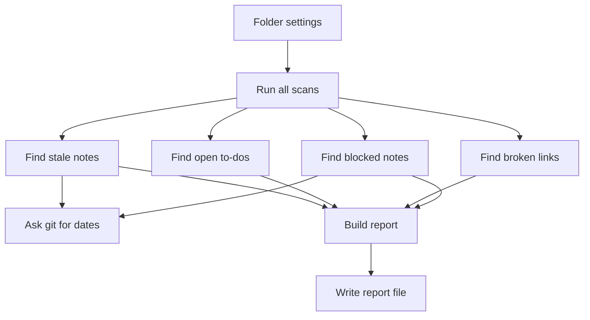

## Purpose

This program scans the vault for four kinds of upkeep problems: notes nobody has changed for a long time, open to-do markers, wiki links that point nowhere, and notes tagged as blocked that have sat untouched. It writes one Markdown report into the output folder. It is the staleness step of the nightly run and can also be run by hand.

## Dependencies

**Depends on.**
- [[paths]] (no doc yet): `core.paths` supplies `get_path`, `NotSetUp`, `folder_name` and `LAYOUT_SUBDIRS` {src:scripts/cron/vault_staleness.py:30}.
- The `git` program, run once per scanned note {src:scripts/cron/vault_staleness.py:94-99}.
- The vault folder, which is read, and the output folder, which is written {src:scripts/cron/vault_staleness.py:49-50}.
- Standard library: `logging`, `re`, `subprocess`, `sys`, `collections`, `datetime`, `pathlib`.

**Used by.**
- Product code: [[nightly_index]] [nightly_index](nightly_index.md) runs it with `--report-only` {src:scripts/cron/nightly_index.sh:146}.
- Tests: `test_vault_staleness_*` in `tests/scripts/cron/test_cron_tools.py`, which call `under_folder` and read `STALENESS_RULES` {src:tests/scripts/cron/test_cron_tools.py:189-204} and run the whole program {src:tests/scripts/cron/test_cron_tools.py:291-304}.
- Searched with `git grep vault_staleness` over the repo except `docs/` on 2026-11-20. The report name `vault-health-report.md` is read by no file in the repo other than the test {src:tests/scripts/cron/test_cron_tools.py:300}. Searched with `git grep vault-health-report`.
- Exports: besides the functions, 18 upper-case module names exist; only `STALENESS_RULES` is read by another file (a test). The other 17 are listed in Notes.

## Behavior

**Setup at import.** Folder names for system map, reference, tickets, knowledge, education, conversations, chat threads and memory are looked up when the module loads {src:scripts/cron/vault_staleness.py:32-38} {src:scripts/cron/vault_staleness.py:81}.

**`configure`.** Sets the vault and report path; with no arguments both come from the path loader, the report being `<output>/vault-health-report.md` {src:scripts/cron/vault_staleness.py:46-50} {src:scripts/cron/vault_staleness.py:43}.

**Rules for stale notes.** The rule table has one entry per subfolder of the system map listed in the layout table, with a day limit from `SUBDIR_THRESHOLDS` or the 60 day default, plus the education folder at 90 days {src:scripts/cron/vault_staleness.py:64-69} {src:scripts/cron/vault_staleness.py:55-62}. All five system map subfolders are named in `SUBDIR_THRESHOLDS`, so the default limit is currently never used {src:scripts/core/paths.py:46}.

**`under_folder`.** True when a vault relative path is the folder or lies inside it, compared by whole path segments {src:scripts/cron/vault_staleness.py:85-89}.

**`git_last_modified`.** Runs `git log -1 --format=%ai -- <path>` inside the vault {src:scripts/cron/vault_staleness.py:94-99}. If git gives nothing it uses the file's modified time; if that fails it returns nothing {src:scripts/cron/vault_staleness.py:101-107}. A git date is read from its first 19 characters and marked as UTC, so the commit's own time zone is ignored {src:scripts/cron/vault_staleness.py:109}.

**`collect_all_wikilink_targets`.** Collects the lower case stem and file name of every `.md` file under the vault, including hidden folders, because it uses `rglob` on the vault root {src:scripts/cron/vault_staleness.py:121-123}.

**`scan_staleness`.** For each rule folder that exists, every `.md` file whose age is at or over the limit becomes a finding {src:scripts/cron/vault_staleness.py:129-146}.

**`scan_todos`.** Looks only in the system map and education folders {src:scripts/cron/vault_staleness.py:72-75} {src:scripts/cron/vault_staleness.py:152-165}. A file matches when it has an unchecked checkbox line, `TODO:` or `FIXME:` anywhere {src:scripts/cron/vault_staleness.py:77} {src:scripts/cron/vault_staleness.py:161}.

**`scan_broken_wikilinks`.** Same two folders, skipping files under the memory folder {src:scripts/cron/vault_staleness.py:178-179}. For each `[[link]]` it drops any alias or anchor, then checks the target's stem and name in lower case against the target set; a link is broken when neither is found {src:scripts/cron/vault_staleness.py:78} {src:scripts/cron/vault_staleness.py:184-193}. Only the file name is compared, not the folder part {src:scripts/cron/vault_staleness.py:186-187}.

**`scan_stale_blocked`.** Walks the whole vault except the tickets and memory folders {src:scripts/cron/vault_staleness.py:201-204}. A note counts when the text `status/blocked` appears in its first 500 characters and its last change is more than 30 days ago {src:scripts/cron/vault_staleness.py:206-212}.

**`render_report`.** Builds a Markdown report: counts, then stale notes grouped by label in tables, TODO files, broken links grouped by file, and blocked notes; or the line "No issues found" when the total is zero {src:scripts/cron/vault_staleness.py:235-283}.

**`main`.** If the path loader fails it prints "not set up" and returns 2; if the vault folder is missing it logs an error and returns 1 {src:scripts/cron/vault_staleness.py:288-295}. Otherwise it runs the four scans, creates the output folder, writes the report, prints a one line summary, and returns 0 when there are no issues or `--report-only` is present, else 2 {src:scripts/cron/vault_staleness.py:299-314}.

## Diagram: module level (L2, required)

## Diagram: function level (L3, optional)

None: no function has branching that the signature does not show beyond the flow already drawn for `main` and the date fallback described above.

## Notes

**Code and its own description disagree.**
- A comment says the content scan folders are "All vault folders scanned for TODOs and broken wikilinks (broader net)" {src:scripts/cron/vault_staleness.py:71}. The list holds two folders, the system map and education {src:scripts/cron/vault_staleness.py:72-75}.
- The docstring of `collect_all_wikilink_targets` says it builds "a lowercase stem to path map" {src:scripts/cron/vault_staleness.py:119}. It returns a set of names with no paths {src:scripts/cron/vault_staleness.py:120-124}.
- The comment on the thresholds says "days since last git commit" {src:scripts/cron/vault_staleness.py:52}. The code falls back to the file modified time for untracked files {src:scripts/cron/vault_staleness.py:102-105}.
- The usage line says exit 2 means issues were found {src:scripts/cron/vault_staleness.py:13}. Exit 2 is also returned when the paths are not set up {src:scripts/cron/vault_staleness.py:291-292}, so a caller cannot tell the two apart.
- The docstring of `scan_stale_blocked` says "status/blocked tag", but the code matches the text anywhere in the first 500 characters, not a frontmatter tag {src:scripts/cron/vault_staleness.py:198} {src:scripts/cron/vault_staleness.py:206-209}.
- The report text says broken links point to "files that do not exist in the vault" {src:scripts/cron/vault_staleness.py:264}. Only `.md` files are known targets, so a link to an image or other non-note file is reported broken {src:scripts/cron/vault_staleness.py:121-123}. A link such as `[[v1.2 plan]]` is cut at its dot by `Path.stem`, which can make a good link look broken {src:scripts/cron/vault_staleness.py:186}.
- The comment at line 54 says folders not in the layout are skipped, and that matches the rule table, which is built only from layout entries {src:scripts/cron/vault_staleness.py:64-69}. Files that sit directly in the system map folder, outside any subfolder, are not checked for staleness.

**Other upper-case names (17 besides `STALENESS_RULES`, none read by another file).** `SYSTEM_MAP_DIR`, `REFERENCE_DIR`, `TICKETS_DIR`, `KNOWLEDGE_DIR`, `EDUCATION_DIR`, `CONVERSATIONS_DIR_NAME`, `THREADS_DIR_NAME`, `VAULT`, `REPORT_PATH`, `REPORT_NAME`, `DEFAULT_THRESHOLD`, `SUBDIR_THRESHOLDS`, `CONTENT_SCAN_FOLDERS`, `TODO_PATTERN`, `WIKILINK_PATTERN`, `MEMORY_DIR`, `WIKILINK_SKIP_DIRS`. Four of them, `REFERENCE_DIR`, `KNOWLEDGE_DIR`, `CONVERSATIONS_DIR_NAME` and `THREADS_DIR_NAME`, are set and never used again in this file {src:scripts/cron/vault_staleness.py:33} {src:scripts/cron/vault_staleness.py:35} {src:scripts/cron/vault_staleness.py:37-38}. Searched with `git grep` for the four names over `scripts` and `tests`: other scripts define their own copies, none imports these.

**Inputs reaching paths, commands or text with no check.**
- The note path passed to `git log` comes from the folder walk and is given as one list item with no shell; the vault location comes from the path loader {src:scripts/cron/vault_staleness.py:93-96}.
- The git command is not guarded: if `git` is not installed, `subprocess.run` raises and the program stops with a traceback; a folder that is not a git repository gives empty output and uses the file time {src:scripts/cron/vault_staleness.py:94} {src:scripts/cron/vault_staleness.py:101-105}.
- File names and wiki link text from the vault are written into the report unescaped, so a name with a pipe or backtick can break the table or code span {src:scripts/cron/vault_staleness.py:254} {src:scripts/cron/vault_staleness.py:270}.
- `--report-only` is found by looking for the exact word in the argument list; other arguments are ignored {src:scripts/cron/vault_staleness.py:314}.

**Writes to shared files.** One file, `vault-health-report.md`, is written with `write_text`: not atomic, no lock; two runs at once write the same file {src:scripts/cron/vault_staleness.py:308-309}.

**Cost.** One `git` process per scanned note, and the blocked scan walks the whole vault including hidden folders such as `.git` {src:scripts/cron/vault_staleness.py:94} {src:scripts/cron/vault_staleness.py:201}.

**Tests.** The memory folder test and the rules test only exercise `under_folder` and `STALENESS_RULES` {src:tests/scripts/cron/test_cron_tools.py:189-204}. The full run test uses an unchecked box and a missing link, so it proves the report is written and exit 2 appears, but not the stale and blocked scans {src:tests/scripts/cron/test_cron_tools.py:291-304}.
