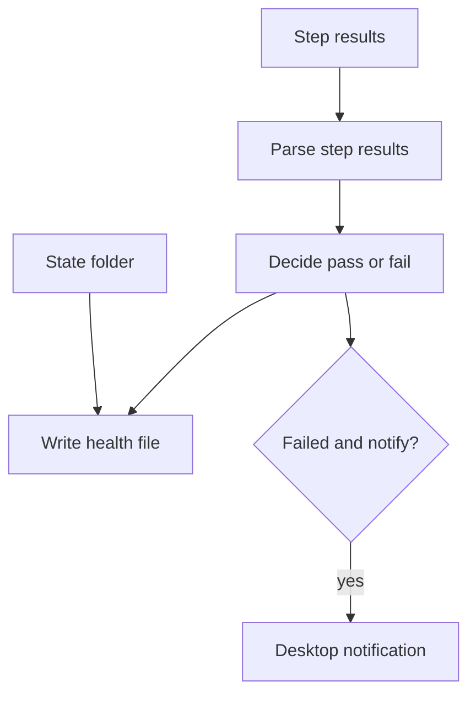

## Purpose

This program turns the pass or fail results of the nightly steps into a small JSON health file in the state folder, so a person or tool can see in one place whether last night's run went well. With a flag it also shows a desktop notification when something failed.

## Dependencies

**Depends on.**
- [[paths]] (no doc yet): `core.paths` supplies `get_path` and `NotSetUp` {src:scripts/cron/write_nightly_health.py:24}.
- The macOS program `osascript`, used only for the notification {src:scripts/cron/write_nightly_health.py:71}.
- Standard library: `argparse`, `json`, `logging`, `pathlib`, `subprocess`, `sys`, `datetime`.

**Used by.**
- Product code: [[nightly_index]] [nightly_index](nightly_index.md) calls it last, passing every step result {src:scripts/cron/nightly_index.sh:150}. Nothing reads the health file it writes in product code; searched with `git grep nightly-health` over the repo except `docs/` on 2026-11-20 (only a dry run message prints the name {src:scripts/cron/nightly_index.sh:63}).
- Tests: `tests/scripts/cron/test_cron_tools.py`, the health file checks {src:tests/scripts/cron/test_cron_tools.py:250} {src:tests/scripts/cron/test_cron_tools.py:263} and the notification test {src:tests/scripts/cron/test_cron_tools.py:276-289}.

## Behavior

**`parse_args(args)`.** Despite its name it parses step results, not command line flags. Each item is split on at most two colons; an item with no colon is skipped with a warning {src:scripts/cron/write_nightly_health.py:38-41}. The first part is the step name and the second the status; a third part is read as an integer exit code, and a non-integer is dropped with a warning while the step is kept {src:scripts/cron/write_nightly_health.py:42-48}.

**`compute_overall(steps)`.** An empty list gives `FAIL`; otherwise `PASS` only when every step status is exactly `PASS` {src:scripts/cron/write_nightly_health.py:53-55}. Any other status word counts as a failure.

**`write_health`.** Builds a record with the local time of the run with its UTC offset, the overall result and the steps; creates the state folder if needed and writes the file `nightly-health.json` with two space indent {src:scripts/cron/write_nightly_health.py:59-65} {src:scripts/cron/write_nightly_health.py:29}.

**`fire_notification`.** Runs `osascript -e` with a fixed text; a missing program or a non-zero exit is caught and logged by error type only {src:scripts/cron/write_nightly_health.py:68-73}.

**`main`.** Accepts `--notify` and any number of step results {src:scripts/cron/write_nightly_health.py:77-79}. With no steps it logs a warning and goes on to write a health file with overall `FAIL` {src:scripts/cron/write_nightly_health.py:81-82} {src:scripts/cron/write_nightly_health.py:53-54}. If the state folder cannot be resolved it prints "not set up" and returns 2 {src:scripts/cron/write_nightly_health.py:83-86}. A write error is logged and returns 1 {src:scripts/cron/write_nightly_health.py:90-94}. The notification fires only when the overall result is `FAIL` and `--notify` was given {src:scripts/cron/write_nightly_health.py:95-96}. Returns 0 otherwise {src:scripts/cron/write_nightly_health.py:97}.

## Diagram: module level (L2, required)

## Diagram: function level (L3, optional)

None: no function has branching that the signature does not show beyond the flow already drawn for `main`.

## Notes

**Code and its own description disagree.** None found for the header and usage text. The usage line shows `name:PASS name:FAIL:exit_code` {src:scripts/cron/write_nightly_health.py:11}; the code also accepts `name:FAIL` with no code and any other status word {src:scripts/cron/write_nightly_health.py:42-46}. Also, the stated exit codes (0, 2, 1) leave out the exit code 2 that `argparse` gives for bad flags {src:scripts/cron/write_nightly_health.py:13}.

**Edge cases.**
- A malformed item is dropped, not counted. If one item out of several is malformed and the rest pass, the overall result is `PASS`, and the dropped item is missing from the file {src:scripts/cron/write_nightly_health.py:39-41} {src:scripts/cron/write_nightly_health.py:55}.
- If a step name contains a colon, the name is cut at the first colon {src:scripts/cron/write_nightly_health.py:38}.
- The notification text is fixed, so no step name reaches `osascript` {src:scripts/cron/write_nightly_health.py:30-31} {src:scripts/cron/write_nightly_health.py:69}.

**Inputs reaching a path, command or text with no check.** Step names and status words come from the command line and go into the JSON file, escaped by `json.dumps`, with no check on their value {src:scripts/cron/write_nightly_health.py:42} {src:scripts/cron/write_nightly_health.py:65}. The health file path comes from the path loader plus a fixed name {src:scripts/cron/write_nightly_health.py:84}. No input reaches a shell, a network address or the notification text.

**Writes to shared files.** `nightly-health.json` is written with `write_text`: not atomic, no lock. A reader could see a half written file if it reads during the write; two writers at once would overwrite each other {src:scripts/cron/write_nightly_health.py:65}. In the nightly run only one writer exists at a time unless two runs overlap [uncertain: the schedule is outside this file].

**Tests.** The notification test puts a fake `osascript` first on the path and proves the notification appears only with the flag {src:tests/scripts/cron/test_cron_tools.py:276-289}. Because it prepends to `PATH`, it depends on the test environment resolving `osascript` through `PATH`, which the code does by name {src:scripts/cron/write_nightly_health.py:71}.
