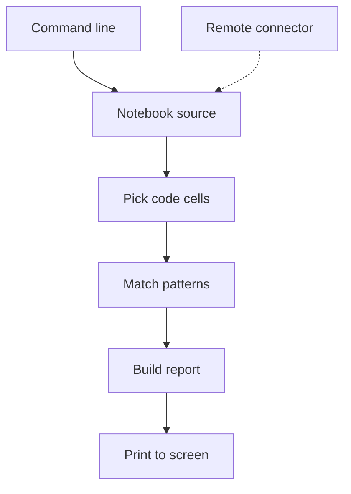
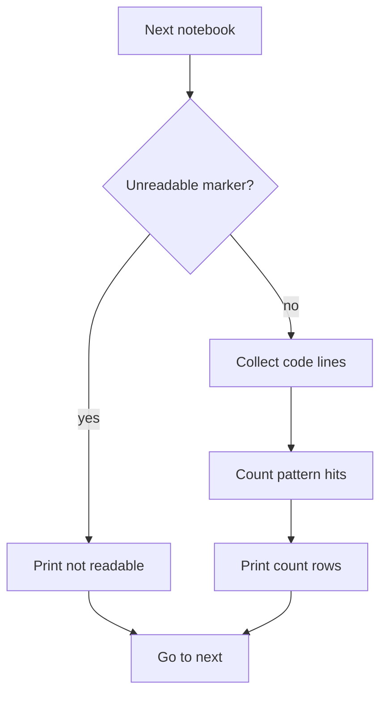

## Purpose

A scanner for notebooks. It counts, per notebook, how many code lines match a fixed set of sensitive-content patterns (emails, secret-looking assignments, storage addresses and similar) and prints only counts and line positions, never the matched text. Where the notebooks come from is a seam: the scanner asks a source object for (label, notebook) pairs, a local folder source is built in, and a remote connector can supply its own.

## Dependencies

**Depends on.**
- Standard library only: `argparse`, `json`, `pathlib`, `re`, `sys`, `typing`. No other file in the repo is imported.

**Used by.**
- Product code: `scripts/connectors/data/databricks.py` imports `NotebookSource` and `scan_source` {src:scripts/connectors/data/databricks.py:35}, subclasses `NotebookSource` {src:scripts/connectors/data/databricks.py:264} and prints the lines returned by `scan_source` {src:scripts/connectors/data/databricks.py:397}. Page: [[databricks]] and [databricks](../connectors/data/databricks.md).
- Mentioned in the scripts overview {src:scripts/README.md:11}.
- Tests: `tests/scripts/qa/test_scan_notebooks.py`.
- Searched `git grep scan_notebooks` over the repo except `docs/` on 2026-11-20. No command file, hook, installer line or cron entry runs it.

## Behavior

**Patterns.** `PATTERNS` holds 11 named regular expressions {src:scripts/qa/scan_notebooks.py:29-43}: email, SSN-like numbers, runs of 7 or more digits, lists of long numbers, date literals, hard-coded secret assignments, storage connection markers, secret-store calls, cloud storage addresses, mount or volume paths, and output-showing calls such as `print(` and `.show(`.

**Source seam.** `NotebookSource.iter_notebooks` raises `NotImplementedError`, so a source must override it {src:scripts/qa/scan_notebooks.py:53-54}. `LocalFolderSource` takes the path given, scans that single path when it is a file, otherwise every `*.ipynb` under it in sorted order {src:scripts/qa/scan_notebooks.py:64}. Each file is yielded as (file name cut to 24 characters, parsed JSON) {src:scripts/qa/scan_notebooks.py:67}. A file that cannot be read or parsed is yielded as `{"_unreadable": True}` {src:scripts/qa/scan_notebooks.py:68-69}.

**Cell reading.** `cell_sources` keeps only code cells {src:scripts/qa/scan_notebooks.py:78}, joins a list-form source into one string {src:scripts/qa/scan_notebooks.py:82}, appends every line to one combined list {src:scripts/qa/scan_notebooks.py:83}, and counts a cell as holding saved output when its `outputs` list is non-empty {src:scripts/qa/scan_notebooks.py:84}. Output content is never read.

**Matching.** `scan_lines` tests each combined line against each pattern and records 1-based positions {src:scripts/qa/scan_notebooks.py:92-95}. The text of the match is not kept.

**Report.** `format_report` prints a header with code cell count, line count and cells with saved output {src:scripts/qa/scan_notebooks.py:100}, then one row per pattern with the total count and at most the first 12 positions {src:scripts/qa/scan_notebooks.py:102-103}. `scan_source` prints a "not readable (not scanned)" line for an unreadable notebook {src:scripts/qa/scan_notebooks.py:110-112}.

**Command line.** `main` takes one `path`. When the path does not exist it prints "No such path" to stderr and returns 2 {src:scripts/qa/scan_notebooks.py:122-124}. Otherwise it prints the report and returns 0 {src:scripts/qa/scan_notebooks.py:125-127}, even when matches were found. The exit code carries no verdict.

## Diagram: module level (L2, required)

## Diagram: function level (L3, optional)

The branch is in `scan_source` {src:scripts/qa/scan_notebooks.py:110-114}.

## Notes

**Code and description disagree.**
- The change log says the patterns were "made vendor neutral" {src:scripts/qa/scan_notebooks.py:13}. Three patterns name one vendor's tools: `dbutils.secrets.get` {src:scripts/qa/scan_notebooks.py:39}, and `dbfs:/`, `/mnt/` and `/Volumes/` paths {src:scripts/qa/scan_notebooks.py:41}, plus Azure storage schemes `abfss` and `wasbs` {src:scripts/qa/scan_notebooks.py:40}.
- The header says it prints "counts and line numbers" {src:scripts/qa/scan_notebooks.py:4}. The numbers are positions in the combined list of code-cell lines {src:scripts/qa/scan_notebooks.py:83}, not line positions in the notebook file. The report also prints the file name (first 24 characters) {src:scripts/qa/scan_notebooks.py:67}.
- The usage line says PATH is a `.ipynb` file or a folder {src:scripts/qa/scan_notebooks.py:15}. A single file is read whatever its extension {src:scripts/qa/scan_notebooks.py:64}.
- The header has an empty `date:` field {src:scripts/qa/scan_notebooks.py:10}.

**Crash cases (read from the code, not run).** A file whose JSON top level is not an object (for example a list) is yielded as is {src:scripts/qa/scan_notebooks.py:67}, and then `notebook.get` fails because a list has no `get` {src:scripts/qa/scan_notebooks.py:110}. A cell that is not an object fails at `cell.get` {src:scripts/qa/scan_notebooks.py:78}. A source list holding non-text items fails at the join {src:scripts/qa/scan_notebooks.py:82}. Only `OSError` and `ValueError` are caught {src:scripts/qa/scan_notebooks.py:68}.

**Unchecked inputs.** The `path` argument reaches file reading {src:scripts/qa/scan_notebooks.py:61} and {src:scripts/qa/scan_notebooks.py:67} with only an existence check {src:scripts/qa/scan_notebooks.py:122}. Links are followed and file names are not restricted when a single file is given. The file name reaches outbound text (the printed report) cut to 24 characters with no check on its content {src:scripts/qa/scan_notebooks.py:67}. No shell command, network address or write path is built from input.

**Writes to shared files.** None. The script opens nothing for writing; output goes to stdout and stderr only {src:scripts/qa/scan_notebooks.py:125-126}.

**Limits.** A zero count does not show a notebook is clean, as the header says {src:scripts/qa/scan_notebooks.py:7}. The `output_exposure_calls` pattern matches any `print(` {src:scripts/qa/scan_notebooks.py:42}, so it counts many harmless lines.
