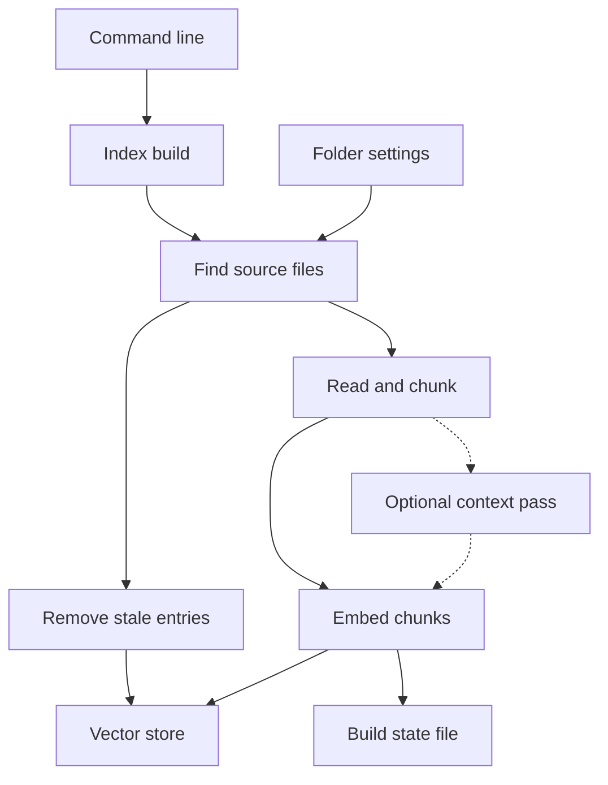
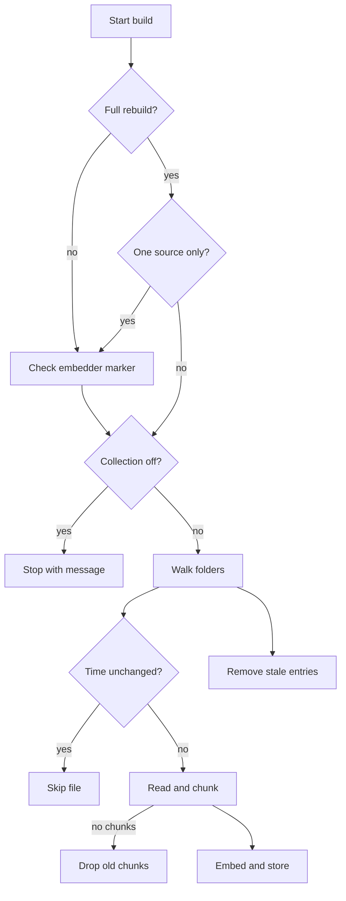

## Purpose

The builder of the search index. It walks the vault, ticket and reference folders (and the optional code and standards folders), cuts each file into chunks, turns the chunks into vectors with the chosen embedder, and stores them in one local vector database per collection. It is incremental: it remembers each file's modification time so unchanged files are skipped. Other search scripts reuse its chunking and storing functions.

## Dependencies

**Depends on.**
- Repo files: [[config]] and [config](config.md) {src:scripts/search/build_index.py:40}; [[embedder]] and [embedder](embedder.md) {src:scripts/search/build_index.py:41}; [[context_generator]] and [context_generator](context_generator.md), imported only when the context pass runs {src:scripts/search/build_index.py:418}; `core.paths` for `NotSetUp` and `get_path` {src:scripts/search/build_index.py:42} (paths, no doc yet).
- Outside packages: `chromadb` (through `config.chroma_client`) {src:scripts/search/config.py:242}; `ebooklib` and `bs4` for epub files only. They are imported inside `chunk_epub`, at the moment an epub is read, not when the module loads {src:scripts/search/build_index.py:192} {src:scripts/search/build_index.py:193} {src:scripts/search/build_index.py:194}. `bs4` comes with `scripts/requirements.txt`; `ebooklib` (AGPL-3) is in the optional `scripts/requirements-epub.txt`, which the installer does not install {src:scripts/requirements-epub.txt:5}.
- Folder names asked of the path loader: `vault`, `meetings`, `tickets`, `references`, `repos`, `standards` {src:scripts/search/build_index.py:262} {src:scripts/search/build_index.py:269} {src:scripts/search/build_index.py:274} {src:scripts/search/build_index.py:280}.
- Files it writes under the index folder: one `build_state.json` per collection {src:scripts/search/build_index.py:453} and the `embedder.json` marker, which is written only when the run is not limited to one source or no marker exists yet {src:scripts/search/build_index.py:459} {src:scripts/search/build_index.py:460} (marker format in {src:scripts/search/embedder.py:153}).

**Used by.**
- Product code: `scripts/core/run.sh` runs it {src:scripts/core/run.sh:47}. `scripts/search/rebuild.sh` replaces itself with it {src:scripts/search/rebuild.sh:22}, and `rebuild.sh` is run by the installer {src:install.sh:1631}, the nightly job {src:scripts/cron/nightly_index.sh:142} and the cron task launcher {src:scripts/cron/launchers/run_task.sh:30}.
- `scripts/search/reference_add.py` imports it and uses `EXTENSIONS`, `real_inside`, `load_state`, `read_chunks`, `FileRecord` and `embed_records` {src:scripts/search/reference_add.py:23} {src:scripts/search/reference_add.py:32} {src:scripts/search/reference_add.py:43} {src:scripts/search/reference_add.py:55} {src:scripts/search/reference_add.py:59} {src:scripts/search/reference_add.py:64} {src:scripts/search/reference_add.py:66}.
- `scripts/search/router.py` asks it for `active_collections` {src:scripts/search/router.py:36-37}. `scripts/search/eval_retrieval.py` calls `build` {src:scripts/search/eval_retrieval.py:38}.
- Mentioned in comments only (no import): `scripts/sync/sweep` {src:scripts/sync/sweep:18}.
- Tests: `tests/scripts/search/test_internals.py`, `test_golden.py`, `test_embedder_profile.py`, `test_index_health.py`, `test_reference.py`, `test_review_fixes.py`, `test_ticket_flags.py`, `test_ground.py`, `tests/system/test_e2e.py`, `tests/installer/test_lifecycle.sh`, `tests/scripts/cron/test_cron_tools.py`.
- Searched `git grep build_index` over the repo except `docs/` on 2026-11-20.

## Behavior

**Which files are indexed.** Allowed extensions per collection: vault and tickets `.md`; references `.md .txt .rst .epub`; code `.md .py .sql .ipynb .yaml .yml`; standards `.md` {src:scripts/search/build_index.py:49-55}. `source_roots` lists vault first {src:scripts/search/build_index.py:265-266}, then a meetings folder when it lies outside the vault, filed under the vault collection {src:scripts/search/build_index.py:269-271}, then tickets and references {src:scripts/search/build_index.py:274-279}. Code and standards are added only when their folder exists and is not empty {src:scripts/search/build_index.py:287-289}, and code is dropped when its folder is inside the vault {src:scripts/search/build_index.py:285-286}. A path name that cannot be resolved is skipped {src:scripts/search/build_index.py:272-273}.

**Walking.** `find_source_files` walks each root with `os.walk` {src:scripts/search/build_index.py:333}. It prunes skip folders, dot folders, nested collection roots inside the vault, and the vault skip paths {src:scripts/search/build_index.py:335-338}. It ignores dot files and files with other extensions {src:scripts/search/build_index.py:341-342}, and skips a link whose real target is outside the folder {src:scripts/search/build_index.py:343-345}. A missing root logs a warning and is skipped {src:scripts/search/build_index.py:323-325}. Unreadable folders are counted per collection {src:scripts/search/build_index.py:328-331}. Keys are paths relative to the root, with the root's prefix in front {src:scripts/search/build_index.py:346-347}.

**Chunking.** Markdown is split on headings H1 to H3 {src:scripts/search/build_index.py:101}; text before the first heading is titled "(top)" {src:scripts/search/build_index.py:93}. Python is split at lines that start with `def `, `class ` or `async def ` in column 0 {src:scripts/search/build_index.py:113}. SQL splits on a semicolon followed by a blank line {src:scripts/search/build_index.py:135}. A notebook gives one chunk per cell {src:scripts/search/build_index.py:157-164}, and a file that is not valid JSON gives none {src:scripts/search/build_index.py:153-155}. Anything else, and epub text, is cut by paragraph into pieces up to the size limit {src:scripts/search/build_index.py:170-181}. A file ending in `.epub` goes to `chunk_epub` before any other check {src:scripts/search/build_index.py:406} {src:scripts/search/build_index.py:407}. If `ebooklib` or `bs4` is missing, `chunk_epub` raises an `ImportError` whose text ends with the hint `pip install -r scripts/requirements-epub.txt` {src:scripts/search/build_index.py:195} {src:scripts/search/build_index.py:196}. The dispatch picks by extension and falls back to paragraph splitting {src:scripts/search/build_index.py:213-214}. In every splitter a piece shorter than `MIN_CHUNK_CHARS` is dropped, for example {src:scripts/search/build_index.py:97} and {src:scripts/search/build_index.py:160}. Text over `MAX_CHUNK_CHARS` is cut off and flagged `truncated` {src:scripts/search/build_index.py:72-74}. Each chunk after the first gets "[...]" plus the last `OVERLAP_CHARS` characters of the previous chunk in front {src:scripts/search/build_index.py:83-85}; overlap is skipped when the setting is 0 or there is one chunk {src:scripts/search/build_index.py:79-80}. Chunk ids are an MD5 of file key, heading and position {src:scripts/search/build_index.py:218}.

**Meeting files.** A file whose key starts with the meetings prefix is cut by size, not heading {src:scripts/search/build_index.py:410-412}.

**Embedding and storing.** For each changed file, `embed_records` first deletes that file's earlier chunks of the same origin {src:scripts/search/build_index.py:383}. It stores the chunk text with the file, heading, collection, embedder name, truncated flag, origin and tags {src:scripts/search/build_index.py:388-392}. The text that gets embedded is the file name, heading and chunk together, while only the chunk is stored {src:scripts/search/build_index.py:394-395}. Vectors come from the embedder {src:scripts/search/build_index.py:396}, are added to the collection {src:scripts/search/build_index.py:397}, and the file's modification time goes in the state map {src:scripts/search/build_index.py:398}. The state file is written once, after all records of that collection {src:scripts/search/build_index.py:400}.

**Build flow.** `build` creates the index folder {src:scripts/search/build_index.py:438-439}, gets the embedder {src:scripts/search/build_index.py:440}, and refuses an index made by a different embedder. This check runs unless the run is a full rebuild of all collections: it also runs when `full` is combined with `only` {src:scripts/search/build_index.py:441-442}. The refusal is a `ValueError` {src:scripts/search/embedder.py:185}. A named collection that is off raises `ValueError` {src:scripts/search/build_index.py:444-445}. With `full`, it deletes every chunk with origin "build" and starts from an empty state; chunks with another origin stay {src:scripts/search/build_index.py:454-458}. It then writes the embedder marker, unless the run is limited to one source and a marker already exists, in which case the marker is left as it was {src:scripts/search/build_index.py:459} {src:scripts/search/build_index.py:460}. Files whose stored modification time equals the current one are skipped {src:scripts/search/build_index.py:470-472}. A read that raises `ImportError` (the epub library missing) is skipped: it logs one warning for the whole run, `Skipping .epub files:` followed by the hint, counts the file as skipped, and does not write the file's modification time to the state map, so the file is read again on the next run and is indexed once the library is installed {src:scripts/search/build_index.py:475} {src:scripts/search/build_index.py:477} {src:scripts/search/build_index.py:478} {src:scripts/search/build_index.py:479} {src:scripts/search/build_index.py:480}. Any other read failure is logged and counted as an error {src:scripts/search/build_index.py:482} {src:scripts/search/build_index.py:483} {src:scripts/search/build_index.py:484}. A file that yields chunks is queued for embedding {src:scripts/search/build_index.py:486-487}. A file that yields no chunks has its earlier chunks of origin "build" deleted and its modification time put in the state map, so an unchanged short file is skipped on the next run instead of read again {src:scripts/search/build_index.py:488-491}. That state entry is saved with the stale-entry step {src:scripts/search/build_index.py:505}, or with the next embedding write {src:scripts/search/build_index.py:400}; a collection that had a folder read error skips the first save {src:scripts/search/build_index.py:502-503}.

**Removing stale entries.** Chunks and state entries for files that are no longer found are deleted per collection {src:scripts/search/build_index.py:501-505}, using only chunks with origin "build" {src:scripts/search/build_index.py:365}. A collection that had a folder read error is left alone {src:scripts/search/build_index.py:502-503}. A file that exists but could not be read still counts as present {src:scripts/search/build_index.py:498-500}.

**Optional context pass.** Only with `--context` and at least one changed file {src:scripts/search/build_index.py:507}. It loads the cache, counts calls for pairs not cached {src:scripts/search/build_index.py:419-421}, calls `batch_generate_context` {src:scripts/search/build_index.py:422}, puts each description in front of its chunk {src:scripts/search/build_index.py:426-427} and saves the cache {src:scripts/search/build_index.py:429}.

**Result and exit codes.** `build` returns a summary of files indexed, skipped, chunks added, orphans removed, context calls, errors, seconds, embedder name and per-collection counts {src:scripts/search/build_index.py:515-520}. `main` prints it as JSON {src:scripts/search/build_index.py:542}, returns 2 for not set up, a missing package or a `ValueError` {src:scripts/search/build_index.py:533-541}, and 1 when the error count is not zero {src:scripts/search/build_index.py:543}.

## Diagram: module level (L2, required)

## Diagram: function level (L3, optional)

The branches are in `build` {src:scripts/search/build_index.py:441-491}.

## Notes

**Code and description disagree.**
- The change log names `config.VAULT_ONLY_SKIP_DIRS` {src:scripts/search/build_index.py:12}. No such name exists in `config.py` (searched `git grep VAULT_ONLY_SKIP_DIRS`, 2026-11-20, only this comment). The code uses `config.vault_skip_paths()` {src:scripts/search/build_index.py:318}, built from `VAULT_SKIP_TOP_NAMES` {src:scripts/search/config.py:42}.
- Line 11 and 12 say the vault walk skips archive, work and landing {src:scripts/search/build_index.py:11-12}. Line 13 says archive, work, history, landing and output {src:scripts/search/build_index.py:13}. The code gives the second list, and the layout folders only when the layout resolves {src:scripts/search/config.py:187-191}.
- The `version` field reads 1.0.0 {src:scripts/search/build_index.py:6} while the change log goes up to 1.2.0 {src:scripts/search/build_index.py:13}. The `date:` field is empty {src:scripts/search/build_index.py:5}.
- The header says epub gives "one section per chapter" {src:scripts/search/build_index.py:24}. Each document item is further split by size, so a long chapter gives several chunks {src:scripts/search/build_index.py:206-208}.
- `SIZE_CHUNKED_SOURCES` is compared with the collection name {src:scripts/search/build_index.py:411}, but no collection is named "meetings" {src:scripts/search/config.py:29}. Only the file-key prefix check can fire.
- The `rebuild.sh` usage line lists three `--source` values {src:scripts/search/rebuild.sh:9}, but the builder accepts five {src:scripts/search/build_index.py:526}.

**Behavior worth knowing (read from the code, not run).**
- The skip handler catches every `ImportError` raised while reading a file, and its warning always says `.epub`. Only `chunk_epub` imports anything while reading today, so it fires only for epubs (searched `read_chunks`, `chunk_file` and the chunkers for other imports, 2026-11-21). The warning appears once per run, and a skipped epub still adds to the `skipped` count in the summary {src:scripts/search/build_index.py:465} {src:scripts/search/build_index.py:477} {src:scripts/search/build_index.py:480}. Because the file is not recorded, a stale index entry for an epub that was indexed earlier is kept while the library is missing: the file still counts as present in the walk {src:scripts/search/build_index.py:500}.
- `--full` with `--source` no longer rewrites the embedder marker when one exists {src:scripts/search/build_index.py:459}, and it now runs the marker check first {src:scripts/search/build_index.py:441-442}. So it cannot be used to switch to a new embedder: it raises, and the message tells the person to run with `--full` {src:scripts/search/embedder.py:187}, which is what they already did. Only a `--full` run with no `--source` switches the embedder (read from the code, not run).
- A file whose every chunk is shorter than `MIN_CHUNK_CHARS` (80 characters) {src:scripts/search/config.py:69} gives no chunks {src:scripts/search/build_index.py:486}. Its old chunks are removed and its modification time is recorded, so it is skipped until the file changes {src:scripts/search/build_index.py:488-491}.
- A file that vanishes between the walk and the `stat` call raises, because the `stat` is outside the `try` {src:scripts/search/build_index.py:469}.
- `RuntimeError` from the context pass (a missing API key, or failed calls) is not caught in `main` {src:scripts/search/build_index.py:533-541}, so it ends as a traceback. At that point stale entries are already removed {src:scripts/search/build_index.py:504}.
- The `seconds` value starts after reading and the context pass {src:scripts/search/build_index.py:508}, so it covers embedding and storing only.
- Python chunking cuts at any column-0 `def ` line, also inside a multi-line string, and decorators and comments above a function fall into the previous chunk {src:scripts/search/build_index.py:113}.

**Inputs reaching paths, commands, addresses or outbound text.**
- Folder paths come from the path loader and are walked and read with no check beyond existing {src:scripts/search/build_index.py:323}. Directory links are not followed by `os.walk` {src:scripts/search/build_index.py:333}; file links are checked {src:scripts/search/build_index.py:343}.
- `--source` is limited to known names {src:scripts/search/build_index.py:526}. `--embedder` is not checked: an unknown value falls back to auto {src:scripts/search/embedder.py:145-148}.
- With `--context`, up to `CONTEXT_MAX_DOC_CHARS` of each file {src:scripts/search/build_index.py:487} and each chunk {src:scripts/search/build_index.py:420} are sent to the configured provider (Anthropic or a URL named in `TOLLGATE_OLLAMA_URL`) {src:scripts/search/context_generator.py:168-181} {src:scripts/search/context_generator.py:219-220}. No filter checks that text for secrets or personal data first.
- No shell command is built from input.

**Writes to shared files.**
- Build state: `write_text` in place, not atomic, no lock {src:scripts/search/build_index.py:361}. Two builders at once can overwrite each other's state.
- Embedder marker: `write_text` in place, not atomic, no lock {src:scripts/search/embedder.py:153}.
- Vector store: written through the database client; the script adds no lock of its own {src:scripts/search/build_index.py:397}.
- Context cache: temporary file then `os.replace`, which is atomic {src:scripts/search/context_generator.py:69-72}; no lock between two writers.
