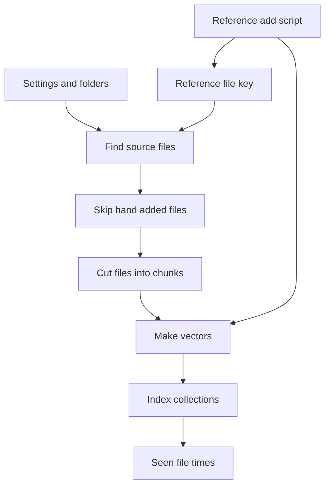
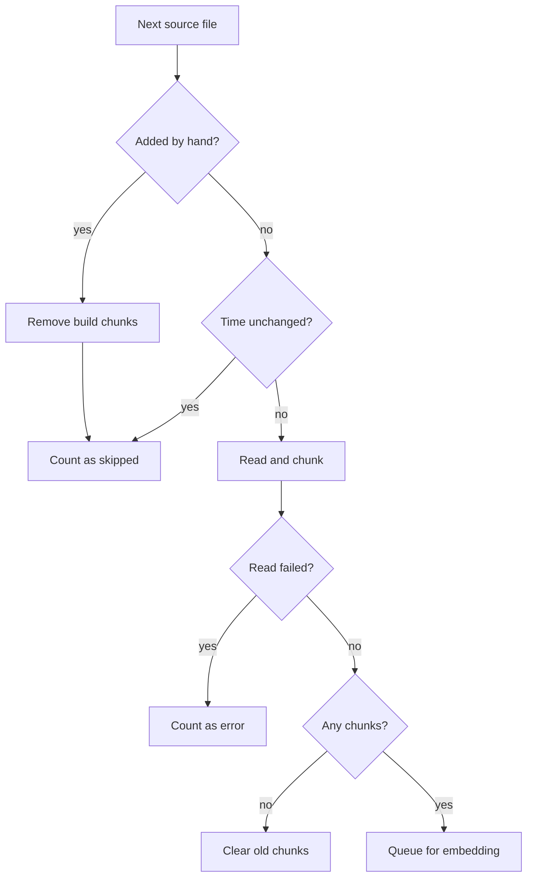

## Purpose

This script builds and updates the search index. It walks the configured folders, cuts each file into chunks, turns the chunks into vectors, and stores them in one collection per source (vault, tickets, references, and optionally code and standards). It is the one place that defines how files are chunked and keyed, so `reference_add.py` borrows its helpers to store reference files the same way. Version 1.3.0 (TG-1) added `reference_key()` and a rule that the build leaves alone any reference file that was added by hand.

## Dependencies

**Depends on.**
- [[config]] / [config](config.md): chunk sizes, collection names, skip folders, the index folder and the Chroma client. Imported at {src:scripts/search/build_index.py:43}.
- [[embedder]] / [embedder](embedder.md): makes the embedder and checks or writes the marker that records which model built the index. Imported at {src:scripts/search/build_index.py:44}.
- [[paths]] / [paths](../core/paths.md): `get_path` and `NotSetUp`, used to find the vault, meetings, tickets, references, repos and standards folders. Imported at {src:scripts/search/build_index.py:45}.
- [[context_generator]] / [context_generator](context_generator.md): imported only inside `_run_context_pass`, so it loads only when `--context` is given {src:scripts/search/build_index.py:439}.
- Standard library: `argparse`, `hashlib`, `json`, `logging`, `os`, `pathlib`, `re`, `sys`, `time`, `dataclasses`.
- Optional outside packages: `ebooklib` and `bs4`, imported only when an `.epub` file is read {src:scripts/search/build_index.py:195-197}.
- The index folder on disk (one Chroma store and one `build_state.json` per collection) {src:scripts/search/build_index.py:470-474}.

**Used by.** Product code:
- [[reference_add]] / [reference_add](reference_add.md): imports the module and calls `EXTENSIONS`, `reference_key`, `real_inside`, `load_state`, `read_chunks`, `FileRecord`, `_delete_file` and `embed_records` {src:scripts/search/reference_add.py:25}, {src:scripts/search/reference_add.py:36}, {src:scripts/search/reference_add.py:69-70}.
- [[router]] / [router](router.md): calls `active_collections()` {src:scripts/search/router.py:36-37}.
- [[eval_retrieval]] / [eval_retrieval](eval_retrieval.md): calls `build(full=True, ...)` {src:scripts/search/eval_retrieval.py:37-38}.
- [[rebuild]] / [rebuild](rebuild.md): `rebuild.sh` runs the script {src:scripts/search/rebuild.sh:22}.
- [[run]] / [run](../core/run.md): the `index` step of `run.sh` runs the script {src:scripts/core/run.sh:47}.
- [[nightly_index]] / [nightly_index](../cron/nightly_index.md): the nightly job runs `rebuild.sh` {src:scripts/cron/nightly_index.sh:142}.

Tests: `tests/scripts/search/test_internals.py`, `test_reference.py`, `test_review_fixes.py`, `test_ground.py`, `test_ticket_flags.py`, `test_python_choice.py`, `test_epub_optional.py`, `test_embedder_profile.py`, `test_golden.py`, `test_index_health.py`, `tests/system/test_e2e.py`, `tests/scripts/cron/test_cron_tools.py`, `tests/scripts/sync/test_sync_tools.py` (searched the repo except `.git`, `docs/` and virtual environments, 2026-11-22).

## Behavior

**Chunking.** `chunk_file` picks a chunker by extension: `.md`, `.py`, `.sql` and `.ipynb` have their own, everything else uses paragraph chunking {src:scripts/search/build_index.py:216-217}. Every chunk is cut to `MAX_CHUNK_CHARS` and marked `truncated` when it was longer {src:scripts/search/build_index.py:75-77}.
- Markdown splits at heading levels 1 to 3 {src:scripts/search/build_index.py:104}, and drops sections shorter than `MIN_CHUNK_CHARS` {src:scripts/search/build_index.py:100-101}.
- Python splits at lines that start with `def `, `class ` or `async def ` at column 0 {src:scripts/search/build_index.py:116}. A file with none becomes one chunk named `(module)` {src:scripts/search/build_index.py:117-120}. Text before the first definition becomes `(module header)` {src:scripts/search/build_index.py:122-125}.
- SQL splits on a semicolon followed by a blank line, or a final semicolon {src:scripts/search/build_index.py:138}.
- A notebook gives one chunk per cell, and invalid JSON gives no chunks {src:scripts/search/build_index.py:156-158}.
- Plain text packs paragraphs into chunks up to `MAX_CHUNK_CHARS` {src:scripts/search/build_index.py:177-181}.
- An `.epub` gives one set of chunks per chapter {src:scripts/search/build_index.py:202-211}. Missing `ebooklib` or `bs4` raises `ImportError` with an install hint {src:scripts/search/build_index.py:198-199}.
- Markdown, Python, SQL, notebook and text chunkers end with `add_overlap`, which prefixes each chunk after the first with the last `OVERLAP_CHARS` of the one before, then cuts to the size limit {src:scripts/search/build_index.py:86-90}.
- `chunk_id` is an md5 of the file key, the heading and the chunk position {src:scripts/search/build_index.py:221}.

**Finding folders.** `source_roots()` lists the vault, plus the meetings folder when it lies outside the vault (in the vault collection) {src:scripts/search/build_index.py:269-274}, then tickets and references {src:scripts/search/build_index.py:277-282}. A path that is not set up is skipped. Code (the repos path) and standards are listed only when the folder exists and is not empty, and code is left out when the repos folder is inside the vault {src:scripts/search/build_index.py:288-292}. `active_collections()` is the three core names plus those optional ones that are on {src:scripts/search/build_index.py:298-299}.

**Finding files.** `find_source_files` walks each root with `os.walk`, counting unreadable folders per collection {src:scripts/search/build_index.py:354}, {src:scripts/search/build_index.py:349-352}. It prunes skip folders, dot folders, other collections' roots nested in the vault, and the vault's archive-style folders {src:scripts/search/build_index.py:356-359}. It keeps only files whose extension is listed for that collection {src:scripts/search/build_index.py:362}, and skips links that point outside the root {src:scripts/search/build_index.py:364-366}. The key is the path under the root, prefixed when the root has a prefix {src:scripts/search/build_index.py:367-368}.

**`reference_key(path)`** (new in 1.3.0). For a path inside the references root it returns the same key `find_source_files` would give it, trying the root as configured and resolved, and the path as given and resolved {src:scripts/search/build_index.py:316-325}. It returns `None` when the path is not inside the references root {src:scripts/search/build_index.py:326}. `reference_add.py` uses it and falls back to the folder name when it returns `None` {src:scripts/search/reference_add.py:36}, {src:scripts/search/reference_add.py:47}.

**Storage.** `embed_records` handles each file in turn: it removes the file's earlier chunks of the same origin {src:scripts/search/build_index.py:404}, then stores the chunks with metadata for file, heading, collection, embedder name, truncation, origin and tags {src:scripts/search/build_index.py:409-413}. The text that is embedded is the file name, the heading and the chunk, while the stored text is the chunk alone {src:scripts/search/build_index.py:415-418}. The mtime is recorded per file {src:scripts/search/build_index.py:419}, and the state file is written once after all records {src:scripts/search/build_index.py:421}. `_delete_file` only removes chunks whose origin matches (default `build`) {src:scripts/search/build_index.py:386-388}. `reconcile_orphans` removes chunks and state for keys no longer on disk, again for build chunks only {src:scripts/search/build_index.py:395-398}.

**`build()`** runs these steps:
1. Unless this is a `--full` run for all collections, it checks that the embedder matches the one that built the index {src:scripts/search/build_index.py:462-463}. A source that is off raises `ValueError` {src:scripts/search/build_index.py:465-466}.
2. For each collection it opens or creates the store {src:scripts/search/build_index.py:473}. On `--full` it deletes build chunks only, so chunks added by `reference_add.py` stay {src:scripts/search/build_index.py:476-478}, and it starts with empty state {src:scripts/search/build_index.py:479}.
3. It reads the file keys already stored with origin `add` in the references collection {src:scripts/search/build_index.py:485-487}. In the file loop, a references file with such a key is left out of the build: its build chunks are deleted, its state entry is removed, and it counts as skipped {src:scripts/search/build_index.py:496-500}.
4. Other files whose mtime matches the state are skipped {src:scripts/search/build_index.py:501-503}. A missing optional reader (`ImportError`) skips the file without recording it {src:scripts/search/build_index.py:507-513}. Any other read error is logged and counted {src:scripts/search/build_index.py:514-517}. A file that now yields no chunks has its old chunks removed and its mtime recorded {src:scripts/search/build_index.py:518-523}.
5. Orphans are removed per collection, except a collection whose folders could not all be listed {src:scripts/search/build_index.py:533-536}.
6. With `--context`, each chunk gets a generated description first {src:scripts/search/build_index.py:539}. Records are then embedded per collection {src:scripts/search/build_index.py:542-546}. The summary holds counts, orphans, errors, timing and the embedder name {src:scripts/search/build_index.py:547-552}.

**`main()`** accepts `--full`, `--source`, `--embedder` and `--context` {src:scripts/search/build_index.py:557-560}. It prints the summary as JSON. Exit code is 2 for a path not set up, a missing package or a `ValueError` {src:scripts/search/build_index.py:565-573}, 1 when any file errored, otherwise 0 {src:scripts/search/build_index.py:575}.

## Diagram: module level (L2, required)

## Diagram: function level (L3, optional)

`build()` decides per file whether to skip, drop, read or embed.

## Notes

**Code and its own description disagree.**
- The header says a file that `reference_add.py` added "with or without tags" is skipped {src:scripts/search/build_index.py:16}. The code tests only that stored chunks have origin `add` {src:scripts/search/build_index.py:486}. `reference_add.py` stores origin `add` even when no `--tag` is given, because the tag list defaults to empty {src:scripts/search/reference_add.py:77}, {src:scripts/search/reference_add.py:70}. The header and the code agree: a file added with no tags is also skipped by the build.
- The comment says meeting files are split by size through `SIZE_CHUNKED_SOURCES` {src:scripts/search/build_index.py:49-51}. The check `collection in SIZE_CHUNKED_SOURCES` never matches, because the meetings folder is registered in the `vault` collection, not under a name `meetings` {src:scripts/search/build_index.py:274}, {src:scripts/search/build_index.py:432}. Only the key prefix test does the work.
- The header says Python is cut at "top level def and class" {src:scripts/search/build_index.py:26}. The pattern also matches `async def` {src:scripts/search/build_index.py:116}. A decorator line before a `def` is not a boundary, so it ends up at the tail of the chunk before {src:scripts/search/build_index.py:127-128}.
- The `date:` field in the header is empty {src:scripts/search/build_index.py:5}.

**Skip rule and edits.** A hand added reference file is never re-read by the build, so edits reach the index only when it is added again. A hand added file that is deleted from disk keeps its chunks, because orphan cleanup removes build chunks only {src:scripts/search/build_index.py:386-388}, {src:scripts/search/build_index.py:395-398}. If a run is limited with `--source` to another collection, the references list is not read {src:scripts/search/build_index.py:485}.

**Unchecked inputs.**
- `--embedder` is free text passed to `get_embedder`; an unknown name falls back to automatic choice {src:scripts/search/build_index.py:461}, {src:scripts/search/embedder.py:138-148}. `--source` is limited to the known collection names {src:scripts/search/build_index.py:558}.
- File paths are not typed in: they come from configured folders. The walk follows links only when the real location is inside the root {src:scripts/search/build_index.py:364-366}.
- With `--context`, file text goes to the configured provider through `batch_generate_context` with no check on its content {src:scripts/search/build_index.py:442-443}.
- No shell command or network address is built from input in this file (searched the file for `subprocess`, `os.system` and URL use, 2026-11-22).

**Shared file writes.** `save_state` writes `build_state.json` directly with `write_text`, not through a temporary file and rename, so a crash mid-write can leave a damaged file (the loader then returns an empty state and files are re-read) {src:scripts/search/build_index.py:382}, {src:scripts/search/build_index.py:374-378}. The embedder marker is written the same way {src:scripts/search/embedder.py:151-153}. Nothing stops two writers at once: this file has no lock (searched for `lock` and `flock`, 2026-11-22), so a nightly build and a `reference_add.py` run on the same index can overlap. `reference_add.py` also writes the same state file {src:scripts/search/reference_add.py:70}.
