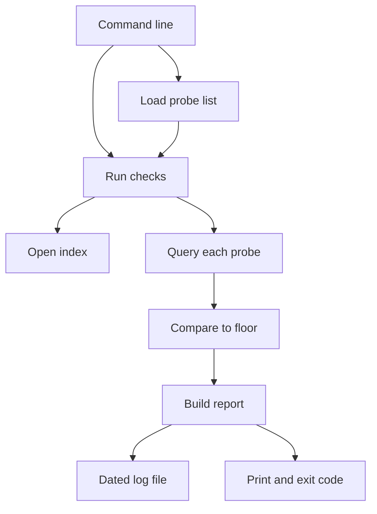
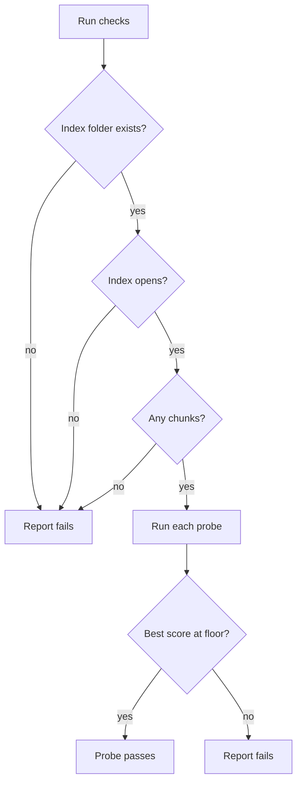

## Purpose

A health check for the search index. It runs a list of probe questions, each naming a part of a file name that should come back, and reports whether a matching passage scores at or above the embedder's floor. With no probes it only checks that the index holds chunks. It prints a JSON report, writes a dated copy to the logs folder, and returns a pass or fail exit code for scripts to act on.

## Dependencies

**Depends on.**
- Repo files: [[config]] and [config](config.md) {src:scripts/search/check_index_health.py:24}; [[embedder]] and [embedder](embedder.md) {src:scripts/search/check_index_health.py:25}; refstore (no doc yet) {src:scripts/search/check_index_health.py:26}; paths (no doc yet) for `NotSetUp` and `get_path` {src:scripts/search/check_index_health.py:27}; router (no doc yet), imported inside `run_checks` {src:scripts/search/check_index_health.py:63}.
- Outside packages: the vector database client, reached through `config.chroma_client` {src:scripts/search/config.py:242}.
- Environment: `TOLLGATE_PATHS`, read by `refstore.situations_file` to find the probe file's folder {src:scripts/search/refstore.py:26}.
- Files read: `index_health.json` next to the paths file {src:scripts/search/check_index_health.py:36}, or the file named with `--checks` {src:scripts/search/check_index_health.py:99}.

**Used by.**
- Product code: none. No command file, hook, installer line, cron entry or other script imports or runs it. `scripts/search/vault_health.py` defines its own function with the same name {src:scripts/search/vault_health.py:190} and does not import this file. Searched `git grep check_index_health` and `git grep index_health` over the repo except `docs/` and `tests/` on 2026-11-20.
- Tests: `tests/scripts/search/test_index_health.py`, `tests/scripts/search/test_internals.py`.

## Behavior

**Probe file.** `load_checks` returns an empty list when no paths file is named {src:scripts/search/check_index_health.py:37-38}, when the file cannot be read or parsed {src:scripts/search/check_index_health.py:39-42}, or when the JSON is not a list {src:scripts/search/check_index_health.py:43}. It keeps only entries that are objects with a non-empty `query` and `file_contains` {src:scripts/search/check_index_health.py:43}.

**One probe.** `_query_file` embeds the query with the embedder's query method {src:scripts/search/check_index_health.py:47}, asks each collection for up to `TOP_K` (60) nearest chunks {src:scripts/search/check_index_health.py:50-53}, keeps those whose file name contains `file_contains`, ignoring case {src:scripts/search/check_index_health.py:55}, turns each distance into a score {src:scripts/search/check_index_health.py:56}, and sorts best first {src:scripts/search/check_index_health.py:58}. Empty collections are skipped {src:scripts/search/check_index_health.py:51-52}.

**The run.** `run_checks` sets up a report that starts as passed {src:scripts/search/check_index_health.py:65}. It fails at once when the index folder is missing {src:scripts/search/check_index_health.py:66-68}, when the embedder or collections cannot be opened {src:scripts/search/check_index_health.py:69-74}, or when every collection is empty {src:scripts/search/check_index_health.py:78-80}. Otherwise each probe is run against its named collection, or all collections when that name is absent or unknown {src:scripts/search/check_index_health.py:82-83}. A probe passes when at least one passage was found and the best score is at least the embedder's `base_floor` {src:scripts/search/check_index_health.py:85}. The report holds the best score, result count and threshold per probe {src:scripts/search/check_index_health.py:86-88}, and the overall flag is false when any probe fails {src:scripts/search/check_index_health.py:89}. The embedder is the one that built the index {src:scripts/search/check_index_health.py:70}.

**Command line.** `--checks` names a probe file and `--no-report` skips the dated file {src:scripts/search/check_index_health.py:95-96}. `main` prints "not set up" and returns 2 when the path loader or an import fails {src:scripts/search/check_index_health.py:102-104}. Unless `--no-report` is given, it writes `index-health-<date>.json` in the logs folder {src:scripts/search/check_index_health.py:105-110}; a write failure only prints a warning {src:scripts/search/check_index_health.py:111-112}. It prints the report {src:scripts/search/check_index_health.py:113}. A failed report prints "FAIL" with the error or the failed probe labels on stderr and returns 1 {src:scripts/search/check_index_health.py:114-117}; a pass prints "PASS" and returns 0 {src:scripts/search/check_index_health.py:118-119}.

## Diagram: module level (L2, required)

## Diagram: function level (L3, optional)

The gates are in `run_checks` {src:scripts/search/check_index_health.py:66-89}.

## Notes

**Code and description disagree.**
- The header says exit 2 means "not set up" and exit 1 means a probe failed or the index is empty {src:scripts/search/check_index_health.py:12}. A missing index folder and an index that cannot be opened (including a missing database package inside `open_collections`) also give exit 1 {src:scripts/search/check_index_health.py:66-74}. Exit 2 only comes from `NotSetUp` and from an import failure outside that block {src:scripts/search/check_index_health.py:102-104}.
- The comment on `TOP_K` says the check filters by file "after the global top-K" {src:scripts/search/check_index_health.py:29}. The code asks each collection for its own top 60 and filters afterward {src:scripts/search/check_index_health.py:49-55}, so the window is per collection.
- `os` is imported {src:scripts/search/check_index_health.py:18} and never used in the file. The `date:` field is empty {src:scripts/search/check_index_health.py:6}.

**Behavior worth knowing (read from the code, not run).**
- A `--checks` file that does not exist, or has bad JSON, gives an empty probe list {src:scripts/search/check_index_health.py:39-42}. That list is not `None`, so the default probe file is not used {src:scripts/search/check_index_health.py:81}. The run then checks only that chunks exist and can report a pass with zero probes. A mistyped path passes quietly.
- A probe that names an unknown `collection` is run against all collections {src:scripts/search/check_index_health.py:82}.
- With the hash embedder the floor is 0.1 {src:scripts/search/embedder.py:45}, a low bar.

**Inputs reaching paths, commands, addresses or outbound text.**
- The `--checks` value is read as a file path with no check beyond the read itself {src:scripts/search/check_index_health.py:99} {src:scripts/search/check_index_health.py:40}.
- Probe `query` and `file_contains` are used only for embedding and for a substring test {src:scripts/search/check_index_health.py:47} {src:scripts/search/check_index_health.py:55}. The query text is copied into the report {src:scripts/search/check_index_health.py:86}, which is printed and written to the logs folder {src:scripts/search/check_index_health.py:109} {src:scripts/search/check_index_health.py:113}. No filter checks it.
- No shell command or network address is built from input.

**Writes to shared files.** The dated report is written in place with `write_text`, not atomic, with no lock {src:scripts/search/check_index_health.py:109}. Two runs on the same day write the same file name {src:scripts/search/check_index_health.py:108}, and the later run wins.
