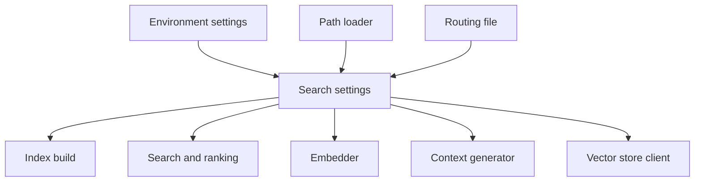
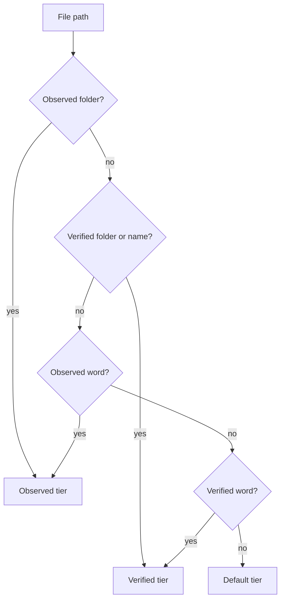

## Purpose

The one place for search settings: collection names, folders to skip, chunk sizes, how many results to fetch, how results are re-weighted, which models and providers to use, and small helpers that depend on them (index folder, confidence tier of a file, database client). Folder locations are not written here; they come from the path loader so that nothing is tied to one machine. Nearly every search script imports this file.

## Dependencies

**Depends on.**
- Repo file: paths (no doc yet), for `NotSetUp`, `folder_name` and `get_path` {src:scripts/search/config.py:22}.
- Routing file `scripts/search/routing.yaml`, next to this module {src:scripts/search/config.py:25}.
- Outside packages: `yaml` (optional, loaded only when the routing file exists) {src:scripts/search/config.py:161} and `chromadb` {src:scripts/search/config.py:242}.
- Environment variables read when the module loads: `TOLLGATE_EMBED_MODEL` {src:scripts/search/config.py:56}, `TOLLGATE_RERANK_MODEL` {src:scripts/search/config.py:57}, `TOLLGATE_CONTEXT_PROVIDER` {src:scripts/search/config.py:110}, `TOLLGATE_CONTEXT_MODEL` {src:scripts/search/config.py:111}, `TOLLGATE_OLLAMA_MODEL` {src:scripts/search/config.py:113}, `TOLLGATE_OLLAMA_URL` {src:scripts/search/config.py:114}. Read when a function runs: `TOLLGATE_INDEX_SKIP` {src:scripts/search/config.py:148}. Only the names are stored here, and read by the callers: `TOLLGATE_EMBEDDER` {src:scripts/search/config.py:59}, `TOLLGATE_EMBED_QUERY_PROMPT` {src:scripts/search/config.py:62}, `TOLLGATE_EMBED_TRUST_REMOTE_CODE` {src:scripts/search/config.py:64}, `TOLLGATE_RERANK` {src:scripts/search/config.py:65}.

**Used by.**
- Product code, each by `import config`: `scripts/search/build_index.py` {src:scripts/search/build_index.py:40}, `check_index_health.py` {src:scripts/search/check_index_health.py:24}, `context_generator.py` {src:scripts/search/context_generator.py:22}, `download_model.py` {src:scripts/search/download_model.py:18}, `embedder.py` {src:scripts/search/embedder.py:22}, `eval_judge.py` {src:scripts/search/eval_judge.py:24}, `eval_rag.py` {src:scripts/search/eval_rag.py:25}, `ground.py` {src:scripts/search/ground.py:27}, `intent.py` {src:scripts/search/intent.py:19}, `query_index.py` {src:scripts/search/query_index.py:25}, `reference_add.py` {src:scripts/search/reference_add.py:24}, `reference_query.py` {src:scripts/search/reference_query.py:27}, `refstore.py` {src:scripts/search/refstore.py:18}, `router.py` {src:scripts/search/router.py:23}, `vault_health.py` {src:scripts/search/vault_health.py:23}.
- `scripts/sync/sweep` imports it as `search_config` and uses `NORMALIZE_EMBEDDINGS` and `chroma_client` {src:scripts/sync/sweep:231} {src:scripts/sync/sweep:233} {src:scripts/sync/sweep:238}.
- Tests: `tests/scripts/search/test_internals.py`, `tests/scripts/search/test_review_fixes.py`, `tests/scripts/search/test_embedder_profile.py` and others under `tests/scripts/search/`.
- Searched `git grep "config\."` and `git grep "import config"` over `scripts/` and `tests/` on 2026-11-20.

## Behavior

The file has 56 module-level constants. The frontmatter lists the 42 that another file reads by attribute (tests included). The other 14 are used only inside this file, or by nobody: `HERE`, `ROUTING_FILE`, `DEFAULT_SKIP_DIRS`, `VAULT_SKIP_TOP_NAMES`, `VAULT_SKIP_LAYOUT_KEYS`, `ENV_EXTRA_SKIP`, `MIN_SCORE`, `TIER_LABELS`, `DEFAULT_TIER_WORDS`, `TIER_FOLDER_KEYS`, `TIER1_KNOWLEDGE_SUBDIRS`, `TIER1_SEGMENT_NAMES`, `DEFAULT_TIER`, `CONTEXT_CACHE_NAME`. `folder_name` is a re-exported name that `vault_health.py` reads through this module {src:scripts/search/vault_health.py:54}.

**Collections.** Three built collections, two optional ones that are off until their folder is set, and one query-only collection written by `sweep` and never rebuilt here {src:scripts/search/config.py:29-36}. `build_index` uses the list to decide what to build {src:scripts/search/build_index.py:296} and `router` to decide what to open {src:scripts/search/router.py:34}.

**Skip lists.** Folder names left out of every walk {src:scripts/search/config.py:37-39}, top-level vault folders left out of the vault walk {src:scripts/search/config.py:42}, layout keys whose folders are also left out {src:scripts/search/config.py:44}, and extra skip names for the code and standards collections {src:scripts/search/config.py:46-50}. `vault_skip_paths` joins the fixed names with the layout folders that resolve {src:scripts/search/config.py:184-192}; a layout key that does not resolve is skipped quietly {src:scripts/search/config.py:190-191}. `skip_dirs` is the default set plus names from `TOLLGATE_INDEX_SKIP`, comma separated {src:scripts/search/config.py:147-153}.

**Chunk sizes.** Pieces under 80 characters are dropped, over 2000 are cut, and 200 characters of overlap are added {src:scripts/search/config.py:69-71}. `build_index` applies them {src:scripts/search/build_index.py:72} {src:scripts/search/build_index.py:83} {src:scripts/search/build_index.py:97}.

**Retrieval and ranking.** 60 candidates are fetched per collection {src:scripts/search/config.py:75}, the best 20 per collection are kept {src:scripts/search/config.py:76} {src:scripts/search/router.py:146}, 5 are returned by default {src:scripts/search/config.py:77} {src:scripts/search/query_index.py:41}, and excerpts are 300 characters {src:scripts/search/config.py:79} {src:scripts/search/router.py:173}. The score is the similarity plus an ID bonus of 0.1 when the query names an ID found in the path as a whole token, times a collection tilt of up to plus or minus 0.1, plus a tier adjustment of minus 0.05 for the observed tier {src:scripts/search/config.py:89-92} {src:scripts/search/router.py:139-141}. With the optional re-ranker the score blends 50-50 {src:scripts/search/config.py:92} {src:scripts/search/router.py:163-164}. `STAKES_FLOOR_SHIFT` moves the score floor by stakes level {src:scripts/search/config.py:130} {src:scripts/search/reference_query.py:45}.

**Tiers.** `tier_for` returns (number, label) for a file path. It checks, in order: observed layout folders, verified folders or a folder segment named like `rca`, `decisions` or `patterns`, observed words, verified words, then the default tier 2 {src:scripts/search/config.py:227-236}. A word matches a whole token of a path segment, with an optional trailing "s" {src:scripts/search/config.py:217-218} {src:scripts/search/config.py:226}. `tier_words` starts from the defaults and replaces entries with the ones under `tiers` in the routing file {src:scripts/search/config.py:168-177}. `tier_rules` gathers everything once so a query does not re-read the layout for each result {src:scripts/search/config.py:195-210} {src:scripts/search/router.py:130}.

**Routing file.** `load_routing` returns an empty dict when the file or PyYAML is missing, and also when the parsed value is not a mapping {src:scripts/search/config.py:158-165}.

**Models and context.** The embedding model defaults to `all-MiniLM-L6-v2` and the re-ranker to a cross-encoder {src:scripts/search/config.py:56-57}. The optional context pass defaults to the `claude` provider with model `claude-haiku-5-5` {src:scripts/search/config.py:110-111}; the Ollama values default to empty {src:scripts/search/config.py:113-114}. The remaining worker, timeout and token numbers are read by `context_generator` {src:scripts/search/context_generator.py:105} {src:scripts/search/context_generator.py:190} {src:scripts/search/context_generator.py:215}.

**Helpers.** `index_root` and `collection_dir` ask the path loader at call time, so importing this file never fails when nothing is set up {src:scripts/search/config.py:135-140}. `chroma_client` sets the telemetry variable to "False" if unset, then opens a persistent local client with telemetry off {src:scripts/search/config.py:241-244}.

## Diagram: module level (L2, required)

## Diagram: function level (L3, optional)

The order is in `tier_for` {src:scripts/search/config.py:227-236}.

## Notes

**Code and description disagree.**
- The comment says the extra skip names (`TOLLGATE_INDEX_SKIP`) leave folders out "of the vault walk" {src:scripts/search/config.py:51}. `build_index` merges them into the skip set of every collection {src:scripts/search/build_index.py:316} {src:scripts/search/build_index.py:326}, and `reference_add` uses them too {src:scripts/search/reference_add.py:36}.
- The `version` field reads 1.0.0 {src:scripts/search/config.py:6} while the change log lists 1.1.0 {src:scripts/search/config.py:10}. The `date:` field is empty {src:scripts/search/config.py:5}.
- `MIN_SCORE` is defined {src:scripts/search/config.py:78} but nothing reads `config.MIN_SCORE`. `query_index` takes its floor from the embedder or its own argument {src:scripts/search/query_index.py:60}. (`scripts/core/memory/_enums.py` has its own `MIN_SCORE` {src:scripts/core/memory/_enums.py:114}.)
- The header says settings come from the path loader "never from literals" {src:scripts/search/config.py:3}. The skip list names `.venv-inventory`, `.venv-smart` and `.venv-photos` {src:scripts/search/config.py:48}, which look tied to one machine's layout.
- The comment says tier word lists "can be replaced in routing.yaml" {src:scripts/search/config.py:97}. Only tiers 1 and 3 are ever read {src:scripts/search/config.py:233}, so a list under another tier number is stored and ignored {src:scripts/search/config.py:172-174}.

**Behavior worth knowing (read from the code, not run).**
- Model names, context settings and the Ollama address are read once at import {src:scripts/search/config.py:56} {src:scripts/search/config.py:114}. Changing the environment later in the same process has no effect on them.
- A routing file that is not valid YAML raises out of `load_routing`, since only a missing package is caught {src:scripts/search/config.py:161-164}.
- `chroma_client` changes the process environment {src:scripts/search/config.py:241}.

**Inputs reaching paths, commands, addresses or outbound text.**
- `TOLLGATE_OLLAMA_URL` becomes a network address with no check on its value {src:scripts/search/config.py:114} {src:scripts/search/context_generator.py:219}.
- `TOLLGATE_EMBED_MODEL` and `TOLLGATE_RERANK_MODEL` are passed to the model loader as names or local paths with no check {src:scripts/search/config.py:56} {src:scripts/search/embedder.py:100}. With `TOLLGATE_EMBED_TRUST_REMOTE_CODE=1` the model's own code runs {src:scripts/search/embedder.py:99-101}.
- The path given to `chroma_client` is turned to text and used as the database folder with no check {src:scripts/search/config.py:244}.
- `TOLLGATE_INDEX_SKIP` is only compared with folder names {src:scripts/search/build_index.py:336}. No shell command is built from input.

**Writes to shared files.** None. This module does not write a file.
