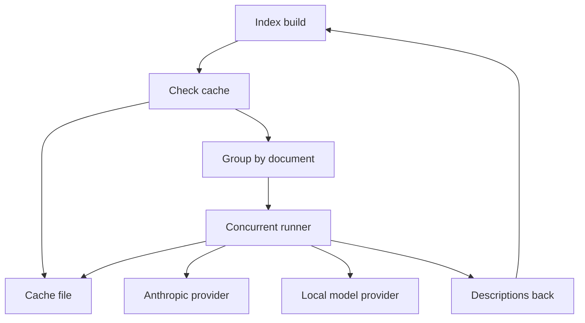
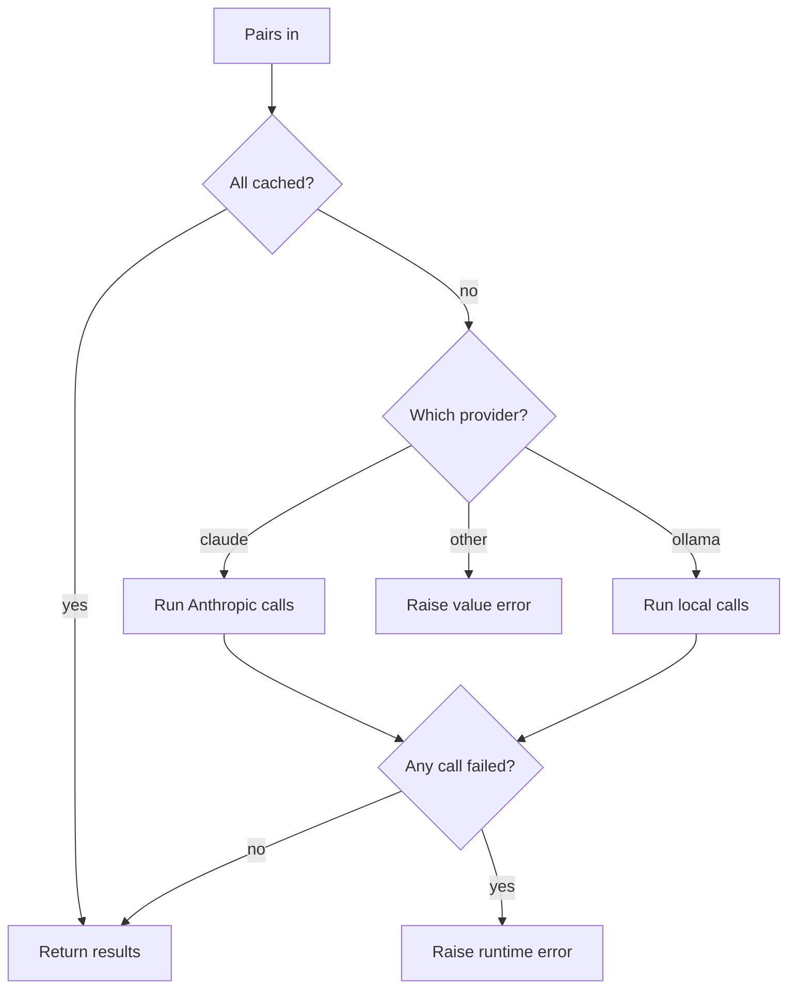

## Purpose

An optional helper for the index build. For each chunk of text it asks a language model for a one or two sentence description of what the chunk covers, so the description can be placed in front of the chunk before it is embedded. It supports two providers (the Anthropic API, or a local Ollama server), caches every answer on disk so a rerun asks only for what is missing, and runs the calls concurrently. It is used at index time only.

## Dependencies

**Depends on.**
- Repo file: [[config]] and [config](config.md) {src:scripts/search/context_generator.py:22}. It reads the provider, model, worker, timeout, token and cache settings from there {src:scripts/search/context_generator.py:262} {src:scripts/search/context_generator.py:169-171} {src:scripts/search/context_generator.py:190} {src:scripts/search/context_generator.py:197-215}.
- Outside packages, imported only when that provider runs: `anthropic` {src:scripts/search/context_generator.py:161}, `aiohttp` {src:scripts/search/context_generator.py:212}.
- Environment: `ANTHROPIC_API_KEY` {src:scripts/search/context_generator.py:162}; `TOLLGATE_OLLAMA_URL` and `TOLLGATE_OLLAMA_MODEL` through `config` {src:scripts/search/context_generator.py:213-214}.
- File: the context cache under the index folder, named by `config.context_cache_file()` {src:scripts/search/context_generator.py:59}.

**Used by.**
- Product code: `scripts/search/build_index.py` imports `batch_generate_context`, `load_cache` and `save_cache` inside `_run_context_pass` {src:scripts/search/build_index.py:418}, loads the cache {src:scripts/search/build_index.py:419}, calls the batch function {src:scripts/search/build_index.py:422} and saves the cache {src:scripts/search/build_index.py:429}. That pass runs only with `--context` {src:scripts/search/build_index.py:507}.
- Tests: none. Searched `git grep -E "context_generator|batch_generate_context"` over the repo except `docs/` on 2026-11-20; only `build_index.py` and this file match.

## Behavior

**Prompt.** The system prompt asks for only the description {src:scripts/search/context_generator.py:26}. The document goes in one block and the chunk in another, with an instruction to write one or two sentences, be specific and use different words {src:scripts/search/context_generator.py:28-39}.

**Cache.** The key is the SHA-256 of the document text and chunk text joined {src:scripts/search/context_generator.py:54-55}. `load_cache` returns the stored JSON or an empty dict when the file is absent {src:scripts/search/context_generator.py:58-63}. `save_cache` writes a temporary file next to the cache and swaps it in with `os.replace` {src:scripts/search/context_generator.py:69-72}.

**Entry point.** `batch_generate_context` takes (document, chunk) pairs and an optional cache {src:scripts/search/context_generator.py:248-251}. It fills answers from the cache first and groups the missing pairs by document {src:scripts/search/context_generator.py:239-245}. If nothing is missing, no provider is called {src:scripts/search/context_generator.py:261}. Otherwise it runs the `claude` or `ollama` provider {src:scripts/search/context_generator.py:263-266}, and any other provider name raises `ValueError` {src:scripts/search/context_generator.py:267-268}. It returns answers in input order {src:scripts/search/context_generator.py:269}.

**Runner.** `_run_groups` starts a fixed number of workers that pull documents from one shared iterator {src:scripts/search/context_generator.py:137-145}, with a semaphore capping simultaneous calls {src:scripts/search/context_generator.py:136}. For each document the first chunk is sent alone to warm the provider's prompt cache, then the rest run in parallel {src:scripts/search/context_generator.py:124-126}. A call that raises is logged and gives `None` for that chunk only {src:scripts/search/context_generator.py:119-122}. Results are stored, and cached when the text is not empty {src:scripts/search/context_generator.py:96-102}. The cache is saved every `CONTEXT_SAVE_EVERY_CALLS` calls {src:scripts/search/context_generator.py:105-106} and again at the end, even after an error {src:scripts/search/context_generator.py:146-147}. When any call failed, it raises `RuntimeError` after saving {src:scripts/search/context_generator.py:148-151}.

**Claude provider.** It needs `ANTHROPIC_API_KEY` in the environment or raises {src:scripts/search/context_generator.py:162-164}. Each call sends the system prompt and the document block marked for prompt caching, and the chunk block unmarked {src:scripts/search/context_generator.py:172-180}. It adds the token usage to a running total {src:scripts/search/context_generator.py:182} and returns the first text block, trimmed {src:scripts/search/context_generator.py:183} {src:scripts/search/context_generator.py:187}. With no text block it logs a warning and returns an empty string {src:scripts/search/context_generator.py:184-186}.

**Ollama provider.** It raises when either the URL or the model is empty {src:scripts/search/context_generator.py:213-214}. It posts a JSON body (no streaming, temperature 0) to `<url>/api/generate` {src:scripts/search/context_generator.py:195-208} {src:scripts/search/context_generator.py:219-220}, with a total timeout from `config` {src:scripts/search/context_generator.py:215}. A reply without a `response` field raises {src:scripts/search/context_generator.py:222-223}. Otherwise it adds token counts {src:scripts/search/context_generator.py:224-225} and returns the trimmed text {src:scripts/search/context_generator.py:226}.

## Diagram: module level (L2, required)

## Diagram: function level (L3, optional)

The branches are in `batch_generate_context` and `_run_groups` {src:scripts/search/context_generator.py:261-269} {src:scripts/search/context_generator.py:148-151}.

## Notes

**Code and description disagree.**
- The return annotation is `list[str]` {src:scripts/search/context_generator.py:251}, but the results list is typed to hold `None` {src:scripts/search/context_generator.py:258}. In practice `None` entries do not come back, because any failed call raises first {src:scripts/search/context_generator.py:148-151}.
- The error text says "finished work is saved in the cache" {src:scripts/search/context_generator.py:150}. That holds only when a cache dict was passed; with `cache=None` nothing is saved {src:scripts/search/context_generator.py:87-88}.
- The header says the Claude provider reads the key "from the environment only" {src:scripts/search/context_generator.py:8}. The code checks only that the variable is non-empty {src:scripts/search/context_generator.py:162}; the client is then built with no arguments {src:scripts/search/context_generator.py:165}, so what else the SDK reads from the environment is decided by the SDK {unverified}.
- The header `date:` field is empty {src:scripts/search/context_generator.py:5}.
- The `output_config` argument and the default model name `claude-haiku-5-5` are not checked against the installed SDK in this run {src:scripts/search/context_generator.py:171} {src:scripts/search/config.py:111} {unverified}.

**Behavior worth knowing (read from the code, not run).**
- The cache key joins document and chunk with no separator {src:scripts/search/context_generator.py:55}, so two different pairs can in theory share a key. The key also ignores the provider, the model and the prompt text, so changing any of them keeps serving old answers. `build_index` repeats the same key rule by hand {src:scripts/search/build_index.py:421}.
- `load_cache` has no error handling, so a damaged cache file raises {src:scripts/search/context_generator.py:61-62}.
- An unknown provider name is only noticed when at least one pair is uncached {src:scripts/search/context_generator.py:261-268}.
- The Ollama URL is used as given, so a trailing slash gives a double slash {src:scripts/search/context_generator.py:219}. `eval_judge.py` strips it {src:scripts/search/eval_judge.py:48}.
- The Ollama reply status is not checked, only the presence of `response` {src:scripts/search/context_generator.py:220-223}.

**Inputs reaching paths, commands, addresses or outbound text.**
- Outbound text: the full document text and the chunk go to the Anthropic API {src:scripts/search/context_generator.py:176} {src:scripts/search/context_generator.py:179}, or to the Ollama address {src:scripts/search/context_generator.py:199} {src:scripts/search/context_generator.py:220}. Nothing filters that text for secrets or personal data.
- Network address: `config.OLLAMA_BASE_URL` is checked only for being non-empty {src:scripts/search/context_generator.py:213}. Any host is accepted.
- Error logs include up to 200 characters of the exception text {src:scripts/search/context_generator.py:121}, and the Ollama error includes up to 300 characters of the reply {src:scripts/search/context_generator.py:223}.
- The cache path comes from `config.index_root()` {src:scripts/search/config.py:143-144}. No shell command is built from input.

**Writes to shared files.** The cache is written to a temporary file and swapped in with `os.replace`, which is atomic {src:scripts/search/context_generator.py:69-72}. The temporary name is fixed (`.json.tmp`) {src:scripts/search/context_generator.py:69}, and nothing stops two runs at once from writing the same temporary file, and the later swap wins. A run also loads the cache once at the start, so a second run's answers can be lost when the first saves last.
